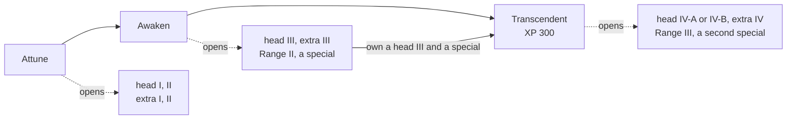

# jTD — a Swing tower defense game

A desktop tower-defense game written in plain Java and Swing. Enemies walk a fixed path
across a grid board; you spend credits placing towers on the buildable cells beside it and
try to kill everything before it laps the path and costs you a life.

All of the artwork is vector — every enemy, tower, beam and path marker is a
`java.awt.Shape` built and painted in code. There are no image assets in the project.

## Requirements

- **JDK 25** (the build targets release 25)
- **Maven 3.9+**

## Build and run

```bash
mvn package               # build target/jTD.jar
java -jar target/jTD.jar  # run the game
```

The jar is shaded, so it bundles its SLF4J/Logback dependencies and needs no extra classpath.

Other useful commands:

```bash
mvn verify        # rules check + test suite — the standing check before a commit
mvn test          # run the test suite
mvn -q compile    # fast syntax/type check

# run a single test
mvn test -Dtest=GameEngineTest#placingATowerOnABuildableCellChargesCreditsAndOccupiesTheCell
```

## Playing

The game opens on a level-select screen. Pick a level to start it; each level brings its own
board size, path, wave list, starting credits and starting lives.

Buy a tower from the toolbar on the right (or with `q`–`t`), then click a buildable
cell to place it; hovering a toolbar button opens a tooltip of the tower, and the side panel shows
it in full while you place it. The click that builds a tower selects it, as does clicking a placed
tower later: the side panel shows its stats and its own upgrade
tree — three slots, `base`/`head`/`special`, each offering a small number of nodes to buy.
Start each wave yourself when you are ready — waves do not auto-advance.

### Controls

| Key                             | Action                                                                                               |
|---------------------------------|------------------------------------------------------------------------------------------------------|
| `q` `w` `e` `r` `t` `y` `u` `i` | Select tower 1–8 for placement                                                                       |
| `Esc`                           | Cancel tower placement                                                                               |
| `1`–`8`                         | Buy the selected tower's upgrade: 1 chain, 2 Range, 3 extra line, 4/5 the branches, 6–8 specials     |
| `s`                             | Start the next wave                                                                                  |
| `p`                             | Pause / unpause                                                                                      |
| `f`                             | Cycle tick speed (normal → fast → super fast → normal)                                               |
| `m`                             | Back to the level-select menu (asks to confirm mid-level)                                            |
| `Ctrl`+`Shift`+`D`              | Open or close the dev panel (playtesting controls; its **Help** button lists its own keys)           |

Mouse: move to preview placement, click to place or to select a placed tower, or click an
upgrade-tree button to buy that node. Click a moving enemy, invisible ones too (when not placing a
tower), to inspect it: the side panel shows its live health, stats, effects and traits, updating even while paused,
and keeps a "Killed" or "Leaked" line after it's gone until your next click. Hovering an enemy in
the wave preview opens a tooltip of the stats that enemy type spawns with.

The dev panel ships in the jar, hidden behind `Ctrl`+`Shift`+`D` rather than a build flag, to
make manual playtesting cheap. It sets credits and lives, keeps them topped up, spawns any wave
script on any path with a live preview, skips, jumps to or restarts waves, steps one tick, shows
the live speed in ticks per second and nudges it by 1 or 5 (0 pauses), kills
or clears the board, saves the game between waves and loads it back (one save per level, in `saves/`), grants XP to or resets the selected tower, lets upgrades ignore their gates,
and draws the cell grid with the path's cells shaded and the pointed-at cell's coordinates. Every
control has an `Alt` shortcut, and while the panel is open the bare keys `n` (skip wave), `x`
(spawn the next catalog enemy) and `c` (grant credits) work too.

`td.balance.BalanceReport` checks balance headlessly. It plays every built-in level with the level's real
credits and lives, over many seeds, with a naive player (random towers on random cells), a competent one
(it reads the coming rounds and buys what it estimates saves the most enemy health per credit) and that
competent player on random cells and without upgrades. Per level it reports whether the level is too easy
or too hard, whether positioning and upgrades matter, where the pressure comes round by round, where the
credits go, which towers carry the defence and what leaks, which effects, enemy abilities and upgrade
nodes no play ever triggers, every number with its 95% interval. The
**margin** is the highest enemy health, as a percentage of the authored one, a player still wins at. A lab
measures each tower on every cell, against every enemy kind at every rank a level sends, and with each
upgrade line, and what it does for a tower beside it, before any play.

```bash
mvn -q compile exec:java -Dexec.mainClass=td.balance.BalanceReport -Dexec.args="--save before"
# change a number, then:
mvn -q compile exec:java -Dexec.mainClass=td.balance.BalanceReport -Dexec.args="--compare before"
```

`--compare` plays the same seeds again and lists what moved beyond the seeds' noise, then plays the saved
competent actions back unchanged, so what the change does shows apart from how the player adapts to it. `--seeds N` (20 by
default) and `--levels 0,2` narrow a run; `--strong` adds a player that rehearses each round before
playing it, `--variety` measures each tower alone and each tower banned, `--sweep lives|bounty|pause|spacing`
shows how the competent player's margin moves with one of the level's knobs, and `--html` writes
`target/balance/report.html` with charts and board heat maps. A run takes one to two minutes; the extras
add several each.

Two older harnesses remain. `td.PurchaseHarness` compares purchases: on a level, with an army of
one tower of every type, it reports the lives saved per 100 credits by another copy of a tower and by each
upgrade node, over many seeded runs (`mvn -q compile exec:java -Dexec.mainClass=td.PurchaseHarness
-Dexec.args="2 12 sniper 4"`: level, seeds, tower, and how many of each tower the base army has; a bigger
army prices "another copy" at what a real build pays). `td.BuildHarness` compares builds of one tower
instead: copies of it bought the same way among a fixed background of the others, for every node on its own
and for every last head node with a special, either at equal copies or at an equal budget with one upgraded
copy and plain ones for the rest (`-Dexec.args="2 40 cinder 4 2 1500 1"`: level, seeds, tower, copies,
background copies, budget, upgraded copies).


### Towers

| Tower  | Price | Behaviour                                                                                                                                           |
|--------|-------|-----------------------------------------------------------------------------------------------------------------------------------------------------|
| Sniper | 15    | Single target, hits whichever enemy in range is furthest along the path; each shot builds on the last, whichever enemy it hits, so the longer it keeps firing, the likelier it crits; a stack fades 3 s after its last shot, one at a time (crits x2.0) |
| Burst  | 15    | Instant blast on a random target in range, physical damage falling off with distance; attuned, it aims at the most crowded group and Saturates what it hits. Forks into the Stormcaller (lightning arcs on past the blast) or the Hexer (every 4th shot casts a hex) |
| Mortar | 30    | Lobs a slow, unguided shell at whichever enemy in range is furthest along the path, never one within 1.5 cells of it; the blast does physical damage with falloff and cracks the plating of everything it reaches. Attuned, a shell landing near the last one hits harder and wider. One head adds heavier shells and nukes, the other shrapnel and bombs along the path, and a ballistics line speeds the shell up, leads the target, widens the blast and fires salvos. Its specials turn every third shell into a Napalm, Tar or Cryo shell that leaves burning, tarred or frozen ground |
| Scorcher | 28    | Turns slowly toward the nearest visible enemy and, once one is in the cone, fires a flame wave that burns everything it reaches, invisible enemies included. A burn never crits but an ignition can, which starts the pool stronger. Attuned, each wave on an enemy it is already burning raises that burn. Forks into hot, short White Flame with Soulfire, or the wide Wide Nozzle that leaves burning ground; a fuel line makes burning enemies heal less, take more and scorch faster |
| Hive   | 30    | Fires a slow homing missile at the fastest enemy in range, which it keeps through invisibility and re-aims at each tick; deals magic damage and freezes whichever mob it actually hits. Attuned, it banks missiles in a nest, between waves too, and launches them as a salvo |
| Radar  | 20    | Long range; a beam sweeps around it once every 3s, hitting everything it passes; once attuned, each sweep Exposes the healthiest enemy it passed |
| Obelisk | 25    | Support, a kill box. Short range; a field that drags everything inside 15% and deals a little magic damage to it every tick, ghosts included and with no visible enemy needed, the damage a quarter less for every other field overlapping it. Attuned, an enemy that stays inside builds Toll, which makes every effect the field holds on it stronger. One head holds enemies longer (Gravity: a deeper drag, Dazes, a wider field, a well or Stasis), the other denies them (Ward: reveal, silence, no heals, True Sight or Purge); an extra line makes them take more damage and builds Toll faster. A special Condemns the strongest enemy inside, bosses first, for every tower to turn on; drains spirit; or links two Obelisks with a Ley Line. Reveals nothing until Ward is bought |
| Beacon | 20    | Passive: buffs the damage and range of the towers in its range (+20%) and halves the disruption they take; it never buffs another Beacon, and several stack. Attuned, the towers it buffs earn more XP for each other tower type in its range (Kinship). One head strengthens the buff, then adds attack speed and crit damage; the other widens its reach, then lengthens buffs and the effects the towers apply. An extra line mentors XP, and a special makes it wither enemies, buff only its best tower, or rally the towers when an enemy reaches a spot on the path |

The shop and the board call the towers Sniper, Burst, Mortar, Scorcher, Hive, Radar, Obelisk and Beacon
(keys `q` `w` `e` `r` `t` `y` `u` `i`, in that order). A Burst that forks is called a Stormcaller or a Hexer.

An attack-speed bonus adds to the attacks a second, so +100% is twice as fast; bonuses add up, and a Jammer
takes 30% away and shrinks range by 0.6 cells. The rate need not be a whole number of ticks: a tower remembers
what is left over, so +10% on the Obelisk, which hits every tick, gives 22 hits in 20 ticks and a second hit in
the tick the fractions add up. The Radar spins faster instead. No tower runs more than ten times faster than its
base, or slower than a quarter of it.

The price is the first copy's: each copy of a tower already on the board makes the next one cost
15% more, and the shop shows the current price. Selling refunds three quarters of what the tower
and its upgrades cost.

Every tower, the Aura included, has its own upgrade tree of three slots, shown in place of the
wave preview once the tower is selected. `base` holds three Range steps and the chain Attune ->
Awaken -> Transcendent: Attune opens the first two levels of `head`, Awaken opens level III and
a special, and Transcendent (once a special and a level III head are owned) opens Range III and a
second special. `head` offers two chains that exclude each other; `special` offers one to three
specializations, of which a tower keeps one, or two once Transcendent. Past the first steps a
node also needs XP: every tower an enemy reached earns its bounty as XP when its walk ends,
killed or leaked (an Aura earns with the towers it buffs), and a few nodes need towers built
nearby. Every purchase is permanent for that tower. Upgrade prices are multiples of the tower's
price. Pips on the board show each slot's
level, and a tower with a special glows. Silver diamonds beside a tower show its rank, earned
with XP: Seasoned at 50, Expert at 150, Hero at 300. The Upgrades panel's XP bar ticks where the
next node waits. The Beacon draws a faint line to every tower it's
currently amplifying, coloured for its reach or its chosen hero, a ring on the tower it mentors, and
(while it is selected) the path spot its Rally watches.



### Enemies

An enemy is made of four kinds of thing, and each belongs to exactly one:

- **Stats** are the numbers every enemy has, zero or not: armor and magic resist (a hit keeps
  `100 / (100 + armor)` of itself), plating and insulation (points every physical or magic hit loses; flat penetration ignores them), resilience
  (against crits; 100 is crit-immune, below zero crits land harder), agility (aimed shots miss) and
  spirit (heals and shields it receives, and how fast its debuffs run out). The info pane lists the ones
  off zero; nothing is drawn on the board for them.
- **Traits** are what an enemy has that most don't, always on: a resistance or immunity to an effect,
  regeneration, a stat that follows its state (faster or harder to hit when hurt) or adapts to how the
  level is played. Each draws a marker under the enemy.
- **Abilities** are what it does at a moment: a trigger (a timer, a threshold, a hit, a dodge, its death)
  and an action (put an effect on itself or its allies, or spawn enemies).
- **Effects** are timed statuses on an enemy, from a tower or an ability, shown as markers above it.

From Elite every enemy carries some of each stat, small where it is off its identity; the exceptions are
plating and insulation (only the enemies built around them), agility on the heaviest (Juggernaut, Wardens, eggs) and resilience
on the Wardens, whose shield answers crits.

| Enemy      | Looks like    | Behaviour                                                                                                                                                                                                                                                                                                         |
|------------|---------------|-------------------------------------------------------------------------------------------------------------------------------------------------------------------------------------------------------------------------------------------------------------------------------------------------------------------|
| Simple     | circle        | Plain mob, no special ability, and no stats up to Veteran. From Elite, adaptive armor and a little of every stat; at Boss, +30 resilience |
| Armored    | square        | +25 armor and magic resist, rising with rank, plating from 2 to 10 and 20% freeze resist; immune to critical hits. From Veteran it resists chill; from Elite, thick plating, a physical shield once below half health, and ward mines laid along its path; at Boss rank, calls three armored reinforcements every three seconds |
| Fast       | triangle      | Speeds up as it loses health; -20 resilience, so crits land harder. From Veteran, once badly hurt, it throws down haste ground that lasts until the wave is over; from Elite it also sprints once below half health; at Boss rank, no haste ground, crit immune, calls three spawnlings once below half health and heals itself when left alone |
| Ghost      | tinted circle | +20 armor. Turns invisible to single-target towers for ~10s the first time it's hit (~15s from Veteran; area damage still reaches it); at Elite and Boss rank, also permanently shrouds every other ally near it; at Boss rank it fades out for 3s of every 10 |
| Mender     | cross         | Deals no damage of its own; periodically restores health to every other ally near it; +20 spirit, rising to 60 at Boss. From Veteran it heals itself when left alone and, when it dies, heals and shields every ally near it; from Elite, adaptive armor; at Boss rank, the death blast is a heal alone. On Curly Path, from Elite it also wards every other ally near it with a small shield that stops any damage |
| Jammer     | square        | Jams every tower near it: they fire more slowly and see less far while it's in range (drawn as a pink ring; affected towers show a pink marker). A tower in a Beacon's range takes half of it. +20 magic resist; its reach and strength grow from Veteran, and from Elite it keeps a magic-only shield and its casing blunts magic hits (2 insulation, 4 at Boss). |
| Juggernaut | square        | Slow, with plating that blunts a huge flat chunk of every physical hit; magic, Cracked and Sundered get past it. +15 magic resist and 30% freeze and chill resist. From Veteran, when it dies it blinds the towers within 2 cells (4 from Elite) until the wave is over; from Elite, crit immune; at Boss rank, a large magic shield once below half health. |
| Mite       | circle        | Tiny and quick, with 10 agility rising 5 a rank to 25 at Elite and 35 at Boss; meant for a `swarm 12 mite`. at Boss rank it bursts into three broodlings when it dies. |
| Courier    | triangle      | Very fast and fragile, with a high bounty, and nimble (25 agility, 35 from Veteran, 50 at Boss) enough to dodge an aimed shot now and then. From Elite it sprints when first hit; at Boss rank, after every dodge too. |
| Shieldbearer | cross         | +30 armor, and spirit from Veteran that strengthens the shields it gets. Periodically shields every other ally near it against physical damage only; magic goes straight through. From Elite it shields itself too and has a little plating; at Boss rank, in a wider reach. |
| Salamander | circle        | Immune to burn, so a Cinder-only defence does nothing; Soulfire still burns it. Regenerates 1 health a second (a trait), doubling at Veteran, Elite and Boss. From Elite, +25 magic resist and a burst of healing once below 30% health. |
| Yeti       | circle        | Immune to freeze and chilled half as long (a quarter from Veteran); Dazed still stops it. +15 armor and magic resist. From Elite its fur blunts 2 points of every hit and it heals once below 40% health; at Boss rank, +50 resilience. |
| Skirmisher | diamond       | Nimble: 40 agility, rising to 80 with rank, so it dodges some aimed shots; +20 resilience. From Soldier it sprints off for 1.5 s after every dodge; from Elite it gets harder to hit the more it is hurt; at Boss rank it also vanishes for a moment after every dodge. |
| Empty      | —             | Not a real enemy — a spacer that opens a timing gap inside a wave                                                                                                                                                                                                                                                 |
| The Warden | large spiked crest | A boss: armor and magic resist, and plating, all lower with each hatching; periodically summons reinforcements and shields itself and nearby allies, and shields itself again whenever it survives a critical hit. On death it leaves behind a stationary egg that hatches back into a weaker Warden if not destroyed in time — the fight only ends once an egg is defeated before it hatches. If any stage escapes, the level is lost, however many lives are left. Appears as the final wave of Curly Path. |
| Reaver     | triangle, path-facing | Speeds up as it's hurt, shrugs off a flat point of every hit, crit immune from Elite, shields itself once badly wounded, and splits into two Simple mobs on death. Appears in Twisted Hourglass's first wave — a level-authored enemy, registered only for that level rather than globally (see `td.level.LevelDefinition.customEnemies`). |

### Rank

Every enemy spawns at one of five named ranks — **Grunt, Soldier, Veteran, Elite, Boss** — shown
as a badge on its body rather than as a number. A wave declares the rank its slots default to;
any slot can name a different rank inline, before the enemy id (`elite c`) or before a spawn
shape (`elite swarm 4 c`). Each rank's health and bounty are written out per enemy (the Simple mob
derives its own from the pattern), following one pattern: health multiplies by about the same factor every rank, 2 for the Simple mob and 1.7 to 2 for
the others, lower where an enemy's traits already grow with rank; bounty adds instead, a step of its
own for Soldier and for Veteran, three more for Elite and five more for Boss (a Simple mob has 75,
150, 300, 600 and 1200 health and pays 2, 4, 6, 12 and 22). A kill's score is weighted by
rank too — a Boss-rank kill is worth disproportionately more than a Grunt-rank one of the same
bounty. Every enemy defines all five ranks, and gains traits or abilities as it climbs, except the
spawnlings, which are one rank each, and the Warden chain, which is unique: every stage and egg is a
Boss whatever rank its wave asks for (a non-`boss` rank keyword before it fails the level load), and
the reinforcements a Warden calls come three at a time as Elites, every five seconds. Elite and Boss Simple and Mender enemies carry adaptive
armor: it resists whichever damage type (physical or magic) has landed most this level, from not
at all at an even split up to full strength against a one-type defence.

### Status effects

Towers and enemy abilities put timed effects on enemies. An enemy shows one marker per kind of
effect it carries; selecting it shows each effect as an icon whose tooltip says what it does.

| Effect | Group | Side | What it does |
|---|---|---|---|
| Chill | Control | Debuff | Slows by its level, up to 80%, and fades; at its most it takes 50% off the damage of Burn and Soulfire. |
| Burn | Affliction | Debuff | Damage over time that fades; a top-up adds less the fuller it is, up to x2 its strongest application; it adds a stack of Scorch every 0.5 s while it lasts, and Freeze puts it out, landing at least 50% of what is left at once. |
| Freeze | Control | Debuff | Stops it where it stands and keeps its abilities from firing; it removes Chill and lasts longer by its level, and puts out Burn and Soulfire; within 10 s, each fresh one lasts 100%, 50%, 25%, then none. |
| Shield | Boon | Buff | Absorbs damage until its amount is spent or it runs out. |
| Invisibility | Boon | Buff | Towers can't aim at it, though damage on an area still reaches it. |
| Heal | Boon | Buff | Restores health over time. |
| Vulnerable | Weakness | Debuff | Each stack: +15% physical and magic damage taken, up to 3 stacks. |
| Reveal | Mark | Debuff | Every tower can see and aim at it, and it counts as having Expose. |
| Poison | Affliction | Debuff | Damage over time that fades, and a slow of up to 30% while it is full; it adds a stack of Sicken every 0.5 s while it lasts. |
| Scorch | Weakness | Debuff | Each stack: -1 resilience, up to 100; once nothing adds more, it loses a stack every 1 s, sooner with more spirit. |
| Sicken | Weakness | Debuff | Each stack: -1 spirit, up to 100; once nothing adds more, it loses a stack every 1 s, sooner with more spirit. |
| Sunder | Weakness | Debuff | Each stack: -5 armor, up to 10 stacks. |
| Expose | Mark | Debuff | -50 resilience: crits find it more often and hit it harder. |
| Mark | Mark | Debuff | The next hit on it is a crit, which spends this. |
| Priority | Mark | Debuff | +15% physical and magic damage taken, and a tower that picks one target picks it. |
| Resonance | Weakness | Debuff | Each stack: +8% magic damage taken, up to 3 stacks. |
| Fracture | Weakness | Debuff | Each stack: -10 resilience, up to 5; it loses a stack every 1 s. |
| Daze | Control | Debuff | Stops it and keeps its abilities from firing, like Freeze, but leaves its Burn and Chill; within 10 s, each fresh one lasts 100%, 80%, 60%, 40%, 20%, then none. |
| Saturation | Weakness | Debuff | Each stack makes a Burst's blasts hit it harder. |
| Charge | Mark | Debuff | The next hit on it from another tower lands 30% of that hit again as magic, twice that on a crit, for the tower that applied it. |
| Doom | Hex | Debuff | When it ends, it takes a share of all the damage it took while it lasted. |
| Blight | Hex | Debuff | It has Poison for as long as this lasts. |
| Contagion | Hex | Debuff | When it dies, its hexes and debuffs jump to the enemies nearest it. |
| Rime | Hex | Debuff | A Freeze on it buys x2 the extra time from Chill, and lands all of its Burn or Soulfire at once instead of putting it out; Ash replaces it. |
| Ash | Hex | Debuff | Its Burn, Poison and Soulfire hold x2 as much and add their stacks x2 as fast; it takes only 25% of a Chill, and Freeze can't take hold; Rime replaces it. |
| Inversion | Hex | Debuff | A Heal or Shield it receives is dealt to it as damage instead, and it can't gain Invisibility. |
| Sympathy | Hex | Debuff | Once a second, its Chill, Vulnerable, Sunder, Expose and Unravel are copied, up to what it has, to the other enemies nearby that carry a hex from the same tower. |
| Reckoning | Hex | Debuff | When it dies, each Doom from the same tower near it releases at once and starts again. |
| Silence | Control | Debuff | Its abilities don't fire; abilities on death and auras still do. |
| Anchor | Control | Debuff | It can't be sped up, and its speed is held to 75% of its base. |
| Unravel | Weakness | Debuff | Each stack: -10 magic resist, up to 5 stacks. |
| Brittle | Weakness | Debuff | While it has Freeze: +30% physical damage taken. |
| Toll | Weakness | Debuff | Time spent in an Obelisk's field, a stack a second; it sets how strongly the field holds it, and goes soon after it leaves. |
| Corrode | Weakness | Debuff | Each stack: -3 armor and magic resist, up to 15 stacks. |
| Drag | Control | Debuff | Each stack takes 1% of its speed, up to 50 stacks; it is no Chill, and nothing resists it. |
| Undertow | Control | Debuff | A Freeze counts it as 25% Chill. |
| Condemn | Weakness | Debuff | Each stack: +5% physical and magic damage taken, up to 4 stacks. |
| Stasis | Weakness | Debuff | While it also has Daze, the field holding it takes its Toll away. |
| Unveil | Mark | Debuff | It can't gain Invisibility. |
| Dead Zone | Weakness | Debuff | Heal and Shield can't take hold. |
| Fallout | Weakness | Debuff | Heal can't take hold; Shield still can. |
| Frail | Weakness | Debuff | Each stack: +2% physical and magic damage taken, up to 15 stacks. |
| Crack | Weakness | Debuff | -5 plating and -5 insulation. |
| Tar | Weakness | Debuff | -40% speed; a Burn or Soulfire it catches starts at x2, and a Freeze lasts 1 s longer. |
| Bleed | Affliction | Debuff | Physical damage for every cell it travels; standing still, it takes none. |
| Soulfire | Affliction | Debuff | Damage over time in a pool of its own beside Burn and Poison; nothing resists it, it adds a stack of Scorch and Sicken every 0.5 s while it lasts, and Freeze puts it out. |
| Sprint | Boon | Buff | +60% speed. |
| Hasten | Boon | Buff | Twice the speed, and no slow (Chill, Tar, Drag, Anchor) can take hold; a Freeze or Daze still stops it. |

#### Tower terms

Buffs, debuffs and mechanics that towers carry or leave on enemies.

| Term | Side | What it does |
|---|---|---|
| Steady Aim | Buff | Each shot adds a stack, kept across targets and kills; 3 s after the last shot a stack fades, then the next. |
| Crit Streak | Buff | Crits in a row make the next crit hit harder. |
| Focus | Buff | Hits on one target build it; it starts over on a new target. |
| Frenzy | Buff | Faster attacks for the next few shots. |
| Haste | Buff | Faster attacks for a while. |
| Charged Shot | Buff | The next shot hits far harder and ignores armor and plating. |
| Patience | Buff | The next shot is a crit. |
| Deadeye Round | Buff | A shot that is a crit and hits harder. |
| Silver Round | Buff | A shot of magic damage that ignores some magic resist. |
| Bracketing | Buff | Each shell landing near the last hits harder and wider, a step at a time; a shell elsewhere clears it. |
| Napalm Shell | Buff | A shell whose blast is magic and leaves flames that apply Burn. |
| Tar Shell | Buff | A shell that leaves tar applying Tar and Poison. |
| Cryo Shell | Buff | A shell that leaves frost applying Chill, and Freeze to an enemy that stays. |
| Nuke Shell | Buff | A shell that hits far harder and wider and leaves Fallout. |
| Cryo Missile | Buff | A missile that applies Freeze. |
| Arcane Missile | Buff | A missile that applies Unravel instead of Freeze. |
| EMP Missile | Buff | A missile that removes Shield and Heal and applies Silence. |
| Tracer Missile | Buff | A missile that applies Reveal and Mark. |
| Event Horizon | Buff | Each death inside the field widens it until the wave ends. |
| Rally | Buff | Faster attacks for a while, from a Beacon's rally spot. |
| Aura | Buff | A Beacon in range raises its damage and range, and takes some of the jam enemies put on it. |
| Ley Line | Buff | A beam between two Obelisks; an enemy on it gets both fields' rules. |
| Nest | Buff | Missiles stored to launch one after another when a target comes. |
| Jammed | Debuff | An enemy nearby slows its attacks and shortens its range. |
| Interference | Debuff | Other Obelisk fields overlapping this one take some of its damage away. |
| Stoke | Debuff | Each wave on an enemy with this tower's Burn raises that Burn a step; the steps go when it ends. |
| Kinship | Buff | Towers a Beacon buffs earn more XP for each other tower type in range. |
| Ping | Buff | Each revolution, the Radar applies Expose to the enemy with the most health its beam passes. |
| Shatter | Buff | An enemy with Freeze breaks apart and hurts the enemies around it. |
| Arc | Buff | Lightning that jumps from a blast to enemies past its edge, as magic. |
| Hex | Buff | A curse a Burst casts instead of a blast; each kind does its own thing. |
| Shrapnel | Buff | Fragments that fly past a shell's blast. |
| Bomblet | Buff | A small bomb a shell drops on the path. |

Stacks wear off at a pace spirit sets: neutral spirit loses one per second, more spirit is faster, and at -100 they never wear off, so a fully sickened enemy stays sickened. Every other debuff's timer runs at `max(0.25, 1 + spirit / 100)` of normal speed, and at -100 it stops too (freeze keeps its own diminishing returns). A frozen enemy cannot burn, and freezing an enemy puts out its burn, landing half of what was left at once, but keeps its Scorched stacks. Hexes bend this: Rimed and Ashen change what a freeze does, and Inverted keeps an enemy from turning invisible. Nothing else cancels anything.

### Ground zones

A tower can leave a patch of ground that keeps working after the shot that made it. A zone pulses
twice a second on every enemy inside (hidden ones too), credited to the tower that made it, and the
pulse never crits. Two zones of one kind never stack: an enemy standing in both takes one pulse.
Zones combine only through what they leave on the enemy, so tar then fire burns at double and a
freeze in frost bursts a burn.

| Zone           | Made by                    | What it does to enemies inside |
|----------------|----------------------------|--------------------------------|
| Burning ground | Mortar's Napalm            | Burns them |
| Tar            | Mortar's Tar               | Poisons them and leaves them Tarred (slowed 40%; a burn starts at double, a freeze lasts a second longer) |
| Frost ground   | Mortar's Cryo Shells       | Chills them, and freezes one that stays 2 s |
| Fallout        | Mortar's Tactical Nuke     | Drains their spirit and keeps heals from taking hold                    |
| Mine           | Splash, from Range III     | The first enemy to step on it sets it off as one blast, and it is gone; it lasts 10 s, a Splash keeps 3 |
| Cursed cloud   | Hexer's Mastery            | Gives every enemy inside the debuffs the hexed enemy that died there carried, for as long as they had left |
| Healing ground | Mender, from Soldier       | Heals them; it lasts 5 s |
| Haste ground   | Fast, from Veteran         | Hastens them (twice the speed, no slow) for a second after each pulse; it lasts until the wave is over |
| Ward mine      | Armored, from Elite        | Armed a second after it is laid; the first enemy to step on it gets a Shield, and it is gone; it lasts 8 s |
| Blinding field | Juggernaut, from Veteran   | Works on towers, not enemies: every tower inside misses 75% of its hits, whatever hits them again; fields never stack, the strongest counts; it lasts until the wave is over |

Only a hit can crit: a shot, a blast, a beam pass. Damage that ticks (a burn, a poison, a field)
never does, but a burn or poison started by a crit starts that much stronger. Each tower has its
own crit multiplier (x1.5, the Sniper x2.0). A guaranteed crit lands whenever the enemy's
resilience is below 100; at 100 nothing crits. Negative resilience makes crits likelier and harder;
Exposed and Revealed take 50 resilience. Armor and magic resist never go below 0.

An enemy with agility can dodge a hit aimed at it alone: the Sniper's shot and its Ricochet bounces,
and the Sonar beam's hit. The chance is `agility / (agility + 100)` (25 dodges 20%, 100 dodges 50%),
after the tower's accuracy, which cancels agility point for point. A dodged hit deals nothing, can't
crit and sets off nothing a hit would; a dodged Sonar hit still counts for its ping. Area damage,
damage over time, the Railgun's line, arcs and missiles are never dodged, and neither is a
guaranteed crit, so a Marked enemy can't dodge. A frozen or Dazed enemy can't dodge at all. The
Sniper's Steady Aim stacks add 10 accuracy each from Attune; with Marksman's Eye a dodged shot makes
the next one a guaranteed crit, and Focused Optics II's Frenzy also starts on a dodged shot.

### Spawn shapes

A wave's script can shape how a slot spawns, not just what it spawns — write the shape's
keyword before the enemy id (`plated warden`), or before a member count and the enemy id for
the shapes that take one (`swarm 4 c`):

| Shape   | Keyword  | What one slot produces                                                |
|---------|----------|-------------------------------------------------------------------------|
| Normal  | (none)   | One enemy on the path centre                                            |
| Plated | `plated`| One enemy with extra physical-only armor, on top of any armor it already has: from +25 armor rising to +400 armor as the level's landed damage leans fully physical — no size, speed, health or bounty change |
| Swarm   | `swarm`  | *N* enemies at 50% size, scattered off-path, sharing one spawn's bounty and health |
| Line    | `line`   | *N* enemies spread evenly across the path's width, abreast              |
| Flank   | `flank`  | Two enemies hugging opposite edges of the path                          |
| Column  | `column` | *N* enemies in a tight single file, closer together than *N* separate spawns |
| Drip    | `drip`   | *N* enemies stretched over more time than *N* separate spawns           |

A wave's script can also open with `w<number>` (`w30 8 c`), which sets how many ticks one
slot of spacing is worth. The default is 22.4; a bigger number spreads the wave out, a smaller one
packs it tighter.

### Levels

Three levels ship with the game: **Curly Path** (a 20×13 board whose single lane spirals
through two tight loops before unwinding into a zigzag, 18 waves: the hard level, built around five
waves that each ask for a different defence - single-target damage at 6, area damage at 11, control at 12,
anti-physical at 15, all of them at 17 - and the Warden at 18, with just enough bounty to beat it), **Zigzag Path** (a smaller,
16×11 board where a fuchsia lane hooks back on itself and a lime lane cuts across it twice, 8
waves per lane, only 3 lives) and **Twisted Hourglass** (a tight, 9×14 portrait board where three
Bezier lanes - crimson, teal and amber - twist through a pinched waist so the layout reads as an
hourglass, 10 waves per lane). A level can define more than one enemy path, each with its own color, waves
and pace; Zigzag Path and Twisted Hourglass are the two built-in levels that do. A level's
paths all run the same number of waves as synchronized rounds - starting a round spawns every
path's wave for it together. A level can also register its own enemy on top of the ones above,
scoped to that level only; Twisted Hourglass's Reaver and Curly Path's warding Mender (see the
Enemies table) are the built-in ones.

Levels are defined as Java constants in `td.level.BuiltInLevelCatalog`, so adding one today
means a code change and a rebuild. See `TODO.md` for the planned file-based catalog.

## Logging

Each run writes its own log file under `logs/jTD-<timestamp>.log`, alongside console output.
The default level is `INFO`; per-tick and per-render detail is at `DEBUG` and is off by
default — raise the root level in `src/main/resources/logback.xml` for a deep-dive session.
Old run logs are pruned on startup. Tests use `src/test/resources/logback-test.xml` and stay
quiet.

## Project layout

```
src/main/java/td/
  GameEngine, GameLoop, TowerDefense   entry points and the loop
  board/    a level's pixel scale and cell↔pixel math
  cell/     board squares and buildability
  damage/   the damage value type
  economy/  credits, score and lives
  effect/   timed status effects
  enemy/    enemy definitions, traits, abilities and the live mob
  level/    level definitions and the level catalog
  projectile/ in-flight shells and missiles
  stat/     the enemy stat sheet
  tower/    the tower hierarchy, targeting, buffs and upgrade trees
  ui/       Swing presentation, render commands and the Java2D backend
  util/     GameWorld (the composition root) and GameHost
  wave/     path geometry, smoothing and wave composition
```

The one structural rule worth knowing before changing anything: **the game engine is
headless.** `GameEngine` and the domain packages own all game state and never touch Swing;
`TowerDefense` and `td.ui` own all presentation. That is what lets the whole simulation be
driven and asserted from tests with no display.

## Documentation

- **`CLAUDE.md`** — the constraints: the headless/Swing boundary, the threading rule, code
  style, conventions, test conventions and the wave mini-language. Read this before making
  non-trivial changes. It deliberately holds rules only, no rationale.
- **`docs/ARCHITECTURE.md`** — the *why* behind those constraints: how the render pipeline is
  layered, why the art is vector, how levels load and unload, what the threading rule is
  protecting against, and the design history.
- **`docs/features/`** — design documents for features that have shipped, kept as a record.
- **`src/main/java/td/<package>/CLAUDE.md`** — per-package notes for the packages whose
  internals have invariants worth stating up front.
- **`TODO.md`** — the single source of truth for known gaps and future work. Inline `TODO`
  comments are deliberately not used; add an entry here instead.
- **`docs/releases/`** — one frozen snapshot per released version: every feature, its numbers
  and the technical shape of the game at that tag.

## Version

`pom.xml`'s `<version>` is the single source of truth. It is filtered into
`src/main/resources/version.properties` at build time and read back at startup.

Cutting a release: write `docs/releases/v<version>.md`, commit it, tag that commit
`v<version>`, then raise the pom version in the next commit, so everything after the tag builds
as the next version.
