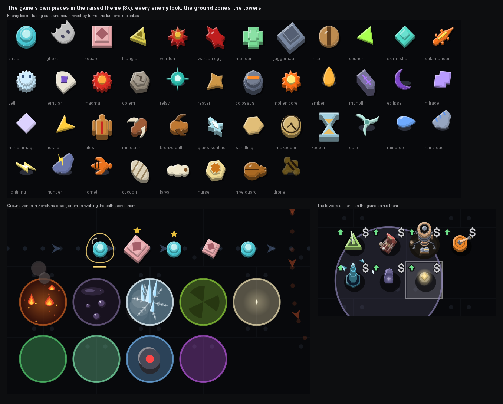

# jTD: a Swing tower defense game

A desktop tower-defense game written in plain Java and Swing. Enemies walk fixed paths across a grid board; you spend
credits on towers beside them and try to kill everything before it gets through and costs you a life.

All of the art is vector: every enemy, tower, beam and path marker is a `java.awt.Shape` built and painted in code,
with no image assets in the game. The sheet below is rendered by the game's own painters.



## Features

- **7 towers**, each with its own four-tier upgrade tree: XP opens a tier, credits buy its nodes, and clusters and
  forks let one tower grow into different builds
- **6 levels**, most with several lanes that run their rounds together
- **Over 40 enemies** at five ranks, from Grunt to Boss, with stats, traits and abilities; 20 affixes and
  6 spawn shapes vary them inside a wave
- **Status effects and ground zones**: burns, chills, freezes, shields and heals, and ground that keeps working
  after the shot that made it
- **Headless balance tools** that play every level with simulated players over many seeds
- **An in-game dev panel** (`Ctrl`+`Shift`+`D`) for playtesting

## Quick start

Needs JDK 25 and Maven 3.9+.

```bash
mvn package               # build target/jTD.jar (shaded, no extra classpath)
java -jar target/jTD.jar  # run the game
mvn verify                # formatting, Checkstyle and the whole test suite
```

| Key                         | Action                                            |
|-----------------------------|---------------------------------------------------|
| `q` `w` `e` `r` `t` `y` `u` | Pick a tower, then click a cell to place it       |
| `Space`                     | Pause, or send the next wave                      |
| `d` `f` `g`                 | Normal, fast, super fast                          |
| `0`–`4`                     | Buy the selected tower's affordable tier upgrades |
| `Delete`                    | Sell the selected tower                           |

The full controls are in [`docs/GAMEPLAY.md`](docs/GAMEPLAY.md#controls).

## Design notes

- **The engine is headless.** `GameEngine` and the domain packages own all game state and input
  semantics and never touch Swing. The game, the tests and the balance tools drive the same engine;
  `GameHost` is its only channel to the UI ([ADR 0002](docs/adr/0002-headless-engine.md)).
- **Two threads, and only immutable snapshots cross between them.** The `game-loop` thread runs the
  simulation and builds each frame. The Swing thread only paints the finished frame. A click that changes
  game state is a request the next tick picks up, never a write into engine state
  ([0007](docs/adr/0007-owner-publishes-snapshots.md), [0019](docs/adr/0019-edt-commands-are-requests.md)).
- **Frames are described, then painted.** `BoardRenderer` turns a tick into AWT-free draw records,
  and `Java2DFrameRenderer` alone turns them into pixels
  ([0003](docs/adr/0003-frames-are-described-then-painted.md)).
- **Runs reproduce.** A tick always runs in the same order, randomness comes from an injected seeded
  source, and whatever the simulation iterates keeps a fixed order. A save between waves replays the
  next wave tick for tick ([0021](docs/adr/0021-a-wave-starts-from-its-save.md)).
- **Balance is measured, not guessed.** Simulated players play every level headlessly over many seeds,
  and each margin is reported with its 95% interval ([0010](docs/adr/0010-balance-is-measured-by-players.md)).
- **A performance budget with a harness that checks it.** `td.PerformanceHarness` fills the level with
  the most buildable cells with towers and fails when the 99th-percentile tick, frame build or paint goes over budget.

## Tech stack

Java 25, Swing and Java2D with no game framework · Maven, shaded into one jar · JUnit 5 and AssertJ with
hand-written fakes, no mocking library · SLF4J and Logback · Spotless and Checkstyle (style and package
boundaries) in `mvn verify` · PIT mutation testing on demand.

## How it is built

jTD began as a hobby project in my first year at university, when I was learning Java. Today it is how
I learn agentic coding: [Claude Code](https://claude.com/claude-code) writes the code and commits every
change, so nearly every commit is co-authored with it. I steer it and review its design decisions,
aiming for clean code and a clean architecture. The `CLAUDE.md` files hold the constraints it works under.

## Documentation

| Doc | What it holds |
|---|---|
| [`docs/GAMEPLAY.md`](docs/GAMEPLAY.md) | How the game plays: controls, upgrades, enemies, effects, zones |
| [`docs/CONTENT.md`](docs/CONTENT.md) | The towers, enemies and levels that ship |
| [`docs/WAVE-SCRIPTS.md`](docs/WAVE-SCRIPTS.md) | Spawn shapes, affixes and enemy ids a wave script can use |
| [`docs/TOOLING.md`](docs/TOOLING.md) | Dev panel, balance and performance harnesses, logging, releases |
| [`docs/BALANCE.md`](docs/BALANCE.md) | The balance pipeline for enemies, towers and waves |
| [`docs/ARCHITECTURE.md`](docs/ARCHITECTURE.md) | An overview of the system as it is now |
| [`docs/DESIGN.md`](docs/DESIGN.md) | How to choose a design in this codebase |
| [`docs/adr/`](docs/adr/README.md) | One record per structural decision: what, why, what was rejected |
| [`docs/art/`](docs/art/README.md) | Living art sheets of every tower, enemy and ground |
| [`docs/features/`](docs/features/) | Feature design docs, the shipped ones kept as a record |
| [`docs/releases/`](docs/releases/) | A frozen snapshot of each released version |
| [`TODO.md`](TODO.md) | Known gaps and feature ideas |

## Licence

[Apache License 2.0](LICENSE).
