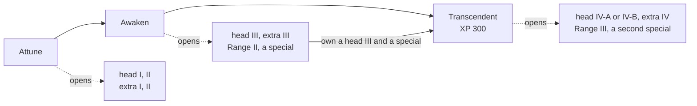

# jTD — a Swing tower defense game

A desktop tower-defense game written in plain Java and Swing. Enemies walk a fixed path
across a grid board; you spend credits placing towers on the buildable cells beside it and
try to kill everything before it laps the path and costs you a life.

All of the artwork is vector — every enemy, tower, beam and path marker is a
`java.awt.Shape` built and painted in code. There are no image assets in the project.

## Requirements

- **JDK 25** (the build targets release 25)
- **Maven 3.9+**

## Build and run

```bash
mvn package               # build target/jTD.jar
java -jar target/jTD.jar  # run the game
```

The jar is shaded, so it bundles its SLF4J/Logback dependencies and needs no extra classpath.

Other useful commands:

```bash
mvn verify        # rules check + test suite — the standing check before a commit
mvn test          # run the test suite
mvn -q compile    # fast syntax/type check

# run a single test
mvn test -Dtest=GameEngineTest#placingATowerOnABuildableCellChargesCreditsAndOccupiesTheCell
```

## Playing

The game opens on a level-select screen. Pick a level to start it; each level brings its own
board size, path, wave list, starting credits and starting lives.

Buy a tower from the toolbar (or with its key, `q`–`i`), then click a buildable
cell to place it; hovering a toolbar button opens a tooltip of the tower, and the side panel shows
it in full while you place it. The click that builds a tower selects it, as does clicking a placed
tower later: the side panel shows its stats and its own upgrade
tree — four slots, `core`/`base`/`head`/`special`, drawn whole as a talent tree.
Start each wave yourself when you are ready — waves do not auto-advance. A level may pay bonus credits, scored
alike, for each round cleared with no enemy leaked: the Waves panel marks a round's bounty and bonus (`24+5`), and the
cash icon flashes when the bonus pays. Hover that mark, or a round's skull in the Wave popup, for what each one means.

### Controls

Every button shows its key on a chip in its top-left corner.

| Key                             | Action                                                                                               |
|---------------------------------|------------------------------------------------------------------------------------------------------|
| `q` `w` `e` `r` `t` `y` `u` `i` | Select tower 1–8 for placement                                                                       |
| `Esc`                           | Cancel tower placement; cancel a question                                                            |
| `1`–`8`                         | Buy the selected tower's next upgrade step: 1 Core, 2 Range, 3 extra line, 4/5 the branches, 6–8 specials |
| `Space` or `P`                  | Pause; while paused or between waves, play on at the last speed and send the next wave               |
| `d` `f` `g`                     | Normal, fast, super fast speed; each also sends the next wave if it is waiting                       |
| `Delete`                        | Sell the selected tower                                                                              |
| `m`                             | Back to the level-select menu (asks to confirm mid-level)                                            |
| `z`                             | Restart the last wave sent, back to how it was sent (asks to confirm)                                |
| `Enter`                         | Confirm a question                                                                                   |
| `1`–`9` on the menu             | Start that level                                                                                     |
| `Ctrl`+`Shift`+`D`              | Open or close the dev panel (playtesting controls; hold `Alt` to see their keys)                     |

Mouse: move to preview placement, click to place or to select a placed tower. In the Upgrades panel,
hovering a node shows what it does and what a click would do; a click buys it with every node it
needs first, in one payment or not at all, and a right-click on an owned node downgrades it (after a
confirmation, unless all of it refunds in full) with every node that depends on it. Click a moving enemy, invisible ones too (when not placing a
tower), to inspect it: the side panel shows its live health, stats, effects and traits, updating even while paused,
and keeps a "Killed" or "Leaked" line after it's gone until your next click. Hovering an enemy in
the wave preview opens a tooltip of the stats that enemy type spawns with.

The dev panel ships in the jar, hidden behind `Ctrl`+`Shift`+`D` rather than a build flag, to
make manual playtesting cheap. It sets credits and lives, keeps them topped up, spawns any wave
script on any path with a live preview (enemies spawned between waves hold the next wave back until
they are gone), skips, jumps to or restarts waves, steps one tick, shows
the live speed in ticks per second and nudges it by 1 or 5 (0 pauses), kills
or clears the board, saves the game between waves and loads it back (one save per level, in `saves/`), grants XP to or resets the selected tower, lets upgrades ignore their gates,
and draws the cell grid with the path's cells shaded and the pointed-at cell's coordinates. Every
control has an `Alt` shortcut.

`td.balance.BalanceReport` checks balance headlessly. It plays every built-in level with the level's real
credits and lives, over many seeds, with a naive player (random towers on random cells), a competent one
(it reads the coming rounds and buys what it estimates saves the most enemy health per credit) and that
competent player on random cells and without upgrades. Per level it reports whether the level is too easy
or too hard, whether positioning and upgrades matter, where the pressure comes round by round, where the
credits go, which towers carry the defence and what leaks, which effects, enemy abilities and upgrade
nodes no play ever triggers, every number with its 95% interval. The
**margin** is the highest enemy health, as a percentage of the authored one, a player still wins at. A lab
measures each tower on every cell, against every enemy kind at every rank a level sends, and with each
upgrade line, and what it does for a tower beside it, before any play.

```bash
mvn -q compile exec:java -Dexec.mainClass=td.balance.BalanceReport -Dexec.args="--save before"
# change a number, then:
mvn -q compile exec:java -Dexec.mainClass=td.balance.BalanceReport -Dexec.args="--compare before"
```

`--compare` plays the same seeds again and lists what moved beyond the seeds' noise, then plays the saved
competent actions back unchanged, so what the change does shows apart from how the player adapts to it. `--seeds N` (20 by
default) and `--levels 0,2` narrow a run; `--strong` adds a player that rehearses each round before
playing it, `--variety` measures each tower alone and each tower banned, `--sweep lives|bounty|clear|pause|spacing`
shows how the competent player's margin moves with one of the level's knobs, and `--html` writes
`target/balance/report.html` with charts and board heat maps. A run takes one to two minutes; the extras
add several each.

Two older harnesses remain. `td.PurchaseHarness` compares purchases: on each level asked for, with an army
of one tower of every type, it reports the lives saved per 100 credits by another copy of a tower and by each
upgrade node, over many seeded runs (`mvn -q compile exec:java -Dexec.mainClass=td.PurchaseHarness
-Dexec.args="0,1,2 12 all 4"`: levels, seeds, a tower or all of them, and how many of each tower the base army has; a bigger
army prices "another copy" at what a real build pays). It also gives each line's fair price, the price at which
it saves as many lives per credit as another tower, and closes with what a node at each tier should cost as a
percent of its tower's list price. `td.BuildHarness` compares builds of one tower
instead: copies of it bought the same way among a fixed background of the others, for every node on its own
and for every last head node with a special, either at equal copies or at an equal budget with one upgraded
copy and plain ones for the rest (`-Dexec.args="2 40 cinder 4 2 1500 1"`: level, seeds, tower, copies,
background copies, budget, upgraded copies).


### Towers

A tower's info pane shows Range, then how it deals damage: a hit tower its Physical or Magic damage (/hit), Fire
rate (/s) and DPS (/target: damage times fire rate times the average crit, before the target's defences; for the Scorcher, the burn
its waves keep going on one target), the Radar
its Sweep time in place of a fire rate, the Obelisk its damage a second, a placed tower its Wave DPS (what it really
dealt this wave, over the span from its first damage to its last, once that span reaches a second); then every other stat off its default
(Crit damage whenever it can crit, Effect duration whenever it applies an effect), and what a Beacon gives.
A changed value has an arrow for which way it moved, and is red only when that is worse; hovering a row says what
the stat does and what made it. An upgrade's hover shows each change and what the row it moves would become
(`Fire rate +25% 1.3 → 1.6 /s`).

| Tower  | Price | Behaviour                                                                                                                                           |
|--------|-------|-----------------------------------------------------------------------------------------------------------------------------------------------------|
| Sniper | 15    | Single target, hits whichever enemy in range is furthest along the path; each shot builds on the last, whichever enemy it hits, so the longer it keeps firing, the likelier it crits; a stack fades 3 s after its last shot, one at a time (Crit damage 200%) |
| Burst  | 15    | Instant blast on a random target in range, physical damage falling off with distance; attuned, it aims at the most crowded group and Saturates what it hits. Forks into the Stormcaller (lightning arcs on past the blast) or the Hexer (every 4th shot casts a hex) |
| Mortar | 30    | Lobs a slow, unguided shell at whichever enemy in range is furthest along the path, never one within 1.5 cells of it; the blast does physical damage with falloff and cracks the plating of everything it reaches. Attuned, a shell landing near the last one hits harder and wider. One head adds heavier shells and nukes, the other shrapnel and bombs along the path, and a ballistics line speeds the shell up, leads the target, widens the blast and fires salvos. Its specials turn every third shell into a Napalm, Tar or Cryo shell that leaves burning, tarred or frozen ground |
| Scorcher | 28    | Turns slowly toward the nearest visible enemy and, once one is in the cone, fires a flame wave that burns everything it reaches, invisible enemies included. A burn never crits but an ignition can, which starts the pool stronger. Attuned, each wave on an enemy it is already burning raises that burn. Forks into hot, short White Flame with Soulfire, or the wide Wide Nozzle that leaves burning ground; a fuel line makes burning enemies heal less, take more and scorch faster |
| Hive   | 30    | Fires a slow homing missile at the fastest enemy in range, which it keeps through invisibility and re-aims at each tick; deals magic damage and freezes whichever mob it actually hits. Attuned, it banks missiles in a nest, between waves too, and launches them as a salvo |
| Radar  | 20    | Long range; a beam sweeps around it once every 3s, hitting everything it passes; once attuned, each sweep Exposes the healthiest enemy it passed |
| Obelisk | 25    | Support, a kill box. Short range; a field that drags everything inside 15% and deals a little magic damage to it every tick, ghosts included and with no visible enemy needed, the damage a quarter less for every other field overlapping it. Attuned, an enemy that stays inside builds Toll, which makes every effect the field holds on it stronger. One head holds enemies longer (Gravity: a deeper drag, Dazes, a wider field, a well or Stasis), the other denies them (Ward: reveal, silence, worthless heals, True Sight or Purge); an extra line makes them take more damage and builds Toll faster. A special Condemns the strongest enemy inside, bosses first, for every tower to turn on; drains spirit; or links two Obelisks with a Ley Line. Reveals nothing until Ward is bought |
| Beacon | 20    | Passive: gives the towers in its range Damage and Range +20% and Jam taken x0.5; it never buffs another Beacon, and several stack. Attuned, the towers it buffs earn more XP for each other tower type in its range (Kinship). One head strengthens the buff, then adds Fire rate and Crit damage; the other widens its reach, then raises Buff duration and Effect duration. An extra line mentors XP, and a special makes it wither enemies, buff only its best tower, or rally the towers when an enemy reaches a spot on the path |

The shop and the board call the towers Sniper, Burst, Mortar, Scorcher, Hive, Radar, Obelisk and Beacon
(keys `q` `w` `e` `r` `t` `y` `u` `i`, in that order). A Burst that forks is called a Stormcaller or a Hexer.

An attack-speed bonus adds to the attacks a second, so +100% is twice as fast; bonuses add up, and a Jammer
takes 30% away and shrinks range by 0.6 cells. The rate need not be a whole number of ticks: a tower remembers
what is left over, so +10% on the Obelisk, which hits every tick, gives 22 hits in 20 ticks and a second hit in
the tick the fractions add up. The Radar spins faster instead. No tower runs more than ten times faster than its
base, or slower than a quarter of it.

The price is the first copy's: each copy of a tower already on the board makes the next one cost
15% more, and the shop shows the current price. Selling refunds three quarters of what the tower
and its upgrades cost.

Every tower, the Aura included, has its own upgrade tree of four slots, shown in place of the
wave preview once the tower is selected. `core` holds the chain Attune -> Awaken -> Transcendent and
`base` three Range steps: Attune opens the first two levels of `head`, Awaken opens level III and
a special, and Transcendent (once a special and a level III head are owned) opens Range III and a
second special. `head` offers two chains that exclude each other; `special` offers one to three
specializations, of which a tower keeps one, or two once Transcendent. Past the first steps a
node also needs XP: every tower an enemy reached earns its bounty as XP when its walk ends,
killed or leaked (an Aura earns with the towers it buffs), and a few nodes need towers built
nearby. A downgrade takes a node back with everything that needs it, refunds three quarters of what
they cost (selling afterwards pays what selling would have) and reopens the choices they made. Upgrade
prices are multiples of the tower's price. Pips on the board show each slot's
level, and a tower with a special glows. Silver diamonds beside a tower show its rank, earned
with XP: Seasoned at 50, Expert at 150, Hero at 300. The Upgrades panel's XP bar ticks where the
next node waits. The Beacon draws a faint line to every tower it's
currently amplifying, coloured for its reach or its chosen hero, a ring on the tower it mentors, and
(while it is selected) the path spot its Rally watches.



### Enemies

An enemy is made of four kinds of thing, and each belongs to exactly one:

- **Stats** are the numbers every enemy has, zero or not: Move speed (cells/s), Armor and Magic resist (a hit
  keeps `100 / (100 + armor)` of itself), Plating and Insulation (dmg every physical or magic hit loses; Flat
  penetration ignores them), Resilience (against crits; 100 is crit-immune, a negative value makes crits stronger), Agility
  (aimed shots miss; a negative value means no dodges and more crits), Physical, Magic and Damage over time taken (%), Spirit (what its regeneration restores and its shields hold),
  Regeneration (hp/s; at a negative value it crumbles, losing health on its own) and Tenacity (how long its debuffs last: `100 / (100 + t)` of their time at a positive
  value, `1 - t / 100` at a negative one; it cuts a pool's damage with its time). An immunity is a trait of its own: that effect never takes hold.
  The info pane lists the ones off their default, each with its unit and, where the number alone says little, what
  it does (`Armor 30 -23% dmg`); hovering a row explains it and, live, what made it. Nothing is drawn on the board
  for them. Under a selected enemy's health bar a strip shows what its shields hold, tinted where a shield takes only
  physical or only magic damage; hovering the Shield or Heal icon lists each source's share and how long it has.
- **Traits** are what an enemy has that most don't, always on: a resistance or immunity to an effect,
  regeneration, a stat that follows its state (faster or harder to hit when hurt) or adapts to how the
  level is played.
- **Abilities** are what it does at a moment: a trigger (a timer, a threshold, a hit, a dodge, its death)
  and an action (put an effect on itself or its allies, or spawn enemies).
- **Effects** are timed statuses on an enemy, from a tower or an ability. The main ones are drawn on the enemy; others show as a small dot under it.

From Elite every enemy carries some of each stat, small where it is off its identity; the exceptions are
plating and insulation (only the enemies built around them), agility on the heaviest (Juggernaut, Wardens, eggs) and resilience
on the Wardens, whose shield answers crits.

| Enemy      | Looks like    | Behaviour                                                                                                                                                                                                                                                                                                         |
|------------|---------------|-------------------------------------------------------------------------------------------------------------------------------------------------------------------------------------------------------------------------------------------------------------------------------------------------------------------|
| Walker     | circle        | Plain mob, no special ability, and no stats up to Veteran. From Elite, adaptive armor and a little of every stat; at Boss, +30 resilience |
| Knight     | square        | +25 armor and magic resist, rising with rank, plating from 2 to 10; immune to crits. From Veteran, +33 tenacity; from Elite, thick plating, a physical shield once below half health, and ward mines laid along its path; at Boss rank, calls three Squires every three seconds |
| Runner     | triangle      | Speeds up as it loses health; -20 agility, so crits land more often. From Veteran, once badly hurt, it throws down haste ground that lasts until the wave is over; from Elite it also sprints once below half health; at Boss rank, no haste ground, crit immune, calls three spawnlings once below half health and heals itself when left alone |
| Ghost      | sheet with eyes, floating | +20 armor. Turns invisible to single-target towers for ~10s the first time it's hit (~15s from Veteran; area damage still reaches it); at Elite and Boss rank, also permanently shrouds every other ally near it; at Boss rank it fades out for 3s of every 10 |
| Mender     | cross         | Deals no damage of its own; periodically restores health to every other ally near it; +20 spirit, rising to 60 at Boss. From Veteran it heals itself when left alone and, when it dies, heals and shields every ally near it; from Elite, adaptive armor; at Boss rank, the death blast is a heal alone. |
| Jammer     | disc with four antennae, spinning | Jams every tower near it: they fire more slowly and see less far while it's in range (drawn as a pink ring; affected towers show a pink marker). A tower in a Beacon's range takes half of it. +20 magic resist; its reach and strength grow from Veteran, and from Elite it keeps a magic-only shield and its casing blunts magic hits (2 insulation, 4 at Boss). |
| Juggernaut | square with an inset plate | Slow, with plating that blunts a huge flat chunk of every physical hit; magic, Cracked and Sundered get past it. +15 magic resist and +43 tenacity. From Veteran, when it dies it blinds the towers within 2 cells (4 from Elite) until the wave is over; from Elite, crit immune; at Boss rank, a large magic shield once below half health. |
| Mite       | circle        | Tiny and quick, with 10 agility rising 5 a rank to 25 at Elite and 35 at Boss; meant for a `swarm 12 mite`. at Boss rank it bursts into three broodlings when it dies. |
| Courier    | triangle      | Very fast and fragile, with a high bounty, and nimble (25 agility, 35 from Veteran, 50 at Boss) enough to dodge an aimed shot now and then. From Elite it sprints when first hit; at Boss rank, after every dodge too. |
| Shieldbearer | cross         | +30 armor, and spirit from Veteran that makes the shields it gets hold more. Periodically shields every other ally near it against physical damage only; magic goes straight through. From Elite it shields itself too and has a little plating; at Boss rank, in a wider reach. |
| Salamander | lizard, wriggling as it walks | Immune to burn, so a Cinder-only defence does nothing; Soulfire still burns it. Regenerates 1 health a second (a trait), doubling at Veteran, Elite and Boss. From Elite, +25 magic resist and a burst of healing once below 30% health. |
| Yeti       | shaggy ball with eyes, lumbering | Immune to freeze and chill; Dazed still stops it. +15 armor and magic resist. From Elite its fur blunts 2 points of every hit and it heals once below 40% health; at Boss rank, +50 resilience. |
| Magma      | jagged boulder with a glowing core | Slow, pulsing and immune to burn. +30 magic resist, 30 spirit, 10 agility, 70 resilience (85 from Elite, 95 at Boss), so crits rarely land. Once below 65% health it gives every other enemy within 3 cells +15 magic resist for 15 s (+30 from Soldier, +50 from Veteran); below 5% it gains +100 resilience, spirit and magic resist for 10 s. From Veteran, every 1.5 s it drops a pool that heals the enemies in it (0.35 health a tick, 0.6 from Elite, 1 at Boss), until it falls below half health (a quarter at Boss). From Elite, +10 armor, 45 magic resist and 45 spirit (+15, 60 and 60 at Boss). |
| Golem      | hexagon       | Slow, swaying and heavily armored: +35 armor, +40 resilience, so crits rarely land. Once below 50% health it hardens into a shield that holds until broken (40 points, then 80, 160, 300 and 600 at Boss). When it dies it splits into two smaller Golemites with its defences and a quarter of its health. From Elite, 50 armor, 60 resilience, +20 magic resist and 2 plating (65, 80, 35 and 4 at Boss). |
| Skirmisher | diamond       | Nimble: 40 agility, rising to 80 with rank, so it dodges some aimed shots; +20 resilience. From Soldier it sprints off for 1.5 s after every dodge; from Elite it gets harder to hit the more it is hurt; at Boss rank it also vanishes for a moment after every dodge. |
| Empty      | —             | Not a real enemy — a spacer that opens a timing gap inside a wave                                                                                                                                                                                                                                                 |
| The Warden | large spiked crest with a gold gem | A boss: armor and magic resist, and plating, all lower with each hatching; periodically calls three Elite Drones, hardens for every ally near it (Hivemind), shields itself and nearby allies, and shields itself again whenever it survives a crit, so its escort has to be cleared before it can be worn down. On death it leaves behind a stationary egg that hatches back into a weaker Warden if not destroyed in time — the fight only ends once an egg is defeated before it hatches. If any stage escapes, the level is lost, however many lives are left. The final round of The Amber Hive — a level-authored enemy. |
| Sandling   | small grain of sand, path-facing | Quick (1.5 cells/s) and a little nimble, and it crumbles: it loses health on its own (negative regeneration), faster with rank, so it lasts about as long as it takes to cross the board. Slow it and it never arrives; a heal it is given holds it together. Appears on The Last Hour — a level-authored enemy, like the Drone. |
| Timekeeper | brass clock face, spinning | Every seven seconds it turns the health of every other enemy within about 3 cells back to what it was two or three seconds before (Rewind), further with rank. A rewind is a heal: it gives back what Spirit makes it worth, nothing under Dead Zone, Inversion turns it into damage, and a freeze, a daze or a silence stops the cast. Appears on The Last Hour. |
| Glass Sentinel | glass crystal | Slow, with 8 plating and 8 insulation that blunt every small hit of either type (up to 22 at Boss) and -60 resilience, so crits shatter it: it asks for big hits, crits, Cracked or flat penetration. Appears on The Last Hour. |
| Sand Reaver | sand-coloured barbed arrowhead, path-facing | Speeds up as it's hurt, shrugs off a flat point of every hit, crit immune from Elite, shields itself once badly wounded, and falls apart into two Sandlings on death. Appears on The Last Hour. |
| The Keeper of Hours | glass hourglass with falling sand, swaying | A boss: every six seconds it turns its health back to what it was three seconds before (Rewind), every ten it calls a Veteran Timekeeper that turns it back further, once below half it calls six Sandlings, and once nearly dead it turns the glass one last time, eight seconds back. Time runs slow around it: it jams the towers near it. Stop it casting (freeze, Daze, Silence), make heals worth nothing (Dead Zone), Invert it, or outpace it. If it escapes, the level is lost. The last round of The Last Hour. |
| Drone      | striped bee, buzzing | A Walker with Hivemind: +4 armor and magic resist for every other enemy within 1.5 cells, up to five, so a pack is far tougher than its members alone; area damage breaks it up. On the Walker's ladder. Appears on The Amber Hive — a level-authored enemy, like the Reaver. |
| Hive Guard | amber beetle, striding | A Walker with three times the health at half the speed, a point of plating and a stronger Hivemind (+9 a neighbour, up to four). On the Walker's ladder. Appears on The Amber Hive. |
| Brood Nurse | cream honeycomb cell with an amber cross | A Mender in the hive's colours, on the Mender's ladder; from Veteran it also wards every other ally near it with a shield that stops any damage. Appears on The Amber Hive. |
| Larva      | pale grub, wriggling | A soft, slow Walker that spins itself into a Cocoon where it stands after nine seconds, unless it is killed first. On the Walker's ladder. Appears on The Amber Hive. |
| Cocoon     | silk-wound ovoid | Stationary, armored and plated but soft to crits (-40 resilience); it hatches into a Hornet after six seconds unless it is broken open. Appears on The Amber Hive. |
| Hornet     | orange hornet with black bands, path-facing | Quick (2 cells/s), nimble and faster as it is hurt, with -20 resilience; from Veteran it sprints after every dodge. What a Cocoon hatches into, and sent on its own in later rounds. Appears on The Amber Hive. |
| Raincloud  | grey cloud with falling rain, pulsing | Slow, +15 magic resist; bursts into Raindrops when it dies, more with rank (3 to 8). From Elite it leaves rain behind it that heals the enemies who stand in it. Appears on The Storm Ridge — a level-authored enemy. |
| Raindrop   | tiny blue drop, path-facing | Quick (2 cells/s) and a little nimble; what a Raincloud bursts into, and sent in swarms of its own. Appears on The Storm Ridge. |
| Gale       | three-bladed whirlwind, spinning | Every four seconds it shoves every other enemy within 1.5 cells 1.2 cells further along its path (Gust), further and wider with rank, never past the end; 15 agility. Kill it first, or hold the whole lane. Appears on The Storm Ridge. |
| The Thunder | wide storm cloud with a lightning bolt, rumbling | A boss, the slow half of the storm's twins: armor, plating and resilience that blunt physical hits, +100 tenacity, immune to Daze, and a rumble that jams the towers near it; once badly hurt it blinds the towers near it until the wave is over (Thunderclap). Bond: if the Lightning falls and the Thunder still stands six seconds later, it calls the Lightning back, reborn - quicker, harder to hit and worth no bounty. If any twin escapes, the level is lost. The last round of The Storm Ridge. |
| The Lightning | white-hot lightning bolt, path-facing | A boss, the quick half of the twins: magic resist and insulation that blunt magic hits, agility, +100 tenacity, immune to Daze, faster as it is hurt and a sprint after every dodge. Its Bond calls the Thunder back, reborn - louder and more heavily plated - if the Thunder falls first and stays down six seconds. Bring both down close together. |
| The Iron Colossus | riveted octagon with a furnace slit, swaying | A boss in an iron shell: armor and heavy plating blunt physical hits, crit immune, +100 tenacity, immune to Daze. It lays ward mines that shield the escorts behind it and calls two Knight escorts from time to time. Once badly hurt it reforges into the Molten Core. If it or the Core escapes, the level is lost. The final wave of Iron Crossing — a level-authored enemy. |
| The Molten Core | blazing star with a white-hot heart, pulsing | What the Colossus melts down into: no armor or plating but high magic resist and a casing that blunts magic hits, immune to burn, freeze and Daze, and faster the more it is hurt. It leaves pools behind it that heal the escorts who stand in them, and bursts into four Embers when it dies. |
| Ember      | tiny flame | A quick, nimble, burn-immune shard of the Molten Core; each one that gets through costs a life. |
| Mirage     | two overlapping diamonds | A Skirmisher that leaves a Mirror Image behind every time it dodges: a fragile copy that pays no bounty and grows tougher with the Mirage's rank. Appears on The Rift — a level-authored enemy. |
| Herald     | swept golden arrow, path-facing | A Courier that lays haste ground until the wave is over the moment it is first hurt, speeding everything behind it. Appears on The Rift. |
| Eclipse    | violet crescent, spinning | Every few seconds hides every other ally near it from aimed shots, longer with rank; never itself. Appears on The Rift. |
| The Monolith | standing stone with a glowing rune | A lone, very slow boss: crit immune, immune to freeze, chill and Daze, armor that hardens against the damage type that hurts it most, regeneration, a heal whenever it is left alone, a stone-skin shield at two thirds and at one third of its health, and a last stand once nearly dead. If it escapes, the level is lost. Walks alone in one round of The Rift. |
| Bronze Bull | horned bull's head, striding | A Runner cast in bronze: half its health, a little plating and immune to burn, on the Runner's ladder and abilities. Appears on The Labyrinth — a level-authored enemy. |
| Talos      | bronze giant with a vein of ichor, swaying | A boss: the bronze guardian. A body that crits cut deep (-60 resilience) inside a huge shield that holds until broken, recast again and again; shooting through it is hopeless, so it asks for a tower that strips, pierces, blocks or inverts shields. If it escapes, the level is lost. Round 2 of The Labyrinth. |
| The Minotaur | large horned bull's head, striding | A boss: thick hide (armor, plating, resilience), +100 tenacity, a bellow that jams the towers near it, a charge every ten seconds, faster the more it bleeds, and a bloodlust once badly hurt that heals it and sends it running. If it escapes, the level is lost. The last round of The Labyrinth. |

### Rank

Every enemy spawns at one of five named ranks — **Grunt, Soldier, Veteran, Elite, Boss** — shown
as a badge on its body rather than as a number. A wave's script can name the rank its slots default to in its head
(`soldier: 8 walker`), and is Grunt when it names none; any slot can name a different rank inline, before the enemy id (`elite walker`) or before a spawn
shape (`elite swarm 4 walker`). Each rank's health and bounty grow from the Grunt's on one pattern:
health climbs a quadratic curve to the enemy's Boss factor (20 times the Grunt for the Walker,
12 to 20 for the others, lower where an enemy's traits already grow with rank), so each rank adds
more than the one before and Elite and Boss stand out; bounty grows only with the square root of
health, so a tougher rank asks for more damage per credit (a Walker has 75, 164, 431, 877 and
1500 health and pays 2, 3, 5, 7 and 9). An enemy can still write a rank's health and bounty by
hand. A kill's score is weighted by
rank too — a Boss-rank kill is worth disproportionately more than a Grunt-rank one of the same
bounty. Every enemy defines all five ranks, and gains traits or abilities as it climbs, except the
spawnlings, which are one rank each, and the Warden chain, which is unique: every stage and egg is a
Boss whatever rank its wave asks for (a non-`boss` rank keyword before it fails the level load), and
the reinforcements a Warden calls come three at a time as Elites, every five seconds. Elite and Boss Walkers and Menders carry adaptive
armor: it resists whichever damage type (physical or magic) has landed most this level, from not
at all at an even split up to full strength against a one-type defence.

### Status effects

Towers and enemy abilities put timed effects on enemies. A burning enemy burns, a frozen one is inside ice and a
shielded one is inside a bubble. Effects with no picture show as one small dot per group under the enemy: a debuff, a mark
that sets it up for another tower, or a buff. Selecting an enemy shows each effect as an icon whose tooltip says what it does.

| Effect | Group | Side | What it does |
|---|---|---|---|
| Chill | Control | Debuff | Slows by what its source gives; only the strongest slow counts, and speed comes back over its last 0.5 s. |
| Burn | Affliction | Debuff | Damage over time that fades; a top-up adds less the fuller it is, up to x2 its strongest application; it adds a stack of Scorch every 0.5 s while it lasts, and every tower can see and aim at it. |
| Freeze | Control | Debuff | Stops it where it stands and keeps its abilities from firing; Agility -100, so no dodges and more crits on it; time under it shortens the next one, and walking wins that back, more slowly at higher rank. |
| Shield | Boon | Buff | Takes a hit before armor does, until its amount is spent or it runs out; more Spirit makes it hold more, shields from different sources add up, and damage over time goes past it. |
| Invisibility | Boon | Buff | Towers can't aim at it, though damage on an area still reaches it. |
| Heal | Boon | Buff | Adds to its Regeneration while it lasts; heals from different sources add up. |
| Vulnerable | Weakness | Debuff | Each stack: Physical damage taken and Magic damage taken +15%, up to 3 stacks. |
| Reveal | Mark | Debuff | Every tower can see and aim at it, and it can't gain Invisibility. |
| Poison | Affliction | Debuff | Damage over time that fades; it adds a stack of Sicken every 0.5 s while it lasts. |
| Scorch | Weakness | Debuff | Each stack: Resilience -1, up to 100; once nothing adds more, it loses a stack every 1 s. |
| Sicken | Weakness | Debuff | Each stack: Spirit -1, up to 100; once nothing adds more, it loses a stack every 1 s. |
| Sunder | Weakness | Debuff | Each stack: Armor -5, up to 10 stacks. |
| Expose | Mark | Debuff | Agility and Resilience -50: more and stronger crits on it. |
| Mark | Mark | Debuff | The next hit on it is a crit, which spends this. |
| Priority | Mark | Debuff | Physical damage taken and Magic damage taken +15%, and a tower that picks one target picks it. |
| Resonance | Weakness | Debuff | Each stack: Magic damage taken +8%, up to 3 stacks. |
| Fracture | Weakness | Debuff | Each stack: Resilience -10, up to 5; it loses a stack every 1 s. |
| Daze | Control | Debuff | Stops it and keeps its abilities from firing, like Freeze; Agility -100, so no dodges and more crits on it. |
| Saturation | Weakness | Debuff | Each stack makes a Burst's blasts hit it harder. |
| Charge | Mark | Debuff | The next hit on it from another tower lands 30% of that hit again as magic, twice that on a crit, for the tower that applied it. |
| Doom | Hex | Debuff | When it ends, it takes a share of all the damage it took while it lasted. |
| Blight | Hex | Debuff | It has Poison for as long as this lasts. |
| Contagion | Hex | Debuff | When it dies, its hexes and debuffs jump to the enemies nearest it. |
| Malaise | Hex | Debuff | Tenacity -50: its debuffs last longer. |
| Inversion | Hex | Debuff | Its Regeneration deals it damage instead of restoring health, and a Shield it receives strikes it instead. |
| Sympathy | Hex | Debuff | Once a second, its Chill, Vulnerable, Sunder, Expose and Unravel are copied, up to what it has, to the other enemies nearby that carry a hex from the same tower. |
| Reckoning | Hex | Debuff | When it dies, each Doom from the same tower near it releases at once and starts again. |
| Silence | Control | Debuff | Its abilities don't fire; abilities on death and auras still do. |
| Anchor | Control | Debuff | Holds Move speed to at most 75% of its base, whatever raises it, and it comes back over its last 0.5 s. |
| Unravel | Weakness | Debuff | Each stack: Magic resist -10, up to 5 stacks. |
| Brittle | Weakness | Debuff | Physical damage taken +30%. |
| Toll | Weakness | Debuff | Time spent in an Obelisk's field, a stack a second; it sets how strongly the field holds it, and goes soon after it leaves. |
| Corrode | Weakness | Debuff | Each stack: Armor and Magic resist -3, up to 15 stacks. |
| Drag | Control | Debuff | Slows by 1% a stack, up to 50 stacks; only the strongest slow counts, and speed comes back over its last 0.5 s. |
| Condemn | Weakness | Debuff | Each stack: Physical damage taken and Magic damage taken +5%, up to 4 stacks. |
| Stasis | Weakness | Debuff | While it also has Daze, the field holding it takes its Toll away. |
| Dead Zone | Weakness | Debuff | Spirit -100, so Heal and Shield are worth nothing. |
| Frail | Weakness | Debuff | Each stack: Physical damage taken and Magic damage taken +2%, up to 15 stacks. |
| Crack | Weakness | Debuff | Plating -5 and Insulation -5. |
| Tar | Weakness | Debuff | Slows by 40%; only the strongest slow counts, and speed comes back over its last 0.5 s. |
| Bleed | Affliction | Debuff | Physical damage for every cell it travels, ignoring Armor and Plating; standing still, it takes none. |
| Soulfire | Affliction | Debuff | Damage over time in a pool of its own beside Burn and Poison; it adds a stack of Scorch and Sicken every 0.5 s while it lasts, and every tower can see and aim at it. |
| Sprint | Boon | Buff | Move speed +60%. |
| Hasten | Boon | Buff | Move speed x2; Freeze and Daze still stop it. |

#### Tower terms

Buffs, debuffs and mechanics that towers carry or leave on enemies.

| Term | Side | What it does |
|---|---|---|
| Steady Aim | Buff | Each shot adds a stack, kept across targets and kills; 3 s after the last shot a stack fades, then the next. |
| Crit Streak | Buff | Crits in a row make the next crit hit harder. |
| Focus | Buff | Hits on one target build it; it starts over on a new target. |
| Frenzy | Buff | Faster attacks for the next few shots. |
| Haste | Buff | Faster attacks for a while. |
| Charged Shot | Buff | The next shot hits far harder and ignores armor and plating. |
| Patience | Buff | The next shot is a crit. |
| Deadeye Round | Buff | A shot that is a crit and hits harder. |
| Silver Round | Buff | A shot of magic damage that ignores some magic resist. |
| Bracketing | Buff | Each shell landing near the last hits harder and wider, a step at a time; a shell elsewhere clears it. |
| Napalm Shell | Buff | A shell whose blast is magic and leaves flames that apply Burn. |
| Tar Shell | Buff | A shell that leaves tar applying Tar and Poison. |
| Cryo Shell | Buff | A shell that leaves frost applying Chill, and Freeze to an enemy that stays. |
| Nuke Shell | Buff | A shell that hits far harder and wider and leaves Dead Zone. |
| Cryo Missile | Buff | A missile that applies Freeze. |
| Arcane Missile | Buff | A missile that applies Unravel instead of Freeze. |
| EMP Missile | Buff | A missile that removes Shield and Heal and applies Silence. |
| Tracer Missile | Buff | A missile that applies Reveal and Mark. |
| Event Horizon | Buff | Each death inside the field widens it until the wave ends. |
| Rally | Buff | Faster attacks for a while, from a Beacon's rally spot. |
| Aura | Buff | A Beacon in range raises its damage and range, and takes some of the jam enemies put on it. |
| Ley Line | Buff | A beam between two Obelisks; an enemy on it gets both fields' rules. |
| Nest | Buff | Missiles stored to launch one after another when a target comes. |
| Jammed | Debuff | An enemy nearby slows its attacks and shortens its range. |
| Interference | Debuff | Other Obelisk fields overlapping this one take some of its damage away. |
| Stoke | Debuff | Each wave on an enemy with this tower's Burn raises that Burn a step; the steps go when it ends. |
| Kinship | Buff | Towers a Beacon buffs earn more XP for each other tower type in range. |
| Ping | Buff | Each revolution, the Radar applies Expose to the enemy with the most health its beam passes. |
| Shatter | Buff | An enemy with Freeze breaks apart and hurts the enemies around it. |
| Arc | Buff | Lightning that jumps from a blast to enemies past its edge, as magic. |
| Hex | Buff | A curse a Burst casts instead of a blast; each kind does its own thing. |
| Shrapnel | Buff | Fragments that fly past a shell's blast. |
| Bomblet | Buff | A small bomb a shell drops on the path. |

Stacks wear off one per second once nothing adds more, and every other debuff runs out on its own clock, whatever the enemy's spirit. Effects don't change one another, with two exceptions: a pool earns its marks while it lasts, and a Reveal keeps Invisibility out.

### Ground zones

A tower can leave a patch of ground that keeps working after the shot that made it. A zone pulses
twice a second on every enemy inside (hidden ones too), credited to the tower that made it, and the
pulse never crits. Two zones of one kind never stack: an enemy standing in both takes one pulse.
Zones combine only through what they leave on the enemy: only the strongest slow counts, and a burn keeps
burning through a freeze.

| Zone           | Made by                    | What it does to enemies inside |
|----------------|----------------------------|--------------------------------|
| Burning ground | Mortar's Napalm            | Burns them |
| Tar            | Mortar's Tar               | Poisons them and leaves them Tarred (slowed 40%) |
| Frost ground   | Mortar's Cryo Shells       | Chills them, and freezes one that stays 2 s |
| Fallout        | Mortar's Tactical Nuke     | Drains their spirit and leaves them in a Dead Zone                       |
| Mine           | Splash, from Range III     | The first enemy to step on it sets it off as one blast, and it is gone; it lasts 10 s, a Splash keeps 3 |
| Cursed cloud   | Hexer's Mastery            | Gives every enemy inside the debuffs the hexed enemy that died there carried, for as long as they had left |
| Healing ground | Mender, from Soldier       | Heals them; it lasts 5 s |
| Haste ground   | Runner, from Veteran       | Hastens them (twice the speed) for a second after each pulse; it lasts until the wave is over |
| Ward mine      | Knight, from Elite         | Armed a second after it is laid; the first enemy to step on it gets a Shield, and it is gone; it lasts 8 s |
| Blinding field | Juggernaut, from Veteran   | Works on towers, not enemies: every tower inside misses 75% of its hits, whatever hits them again; fields never stack, the strongest counts; it lasts until the wave is over |

Only a hit can crit: a shot, a blast, a beam pass. Damage over time (a burn, a poison, a field)
never does, but a burn or poison started by a crit starts that much stronger. Each tower has its
own Crit damage (150%, the Sniper 200%). A guaranteed crit lands whenever the enemy's
resilience is below 100; at 100 nothing crits. Negative resilience makes crits hit harder, and negative agility multiplies their chance (-50 turns 20% into 30%);
Exposed takes 50 agility and 50 resilience. Armor and magic resist never go below 0.

An enemy with agility can dodge a hit aimed at it alone: the Sniper's shot and its Ricochet bounces,
and the Sonar beam's hit. The chance is `agility / (agility + 100)` (25 dodges 20%, 100 dodges 50%),
after the tower's accuracy, which cancels agility point for point. A dodged hit deals nothing, can't
crit and sets off nothing a hit would; a dodged Sonar hit still counts for its ping. Area damage,
damage over time, the Railgun's line, arcs and missiles are never dodged, and neither is a
guaranteed crit, so a Marked enemy can't dodge. A frozen or Dazed enemy can't dodge at all. The
Sniper's Steady Aim stacks add 10 accuracy each from Attune; with Marksman's Eye a dodged shot makes
the next one a guaranteed crit, and Focused Optics II's Frenzy also starts on a dodged shot.

### Spawn shapes

A wave's script can shape how a slot spawns, not just what it spawns — write the shape's
keyword before the enemy id (`flank walker`), or before a member count and the enemy id for
the shapes that take one (`swarm 4 walker`):

| Shape   | Keyword  | What one slot produces                                                |
|---------|----------|-------------------------------------------------------------------------|
| Normal  | (none)   | One enemy on the path centre                                            |
| Swarm   | `swarm`  | *N* enemies at 50% size, scattered off-path, sharing one spawn's bounty and health |
| Line    | `line`   | *N* enemies spread evenly across the path's width, abreast              |
| Flank   | `flank`  | Two enemies hugging opposite edges of the path                          |
| Column  | `column` | *N* enemies in a tight single file, closer together than *N* separate spawns |
| Drip    | `drip`   | *N* enemies stretched over more time than *N* separate spawns           |

A wave's script can also open with a head that sets `w<number>` (`w30: 8 walker`, or `w30 soldier:
8 walker` with a rank), how many ticks one slot of spacing is worth. The default is 22.4; a bigger number spreads the wave out, a smaller one
packs it tighter.

### Affixes

An affix is an adjective a wave script writes right before the enemy id (`3 elite swarm 4 armored
mite`), or in the head for every slot of the wave (`soldier armored: 8 walker`). Each gives the enemy
one twist on top of its type and rank, and its name reads in front of the enemy's ("Armored Knight").
A slot carries at most two, the head's included, and a boss chain takes none. No affix changes the
bounty.

| Affix   | Keyword   | What it does                                                                     |
|---------|-----------|----------------------------------------------------------------------------------|
| Armored | `armored` | Armor against physical damage on top of its own: +25, rising to +400 as the level's landed damage leans physical |

### Wave script ids

A wave script names enemies by these ids; the full grammar is in `src/main/java/td/wave/CLAUDE.md`.

| Token     | Enemy                                                    |
|-----------|----------------------------------------------------------|
| `walker`  | Walker                                                   |
| `knight`  | Knight (reduced damage)                                  |
| `runner`  | Runner (faster when hurt; Boss spawns a brood)           |
| `ghost`   | Ghost (turns invisible when first hit; Elite+ shrouds)   |
| `mender`  | Mender (heals allies)                                    |
| `jammer`  | Jammer (weakens nearby towers; in no wave yet)           |
| `e`       | spacer: takes a spawn slot, spawns nothing               |
| `warden`  | the Warden boss chain (The Amber Hive only)              |
| `drone`, `hiveGuard`, `broodNurse`, `larva`, `cocoon`, `hornet` | The Amber Hive's own enemies (The Amber Hive only) |
| `raincloud`, `raindrop`, `gale`, `thunder`, `lightning` | The Storm Ridge's own enemies (The Storm Ridge only) |
| `sandling`, `timekeeper`, `glassSentinel`, `sandReaver`, `keeperOfHours` | The Last Hour's own enemies (The Last Hour only) |
| `ironColossus` | the Iron Colossus boss (Iron Crossing only)         |
| `mirage`, `herald`, `eclipse`, `monolith` | The Rift's own enemies (The Rift only) |
| `bronzeBull`, `talos`, `minotaur` | The Labyrinth's own enemies (The Labyrinth only) |
| `juggernaut` | Juggernaut (slow, huge plating)                       |
| `mite`    | Mite (tiny, one hit; send in a `swarm`)                  |
| `courier` | Courier (very fast, fragile, high bounty)                |
| `shieldbearer` | Shieldbearer (physical-only shield for allies)      |
| `salamander` | Salamander (burn-immune)                              |
| `yeti`    | Yeti (immune to freeze and chill)                        |
| `magma`   | Magma (slow, burn-proof; its trail heals)                |
| `golem`   | Golem (slow, heavily armored; shields itself when hurt)  |
| `skirmisher` | Skirmisher (nimble: dodges aimed shots)               |

### Levels

Six levels ship with the game, each on a ground of its own: **The Amber Hive** (a 20×13 comb whose single honey
lane loops once at the entrance, sweeps around a wide bend and hooks inward to leave over the top edge, 16 waves: a
brood that is only strong together - Drones and Hive Guards harden for every ally beside them, so area damage that
breaks a pack up comes first; Larvae spin Cocoons that hatch into Hornets if they are let walk; Brood Nurses heal and
ward - and the Warden at the end, who calls Drones to its side), **The Labyrinth** (a 9×9 board where one lane
winds through every cell but the 3×3 at its heart, so nine towers are all there is: three rounds - a long one that
pays for the defence, a round of Bosses around Talos, whose shield needs a tower's answer to shields, and the
Minotaur), **The Last Hour** (a tight, 9×15 portrait board over
wind-rippled sand where three Bezier lanes - dusk, glass and sand - twist through a pinched waist so the layout reads
as an hourglass, glass and sand crossing at its middle, 12 waves per lane: Sandlings crumble on their own, so what
holds them back is worth more than what hits them; Timekeepers turn their allies' health back; Glass Sentinels
shrug off small hits and shatter under crits; and at the end the Keeper of Hours, who turns back what was done to it
unless it is stopped from casting, kept from healing or Inverted), **The Storm Ridge** (a
16×11 board in the rain where a long blue road hooks back on itself and a short yellow lane cuts across it twice, 12
waves per lane, 4 lives: Gales shove whatever walks beside them further along, Rainclouds burst into Raindrops, and
at the end the storm's twins, the Thunder down the road and the Lightning down the lane, who have to fall close
together), **The Rift** (a 17×15 board: lanes
that start and end at a tear in the middle of the board, one of them silent for the first rounds, 12 waves per lane, 3
lives, and one round in which a single enemy walks alone) and **Iron Crossing** (an 18×13
board, the hardest: a long steel lane winds Golems, Juggernauts, Magma and their support back and forth
while a short rush lane of Couriers, Skirmishers, Ghosts and Mite swarms knifes straight through it
three times, 15 waves per lane, 3 lives, and the Iron Colossus at the end: break its shell with magic, then catch the
Molten Core inside with physical damage before it runs). A level can define more than one enemy path, each with its own color, waves
and pace; every built-in level but The Amber Hive and The Labyrinth does. A lane may start or end inside the board, run faster or
slower than the others (`PathDefinition.withSpeed`) and send nothing in a round (a wave of just `e`). A level's
paths all run the same number of waves as synchronized rounds - starting a round spawns every
path's wave for it together. A level can also register its own enemy on top of the ones above,
scoped to that level only; The Last Hour's Sandling, Timekeeper, Glass Sentinel, Sand Reaver and Keeper and The Amber Hive's Drone, Hive Guard, Brood Nurse, Larva, Cocoon, Hornet
and Warden chain and The Storm Ridge's Raincloud, Raindrop, Gale and twins and Iron Crossing's Colossus, Molten Core and Embers and The Rift's Mirage, Herald, Eclipse and Monolith and The Labyrinth's Bronze Bull, Talos and Minotaur (see the Enemies table)
are the built-in ones.

Levels are defined as Java constants in `td.level.BuiltInLevelCatalog`, so adding one today
means a code change and a rebuild. See `TODO.md` for the planned file-based catalog.

## Logging

Each run writes its own log file under `logs/jTD-<timestamp>.log`, alongside console output.
The default level is `INFO`; per-tick and per-render detail is at `DEBUG` and is off by
default — raise the root level in `src/main/resources/logback.xml` for a deep-dive session.
Old run logs are pruned on startup. Tests use `src/test/resources/logback-test.xml` and stay
quiet.

## Project layout

```
src/main/java/td/
  GameEngine, GameLoop, TowerDefense   entry points and the loop
  board/    a level's pixel scale and cell↔pixel math
  cell/     board squares and buildability
  damage/   the damage value type
  economy/  credits, score and lives
  effect/   timed status effects
  enemy/    enemy definitions, traits, abilities and the live mob
  level/    level definitions and the level catalog
  projectile/ in-flight shells and missiles
  stat/     the enemy stat sheet
  tower/    the tower hierarchy, targeting, buffs and upgrade trees
  ui/       Swing presentation, render commands and the Java2D backend
  util/     GameWorld (the composition root) and GameHost
  wave/     path geometry, smoothing and wave composition
```

The one structural rule worth knowing before changing anything: **the game engine is
headless.** `GameEngine` and the domain packages own all game state and never touch Swing;
`TowerDefense` and `td.ui` own all presentation. That is what lets the whole simulation be
driven and asserted from tests with no display.

## Documentation

- **`CLAUDE.md`** — the constraints: the headless/Swing boundary, the threading rule, code
  style, conventions, test conventions and the wave mini-language. Read this before making
  non-trivial changes. It deliberately holds rules only, no rationale.
- **`docs/DESIGN.md`** — how to choose a design here: decomposition, coupling and cohesion,
  object design and SOLID as this codebase applies them, the functional core, and a quick guide.
- **`docs/adr/`** — one architecture decision record per structural decision: what was decided,
  why, and what was rejected.
- **`docs/ARCHITECTURE.md`** — an overview of the system as it is now: the two sides, a tick, the
  threads, the world, a frame, levels, stats and the tooling, linking to the records.
- **`docs/features/`** — design documents for features that have shipped, kept as a record.
- **`src/main/java/td/<package>/CLAUDE.md`** — per-package notes for the packages whose
  internals have invariants worth stating up front.
- **`TODO.md`** — the single source of truth for known gaps and future work. Inline `TODO`
  comments are deliberately not used; add an entry here instead.
- **`docs/releases/`** — one frozen snapshot per released version: every feature, its numbers
  and the technical shape of the game at that tag.

## Version

`pom.xml`'s `<version>` is the single source of truth. It is filtered into
`src/main/resources/version.properties` at build time and read back at startup.

Cutting a release: write `docs/releases/v<version>.md`, commit it, tag that commit
`v<version>`, then raise the pom version in the next commit, so everything after the tag builds
as the next version.
