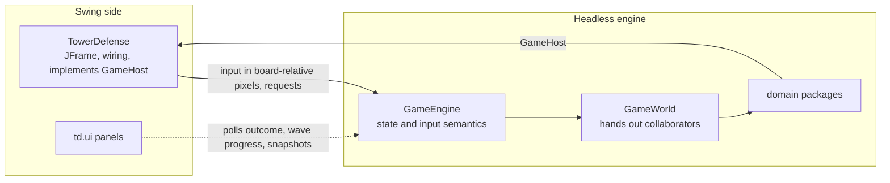
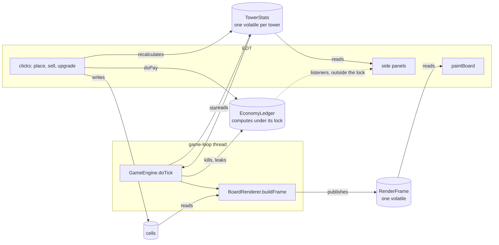
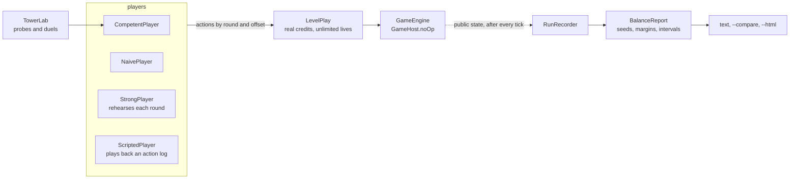

# jTD architecture overview

This describes the system as it is now: its main parts, how a tick and a frame flow, and what
crosses between threads. Why each structure was chosen, and what was rejected, is in the decision
records in [`docs/adr/`](adr/README.md). How to choose a design is in [`DESIGN.md`](DESIGN.md).
The rules are in the root and package `CLAUDE.md` files. If this file contradicts them, the rule
wins and this file is stale: fix it in the same commit.

This file is not loaded automatically. Keep it to the current shape, with no history and no
counts that drift.

## 1. The two sides



- `GameEngine` owns game state and input semantics, and runs headless in tests and in the balance
  tools. `TowerDefense` is the one class on both sides: wiring, never rules.
- `GameHost` is the engine's only channel to the UI. `GameHost.noOp()` serves displays that don't
  exist (previews, tests, harnesses).
- Records: [0002](adr/0002-headless-engine.md).

## 2. A tick

`GameLoop` runs on the `game-loop` thread with two cadences: ticks (none while paused, several in a
row when fast) and frames (a steady rate, so the board redraws while paused). Falling behind runs
one tick and resyncs.

`GameEngine.doTick` runs in a fixed order: **enemies, projectiles, zones, playtest hooks, towers.**
- Projectiles move after enemies, so a homing missile aims at this tick's positions. A projectile
  fired during the towers phase first moves on the next tick.
- Zones pulse after the projectiles, so a shell that lands this tick already pulses.
- The playtest hooks (the dev panel's own work) act like a tower that ticks first. A jam they hold
  joins the enemies' disruption before the towers sample it.
- At the end of the tick the engine settles the round: a loss before a clear, so a last enemy
  leaking the last life loses.

Records: [0007](adr/0007-owner-publishes-snapshots.md).

## 3. Threads, and what crosses them



- The owning thread publishes, and the other reads only what was published. Correlated fields
  cross as one immutable snapshot behind one `volatile`.
- The EDT owns the cells and recalculates tower stats; the game loop owns everything else and
  builds each frame.
- `EconomyLedger` is written from both threads, computes under its lock, and fires outside it.
- The engine's round state crosses as one `RoundState`, and the dev panel's round commands are
  requests the tick applies ([0019](adr/0019-edt-commands-are-requests.md)). The hover highlight
  on cells doesn't follow the snapshot rule yet (`TODO.md`).
- Records: [0007](adr/0007-owner-publishes-snapshots.md).

## 4. The world

`GameWorld` is the composition root. It hands out its collaborators rather than wrapping them,
and its own state is the installed `LoadedLevel` (one `volatile`) and the `RandomSource`. Among the
collaborators it hands out:

| Collaborator | Package | Owns |
|---|---|---|
| `BoardGeometry` | `board` | scale, board size, cell↔pixel conversion (an immutable value) |
| `EconomyLedger` | `economy` | credits, score and lives, and their listeners |
| `EnemyRoster` (an `EnemyRegistry`) | `enemy` | the live enemies, the alive count, walk-end listeners |
| `TowerRoster` | `tower` | the towers; buying, selling and clearing |
| `ProjectileRoster` | `projectile` | shells and missiles in flight |
| `ZoneRoster` | `zone` | ground zones and mines |
| `WaveAnnouncer` | `wave` | the wave-start hub (the Pulse's Event Horizon listens) |
| `DisruptionField` | `stat` | the enemies' disruption, which towers sample |

The actor packages and the world depend on each other: one cycle, accepted by design. The
boundaries that do hold are in `checkstyle-imports.xml`.

Records: [0004](adr/0004-gameworld-hands-out-collaborators.md),
[0017](adr/0017-package-cycle-accepted.md). Layers: [`DESIGN.md`](DESIGN.md) §2.

## 5. A frame

```
BoardRenderer.buildFrame(gameTime, interpolationAlpha, animationSeconds)   on game-loop
    -> one frame builder per domain type, through that type's visitor
    -> RenderFrame (immutable, AWT-free draw records in td.ui.render)
        -> Java2DFrameRenderer.paint(g2, frame)   pixels, on the EDT
        -> AsciiBoardRenderer                     text, for DEBUG logging
```

| Builder | Describes | Dispatch |
|---|---|---|
| `CellFrameBuilder` | placement and selection highlights | plain reads (one `Cell` type) |
| `ZoneFrameBuilder` | ground zones, drawn under the enemies | — |
| `EnemyFrameBuilder` | bodies, death fades, status markers, overlays | `EnemyMobVisitor` |
| `TowerSpriteFrameBuilder` | tower base and turret head | `TowerVisitor` |
| `TowerEffectFrameBuilder` | beams, blasts, pulses, auras, cones | `TowerVisitor` |
| `ProjectileFrameBuilder` | shells and missiles in flight | `ProjectileVisitor` |
| `PathMarkerFrameBuilder` | the path trail and moving chevrons | geometry only |

- All art is vector, keyed by a `Palette` role.
- Positions interpolate between the last two ticks. Cosmetics run on the wall clock.
- The live enemy info sheet is built with the frame and travels in it.
- Records: [0003](adr/0003-frames-are-described-then-painted.md),
  [0018](adr/0018-board-looks-are-role-tables.md) (looks as tables per role, planned).

## 6. Levels and paths

- **Levels.** The game boots into level select (a `CardLayout`: menu card, game card). Levels come
  from a `LevelCatalog`; the built-in one holds one holder class per level. `GameEngine.loadLevel`
  tears down the previous level first, in a fixed order, so any entry point can call it.
- **Paths.** A level authors paths in cells. `PathBuilder` turns them into pixel `Path`s through
  the level's `PathSmoothing`. `ArcLengthPath` answers "where is distance *d*" for movement and
  markers alike, and buildable cells come from the final geometry (`PathCoverage`).
- **Rounds.** Every path has the same wave count, and round *N* spawns every path's wave *N*.
- Records: [0005](adr/0005-level-load-tears-down-first.md),
  [0006](adr/0006-paths-are-pixel-geometry.md).

## 7. Stats, effects and hits

One stat formula (`td.stat`) serves both sides:
- A tower's `TowerStats` folds its base, its owned nodes, its statuses, what auras emit to it, and
  disruption.
- An enemy's `StatSheet` folds its rank's base stats, its traits and its effects, each through its
  `EffectRule`.
- `HitResolution` is the one hit formula.

Upgrade effects are data (procs, hit bonuses, statuses, targeting, capabilities). A mechanic with
its own maths is a named class. Rules between effect kinds are rows of `EffectInteractions`.

Records: [0015](adr/0015-stats-drive-buffs-towers-stay-code.md),
[0008](adr/0008-values-that-combine-have-an-algebra.md).

## 8. Tooling around the engine



- **Balance.** `td.balance` plays the real game headless and reports margins over many seeds.
- **Harnesses.** `td.PurchaseHarness` and `td.BuildHarness` compare purchases and builds.
  `td.PerformanceHarness` times ticks and frame builds against the budget in root `CLAUDE.md`.
- **The dev panel.** `td.DevControls` behind `PanelDev` queues every cheat for the game-loop
  thread.
- **Saves.** `td.save` writes a game between rounds as text, and the balance tools start plays
  from saves.
- **Previews.** The `run-jtd` skill's `PreviewBoard` and `PreviewEnemy` render a board or an enemy
  to PNG, headless.
- Logs: one file per run under `logs/`. Tests log quietly.
- Records: [0010](adr/0010-balance-is-measured-by-players.md),
  [0011](adr/0011-saves-hold-only-between-rounds.md),
  [0016](adr/0016-upgrade-node-ids-are-permanent.md),
  [0009](adr/0009-logging-and-one-fatal-boundary.md).

## 9. Rules and documents

- Checkable rules are Checkstyle. `CLAUDE.md` files hold constraints only. Design principles are in
  `DESIGN.md`, and decisions in `docs/adr/`.
- Records: [0012](adr/0012-rules-in-checkstyle-and-lean-docs.md),
  [0013](adr/0013-style-stated-in-repo.md),
  [0014](adr/0014-narrow-factories-and-shared-fixtures.md),
  [0020](adr/0020-design-docs-family.md).
