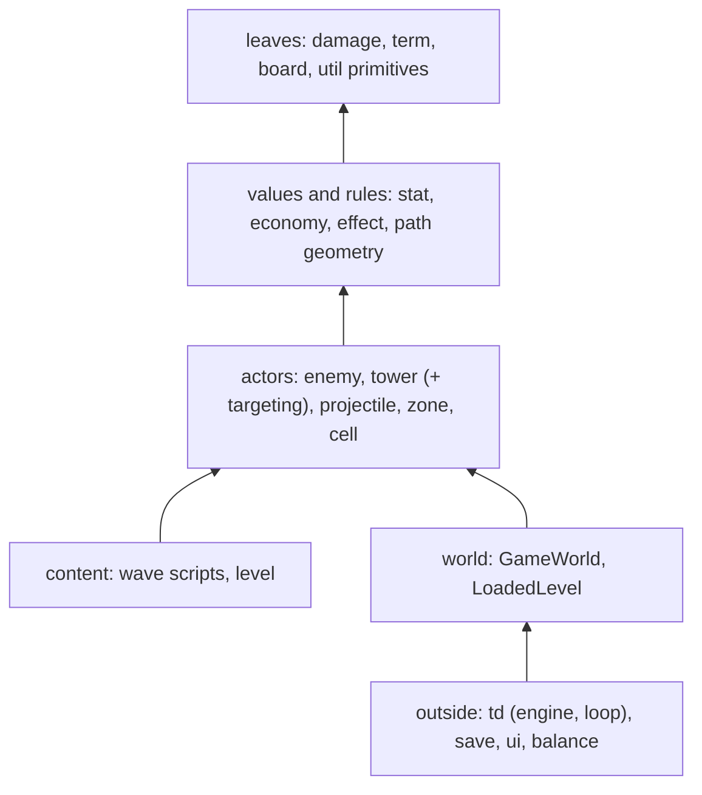

# jTD design guide

This guide is for the moment you choose a structure: a new type, package, interface, listener,
switch, parameter, state field or text format, or a change to one. It says how this codebase
decides, so the choice ends up clean and cheap to change. Read it before such a choice; skip it
for edits that keep the existing structure.

| Document | Holds | Loaded |
|---|---|---|
| `CLAUDE.md` (root) | Rules for every edit: style, threading, tests, boundaries | every session |
| `src/main/java/td/<pkg>/CLAUDE.md` | That package's constraints and "Adding a …" checklists | when the package is touched |
| `docs/DESIGN.md` (this file) | How to choose a design, and why | read before a structural choice |
| `docs/adr/` | One record per decision: what was decided, why, what was rejected | before reversing a structure |
| `docs/ARCHITECTURE.md` | The system as it is now: its parts, a tick, a frame, the threads | for orientation |
| `checkstyle.xml`, `checkstyle-imports.xml` | Rules a tool can check | every `mvn verify` |

A future UI guide (visual language, components, layout) and a UX guide (the player's flows) follow
the same shape as this one. A `CLAUDE.md` rule wins over this guide; if they disagree, one of them is
stale and gets fixed in the same commit.

The principles come from structured design (Yourdon and Constantine, *Structured Design*), Parnas'
information hiding, Fowler's *Refactoring*, Beck's *Tidy First?* and the practice this codebase
already follows. They are heuristics, not laws: a design may deviate when following one would make
the result worse, and the commit body says why.

---

## 1. The measure: what the next change costs

The cost of software is mostly the cost of changing it, and that cost is mostly coupling: how many
places one change has to reach. So every design question in this guide comes down to one test.

**Simulate the next likely change, and count what it touches.** Name the change you expect next
(another effect kind, another tower, another field in the save, another rule of the round). For
each candidate design, list the files, packages and tests that change would edit. The design with
fewer wins. A file that has to change for no reason of its own is a leak: something it should
not know has reached it.

When two designs touch the same amount, decide in this order:

1. **Correct and thread-safe.** Nothing else matters if a design can tear state or race.
2. **Fewer places per likely change** (above).
3. **Testable on values.** A design whose rule can be tested on plain values, with no fake and
   no engine, beats one that needs a fixture world.
4. **A better rung on the coupling ladder** (§3), then **on the cohesion ladder** (§4).
5. **Fewer concepts.** Fewer types, methods and rules to learn, for the same behaviour.
6. **Faster**, but only with a `td.PerformanceHarness` number that shows the difference (§13).

"Looks cleaner" is not on the list. A refactoring is worth doing only if it wins one of these.
Tidy before a change only when the tidying makes that change cheaper; tidy after when it makes the
changes after it cheaper; otherwise record it in `TODO.md` or let it go.

The package `CLAUDE.md` checklists ("Adding a tower", "Adding a kind") are the record of what each
recurring change touches today. A step in one that a better design would remove is a design debt
worth a `TODO.md` entry.

## 2. Decomposition: one decision per unit

**Split along decisions likely to change, not along steps of processing.** Each class or package
hides one such decision (a format, a formula, a rule, an order of work) so that changing it edits
one unit. This is Parnas' criterion, and it beats splitting by size or by flowchart.

**The one-sentence test.** Describe the unit in one plain sentence. If the sentence needs "and",
"or", "manages", "handles", "first … then" or "all the …", the unit holds more than one decision.
Two reasons to change mean two units. A good name is that sentence shortened: the role noun last
(`FurthestAlongPathSelector`, `EconomyLedger`).

**Match the problem.** Each unit should match one piece of the game's problem, and each link
between units should match a link in the game's rules. A link with no counterpart in the rules
(the mob that knows how the economy clamps lives) is coupling with no reason.

What each package hides today:

| Package | The decision it hides |
|---|---|
| `damage` | how damage is stored and combines |
| `stat` | the stat formula |
| `effect` | how timed effects stack and act on each other |
| `enemy` | how an enemy lives, walks and is hit |
| `tower` | how a tower attacks and grows; `tower.targeting`: whom an attack may pick |
| `projectile`, `zone` | what lives on after a shot |
| `economy` | money and lives |
| `wave` | where distance *d* along a path is, and the wave-script language |
| `level` | each built-in level's content |
| `save` | the save text |
| `term` | the game's vocabulary and the text that mentions it |
| `ui.render` | what a frame contains (AWT-free) |
| `ui` | how it all looks and is operated |
| `util` | thread and tick primitives, plus the world that hands out collaborators |
| `balance` | how a headless player plays and how numbers are judged |

`wave` and `util` hide two decisions each: known, accepted for now, and in `TODO.md`. A new package
adds its row here in the same commit.

### Where new code goes

- **New gameplay logic** goes to the domain package whose decision it is, never to `TowerDefense`
  or a `Panel*`. If no package owns that decision, ask whether it is a new decision; if it is
  likely to change on its own, it gets a new unit.
- **New content** (an enemy, an effect kind, a level, an upgrade node) is data in the package that
  owns its kind (§9). New code appears only for a new mechanic.
- **New presentation** goes to `ui`: a frame builder describes it in `ui.render` records, and only
  the Java2D painter knows pixels.
- **A new capability the engine needs from the UI** is a `GameHost` method, added when needed and
  never in advance.

### Layers

Dependencies point down this list. A lower layer never imports a higher one.

The actor packages and the world form one dependency cycle by design: actors take `GameWorld`,
which owns their rosters. Breaking it would take a narrow context interface per package, and
decision record 0004 measured that each would be about as wide as `GameWorld` itself (0017). The
boundaries that do hold are checked in `checkstyle-imports.xml`; a new boundary worth keeping goes
there, not into prose.

## 3. Coupling: how units talk

Coupling has rungs, from worst to best. Climb whenever a change touches a connection anyway.

| Rung | What it looks like | In jTD |
|---|---|---|
| **Content** (worst) | Reaching into another unit's internals | Never expose an internal array or live collection; offer queries or a fresh copy |
| **Common** | Shared mutable state | No static mutable fields; shared state lives in one owner that publishes snapshots |
| **Control** | A flag or mode argument that tells the callee which branch to take; a code returned that tells the caller what to do next | Split the callee into one method or type per mode; one behaviour per component |
| **Stamp** | A whole structure passed where a part would do | Take the narrowest type (`EnemyRegistry`, `EnemyTarget`, `HitReceiver`); `GameWorld` only when most of it is used |
| **Data** (best) | Only the values the callee needs | Pass the value |

A `boolean` parameter is fine when it is a fact (`critical`, `killed`); it is control coupling when
it chooses what the callee does. Control hidden in data is still control: a sentinel (`-1` meaning
"not yet") is a branch the caller must remember, and a value (`OptionalInt`, `none()`) is better.

**Normal, not pathological, connections.** One unit reaches another only through its interface.
A back door (writing another thread's state, a side channel between packages) multiplies: once one
exists, the next is easier. The EDT asks the engine through requests the next tick consumes
(`requestNextWave`); it never writes engine state.

**Facts go up, decisions stay with the owner.** A lower unit returns or reports what happened
(a `HitResult`, an `EnemyWalk`, an `EconomyDelta`); the unit that owns the outcome decides what it
means: the round in `GameEngine`, money and lives in `EconomyLedger`, experience in
`ExperienceAwarder`. A low unit that makes a decision whose effects land elsewhere ends up passing
flags upward or re-making the same decision in several places. This is the book's "scope of effect
within scope of control".

**No inversion of authority.** A callee doesn't tell its caller how to do the caller's job. The
upward channels are `GameHost` (engine to UI) and listeners (one owner to many unrelated
observers). A callback that steers its caller is a missing return value.

**Fan-out and forwarding.** A coordinator with many collaborators should decide and delegate, not
compute (`GameEngine.doTick` orders the phases; the rosters do the work). A unit whose methods only
forward to another is a middle man: when callers need many queries of a part, hand out a read-only
view of that part instead of a forwarding method per query.

## 4. Cohesion: what belongs together

From worst to best: a coincidental grab-bag, a logical group ("all the parsers"), temporal ("all
the start-up work"), procedural (steps that happen in order), communicational (work on the same
data), sequential (one step's output is the next's input), functional (one job). Aim for functional;
accept sequential.

- Split by reasons to change, not by size. A large class with one job is fine. A small class with
  two jobs is not.
- Don't over-split: two classes that always change together, and only together, are one unit.
- `*Util`, `*Helper` and `*Manager` are names that admit low cohesion. Find the decision the unit
  hides, and name it after that.
- A class used by several audiences that change for different reasons (the game, the renderer, an
  inspector) has as many units inside it as it has audiences. Give each audience its own view or
  snapshot (`EnemyInspection` for the inspector).

## 5. Black boxes, not grey boxes

A black box is used without knowing what's inside. Documenting a unit's quirks doesn't make it a
black box; it makes it a grey box, and every caller has to remember the quirk.

**A duty a caller must remember is a missing method or value.** Look out for an order of calls
("first … then"), a sentinel to check, "use this result, not that getter", or "callers must
handle …". Put the duty in code, then delete the rule. Patterns already in use:

- `EconomyLedger.doPay` is the atomic check-and-charge, so nobody writes `if (canPay(n)) doPay(n)`.
- `GameWorld.startWave` seeds the alive count before it announces the start, so no listener sees a
  stale count.
- `ArcLengthPath` is the one answer to "where is distance *d*", so no caller re-derives it.

A rule that stays in a `CLAUDE.md` is one the code could not hold yet. When one shows up in a
review, ask whether a method, a value or a type could hold it instead.

## 6. Object design, and SOLID as jTD applies it

**Single responsibility.** One decision per unit (§2). A class that changes for two unrelated
reasons gets split along them.

**Open/closed.** jTD extends in two ways, and both leave existing code closed:

- *Open content*: data rows and definitions. A new `EffectKind` row, `EnemyDefinition` or upgrade
  node needs no new branch anywhere.
- *Closed variants*: sealed types with exhaustive switches. A new variant is a compile error at
  every place that must decide about it, which is wanted.

A switch over a closed set has no `default`, so the compiler names every place to update. A switch
that cannot be exhaustive, because it handles only part of a wide type, means the type is too wide:
split it into one type per role.

**Liskov substitution.** Inherit only for a closed set of variants: `final` leaves, `private` base
state, and a base class that does what every leaf needs (`AbstractTower`). Anything that stands in
for a type keeps its contract, fakes included: a fake that re-implements a production rule by hand
drifts from it, so it should use the real value types inside (§12).

**Interface segregation.** Depend on the narrowest type that does the job. A consumer that only aims
takes `EnemyTarget`; one that only reads the roster takes `EnemyRegistry`. Stop narrowing where every
implementation would have to carry arguments it never uses for the sake of one of them:
`UpgradeCondition` takes the whole world on purpose (record 0004). The wide domain
interfaces listed in `TODO.md` are known exceptions; don't widen them further.

**Dependency inversion.** The engine depends on what it needs, never on Swing: `GameHost` is its
port to the UI, `RandomSource` its only source of chance, and every collaborator arrives through
the constructor into a `final` field. `GameWorld` is the composition root that hands collaborators
out rather than wrapping them, so each call site shows what it uses.

### Choosing how to dispatch

| Situation | Choose | Avoid |
|---|---|---|
| Variants differ only in numbers or wording | A data row (`EffectRule`, a definition) | A class per variant |
| A closed set of domain variants, decided in many places | A sealed type and exhaustive `switch`, or the domain visitor (`TowerVisitor`) when the set is a class hierarchy | `instanceof`, casts, a `default` branch |
| Behaviour the variant owns and only it needs | A method on the variant (polymorphism) | A switch elsewhere that re-decides it |
| A new behaviour bought or added at runtime | A small strategy object composed in (a `Mechanic`, a `Proc`, a `TargetQuery`) | A flag on the owner |
| A visitor with a single visit method over a single class | Nothing: call the class | A visitor used as a cast |

**Tell, don't ask, within reason.** Ask an object to do work that needs its own data, rather than
pulling its data out and deciding outside it. When a caller only needs to read (a renderer, an
inspector), hand it a snapshot or read-only view, not a chain of getters into live state.

**Composition over inheritance.** A complex actor is assembled from parts that each own one concern
(`DefinedEnemyMob` composes motion, moments, health and effects). Don't put a base class back in to
share code.

## 7. A functional core

**Values first.** A domain value is an immutable record with named factories, grows by `withX`
copies, and models absence as a value (`none()`, `empty()`, `Optional`), never `null`. Validation
lives in its constructor, so an invalid value cannot exist.

**Values that combine get an algebra:** an operation, its identity, and an absorber if there is one.
Then combining needs no special cases. Examples:

- `Damage.plus` with `none()`;
- `StatModifiers.plus` with `none()`;
- `TargetQuery.and` with identity `all()` and absorber `none()`;
- `EconomyDelta`, which turns one game event into one value and one notification;
- `PathSmoothing.none()`, the identity where there would otherwise be a null.

**Compute, then apply.** Work out the result as a value from values (`HitResolution` resolves a hit,
a `StatSheet` resolves stats, a query composes targets). Apply the side effects at the end, in one
place (deal the damage, publish the snapshot, fire the event). Code that mutates or fires halfway
through a calculation can't be tested or reused without its world.

**Derive, don't store.** What can be computed from the current inputs is computed, not kept in step
by hand. A tower's received buffs are a fold of every emitter's `buffFor` on each recompute, never a
stored field.

**One state, one value.** A unit whose behaviour depends on where it is in a sequence (a round, a
fire cycle, a walk) keeps that position as one immutable value with pure transitions, rather than
as several fields that must agree. The transitions can then be tested without the unit. A unit that
resumes each tick where it left off (`FireClock`, `PathMotion`) owns that resume state itself.

**Query or command.** A method either answers or acts. When it must do both, as a check-and-act does
(`doPay`, `buyUpgrade`), it is atomic and its result is the only way to see what happened. A method
that acts and also hands out state for later use (stats that are valid only for this attack) should
return a value that carries that state, so a caller cannot read the wrong one.

Randomness, time and threads are inputs: an injected `RandomSource`, explicit ticks, an owner thread.

## 8. Concurrency is a design choice

- **One owner per piece of mutable state.** The game-loop thread owns the simulation, the EDT owns
  Swing and the cells. Whatever crosses threads is a published, immutable snapshot.
- **Correlated fields cross as one value.** Fields that must agree with each other cross in one
  snapshot behind one `volatile`, read through one accessor. Several separate `volatile`s that must
  agree are a torn read waiting to happen.
- **Requests, not writes.** A thread that wants something changed on another thread's state asks;
  the owner applies the request on its next turn.

The rules are in root `CLAUDE.md` ("Threading"); the reasons are in record 0007.

## 9. Flexibility and generality

**Content is data, mechanics are code.** Behaviour that varies only in numbers, words or
combinations of existing pieces is data, read by general code. A new kind of behaviour is a named
class. Stop before data becomes a language: there is no scripting, and a mechanic with its own
maths is a class (record 0015).

**Generality by exclusion.** A general unit comes from leaving special cases out, so that a smaller
common core is left, not from adding an option for every caller. No parameter, hook, listener or
interface without a second user. Delete a channel nobody listens to.

**Bind late only where a second binding exists.** A strategy, a registry or a configuration point
pays for itself when two things plug into it. Before that it is speculation.

**Push one-off setup up.** What only one caller needs (a level's own enemies, a test's fixture)
stays with that caller, not in the general unit.

## 10. Chains that can trigger themselves

Some work can cause more of itself in the same tick: a kill hook that kills, an effect that applies
effects, a listener that changes what it listens to. Every such chain **stops in code**, and a test
pins the stop. Choose one of:

- a guard (a kill made from inside the kill hook triggers nothing);
- deferral to the next tick (a hex pays out at the start of its caster's tick, never inside the hit
  that caused it);
- a once-per-target ledger;
- top-up semantics (a share brings the receiver up to the carrier's level and never adds on top, so
  two carriers settle).

A chain with no stop is a finding, even if no content makes it loop today.

- Listeners fire outside locks (`EconomyLedger`), and listener lists are copy-on-write.
- Never mutate a collection while iterating it.
- Recursion over data needs a base case and a guard against a cycle the data could contain.

## 11. Boundaries: formats and faults

**One unit owns a text format.** It reads and writes the format, and its structure mirrors the
format's: a rule per production in a grammar (`WaveScriptGrammar`), a line kind per line in the
save (`GameSaveText`). Everything else sees domain values only. Where the format's shape and the
domain's shape differ, put an intermediate value type between them rather than bending one to fit
the other. A tool that reads the format (suggestions, highlighting) asks the owning unit, never
parses it a second time.

**Detect faults early, at the boundary.**

- Validate where data enters (parsing, loading, construction). Invariants go in constructors.
- Bad built-in content fails at start-up with `GameStartupException`, which names what is wrong and
  where. It never fails mid-game.
- Prefer a check the compiler or class loading makes (an exhaustive switch, a table checked complete
  when built) to one that throws in play.
- Fail loudly: log or rethrow, never swallow.

## 12. Design for testability

A design is better when its rules can be tested cheaply. That is a design property, not a test
property.

- **A rule that can be tested on values** (a record, a pure function, a state transition) needs no
  fake and no world. Prefer designs that leave the rule there.
- **A gameplay rule is provable in `GameEngineTest`** through the public API with explicit ticks.
  If a rule can't be reached that way, the boundary is in the wrong place.
- **A fake stands in for a contract, not for logic.** Hand-written fakes record calls and return
  what the test set. Where the real rule is a value type (effects, stats, damage), the fake uses the
  real one, so it can't drift.
- **Narrow factories and shared fixtures absorb change.** A record built through its factory or
  `td.fixtures` survives a new component without test edits. A test that needs editing for a change
  it isn't about is a design leak.
- **Content is data and isn't tested.** Mechanics are tested on definitions built in the test
  (root `CLAUDE.md`, "Tests").

## 13. Performance and structure

Make it correct and modular first, then measure. Bend structure for speed only for a hot path that
`td.PerformanceHarness` shows over budget, and keep the bent part small and isolated: the
allocation-free `StatSheet` path is one class with its reason stated, not a style spread over the
codebase. A design that would push the frame build or the tick over budget is rejected on that
number, not on a guess.

## 14. Quick guide

| When you need to … | Choose | Avoid | § |
|---|---|---|---|
| decide where new code goes | the package whose decision it is; a new unit for a new decision likely to change | `TowerDefense`, a panel, `*Util` | 2 |
| choose between two designs | the one whose next likely change touches fewer files and tests | "cleaner" without a count | 1 |
| make a callee behave two ways | two methods or two types | a `boolean` or mode argument | 3 |
| give a unit what it needs | the values, or the narrowest type | the whole world for one field | 3, 6 |
| tell others something happened | return a value if the caller acts on it; a listener if unrelated owners do | a callback that steers the caller | 3 |
| decide an outcome (money, lives, round, XP) | the owner of that outcome, from facts reported to it | deciding it in the actor that noticed | 3 |
| share state between threads | one immutable snapshot behind one `volatile`; requests to the owner | several `volatile`s; writing the other thread's state | 8 |
| keep track of a sequence (round, cycle, walk) | one state value with pure transitions | fields that must agree | 7 |
| compute something that has effects | compute a value, then apply it once | mutating halfway through | 7 |
| combine values of one kind | an algebra: operation, identity, absorber | special cases for "none" or `null` | 7 |
| grow a record | a narrow factory and `withX` | a wider constructor | 7 |
| vary content | a data row or definition | a class or a `switch` per entry | 9 |
| branch over a closed set | a sealed type with an exhaustive switch, or the domain visitor | `instanceof`, `default` | 6 |
| switch over part of a wide enum | split the enum into one type per role | a `default` that throws | 6, 11 |
| add a mechanic | a small composed strategy (`Mechanic`, `Proc`, query piece) | a flag or a field on the owner | 6 |
| make callers follow an order | one method that does the steps in order | a rule in a `CLAUDE.md` | 5 |
| return "not yet" or "nothing" | `Optional`, `OptionalInt`, `none()` | `-1`, `null` | 3, 7 |
| read or write a text format | its one owning unit; an intermediate value where shapes differ | a second parser | 11 |
| let work trigger more work | a stop in code (guard, deferral, ledger, top-up) and a test for it | trusting content not to loop | 10 |
| make something general | leave special cases out; wait for a second user | options for everyone | 9 |
| speed something up | structure first; a harness number before bending it | optimizing by feel | 13 |
| put a new rule somewhere | see §15 | — | 15 |

## 15. Keeping this guide right

**Where a rule goes.** Put each rule in the cheapest place that enforces it:

1. Checkstyle or a test, if a tool can check it.
2. The package `CLAUDE.md` it governs, if it is local.
3. Root `CLAUDE.md`, if every edit needs it.
4. This guide, if it is about choosing a design.
5. A decision record in `docs/adr/`, for why one specific structure was chosen. `ARCHITECTURE.md`
   only describes the current shape.

**How this guide stays true:**

- It holds principles, not inventories. No counts, sizes or thresholds the code holds. Examples
  name stable types, one or two per principle.
- A rename that breaks an example fixes it in the same commit.
- A principle the code contradicts is fixed the same way as any stale rule: change the code or the
  principle in the same commit, or add a `TODO.md` entry naming both.
- A new principle comes from a review finding or a recorded decision, not from taste. It names the
  change it makes cheaper.
- When the guide grows long, cut principles nobody has used rather than adding sections.
