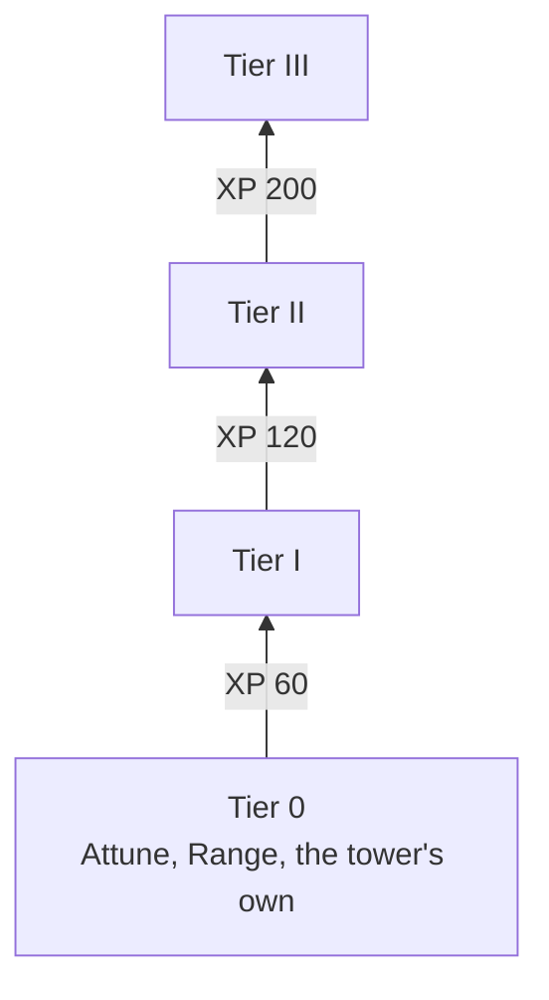

# Playing jTD

How the game plays: controls, towers and their upgrade trees, enemies and the effects on them. The tables of
towers, enemies and levels are in [`CONTENT.md`](CONTENT.md); what a wave script can write is in
[`WAVE-SCRIPTS.md`](WAVE-SCRIPTS.md).

## A level

The game opens on a level-select screen. Pick a level to start it; each level brings its own
board size, path, wave list, starting credits and starting lives.

Buy a tower from the toolbar (or with its key, `q`–`u`), then click a buildable
cell to place it; hovering a toolbar button opens a tooltip of the tower, and the side panel shows
it in full while you place it. The click that builds a tower selects it, as does clicking a placed
tower later: the side panel shows its stats and its own upgrade
tree — four tiers, drawn whole as rows climbing from the bottom.
Start each wave yourself when you are ready — waves do not auto-advance. A level may pay bonus credits, scored
alike, for each round cleared with no enemy leaked: the Waves panel marks a round's bounty and bonus (`24+5`), and the
cash icon flashes when the bonus pays. Hover that mark, or a round's skull in the Wave popup, for what each one means.

## Controls

Every button shows its key on a chip in its top-left corner.

| Key                             | Action                                                                                               |
|---------------------------------|------------------------------------------------------------------------------------------------------|
| `q` `w` `e` `r` `t` `y` `u`     | Select tower 1–7 for placement                                                                       |
| `Esc`                           | Cancel tower placement; cancel a question                                                            |
| `0`–`4`                         | Buy the selected tower's tier 0 to IV singles (nodes in no cluster) it can afford, left to right     |
| `Space` or `P`                  | Pause; while paused or between waves, play on at the last speed and send the next wave               |
| `d` `f` `g`                     | Normal, fast, super fast speed; each also sends the next wave if it is waiting                       |
| `Delete`                        | Sell the selected tower                                                                              |
| `m`                             | Back to the level-select menu (asks to confirm mid-level)                                            |
| `z`                             | Restart the last wave sent, back to how it was sent (asks to confirm)                                |
| `Enter`                         | Confirm a question                                                                                   |
| `1`–`9` on the menu             | Start that level                                                                                     |
| `Ctrl`+`Shift`+`D`              | Open or close the dev panel (playtesting controls; hold `Alt` to see their keys)                     |

Mouse: move to preview placement, click to place or to select a placed tower. In the Upgrades panel,
hovering a node shows what it does and what a click would do; a click buys it with every node it
needs first, in one payment or not at all, and a right-click on an owned node downgrades it (after a
confirmation, unless all of it refunds in full) with every node that depends on it. Between waves, a click on a
cluster's other member switches to it. A click on an open tier's numeral strip, whose foot shows its digit key, does
what that key does: it buys, left to right, each of the tier's nodes in no cluster that is on offer and affordable. Click a moving enemy, invisible ones too (when not placing a
tower), to inspect it: the side panel shows its live health, stats, effects and traits, updating even while paused,
and keeps a "Killed" or "Leaked" line after it's gone until your next click. Hovering an enemy in
the wave preview opens a tooltip of the stats that enemy type spawns with.

## Towers and upgrades

A tower's info pane shows Range, then how it deals damage: a hit tower its Physical or Magic damage (/hit), Fire
rate (/s) and DPS (/target: damage times fire rate times the average crit, before the target's defences), the Scorcher its
Flame (/s) and Stream fuel (what one stream pours into an enemy), the Obelisk its damage a second, a placed tower its Wave DPS (what it really
dealt this wave, over the span from its first damage to its last, once that span reaches a second); then every other stat off its default
(Crit damage whenever it can crit, Effect duration whenever it applies an effect), and what a Beacon gives.
A changed value has an arrow for which way it moved, and is red only when that is worse; hovering a row says what
the stat does and what made it. An upgrade's hover shows each change and what the row it moves would become
(`Fire rate +25% 1.3 → 1.6 /s`).

The shop and the board call the towers Sniper, Burst, Mortar, Scorcher, Aerie, Obelisk and Beacon
(keys `q` `w` `e` `r` `t` `y` `u`, in that order). A Burst that forks is called a Stormcaller or a Hexer.

An attack-speed bonus adds to the attacks a second, so +100% is twice as fast; bonuses add up, and a Jamming enemy
takes 30% away and shrinks range by 0.6 cells. The rate need not be a whole number of ticks: a tower remembers
what is left over, so +10% on the Obelisk, which hits every tick, gives 22 hits in 20 ticks and a second hit in
the tick the fractions add up. No tower runs more than ten times faster than its
base, or slower than a quarter of it.

The price is the first copy's: each copy of a tower already on the board makes the next one cost
25% more than the one before it (compounding: the 10th copy costs about 7.5 times the first), and the
shop shows the current price. Selling refunds three quarters of what the tower
and its upgrades cost.

Every tower, the Beacon included, has its own upgrade tree of four tiers, shown in place of the
wave preview once the tower is selected. A tier opens with XP alone (Tier I at 60, Tier II at 120, Tier III at 200);
every tower an enemy reached earns its bounty as XP when its walk ends,
killed or leaked (a Beacon earns with the towers it lights). Once a tier is open its upgrades cost only credits, and
a tier may give the tower stats or a perk of its own, free from the moment its XP opens it and never refunded: its tier node,
first in the tier's row and marked with its numeral, which no click buys or sells. In a
tier an upgrade stands alone, follows one it needs (in the same tier or the one below), or belongs to a cluster:
one framed set of which a tower keeps one active, switched for free between waves, which sells back what came
after the old one. Attune, in Tier 0, gives each tower its own mechanic. The Burst's Stormcaller or Hexer is a
Tier I cluster like any other, and its pick makes it a Stormcaller or a Hexer; switching sides later works only
between waves and sells the old side's upgrades. A downgrade takes a node back with everything that needs it, refunds three quarters of what
they cost (selling afterwards pays what selling would have) and reopens the choices they made. Upgrade
prices are multiples of the tower's price. A tower stands on one plinth step for each tier it has open, and its
foundation grows wider and richer with each; when a tier opens, the new foundation spreads over the old with a ring
in the tier's colour. A green arrow in a tower's top-left corner says it can buy an upgrade now. The Upgrades panel shows the tower's XP on
its title line, each tier as a band with its numeral, and under a locked tier's band a line filling with the XP
toward its gate. The Info pane shows a tier's free stats apart from the tower's base, as it shows an upgrade's.
A tower that picks one target takes, in order: an enemy with Priority, one about to leak (most of the way along its
path), one that taunts, then its own choice.
A round node changes a number and a square one adds an ability; where a tree holds two builds, one leans left and
the other right. Where the builds are the two members of a cluster (the Burst's Stormcaller and Hexer), their
nodes share slots: a slot shows the picked side's node, the hovered side's while you hover one, and a dashed `?`
before either is picked. A tower in the Towers bar is drawn as a node is, its price on the tag at its foot. A small badge on a node's corner stands for a need more than a tier below. Selecting a Beacon marks every
tower in its light with a small gold diamond.

## Enemies

An enemy is made of four kinds of thing, and each belongs to exactly one:

- **Stats** are the numbers every enemy has, zero or not: Move speed (cells/s), Armor and Magic resist (a hit
  keeps `100 / (100 + armor)` of itself), Plating and Insulation (dmg every physical or magic hit loses; Flat
  penetration ignores them), Resilience (against crits; 100 is crit-immune, a negative value makes crits stronger), Agility
  (aimed shots miss; a negative value means no dodges and more crits), Physical, Magic and Damage over time taken (%), Spirit (what its regeneration restores and its shields hold),
  Regeneration (hp/s; at a negative value it crumbles, losing health on its own) and Tenacity (how long its debuffs last: `100 / (100 + t)` of their time at a positive
  value, `1 - t / 100` at a negative one; it cuts a pool's damage with its time). An immunity is a trait of its own: that effect never takes hold.
  The info pane lists the ones off their default, each with its unit and, where the number alone says little, what
  it does (`Armor 30 -23% dmg`); hovering a row explains it and, live, what made it. Nothing is drawn on the board
  for them. Under a selected enemy's health bar a strip shows what its shields hold, tinted where a shield takes only
  physical or only magic damage; hovering the Shield or Heal icon lists each source's share and how long it has.
- **Traits** are what an enemy has that most don't, always on: a resistance or immunity to an effect,
  regeneration, a stat that follows its state (faster or harder to hit when hurt) or adapts to how the
  level is played.
- **Abilities** are what it does at a moment: a trigger (a timer, a threshold, a hit, a dodge, its death)
  and an action (put an effect on itself or its allies, or spawn enemies).
- **Effects** are timed statuses on an enemy, from a tower or an ability. The main ones are drawn on the enemy; others show as a small dot under it.

From Elite every enemy carries some of each stat, small where it is off its identity; the exceptions are
plating and insulation (only the enemies built around them), agility on the heaviest (below zero on the Juggernaut, the
Elite Golem and the Wardens; none on the eggs) and resilience on the Wardens, whose shield answers crits.
### Rank

Every enemy spawns at one of five named ranks — **Grunt, Soldier, Veteran, Elite, Boss** — shown
as a badge on its body rather than as a number. A wave's script can name the rank its slots default to in its head
(`soldier: 8 walker`), and is Grunt when it names none; any slot can name a different rank inline, before the enemy id (`elite walker`) or before a spawn
shape (`elite swarm 4 walker`). The Walker sets the ladder: its health climbs a curve that bends upward to 32 times the Grunt's, so each
rank adds more than the one before, an Elite is worth more than two Veterans and a Boss two Elites; its
bounty grows only with the square root of its health, so a tougher rank asks for more damage per credit (a
Walker has 75, 138, 458, 1175 and 2400 health and pays 2, 3, 5, 8 and 11). Every other enemy's health is
written rank by rank, and its higher ranks carry stronger stats, traits and abilities rather than health alone, so
a late round asks for upgraded towers that strip more of them. The Walker is the weakest enemy of every rank: none
but the Courier and the Mite weigh less; `td.balance.EnemyPowerReport` measures the weight (`docs/BALANCE.md`). A kill's score is weighted by
rank too — a Boss-rank kill is worth disproportionately more than a Grunt-rank one of the same
bounty. Every enemy defines all five ranks, and gains traits or abilities as it climbs, except the
spawnlings, which are one rank each, and the Warden chain, which is unique: every stage and egg is a
Boss whatever rank its wave asks for (a non-`boss` rank keyword before it fails the level load), and
the reinforcements a Warden calls come two at a time as Elites, every five seconds. Elite and Boss Walkers and Menders and the
Boss Knight carry adaptive armor: it resists whichever damage type (physical or magic) has landed most this level, from not
at all at an even split up to full strength against a one-type defence.

### Status effects

Towers and enemy abilities put timed effects on enemies. A burning enemy burns, a frozen one is inside ice and a
shielded one is inside a bubble. Effects with no picture show as one small dot per group under the enemy: a debuff, a mark
that sets it up for another tower, or a buff. Selecting an enemy shows each effect as an icon whose tooltip says what it does.

| Effect | Group | Side | What it does |
|---|---|---|---|
| Chill | Control | Debuff | Slows by what its source gives; only the strongest slow counts, and speed comes back over its last 0.5 s. |
| Burn | Affliction | Debuff | A pool of fuel that it deals in full, faster the more it holds: 100 in 4 s, four times that in twice the time; fuel adds up whoever gives it, with no cap, and Tenacity shrinks it as it comes in; it adds a stack of Scorch every 0.5 s while it lasts, and every tower can see and aim at it. |
| Freeze | Control | Debuff | Stops it where it stands and keeps its abilities from firing; it can't dodge: its Agility counts as none unless it is lower still; time under it shortens the next one, and walking wins that back, more slowly at higher rank. |
| Shield | Boon | Buff | Takes a hit before armor does, until its amount is spent or it runs out; more Spirit makes it hold more, shields from different sources add up, and damage over time goes past it. |
| Invisibility | Boon | Buff | Towers can't aim at it, though damage on an area still reaches it. |
| Heal | Boon | Buff | Adds to its Regeneration while it lasts; heals from different sources add up. |
| Vulnerable | Weakness | Debuff | Each stack: Physical damage taken and Magic damage taken +15%, up to 3 stacks; each tower keeps its own share for as long as it keeps it up. |
| Reveal | Mark | Debuff | Every tower can see and aim at it, and it can't gain Invisibility. |
| Poison | Affliction | Debuff | A pool of fuel that it deals in full, faster the more it holds: 100 in 4 s, four times that in twice the time; fuel adds up whoever gives it, with no cap, and Tenacity shrinks it as it comes in; it adds a stack of Sicken every 0.5 s while it lasts. |
| Scorch | Weakness | Debuff | Each stack: Resilience -1, up to 200 stacks; what adds stacks holds them 5 s, and what builds them over time holds them while it lasts; after that it loses a stack every 1 s. |
| Radiation | Affliction | Debuff | Magic damage that halves at a steady pace as it runs, until it deals under 0.5 a second; a second dose adds to what is left of the first; while it lasts its Regeneration can't rise above 0, so a Heal restores nothing. |
| Sicken | Weakness | Debuff | Each stack: Spirit -1, up to 200 stacks; what adds stacks holds them 5 s, and what builds them over time holds them while it lasts; after that it loses a stack every 1 s. |
| Sunder | Weakness | Debuff | Each stack: Armor -5, up to 20 stacks; what adds stacks holds them 5 s, and what builds them over time holds them while it lasts; after that it loses a stack every 1 s. |
| Expose | Mark | Debuff | Each stack: Agility and Resilience -25, more and stronger crits on it, up to 3 stacks; each tower keeps its own share for as long as it keeps it up. |
| Mark | Mark | Debuff | The next hit on it is a crit, which spends this. |
| Priority | Mark | Debuff | Physical damage taken and Magic damage taken +15%, and a tower that picks one target picks it. |
| Daze | Control | Debuff | Stops it and keeps its abilities from firing, like Freeze; it can't dodge: its Agility counts as none unless it is lower still. |
| Charge | Mark | Debuff | The next hit on it from another tower lands 30% of that hit again as magic, twice that on a crit, for the tower that applied it. |
| Doom | Hex | Debuff | When it ends, it takes a share of all the damage it took while it lasted, as shadow damage. |
| Blight | Hex | Debuff | It has Poison for as long as this lasts, and a slow that grows to its strongest as it ends. |
| Backlash | Hex | Debuff | Its Regeneration deals it damage instead of restoring health, and a Heal or a Shield strikes it at once with all it would give instead (a Heal it already had too); a renewed Heal strikes only what it adds. |
| Reckoning | Hex | Debuff | When it dies, each Doom from the same tower near it releases at once and starts again. |
| Silence | Control | Debuff | Its abilities don't fire; abilities on death and auras still do. |
| Anchor | Control | Debuff | Holds Move speed to at most 75% of its base, whatever raises it, and it comes back over its last 0.5 s. |
| Unravel | Weakness | Debuff | Each stack: Magic resist -5, up to 20 stacks; what adds stacks holds them 5 s, and what builds them over time holds them while it lasts; after that it loses a stack every 1 s. |
| Brittle | Weakness | Debuff | Physical damage taken +30%. |
| Toll | Weakness | Debuff | Time spent in an Obelisk's field, a stack a second; each stack: Physical damage taken and Magic damage taken +4%, up to 10 stacks; what adds stacks holds them 5 s, and what builds them over time holds them while it lasts; after that it loses a stack every 1 s. |
| Drag | Control | Debuff | Slows by as much as the field gives, deeper with every stack of Toll; only the strongest slow counts, and speed comes back over its last 0.5 s. |
| Wither | Weakness | Debuff | While it lasts its Regeneration can't rise above 0, so a Heal restores nothing. |
| Dead Zone | Weakness | Debuff | Spirit -100, so Heal and Shield are worth nothing. |
| Crack | Weakness | Debuff | Each stack: Plating -5, up to 10 stacks; each tower keeps its own share for as long as it keeps it up. |
| Singe | Weakness | Debuff | Each stack: Insulation -5, up to 10 stacks; each tower keeps its own share for as long as it keeps it up. |
| Tar | Weakness | Debuff | Slows by 40%; only the strongest slow counts, and speed comes back over its last 0.5 s. |
| Bleed | Affliction | Debuff | Physical damage for every cell it travels, ignoring Armor and Plating; standing still, it takes none. |
| Soulfire | Affliction | Debuff | A pool of fuel that it deals in full, faster the more it holds: 100 in 4 s, four times that in twice the time; fuel adds up whoever gives it, with no cap, and Tenacity shrinks it as it comes in, its own beside Burn and Poison; it adds a stack of Scorch and Sicken every 0.5 s while it lasts, and every tower can see and aim at it. |
| Sprint | Boon | Buff | Move speed +60%. |
| Hasten | Boon | Buff | Move speed x2; Freeze and Daze still stop it. |
| Resolve | Boon | Buff | Each stack: Physical damage taken and Magic damage taken -1%, held at as many stacks as the ally that gives it has to give; away from it, it loses a stack every 1 s. |

### Tower terms

Buffs, debuffs and mechanics that towers carry or leave on enemies.

| Term | Side | What it does |
|---|---|---|
| Steady Aim | Buff | Each shot adds a stack, kept across targets and kills; 3 s after the last shot a stack fades, then the next. |
| Frenzy | Buff | Faster attacks for the next few shots; a second one starts them over. |
| Haste | Buff | Faster attacks for a while. |
| Fourth Shot | Buff | A shot that is sure to crit. |
| Hollow Point | Buff | A shot that hits harder. |
| Silver Round | Buff | A shot of magic damage that ignores some magic resist. |
| Magazine | Buff | The shells it has ready, in the order it fires them; a new one at the back draws its kind by lot, each kind as likely as its weight among the kinds it owns. |
| Heavy | Buff | A shell that hits harder than a Normal one and flies slower. |
| Nuke | Buff | Two Heavy shells fused: a harder hit in a wider blast that leaves fallout applying Dead Zone and Sicken, and a flash that gives every enemy on the board Radiation. |
| Payload | Buff | A special shell: the Mortar's damage as magic, and ground it leaves where it lands. |
| Napalm | Buff | A Payload that leaves flames that apply Burn. |
| Tar Shell | Buff | A Payload that leaves tar applying Tar and Poison. |
| Cryo | Buff | A Payload that leaves frost dealing magic damage and applying Chill, and Freeze to an enemy that stays. |
| Flare | Buff | A Normal shell that also leaves a flare lasting until the wave ends; every enemy that enters it gains Reveal. |
| Barrage | Buff | The front shells loaded together and fired one after another at one target. |
| Carpet Bombing | Buff | The front shells loaded together, a Normal between each two, and laid along the path from the target back toward where the enemies come from. |
| Frost | Buff | The plain missile: it applies Freeze to the enemy it hits. |
| Ruby | Buff | A missile that deals more damage, and whose Freeze also holds an enemy immune to it. |
| Shade | Buff | A missile that deals Shadow damage and more of it, applies Wither for as long as its Freeze. |
| Swarm | Buff | Missiles at once, one at each enemy in range, soonest out first, and round again while missiles are left. |
| Hatching | Buff | Missiles that hatch on top of the Nest, one after another, and launch first while it keeps loading. |
| Ice Wake | Buff | While a Freeze the tower landed holds, every enemy walking close past the ice gains Chill. |
| Light | Buff | A Beacon's circle: every enemy in it gains Reveal, while inside and a moment after, and every other tower whose centre is in it is Lit; lights that overlap stack. |
| Lit | Buff | In a Beacon's Light: it takes less of the jam and the blinding enemies put on it. |
| Spotlight | Buff | The lantern's beam holds one enemy in the light until it dies or leaves, then picks again; the held enemy has Priority. |
| Nest | Buff | The missiles it holds ready: it loads one whenever it has room, so it is full at every wave start, and with an enemy in range they launch one after another, each picking its own target. |
| Jammed | Debuff | An enemy nearby slows its attacks and shortens its range. |
| Flame | Buff | Fuel a second the stream pours into the Burn of each enemy in the cone. |
| Stream | Buff | How long it pours before it reloads; it keeps its target the whole stream while that enemy lives and stays in range, and with no enemy left in range it runs its time out into the air. |
| Core | Buff | The middle of the cone's width, where its target always stands; it pours more. |
| Dragon's Breath | Buff | A longer stream with a short reload, at a weaker flame. |
| Sundial | Buff | The stone's shadow, turning once around it every few seconds, past the field; every enemy it passes takes an aimed hit and a stack of Toll. |
| Frailty | Buff | Each stack of Toll makes the enemy take more damage from every source. |
| Shadow | Buff | Magic damage that goes past Shield and insulation; magic resist still holds. |
| Flashover | Buff | A hot Burn in the stream spreads: the enemies beside it take part of the flame too. |
| Thermal Shock | Buff | More flame into an enemy another tower holds with Chill, Freeze or Daze. |
| Meltdown | Buff | An enemy's armor and plating add to the Burn it takes, a share for each point. |
| Kinship | Buff | Towers in a Beacon's Light learn faster for every other kind of tower in the same light. |
| Mentor | Buff | The tower in a Beacon's light that has learned least learns twice as fast. |
| Breakthrough | Buff | A tower in a Beacon's light opening a tier teaches every other tower in it a little. |
| Daylight | Buff | An enemy in a Beacon's light gives its allies no aura: no shroud, command, mending, ward or jam reaches out of it. |
| Prism | Buff | A Beacon's light carries the mark of every kind of tower it lights; the mark fades by its own rule once the enemy leaves. |
| Shatter | Buff | As a Freeze the tower landed ends, the ice bursts on the enemies around it. |
| Arc | Buff | Lightning a primed stone carries from where it lands, jumping from enemy to enemy as magic. |
| Hex | Buff | A curse a Hexer casts with its Soul; each kind does its own thing. |
| Static | Buff | Every enemy its stones or their lightning damage carries a stack, one per Stormcaller; badly hurt, the enemy discharges into itself for each stack and pays each Stormcaller that tagged it in Spark. |
| Soulbrand | Buff | Every enemy its stones damage carries a stack, one per Hexer; when it dies it bursts for each stack, and pays each Hexer that tagged it in Soul. |
| Spark | Buff | The Stormcaller's currency: its stones earn it by the damage they deal, its passive by the enemies that discharge; all of it goes into each of its abilities at once. |
| Soul | Buff | The Hexer's currency: its stones earn it by the damage they deal, its passive by the enemies that die; all of it goes into each of its abilities at once. |
| Shockwave | Buff | A discharge into every enemy in range, as magic. |
| Thunderstrike | Buff | Lightning onto the healthiest enemy in range, as magic, and leaves it Dazed. |

Stacks wear off one per second once nothing adds more, and every other debuff runs out on its own clock, whatever the enemy's spirit. Effects don't change one another, with two exceptions: a pool earns its marks while it lasts, and a Reveal keeps Invisibility out.

## Ground zones

A tower can leave a patch of ground that keeps working after the shot that made it. A zone pulses
twice a second on every enemy inside (hidden ones too), credited to the tower that made it, and the
pulse never crits. Two zones of one kind never stack: an enemy standing in both takes one pulse.
Zones combine only through what they leave on the enemy: only the strongest slow counts, and a burn keeps
burning through a freeze.

| Zone           | Made by                    | What it does to enemies inside |
|----------------|----------------------------|--------------------------------|
| Burning ground | Mortar's Napalm            | Burns them |
| Tar            | Mortar's Tar Shell         | Poisons them and leaves them Tarred (slowed 40%) |
| Frost ground   | Mortar's Cryo              | Chills them, and freezes one that stays inside a while; a frozen one's wait pauses |
| Fallout        | Mortar's Nuke              | Drains their spirit and leaves them in a Dead Zone |
| Flare          | Mortar's Flare             | Reveals them for 3 s; it lasts until the wave is over, and a Mortar keeps only its newest three |
| Healing ground | Mender, from Soldier       | Heals them; it lasts 5 s |
| Haste ground   | Runner, from Veteran       | Hastens them (twice the speed) for a second after each pulse; it lasts until the wave is over |
| Ward mine      | Knight, from Elite         | Armed a second after it is laid; the first enemy to step on it gets a Shield, and it is gone; it lasts 8 s |
| Blinding field | Juggernaut, from Veteran   | Works on towers, not enemies: every tower inside misses 75% of its hits, whatever hits them again; fields never stack, the strongest counts; it lasts until the wave is over |

## Crits and dodges

Only a hit can crit: a shot, a blast, a beam pass. Damage over time (a burn, a poison, a field)
never does, and a stream is no hit. Each tower has its
own Crit damage (150% unless an upgrade raises it). A guaranteed crit lands whenever the enemy's
resilience is below 100; at 100 nothing crits. Negative resilience makes crits hit harder, and negative agility multiplies their chance (-50 turns 20% into 30%);
Each stack of Expose takes 25 agility and 25 resilience. Armor and magic resist never go below 0.

An enemy with agility can dodge a hit aimed at it alone: the Sniper's shot and its Ricochet bounces.
The chance is `agility / (agility + 100)` (25 dodges 20%, 100 dodges 50%),
after the tower's accuracy, which cancels agility point for point. A dodged hit deals nothing, can't
crit and sets off nothing a hit would. Area damage,
damage over time, arcs and missiles are never dodged, and neither is a
guaranteed crit, so a Marked enemy can't dodge. A frozen or Dazed enemy can't dodge at all.
