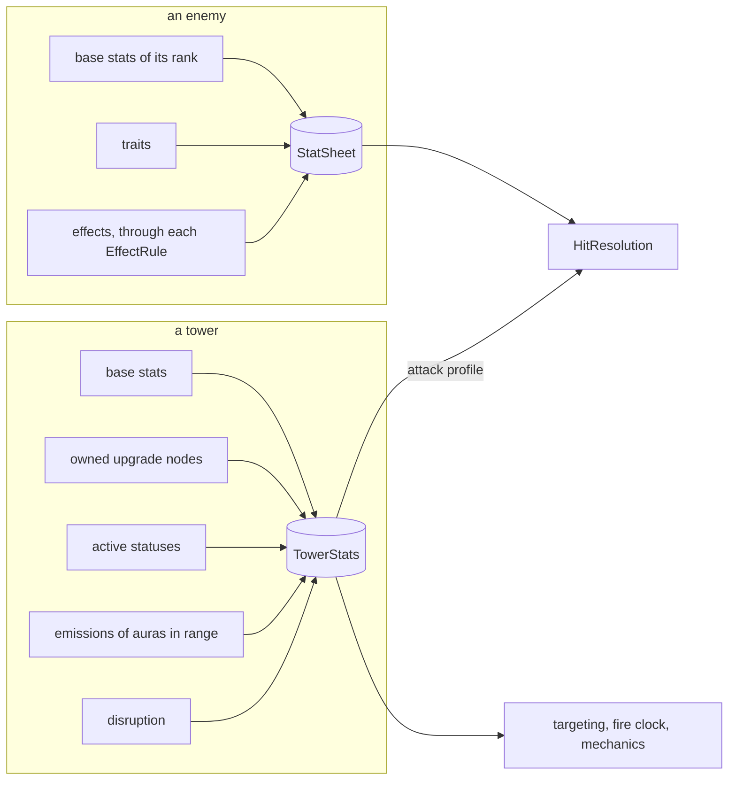

# 0015. Stats drive buffs on both sides; towers stay code

- Status: Accepted
- Date: 2026-10-13

## Context
Enemies were already data: traits and effects change stats, and behaviour reads the resolved
numbers. Towers were not:
- a fixed buff record;
- per-tower specs refined by perk classes in purchase order;
- per-shot bonuses written as code;
- an aura that stored what it derived.

Effects kept their rules in a dozen switches.

## Decision
- One stat formula serves towers and enemies (`td.stat`).
- A tower's number is a `TowerStat` when the tower has it from the start or it belongs to its
  Attune mechanic, and a node changes it flat. Any other number belongs to the mechanic a node
  adds, in that mechanic's spec.
- Generic upgrade effects are data, each a sealed vocabulary whose records carry their own
  behaviour and words: procs, hit bonuses, statuses, targeting, capabilities.
- An effect kind is one `EffectRule`, and every rule between kinds is a row of
  `EffectInteractions`.
- What a tower receives is derived, never stored. Nothing an aura receives changes what it gives:
  auras never buff auras, so one recompute in any order is right.
- There is no scripting language. A mechanic with its own maths stays a named class.

## Consequences
- A node made only of data needs no code and no test.
- Towers remain eight hand-written classes with their own sub-packages, which is the cost of
  mechanics with their own behaviour.

## Rejected
- *Iterating aura-on-aura buffs to a fixed point*: ordering bugs and recompute cost.
- *Making every perk number a stat*: stats would mean nothing.
- *A generic stat sheet on the per-hit path*: allocation in the hottest code.
- *Data-defined towers*: worth revisiting later, not needed now.
