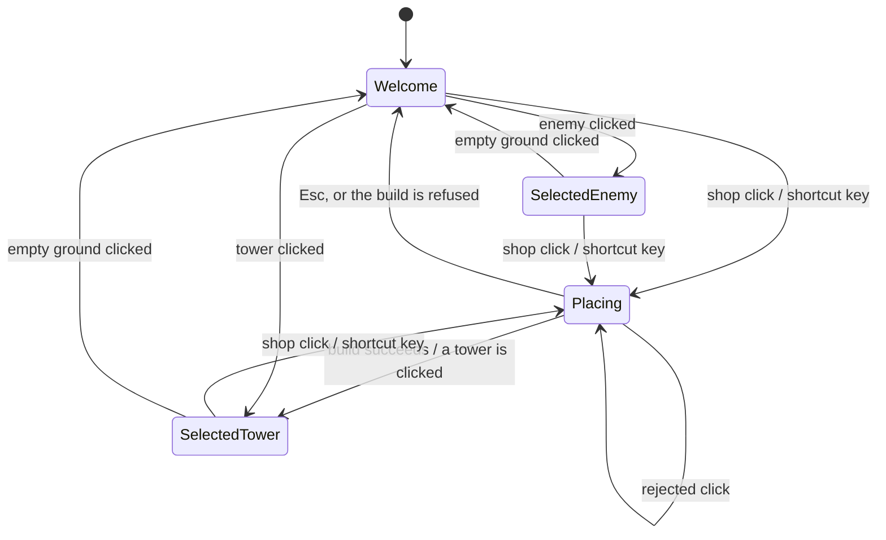

# Feature Request: Hover popups, click Info pane

**Status: requested.**

## Summary

Hovering does two different things today. Most hovers open a popup, but hovering a shop
button or a wave-preview enemy borrows the Info pane instead. Draw one line: a hover always
opens a popup, and only a click changes the Info pane. The popup answers "what is this?" in
short form. The pane holds "what I picked", live, with its actions and its full detail.

## Current state (what exists today)

- **Hovers that open a popup:** a term or icon inside any sheet (traits, buffs, debuffs,
  perks, applies, stat breakdowns), the header status icons (wave, lives, score, cash) and the
  upgrade buttons. Popups are `TooltipPanel`s on the frame's popup layer, owned by
  `TooltipLayer`. They are sticky and chain, open after 150 ms, are at most 240 px wide, and
  open left of their source, toward the board (`TooltipPlacement.place`), clamped inside the
  window.
- **Hovers that borrow the Info pane:** a shop button (`PanelTowerSelector.mouseOver`) and a
  wave-preview enemy (`PanelEnemy.mouseOver`, which the dev panel's preview row reuses through
  `PathWaveRow`). Both go through `TowerDefense.showHoveredSheet`. While one is showing, the pane
  hides Sell and Pin. When it ends, the selection's sheet comes back, and with nothing selected the
  hovered sheet stays (`PanelTowerInfo.showHoveredSheet` / `hoverEnded` / `isHovering`, added in
  `4a26400`). A shop hover is ignored while placing.
- **The board** shows nothing on hover. A click selects a tower or an enemy, and the pane shows
  its live sheet: the tower with Sell/Pin and the upgrade tree, or the enemy's health, fate,
  breakdowns, Buffs and Debuffs.
- **The popup and the pane render the same `InfoSheet`** through the same `SheetPane`, so any
  sheet can be shown in either, and icons inside a popup chain further popups.
- **Shop sheet** (`TowerSheetText.shop`): title + price, Range, damage, Fire rate, Crit chance,
  tower-specific rows (Splash radius; Projectile speed/size on the Mortar and Seeker; Rotation on
  the Sonar), Targets, the Applies icons, description. **Preview enemy sheet**
  (`EnemyStatText.preview`): header, HP + bounty, every stat that differs from the default,
  Traits, role sentence. A preview enemy has no click view.
- **Placing** starts from a shop click or the tower's shortcut key (`doPlace`). It clears the
  selection and puts the shop sheet in the pane. Two gaps:
  - Esc cancels placing but leaves the shop sheet in the pane.
  - A click on a cell you can't build on keeps placing, but the click's `unSelectTower()`
    replaces the sheet with the welcome text first.
- **After a successful build** the pane shows the welcome text, and the new tower is not
  selected.
- **The wave preview and the upgrade tree share one cell.** Selecting a tower hides the
  preview.
- **The welcome text** (shortcut list) is what the pane shows with nothing selected.
- `src/main/java/td/ui/CLAUDE.md` states the current rule ("A hover off the board … lends the
  Info pane its sheet"), and `PanelTowerInfoTest` has three tests for the lending.

## What this feature adds

What the pane shows:

No hover appears in this diagram: a hover never moves the pane.

- **Shop button hover opens a popup**, placing or not, the button being placed included. It
  holds the shop sheet without the rows about how a shot travels or turns (Projectile
  speed/size, Rotation), plus the tower's shortcut key. Its price stays current while it's open.
- **Wave-preview enemy hover opens a popup** with today's preview sheet, unchanged. This applies
  to the dev panel's preview row too.
- **While placing, the pane shows the full shop sheet**, every row included, until placing ends.
  A rejected click doesn't end it.
- **Placing ends** on Esc (welcome text), on a successful build (the new tower is selected, so
  its status and upgrade tree show) or on a click on a tower (that tower is selected).
- **With nothing selected, the pane shows the welcome text.** A hover never leaves a sheet
  behind.
- Sell and Pin stay visible for the whole time a tower is selected: nothing hides them any more.

**Out of scope:** popups for towers or enemies on the board (deferred, see below). Changes to
the welcome text. Any change to the content of the live tower or enemy sheet.

## Interconnections

- Reverses the hover-lending rule recorded in `4a26400`. That rule's other half ("only a click
  changes the selection") stays and becomes the whole rule.
- `FEATURE-effect-icons-and-terms.md` and `FEATURE-tower-info-rows.md` describe the shop sheet
  as "the toolbar hover" in the Info pane. This request moves that hover into a popup.

## Constraints and open risks

- **Selecting after a build hides the wave preview** after every build. This is accepted: a
  fresh tower is when you'd buy its first upgrade, and the next shop click or key clears the
  selection again.
- **A popup covers the board** next to the toolbar or the wave strip. That's where popups already
  open today, and nothing in this request changes it.
- **A disabled (unaffordable) shop button** must still open its popup, as it borrows the pane
  today.
- **The trimmed rows** need a rule that a new tower's rows follow without anyone listing them per
  tower.
- `src/main/java/td/ui/CLAUDE.md`'s hover-lending line becomes false and is rewritten in the same
  commit. The three lending tests in `PanelTowerInfoTest` are deleted with the mechanism. Each
  remaining behaviour (the placing sheet lasts, a build selects, Esc restores the welcome text,
  the shop popup's content) needs a test of its own.
- UI uniformity: popups stay the game's own `TooltipPanel` look. No platform tooltip.
- One live `run-jtd` pass at the end checks what no test sees: the popup opening from a shop
  button and a preview enemy, where it lands, and the pane through a place → reject → build
  sequence.

## Decisions made

- **The line:** a hover opens a popup and never changes the Info pane. Only a click changes the
  pane. *Rejected:* splitting by content size (fuzzy for players) and by owner (board vs off-board).
- **Placing is a selection:** the pane holds the full shop sheet while placing, so the popup can
  be the short version. *Rejected:* keeping the previous selection while placing, and a short
  placement hint.
- **The placing sheet lasts until placing ends, and a build selects the new tower.** The
  preview hiding after each build is accepted. *Rejected:* returning to the welcome text after a
  build, and selecting for the pane without opening the upgrade tree.
- **Every shop button opens its popup while placing**, the placed one included. That keeps one
  rule.
- **Shop popup:** the shop sheet without the shot-mechanics rows, plus the shortcut key. No
  "can't afford" note, since the greyed button already says so.
- **Preview enemy popup:** today's preview sheet, untrimmed. Nothing else shows a preview
  enemy.
- **Placement:** the existing popup placement, with no new height or scroll rule.
- **Empty pane:** always the welcome text.
- **Board hover popups:** deferred. Board hover drives the placement highlight, a popup would
  cover the board you're aiming at, and enemies move out from under the pointer.

## Open questions

None for planning. Still wanted for a later version: whether a tower or an enemy on the board
should open a popup on hover, and what it would show.
