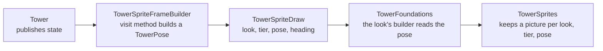

# Feature Request: Next-gen Tower Looks

**Status:** implemented 2026-11-15, but for the Beacon's own look; drafted 2026-11-10, reviewed with the whole bundle 2026-11-13; the art pass drew it the same day
(`next-gen-art/`) in the raised view the user chose, and the enemies and ground zones already in the game were
moved into the same look ("The rest of the board"). Part of `FEATURE-next-gen.md`, whose appendix
holds the visual request as given; this doc owns its "all towers" parts, keyed to tiers.

**Implemented 2026-11-14 (everything a tower's rework draws from):** the calm board (the pips, chevrons, halos,
gold barrel, the Beacon's lines and the XP ranks went; one upgrade arrow), the palette, every tower's foundation at
Tiers 0 to III, the Stormcaller's and the Hexer's, and every identity look (Soulfire, Ruby, Shade, the three runes),
each built from a pose: recoil, reload, every cue on the heads sheet, the loaded shell, the Beacon's panes.
Back-to-front painting with enemy marks over the towers, the tier unlock, a placed tower settling onto its cell, one
idle light a tower, the two-tone toolbar icons and the panel's tier thumbnails. The art sheets are rendered from the
game's own tables. Each tower's rework then sent its cues from its state ("Building a tower's look") and wired its
identity looks, its shots in flight and its enemy marks, and the Obelisk's ripples and the Aerie's orbit stopped
running on an empty board. Only the Beacon's are left, with its rework: its cues, its rings that still run always on,
and Glare's mark.

## Summary

Make the towers far nicer to look at and the board calmer. Every tower becomes a small piece of art in two parts: a
**foundation** that never moves and visibly grows with each tier the tower reaches, and a **head** that aims and
reacts when it fires or reloads. Upgrades stop being marks around the tower (pips, chevrons, halos, rank diamonds)
and become the tower's own shape, its ammunition and its cues. The toolbar gets new icons to match. The art follows
the style of the term icons, effect pictograms and header strip: vector, few colours, one clear silhouette. Each
tower's own look is in its doc; this doc holds what every tower shares.

## Current state (what exists today)

Every tower is drawn by `TowerSpriteFrameBuilder` (sprite and head) and `TowerEffectFrameBuilder`
(transients), painted by `Java2DFrameRenderer`:

| Layer | Today | Where |
|---|---|---|
| Body | One closed flat shape per look (a `TowerLooks` row): Sniper triangle, Burst ring, Radar spiral, Obelisk star, Beacon pulsar, Mortar diamond, Hive kite, Scorcher flame. Fill at alpha 130/255, solid outline. 0.42 of a cell. Never turns. | `paintTowerBody` |
| Head | One shape per look (a `TowerLooks` row), 0.24 of a cell, rotated to the aim. Sniper: a short bar (gold once Transcendent). Burst: a square block. Obelisk: a spinning star. Beacon: a pulsing circle (0.8x to 1.25x). Radar: its sweep. | `paintTurretHead` |
| Slot pips | One dot per owned node under the tower, grouped by slot in slot colours; Transcendent's pip is a gold diamond. | `paintSlotPips` |
| Ready chevrons | One up chevron per slot with an affordable, ungated node, in that slot's colour, above the tower. | `paintSlotReadyChevrons` |
| Enchant halo | A ring that pulses for as long as the tower owns any special. | `paintEnchantHalo` |
| Transcendent halo | A ring of gold dashes, one turn every 12 s. | `paintTranscendentHalo` |
| Rank pips | One silver diamond per rank above Recruit (Seasoned, Expert, Hero), stacked beside the tower. | `paintRankPips` |
| Rank-up glow | A ring that widens and fades over 30 ticks after a rank-up. | `paintRankUpGlow` |
| Jammed | A small marker in the top-right corner while disrupted. | `TowerStatusDraw` |
| Selection | A pink range circle. | `paintTowerSprite` |

- Always-running motion: the Beacon's two breathing rings, pulsing head and a line to every tower it buffs; the
  Obelisk's three ripple rings and spinning head; the Radar's sweep; the enchant halo; the Transcendent halo. Cosmetic
  loops run on `animationSeconds`, so they keep moving while paused.
- The toolbar icon (`renderTowerIcon`) is the body shape alone, one solid colour, 32 px, no head ("a two-tone glyph
  smudges at icon size").
- Primed-shot buffs are `TowerStatus`es and different ones stack, so two can ride one shot. Attack-speed buffs are
  statuses too. All show in the tower pane's Buffs row (`TowerBuffState`).
- Timed visuals follow one idiom: the entity records the tick something happened and the frame builder turns it into a
  0..1 progress.
- Ranks (`TowerRank`: Recruit, Seasoned, Expert, Hero at 50, 150 and 300 XP) grant nothing; they only show how much
  of the fight a tower has seen.
- Every effect the next-gen towers keep already has a marker colour (`EnemyFrameBuilder.markerPaletteFor`,
  `shipped/FEATURE-effect-visuals.md`): Sunder, Crack, Scorch, Bleed, Expose, Priority, Reveal, Chill, Freeze, Daze,
  Doom, Blight, Inversion, Vulnerable, Soulfire, Toll. The Obelisk's doc finds that Silence shows only in the enemy's
  pane.
- An earlier art mock, "jTD Tower Revamp Previews" (https://claude.ai/artifact/So7xnUnVE6o6f3iUhmyUYH), tried two
  directions (instruments around a core; a grounded workshop) and set freeform tier shapes against one shared tier
  grammar at 32 px cells. It is inspiration, not a decision.

## What this feature adds

### Anatomy of a tower

- **Foundation**: the static part (base, body, plinth). It never moves or turns. Its shape and complexity grow a step
  per tier, four steps for Tiers 0 to III, each clearly richer than the one before, so a Tier III tower reads as a
  prize. Fuller than today: a more opaque fill.
- **Head**: the moving part. It aims where it does today and has its own animation for firing and reloading, in the
  tower's style (recoil, a flare, a charge building). A tower that doesn't aim (the Aerie, the Obelisk, the Beacon)
  has its own moving part instead, named in its doc.
- **Identity looks.** A tower whose tree has an identity, a fork (the Burst) or a pick that changes what it is
  (Soulfire, Ruby or Shade, the Obelisk's stones), changes its look with it: the Burst becomes another tower, the
  others change material, colour or rune and keep their silhouette.
- **Upgrades that change how a tower fires or what it fires** (its ammunition) may change the head or the shot, each
  in its own way, chosen per upgrade.
- **Tower buffs** that change the next shot or the fire rate show on the head while held, and they combine: a head
  holding two primed shots shows both.
- **A tier unlock** is a moment on the board: the tower grows into its new foundation (open question 2).

### Art direction

Decided by drawing, in the art pass of 2026-11-13. The sheets are the specification, and each tower's Look section
names its own parts:

| Sheet | Shows |
|---|---|
| [board](next-gen-art/board.png) | all seven towers at four tiers and every identity look on Iron Crossing, painted over the game's own frame at 0.5x, 1x and 2.5x |
| [catalogue](next-gen-art/catalogue.png) | every tower and identity at Tiers 0 to III, large and at the board's two sizes, with its part count |
| [directions](next-gen-art/directions.png) | the two choices as decided: the raised view against the plan view, a growing against a constant footprint (a frozen picture: the rejected options have no builder) |
| [heads](next-gen-art/heads.png) | every moving part, its firing and reload cue, every buff on the head; the tier unlock, a placed tower settling and idle life, frame by frame |
| [shots](next-gen-art/shots.png) | shots and casts in flight |
| [marks](next-gen-art/marks.png) | the enemy marks, on the game's own enemies |
| [grounds](next-gen-art/grounds.png) | the Obelisk's fields and Sundial, the payload grounds, the flare, Ice Wake |
| [icons](next-gen-art/icons.png) | the seven toolbar icons, the upgrade arrow, the Lit mark, the panel's tier thumbnails, the tier colours |
| [theme](next-gen-art/theme.png) | what the game paints in the same look: every enemy, every ground zone, the towers at Tier I |

`next-gen-art/README.md` says how the sheets are rendered and how a look is built from its parts.

- **A tower is a stack of flat parts.** Each part is one closed shape with a height, in one colour of three tones:
  the body tone on its top, a lighter rim along the top's top-left edge, and the shade tone on its side. That is the
  whole shading: one light from the top left on everything that stands on the board, no gradient but a glow.
- **Raised view** (the user, 2026-11-13). The board is seen from the south and above: a part's top is lifted
  straight up the screen by 0.42 of its height, and its side shows below the top as a wall. Towers stand up, and a
  Tier III tower reaches up to half a cell into the cell above its own. What follows from that:
  - Towers are painted back to front, the northern rows first, so a tower covers the foot of nothing in front of it.
  - Inside one foundation the same holds: what stands north of the tower's centre (a henge stone, a post, the far
    half of a wall or of a ring) is painted before the centre, what stands south of it after.
  - A tower's cell is still its own square on the ground: placing, selecting and range are measured from the cell,
    never from the art above it.
  - A tall tower can cover an enemy on the path just north of it. Enemy bars, marks and rank badges are painted
    over the towers, so a covered enemy still shows where it is and how it fares.
  - What lies on the ground stays flat: the field patches, the payload grounds, the Sundial, the shadows, range
    circles and path marks.
- **The plinth is the tier.** Under every tower lie as many plinth steps as its tier: none at Tier 0, three at
  Tier III. The steps are stone in a grey that leans toward the tower's colour, in the tower's own plan shape (a
  hexagon under the Sniper, a square under the Obelisk, an octagon under the Mortar and the Beacon, a circle under the
  rest), and the top step is paved in a dark tone of the tower's colour so the tower, not the stone, carries the
  colour. Above the plinth each tower grows in its own way, as its Look section says.
- **The footprint grows with the tier**: 0.55, 0.63, 0.72 and 0.80 of a cell across for Tiers 0 to III. Each plinth
  step is 0.045 of a cell wide, a pixel and a half at the board's own scale, so the steps can be counted at 1x and
  above; at the smallest zoom (16 px cells) they cannot, and the size is what still tells the tier. That is why the
  constant footprint lost (question 4).
- **Moving parts keep their size.** A barrel or a nozzle may reach past the foundation (the Sniper's rifle 0.30 of a
  cell from the centre, 0.37 with Long Barrel) and is drawn pale, since it crosses the dark floor.
- **Shadows.** A soft dark ellipse lies on the ground under every foundation, down and to the right. On the floors, which are
  near-black, it barely shows, and that is accepted: it is there for the lighter ground (path marks, zones, a
  highlighted cell). Anything that must read as a shadow on the floor itself, the lobbed shots' shadows and the
  Sundial, is a cool grey or violet veil lighter than the floor, never a dark one.
- **The tier unlock** takes half a second on the tick clock: a flash, then the new foundation pushes out of the old
  one from the tower's centre, swelling a little past its size before it settles, while one ring in the new tier's
  colour runs out past the cell's edge and sparks in that colour fly up and out. Then the tower is still again.
- **A placed tower settles**: over a third of a second on the tick clock it grows out of its cell from under half
  its size, overshoots a little and settles back, a thin ring of dust running out from under it. A tower restored
  from a save does not.
- **Idle life** (the user, 2026-11-14: "game looking alive is more important"). A tower with nothing to do carries
  one small living light, on the wall clock: the Sniper's lens and the Mortar's shell glint once in a while, the
  Scorcher's pilot flame flickers, the Stormcaller's ball, the Hexer's brew, the Aerie's tip and the Obelisk's rune
  breathe, the Beacon's lamp turns a pale ray. A head with nothing to aim at scans slowly, a few degrees to either
  side. Neighbouring towers run out of step, so a row never breathes as one.
- **The upgrade arrow** is one green up arrow (`#6ee08a`, dark outline) in the cell's top-left corner; the Jammed
  marker keeps the top right, a Beacon's Lit mark the bottom left.
- **What it costs.** A Tier III foundation is 17 to 37 parts (the catalogue prints each count), so a foundation
  cannot be one draw command a part: a board of Tier III towers would carry thousands. A foundation never moves, so
  the frame names it once (which look, which tier) and the painter keeps its picture. Painting 200 Tier III towers
  part by part took 39 ms a frame in the art lab; through the game's painter, from kept pictures, 1.5 ms still and
  2.9 ms with their idle lights. A picture is rendered from the vector parts when first needed, per look, tier, pose
  and zoom; it is not an image asset. A head is 5 to 10 parts that turn, kept as one picture per heading step. What stays expensive is what multiplies with play, not with towers: the
  Aerie's missiles (each one a command, seven with Swarm), the Scorcher's stream (three shapes, rebuilt every few
  ticks), Arc hops and Flashover tongues. None is heavier than today's effects of the same kind.

### The rest of the board

The raised view would leave the towers standing among flat enemies, so what the game already paints was moved into
the same look on 2026-11-13, in the renderer itself ([theme](next-gen-art/theme.png)):

- **Enemies are built as the towers are**: a small stack of lit parts. Every body has a side that falls down the
  screen, a top with a lit rim along its top-left edge and a shaded far edge, and a shadow cast on the ground to its
  lower right, whichever way it turns. On that, each look gets what suits it:
  - a **cap**, a smaller copy of the body risen above it, so the Walker is a domed pawn, the Knight a stepped block,
    the Juggernaut, the Golem and the Colossus heavy tiered slabs;
  - a **raised detail**: a Warden's or a Magma's core, a Minotaur's horns, a Templar's gem stand off the body as
    parts of their own;
  - **height** to its weight: a Courier or a Sandling is nearly flat, a Monolith and a Keeper stand as tall as a
    Tier 0 tower;
  - a **glint** on what is smooth (the Walker, a Mite, a Cocoon, glass);
  - **flyers hover**: a Ghost, a Hornet, a Drone, the storm's clouds and bolts are thin bodies above a pale shadow on
    the ground.
- **Enemies move as they walk.** A walker lifts off the ground once a stride and a flyer sways on its hover; a hot
  core (Warden, Magma, Molten Core, Relay, Ember, the Monolith's rune) breathes a soft glow. All three follow the
  place the enemy has reached, not a clock, so an enemy that is frozen, stunned or paused holds still.
- An enemy's bars sit under its side, its rank badge above whatever rises from it, and a tint (poison, chill,
  freeze) rides on its top. A cloaking enemy fades whole.
- **Ground zones stay flat patches**, and what stands on them follows the light: burning ground carries tongues of
  flame that rise up the screen, each with a hotter heart; frost ground carries shards of ice with a lit left face;
  a mine's casing stands on its patch. Tar was near-black on near-black floors and is now a violet-grey that shows.
  Fallout and the healing, haste, ward and blinding grounds keep their look.
- **Shells** are lit balls: a shaded edge at the bottom right and a glint at the top left.
- It paints faster than the flat enemies did. A body is drawn once into a kept picture (for its look, size, one
  of 64 headings and the zoom) and placed pixel for pixel after that: 300 bodies took 0.9 ms a frame in the art lab,
  against 6.0 ms for the old flat shapes. The frame build is unchanged. Not yet profiled in a live game.
- Left as they are, because they are flat by nature or leave with the bundle: path marks and the floor, range and
  selection marks, rank badges and affix pips, the freeze block (already lit from above), today's missiles, beams
  and rings, and today's toolbar icons.

### A calmer board

- Gone: slot pips, per-slot ready chevrons, the enchant halo, the Transcendent halo, the gold Transcendent barrel, and
  the Beacon's lines to the towers it buffs.
- **Upgrade available**: one small green up arrow on the tower when it has an affordable upgrade in an open tier,
  or a tier it can unlock. One mark, whatever the tier.
- **XP ranks go**: the tier is the tower's rank and the foundation shows it. The rank diamonds and the rank-up
  glow leave the board, and the pane shows XP toward the next gate (open question 1).
- Idle towers are nearly still: each carries one small living light and an aiming head scans slowly ("Art
  direction", idle life). Any larger motion means something happened: a shot, a reload, a buff, an effect landing.
  Always-on loops (aura rings, ripples, pulsing heads, a nest circling an empty board) are cut back or replaced per
  tower.
- Kept: the selection range circle, the Jammed marker.

### Enemy marks the new towers need

Next-gen moves most of its look onto the towers, but some new debuffs need a mark on the enemy, beside today's
markers and in their style. All are drawn on [the marks sheet](next-gen-art/marks.png):

| Mark | From | Look |
|---|---|---|
| Silence | the Obelisk's Ward, the Aerie's Shade, the Hexer's Choking Blight | a small struck-out speech mark above the head, in Silence's marker colour, while it lasts: new for every source |
| Toll | the Obelisk, the Beacon's Prism | five segments round the enemy in Toll's marker colour, one lit per stack, all five bolder at full; one thin ripple runs out per stack gained |
| A hexed enemy | the Hexer | three arcs of a broken rune circle round the enemy in the hex's marker colour, and the hex's sign over its head (Doom a downward triangle, Blight a drop, Inversion two opposed arrowheads); it replaces today's rune row |
| Blight | the Hexer | the same, its arcs thickening and a tint filling the circle as the slow grows |
| Ruby freeze | the Aerie | today's freeze block in ruby red with a pale pink rim; it thaws into red shards |
| Shade freeze | the Aerie | today's freeze block in smoky dark ice with a pale green rim; it thaws into dark shards with a green edge |
| Glare | the Beacon | a white four-point glint on an Exposed enemy |
| Static, Soulbrand stacks | the Stormcaller, the Hexer | none (question 7) |
| Frailty, Drag | the Obelisk | none: both are Toll's, and Toll shows |

### Toolbar icons

- A new icon per tower that matches its new board look: two colours, the tower's own and one lighter tone of it for
  the moving part, on a simple silhouette. Seven icons, drawn on [the icons sheet](next-gen-art/icons.png): the
  Radar's goes.

  | Tower | Icon |
  |---|---|
  | Sniper | the triangle as an outline, the rifle laid across it past one corner |
  | Burst | seven stones in a ring, the throwing arm in the middle |
  | Mortar | a ring with the wide barrel across it, its bore open |
  | Scorcher | the round tank with the nozzle reaching out of it |
  | Aerie | the spire's hexagon in its perch ring, one missile on the ring |
  | Obelisk | the square stone with its pyramidion's two lit faces |
  | Beacon | the octagonal lantern, every other pane lit |

- The shop sells the base tower, so forks and identities (Stormcaller, Hexer, Ruby, Shade) don't get toolbar icons;
  in the Info pane's header they wear their tower's mark in their own colour.
- In code: a `TowerIcons` row per look. The Upgrades panel's tier thumbnail is that tier's foundation itself, grey
  while the tier is locked.

### Palette

Every tower colour is softened to fit the new look and checked by `docs/UI.md`'s rules: at least 3:1 on the lightest
floor, and at least 10 (CIEDE2000) from every other tower.

| Tower | Colour | On the floor | Nearest tower | Note |
|---|---|---|---|---|
| Sniper | `#a6d674` | 11.7:1 | Beacon, 20.4 | 10.0 from the healing ground's green: the softest green that keeps that distance |
| Burst | `#e2746c` | 6.5:1 | Mortar, 19.1 | 5.1 from Problem red, which is only ever text |
| Stormcaller | `#8496ff` | 7.3:1 | Hexer, 14.1 | moved toward indigo, away from the Aerie |
| Hexer | `#b88ae8` | 7.3:1 | Obelisk, 11.1 | |
| Mortar | `#c39062` | 7.0:1 | Scorcher, 10.8 | 8.6 from Physical orange, which is text and numbers |
| Scorcher | `#ea862a` | 7.4:1 | Mortar, 10.8 | 4.9 from Physical orange; moved away from the Burst, which it sat 9.2 from |
| Aerie | `#5cc4e2` | 9.8:1 | Stormcaller, 22.9 | moved into the open hues toward cyan; 9.8 from Magic blue |
| Obelisk | `#8f86b8` | 5.9:1 | Hexer, 11.1 | the stone itself is a darker step, `#625c86`, at 3.4:1 |
| Beacon | `#d8b866` | 10.2:1 | Mortar, 15.2 | |

The three misses against text colours (Burst, Mortar, Scorcher) are accepted: a tower's art and a line of text are
never read against each other. Identity colours: Ruby `#d0405a`, Shade's glow `#a6e8c8` (moved from `#8fd8a0`, which
sat 4.2 from the Sniper), Soulfire's metal `#3d3650` with a pale violet `#b9a0ff`.

**Tier colours**, for the Upgrades panel's rows and the unlock ring. Each ramp runs from the tower's colour toward a
pale, slightly warm tint of itself, so a higher tier reads lighter and no two towers' Tier III meet:

| Tower | Tier 0 | Tier I | Tier II | Tier III |
|---|---|---|---|---|
| Sniper | `#a6d674` | `#5cc8b0` | `#93dbcb` | `#c9e8ce` |
| Burst | `#e2746c` | the fork's | the fork's | the fork's |
| Stormcaller | | `#8496ff` | `#c0c9ff` | `#e0dee8` |
| Hexer | | `#b88ae8` | `#dbc3f3` | `#eddce2` |
| Mortar | `#c39062` | `#e0b070` | `#ebcba1` | `#f5e0b8` |
| Scorcher | `#ea862a` | `#f0a040` | `#f5c081` | `#fadaa8` |
| Aerie | `#5cc4e2` | `#8fd0f2` | `#b5e0f6` | `#daeae3` |
| Obelisk | `#8f86b8` | `#a89fd2` | `#c6c0e1` | `#e2dad8` |
| Beacon | `#d8b866` | `#ecd48c` | `#f2e3b3` | `#f8ecc2` |

All stand at 6:1 or more on the panel's background. Neighbouring tiers of one tower are 6 to 15 apart, under the
guide's 10 in places: they are rows of one ordered list, each with its name, never told apart by colour alone. The
Beacon's Tiers II and III are the closest (2.6) and may be pulled apart when the panel is built.

## Building a tower's look

Written after the review of 2026-11-14, for whoever reworks a tower. Everything a tower's Look section asks for
already has a place; a rework sends state to it and invents nothing.

| To show | Do | Never |
|---|---|---|
| A buff, a primed shot, a full store | Add its `TowerCue` to the pose in the tower's visit method: `pose.with(TowerCue.SILVER_ROUND, tower.holdsSilverRound())`. The cue is already drawn. | A new draw record, a field on `TowerSpriteDraw`, a branch in the painter |
| Recoil and reload | `poseOfReload(tower.getCoolDownFraction())`; a store that refills is `refilling` | A clock of the frame builder's own |
| A stack count, the loaded shell, the Lit types | `withStacks`, `withShell(LoadedShell)`, `withPanes(List<TowerLook>)` | |
| An identity (Soulfire, Ruby, Shade, a rune) | Return its `TowerLook` from the body-look visitor, as `bodyLookOf(SplashTower)` does for the fork. The tower needs a query that says which identity it took. | A cue for an identity; a second look table |
| A cue no sheet has yet | Draw it on the heads sheet first: a `TowerCue` constant, read in the look's builder in `TowerFoundations`, a tile in `TowerArtSheets3`. Then send it. | A cue painted outside the builder |
| A light on an idle tower | `Build.light(Life, x, y, z, radius, colour)` in the builder | A loop on `animationSeconds` in an effect builder |
| Something that flies, lands or lies on the ground | `TowerEffectDraw`, `ProjectileFrameBuilder`, a ground zone: not the tower's picture | |

Rules the tables hold, and a test for each (`TowerFoundationsTest`, `TowerPoseTest`):

- Every measure is in cells: the cell's centre at 0,0, a cell 1 wide, north at -90 degrees.
- A look whose body ignores the pose is `Row.aiming`; if its body reads the pose it must be `Row.posed`, or the body
  is kept from the idle pose and the cue never shows.
- A pose is snapped to four steps of recoil and reload before a picture is kept for it. A smoother motion than that
  is painted live or not at all; do not raise the steps to get it.
- A shot leaves from `TowerSprites.muzzle(look, tier, pose, ...)` with the tower's real pose
  (`TowerSpriteFrameBuilder.poseOf`), so a recoiled or longer barrel and its shot stay together.
- A moment runs on the tick clock (the tower records the tick, the builder turns it into 0..1); idle life runs on
  the wall clock.
- After any change to a builder: render the sheets (`next-gen-art/README.md`) and read `git diff --stat` on the
  PNGs. Only then one `PreviewBoard` render; the live game only for wiring.

### Mistakes found in the review

Each was in the delivered code or its notes, and is fixed unless it says otherwise.

1. **A head was one fixed list of parts per look.** There was no place for a longer barrel, a loaded shell, a lens
   that brightens or a primed shot, and the picture cache had no key for them. Now the pose.
2. **A tower that does not aim had no moving part.** The thrower's arm, the coil's ball, the brew, the rune and the
   lantern were baked into the still foundation. Now their bodies are built from the pose.
3. **Identity looks had no key.** Soulfire, Ruby, Shade and the three runes are `TowerLook` rows now.
4. **A sentinel in a draw record** (`-1` for "not rising"). Progress rests at 1 instead; absence is a value.
5. **A barrel turned south was painted over the wall in front of it.** The head went on top of everything. A
   foundation now has parts behind the head and parts in front of it (`Foundation.front`).
6. **The measures lived twice**, in the art lab and in the game, and had begun to drift. The sheets are rendered
   from the game now; a look is changed in one place.
7. **The tracer started at the idle muzzle**, so it left a gap to a recoiled barrel. It reads the tower's pose.
8. **A constant pixel stroke in a live effect.** The sheets paint with one unit to a cell, where a 1.5 px stroke is
   a cell and a half wide. Every live size is a share of `scale`.
9. **Icons and thumbnails were left on the old flat shape** while the board changed, so the toolbar showed towers
   that no longer existed.
10. **Open, for the tower that owns it:** Frenzy's jitter is a still offset (the Sniper); no tower says which
    identity it took (the Scorcher, the Aerie, the Obelisk); a flying shell is a plain ball (the Mortar); the old
    always-on loops still run (the Beacon, the Obelisk, the Aerie).

## Interconnections

- `FEATURE-next-gen-upgrade-tiers.md`: the foundation follows the tier; the tier unlock is drawn here.
- `FEATURE-next-gen-shot-flight.md`: what a shot looks like in flight.
- `docs/UI.md` holds what each colour already means. `shipped/FEATURE-hud-identity.md` made the chrome neutral, which
  leaves the pure primaries of the Sniper, Burst, Sonar and Pulse as the loudest colours on screen. A softer Sniper
  green lands on healing's, so each new value gets the guide's checks.
- `shipped/FEATURE-effect-icons-and-terms.md` set the icon style this art follows and made primed shots and
  attack-speed buffs named tower buffs; their head cues draw from the same state.
- `shipped/FEATURE-effect-visuals.md` set the enemy marker colours; marks a tower leaves on an enemy sit beside them.
- The ground grounds a tower leaves (the Mortar's payloads, the Obelisk's field, the Aerie's Ice Wake) draw as one
  patch per kind (`ZonePatchDraw`), as the Obelisk's doc decides.
- The README's tower section describes the pips, the special glow and the rank diamonds.

## Constraints and open risks

- **Frame budget**: every buildable cell a tower on the last level, frame build ≤ 1 ms and ≤ 512 KB
  (`td.PerformanceHarness`). Richer sprites, layered foundations and in-flight shots multiply draw commands per tower;
  the budget's worst case becomes a board of Tier III towers.
- **Readability at board size**: a tower is under half a cell today (0.42), a head a quarter. Each tier's shape must
  still read at the smallest board scale, distinct from the tower's other tiers and from other towers.
- **Two clocks**: animation driven by game state (recoil, flight, reload) must use the tick clock so it pauses and
  speeds with the game; wall-clock loops keep running while paused, which is what the calm board wants less of.
- The renderer holds every shape and colour, keyed by `Palette` roles, never by domain type; there are no image assets.
  The forked Burst looks are the most complex vector art in the game so far.
- **Tower looks become tables first** (ADR 0018, `TODO.md` "A board look is a switch in the painter"): that entry
  is closed before any new art is drawn. How the tables are shaped is the plan's.
- The board can show a primed shot, a target's rank or a running Frenzy only through state the tower publishes for the
  frame build; the engine stays headless.
- Removing slot pips removes the only on-board hint of how far a tower is upgraded; the foundation has to carry that.
- The tower pane's and the toolbar's previews draw the same art, so a richer sprite has to read at icon size too.

## Decisions made

- Remove pips, chevrons, halos and the gold barrel; one green up arrow says "an upgrade is ready".
- Foundation = tier, four visibly richer steps; head = aim and fire animation; upgrades that change firing or
  ammunition may add their own touch.
- An identity changes the look: the Burst's fork becomes another tower; a pick changes material, colour or rune.
- New toolbar icons, at most two colours, none for forks or identities.
- Look tables before new art.
- Ranks go (the user, 2026-11-13): no `TowerRank`, no diamonds, no rank-up glow.
- The art direction, the palette, the tier colours, the enemy marks and the toolbar icons are drawn and decided
  (the art pass, 2026-11-13; "Art direction"). A tower's plan builds what its sheets show; a look that changes
  later is drawn on a sheet again before it is coded.
- A foundation is named once in the frame and its picture kept by the painter; no image assets.
- A tower's state reaches its picture as a pose (the review, 2026-11-14): cues, recoil, reload, shell, panes. The
  look's builder turns the pose into parts.
- Idle towers carry one small living light, and a placed tower settles in (the user, 2026-11-14); this amends the
  calm board, which had idle towers wholly still.
- The art sheets are rendered from the game's tables (the user, 2026-11-14, over a second copy in the lab or a
  frozen set of pictures); only the directions sheet is frozen.

## Open questions

⭐ marks the preferred option.

1. ✅ **XP ranks.** Dropped (the user, 2026-11-13: "drop, redone by the visual revamp anyway"). The tier is the
   tower's rank, and the foundation shows it. The rank diamonds and the rank-up glow go, and the pane shows XP
   toward the next gate.
2. ✅ **The tier unlock on the board.** The first option (the user, 2026-11-13), drawn frame by frame on
   [the heads sheet](next-gen-art/heads.png).
   - ⭐ The tower grows: the new foundation builds up out of the old one over about half a second on the tick clock,
     with one ring of the tier's colour running out and fading. Motion that means something happened.
   - A flash, then the new foundation.
   - Only the new foundation appearing.
3. ✅ **How richly a tower is drawn.** The first option (the user, 2026-11-13), drawn on every sheet. Today a tower is one flat shape at alpha 130 with an outline.
   - ⭐ Flat vector with tonal shading: each colour in two or three tones (shade, body, highlight), one light from the
     top left on every tower, and a soft contact shadow under the foundation. Still no gradients but glows, still no
     image assets.
   - Flat as today, only more opaque, and richer by shape alone.
4. ✅ **A tower's footprint.** It grows (the user, 2026-11-13: "try it visually and evaluate"). Both are drawn on
   [the directions sheet](next-gen-art/directions.png), rows B and B2. At 1x and above both read; at the smallest
   zoom the plinth steps are under a pixel each and only the growing footprint still tells a Tier III tower from
   a Tier I. A constant footprint also makes a bare $15 tower as large as a finished one. The cost: a Tier III
   tower fills 0.80 of its cell, and the Aerie's nest ring then runs along the cell's edge.
   - ⭐ The foundation grows with the tier, from about 0.55 of a cell at Tier 0 to about 0.8 at Tier III, so the tier
     also reads as size; the head stays a quarter of a cell.
   - The same size at every tier (0.42 today, or larger for all), the tier read by shape alone.
5. ✅ **One tier grammar or each tower its own.** The first option (the user, 2026-11-13). The Sniper's, the Obelisk's and the Beacon's docs draw freeform steps
   (triangles to a hexagon of triangles; a stone to a ring of stones; a post to a lighthouse); the mock's shared
   grammar drew the same orbits on every tower.
   - ⭐ Freeform steps, with one cue every tower shares: the number of plinth steps (or rings) under the foundation
     equals the tier, so any tower's tier reads the same way at a glance.
   - Wholly freeform: four shapes per tower to learn, the most character.
   - Wholly shared: one silhouette per tower with the same tier rings on all, the easiest to read.
6. ✅ **Tier colours for Tiers II and III.** The first option (the user, 2026-11-13); the values are in "Palette". Each draft's Tier I colour is a lighter, warmer step of its Tier 0.
   - ⭐ Continue that ramp for Tiers II and III per tower, set with the palette review (`docs/UI.md`'s checks).
   - One shared colour per tier for every tower (a bronze, silver, gold ladder): readable across towers, but the
     towers' panels lose their own colour.
7. ✅ **Passive stacks on the enemy.** Every enemy a Stormcaller or a Hexer hits carries a Static or Soulbrand
   stack. No mark for the stacks: a whole wave would wear one. The discharge and the flying soul are the visible
   moments, and the enemy pane lists the stacks (final review, autonomously).
8. ✅ **Range nodes.** The request had range upgrades make a tower read bigger or taller; next-gen ties the
   foundation to the tier. The tier alone changes the foundation; a range node lengthens the head's barrel or nozzle
   a little where the tower has one, and the selection circle shows the reach (final review, autonomously).
9. ✅ **Plan view or raised view.** Raised (the user, 2026-11-13: "I prefer B, a raised view"), drawn against the plan
   view on [the directions sheet](next-gen-art/directions.png). The towers stand up: the coil, the spire, the
   Obelisk and the lighthouse read at once, and Tier III looks like a prize. What it asks of the board is under "Art
   direction": back-to-front painting, enemy marks over the towers, a cell that stays the tower's own square. The
   enemies and the ground zones were moved into the same look so the towers do not stand among flat pieces ("The
   rest of the board").
