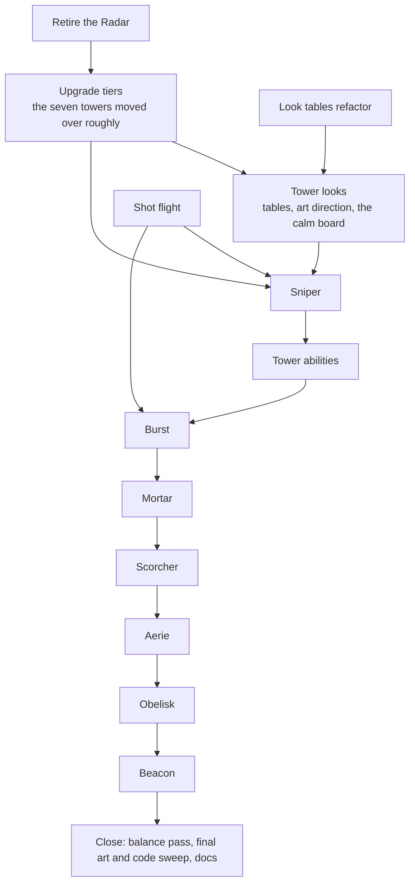

# Feature bundle: Next-gen towers

**Status:** draft, reviewed whole twice on 2026-11-13, its last questions answered on 2026-11-14, and ready for
planning: no doc has an open question left; the art is drawn in the raised view the user chose (`next-gen-art/`). The
root of the bundle: it began as the tower visual revamp, whose request is kept in the appendix, and grew to take in
the towers' mechanics too.

## Summary

Every tower gets new art, a reworked passive, a new upgrade tree and new prices. What began as a visual revamp grew
into a revamp of the towers themselves. The goals:

- **Answer the game's complexity**: a more linear path through each tower, clearer and simpler choices, fewer effects
  and abilities.
- **Make upgrades worth buying.** Today a node rarely beats building another bare tower, which makes the game
  unexpectedly dull (`TODO.md`, "The lab can't read a line past about 3.33x, and upgrades look overpriced").
- **Towers that look far better, on a calmer board.** Every tower becomes a small piece of art that visibly grows with
  its tier, reacts when it fires, and shows what it is loaded with; shots fly; the marks around towers go. The visual
  revamp is a large part of the bundle, not a finish added at the end ("The look of the bundle").

Seven towers stay: the Sniper, the Burst, the Mortar, the Scorcher, the Aerie (was the Hive), the Obelisk and the
Beacon. The Radar leaves the game ("The last three towers").

## The docs

| Doc | Owns | Needs | Status |
|---|---|---|---|
| `FEATURE-next-gen-upgrade-tiers.md` | Tiers, gates, clusters, fork gates, the new Upgrades panel; every tower moved onto tiers | | implemented |
| `FEATURE-next-gen-tower-looks.md` | The art direction, foundation by tier with a head, a calm board, enemy marks, toolbar icons, palette | upgrade tiers | shared parts and every foundation in code; the rest with each tower |
| `FEATURE-next-gen-shot-flight.md` | Hits that land later, arcs, the tracer, chains hop by hop | | draft |
| `FEATURE-next-gen-tower-abilities.md` | Ability bars, currency, casts, the pane's Abilities list | upgrade tiers | draft |
| `FEATURE-next-gen-sniper-tower.md` | The Sniper | tiers, looks, shot flight | Tiers 0 to III |
| `FEATURE-next-gen-splash-tower.md` | The Burst | tiers, looks, shot flight, abilities | Tiers 0 to III |
| `FEATURE-next-gen-mortar-tower.md` | The Mortar | tiers, looks, shot flight | Tiers 0 to III |
| `FEATURE-next-gen-cinder-tower.md` | The Scorcher; the one pool rule for burn, poison and Soulfire | tiers, looks | Tiers 0 to III |
| `FEATURE-next-gen-seeker-tower.md` | The Aerie (was the Hive) | tiers, looks; the Mortar's weighted draw | Tiers 0 to III, fourth round |
| `FEATURE-next-gen-pulse-tower.md` | The Obelisk, with the Radar's beam as its Sundial | tiers, looks | Tiers 0 to III, sixth round |
| `FEATURE-next-gen-aura-tower.md` | The Beacon, with the Radar's reveal | tiers, looks; every other tower's mark (Prism) | Tiers 0 to III, third round |
| `FEATURE-balance-after-next-gen-towers.md` | The second balance pass, played by the built towers | every tower above in code | written; waits |
| (none) | The Radar (`sonar`) leaves the game: "The last three towers" below | | done |

A tower doc is named by its `TowerFactory.Type` constant in lower case, so the review board finds it.

## Order

- **The Radar goes first**, before the tiers feature moves the trees, so no Radar tree is carried over. Done
  2026-11-13: its sweep geometry (`SonarSweep`) waits in `td/tower/pulse/` for the Obelisk. `SpinningBeam` went with
  it, being made of the Radar's twin and phased beams; the Sundial builds its one beam on `SonarSweep`.
- **The look tables refactor** (`TODO.md`, "A board look is a switch in the painter") moves no pixel, so it can run
  beside the tiers work.
- **The five towers after the Burst**, each reusing what the one before built: the Mortar reuses the Burst's blast
  zones and the lobbed projectile; the Scorcher's pool rule reaches the Mortar's Napalm, Tar and Fallout, so it comes
  after them; the Aerie reuses the Mortar's weighted draw; the Obelisk takes the Radar's geometry and the shared ground
  patch; the Beacon comes last, since Prism carries a mark of every other tower.

## Decisions for the whole bundle

- Mechanics, upgrades and prices change, not only visuals. This reverses the old request's "visuals only, except shot
  timing".
- One doc per tower, plus a shared doc for anything two towers need. A need two towers share is listed in "Shared
  between towers" below before either is planned.
- Saves don't load across versions. The native save lives within one game, and the dev panel's file save is not for
  games from older versions. ADR 0016 is superseded by the tiers feature.
- The tiers feature moves every tower onto tiers at once, carrying today's trees over roughly. Two upgrade
  systems never live side by side.
- Balance waits. No tuning until every tower is next-gen, then one pass for all of them.
- A node's fair price lies halfway between what it adds against Walkers (`tree_calc.py prices`, the mix) and what it
  adds against the enemy it counters most: Walkers alone underprice a counter, its best enemy alone overprices it. A
  cluster whose members' prices lie far apart (the tool marks it `rebalance`) is no
  choice at one price, so it is retuned, balance pass or not: on paper before its tower is planned, or once the tower
  is built where the user keeps it as drafted.
- The floor and the ceiling: no tower below the bare Burst (with its Tier 0 nodes) on one enemy or a crowd, and none
  above the Sniper on one enemy. The Obelisk and the Beacon deal little or no damage and are read by what the towers
  around them gain. No tower's balance allows for the Beacon; whatever it adds is tuned in its own nodes.
- Every upgrade's name and glyph is checked again when its tower is redone; glyphs may stay the same or similar.
- Each tower ends with a dead-code sweep; the bundle ends with one more, very detailed, of everything.
- **Every tower's art is drawn and approved before it is coded**: a `PreviewBoard` sheet of the tower at every tier,
  with its identity looks and its buffs on the head, at the smallest and the largest board scale, beside the other
  towers.
- The ADRs the bundle writes: one superseding ADR 0016 (node ids), one naming the Mortar's magazine as build state a
  save keeps (beside ADR 0021).

### Settled in the whole-bundle review (2026-11-13)

Answered from the docs together; each can be reopened.

- **Seven towers, not eight.** The tiers feature, the order and the shop count seven; the Radar is retired before
  the trees move.
- **Expose stays** as the Beacon's Glare, at half strength; the Radar's other terms (Ping, Mark, Resonating,
  Fractured) leave with it.
- **Gates are XP only.** All seven trees gate their tiers on XP, the Mortar and the Obelisk dropped their purpose
  gates, and the Beacon's doc settles "Tier gates stay XP". Deed counts stay possible for a later tree, unused
  (`FEATURE-next-gen-upgrade-tiers.md`, question 7).
- **A tier's unlock price decides how it opens**: a tier with a price waits for the click, one without opens by itself.
  The rule already holds both; the prices are tuning (`FEATURE-next-gen-upgrade-tiers.md`, question 1).
- **No choice of active abilities.** No tree gives a tower more than two bar abilities (the Hexer's hexes and the
  Stormcaller's Storm are each one cluster), so the cap of 3 never binds and the pane needs no picker
  (`FEATURE-next-gen-tower-abilities.md`).
- **"ability" in a Kind column** is a node that adds a mechanic, drawn in the ability shape. Only the Burst's carry a
  bar and a currency; the Fourth Shot and the Aerie's Release are counts, the Sundial a rhythm.
- **The Aerie's missiles get a new flight** of their own (its doc), so they don't "stay as they are".

The final review's own answers are under "Settled in the final review", after the user's.

The final review's own answers are under "Settled in the final review", after the user's.

## The look of the bundle

The original goal: towers that level up many steps in how they look, on a board that is calmer than today's. Every
piece is drawn (the art pass, 2026-11-13) and written into the doc that owns it; the sheets are in `next-gen-art/`:

| Piece | Sniper | Burst | Mortar | Scorcher | Aerie | Obelisk | Beacon | Sheet |
|---|---|---|---|---|---|---|---|---|
| Foundation, four tiers | drawn | drawn (thrower; Stormcaller and Hexer I to III) | drawn | drawn | drawn | drawn | drawn | [catalogue](next-gen-art/catalogue.png), [board](next-gen-art/board.png) |
| Identity look (fork or pick) | | drawn (Stormcaller, Hexer) | | drawn (Soulfire) | drawn (Ruby, Shade) | drawn (three runes) | | catalogue, board |
| Moving part and its firing cue | the rifle | the arm, the coil's ball, the brew | the barrel | the nozzle | the nest | the rune | the lantern's glow | [heads](next-gen-art/heads.png) |
| Shot or cast | drawn | drawn, fork-coloured stones too | drawn (seven shell kinds) | drawn (stream) | drawn (missile flight) | drawn (Sundial) | drawn (reveal ray, Spotlight) | [shots](next-gen-art/shots.png) |
| Buff cues on the moving part | drawn (five, combining) | drawn (a full ability glows) | drawn (loaded shell, Volley) | drawn (hot nozzle, vents) | drawn (Release) | drawn (rune glow, Knell) | drawn (panes, Daylight) | heads |
| Upgrade looks (nodes that show) | written | written | written | written | written | written | written | heads, shots |
| Ground it leaves | | | drawn (flare; payload grounds as today) | | drawn (Ice Wake) | drawn (five field patches) | | [grounds](next-gen-art/grounds.png) |

Shared looks, owned by `FEATURE-next-gen-tower-looks.md` and decided there under "Art direction": the raised view
(the user, 2026-11-13; [directions](next-gen-art/directions.png)), flat parts in three tones lit from the top left,
one plinth step per tier in the tower's own plan shape, a footprint that grows from 0.55 to 0.80 of a cell, the tier
unlock, the one upgrade arrow, the enemy marks ([marks](next-gen-art/marks.png)), the seven toolbar icons, the
palette and the tier colours ([icons](next-gen-art/icons.png)). The enemies, the ground zones, the shells and
today's towers already stand in the same look in the game ([theme](next-gen-art/theme.png); looks, "The rest of
the board"). The earlier art mock, "jTD Tower Revamp Previews"
(https://claude.ai/artifact/So7xnUnVE6o6f3iUhmyUYH), stays as inspiration.

## Shared between towers

What two or more towers need, so it is built once, with the first tower in the order that needs it, and the second
reuses it. The spec stays in the doc named.

| Need | Towers | Specified in | Built with |
|---|---|---|---|
| Blast zones (100% core, 50% edge) instead of falloff | Burst, Mortar | Burst | Burst |
| A lobbed projectile, its drawn arc and its shadow | Burst, Mortar | shot flight | Burst |
| A delayed hit carrying the stats it was fired with | Sniper, Burst, Mortar, Arc hops | shot flight | Sniper |
| A primed or counted shot shown as a tower buff, with a head cue | Sniper (Fourth Shot), Aerie (Release), Burst (Arc) | Sniper | Sniper |
| A weighted draw with a chance strip in the pane | Mortar (magazine), Aerie (nest) | Mortar | Mortar |
| One pool rule (fuel is total damage, square-root rate, no cap) | Scorcher, Mortar (Napalm, Tar, Fallout), Burst (Blight), enemy affixes | Scorcher | Scorcher |
| A rule that reaches the immune | Scorcher (Soulfire), Aerie (Ruby) | Scorcher, Aerie | Scorcher |
| A Silence mark over the enemy | Obelisk (Ward), Aerie (Shade), Burst (Choking Blight) | Obelisk | Burst |
| Shadow damage, a new term: magic that passes Shield and insulation | Aerie (Shade), Obelisk (Deep Shadow) | Aerie | Aerie |
| One ground patch for overlapping areas | Mortar grounds, Obelisk fields, Aerie Ice Wake | Obelisk | Mortar (already zones) |
| A stack with no owner tower | Beacon (Prism's Static, Soulbrand) | Beacon | Beacon |

## The last three towers

Reviewed 2026-11-13, after the first five were redone: do the Radar, the Obelisk and the Beacon still earn their
place, or do they only add names?

| | Radar (`sonar`) | Obelisk (`pulse`) | Beacon (`aura`) |
|---|---|---|---|
| Its idea | A beam that turns, hitting everything along a bearing; Exposes the healthiest enemy to crits | A place on the path that holds enemies and makes them take more (Toll) | Makes the towers around it stronger; halves the jam on them |
| Only it has | The beam's geometry: a path running away from it is hit along its whole length | A field that needs no visible enemy and hits the hidden; time held as a number | The answer to Jamming; a reason to build in a cluster |
| Overlaps the redone five | Area damage (Burst, Mortar, Scorcher), long range (Sniper), reveal (the Mortar's flare); Expose pays only through crits, which of the five only the Sniper builds on | Silence (the Aerie's Shade, the Hexer), damage taken (the Hexer's hexes), ground that holds (the Mortar's Tar and Cryo) | None |
| Names | 17 nodes, 12 mechanics: Ping, Expose, Mark, Resonating, Fractured, Phased Array, Fault Line... | About 19 nodes, the most names of any tower: Toll, Interference, Ley Line, Condemn, Stasis, Purge... | 12 nodes: Kinship, Tutelage, Shared Lessons, Apprentice, Chosen, Rally, Withering Field... |
| Measured (`TODO.md`, before next-gen) | A copy saved nothing past the noise, with four of each tower | A copy saved 3.5 lives, second after the Mortar's 5.4 | With one of each tower, a copy was the best buy for every tower but it and the Hive |

The verdict:

- **The Radar leaves the game.** Retiring it loses nothing the game needs: its roles moved into the five redone
  towers, and its crit vocabulary into the Sniper alone. Its parts worth keeping go elsewhere: the beam's geometry
  to the Obelisk as its Sundial, the reveal and Expose (halved, as Glare) to the Beacon.
- **The Obelisk stays, cut hardest.** The kill box is its own idea; under it, two heads, an extra line and three
  specials piled up names. Toll becomes its passive, with Frailty in it; the Sundial its signature
  (`FEATURE-next-gen-pulse-tower.md`).
- **The Beacon stays, without its numbers.** Retiring it was weighed: it complicated balance and blurred "upgrade or
  build", and both came from its stat multiplier. It keeps the answers no other tower has (jam and blinding, enemy
  auras, the reveal) and loses the multiplier (`FEATURE-next-gen-aura-tower.md`).
- **Combining the Beacon and the Obelisk** (one stone, forked to buff towers or weaken enemies) was weighed and set
  aside: a Beacon wants to stand among towers and an Obelisk on the path, so the player would have to place it before
  knowing which side it takes.
- **None of the three is new to the genre** as a concept: buff towers, slowing fields and turning beams all exist
  elsewhere. What reads as this game's own is three ideas inside them: Toll (time held makes it worse), Kinship (a
  mixed cluster learns faster) and a beam whose cadence is its turn. Each is a passive or a signature in the new docs.

Retiring the Radar (done 2026-11-13) took the shop and its hotkeys (the Obelisk moved to `y`, the Beacon to `u`),
`TowerFactory.Type.SONAR` and everything a `TowerVisitor` reaches, the balance players' roles (`td.balance.Role`),
the README's tower table, `td/tower/sonar/` (its sweep geometry moved to `td/tower/pulse/`), and the terms only it
used (Ping, Resonating, Fractured). Expose stays for Glare, and Mark for the Sniper and the Aerie. The Radar's node
pictograms that the Obelisk's and the Beacon's drafts name as glyphs stay in `PerkPictograms` under their `sonar.*`
keys until those towers are built.

## Working on a tower

1. Write the tower's doc to the node rules (`FEATURE-next-gen-upgrade-tiers.md`, "How a node reads") and refine
   it in review rounds. Its tables (Bare tower, Tiers, Upgrade tree, Open
   questions) follow run-jtd's `SKILL.md`, "PreviewUpgrades".
2. After each round, `td.ui.PreviewUpgrades` rebuilds the review board (today's panel with its real hovers beside the
   new tree, live) and `ledger.md`. Published board: https://claude.ai/artifact/1o1xr7PS8Wxmwjr3MRd32M
3. Build the tower's look from its sheets in `next-gen-art/` (its Look section names them). A look that
   changes is drawn on a sheet again first.
4. Plan, then implement in phases with a commit each.
5. Close it: delete what the ledger lists for the tower. Terms, stats and procs can have users outside upgrades
   (enemies, statuses), so search before deleting them.

## Closing the bundle

- **Balance**: first every bare tower roughly equal per credit, then tiers and prices, in
  `FEATURE-balance-after-next-gen-towers.md`. The placeholder entries in `TODO.md` ("Upgrade-tree node numbers", the
  lab's ceiling) are judged then.
- **Final art pass**: the built towers rendered through `PreviewBoard` beside `next-gen-art/board.png`, at every
  tier and identity, the toolbar icons, and `td.PerformanceHarness` on a board full of Tier III towers.
- **Final sweep**: the ledger with every tower converted, then a manual pass over effects, glyphs, traits, statuses
  and `Palette` entries nothing reaches any more. The Radar left four tower-agnostic pieces with no node using them:
  `ProcPayload.BreakShield`, `HitScaling.PerRangeShare`, `ProcCondition.TargetHasAnyOf` and `HitKind.BEAM` (the
  Sundial may take the last); keep each a built tower uses, delete the rest. The Radar's node pictograms
  (`sonar.*` in `PerkPictograms`) go once the Obelisk and the Beacon are built, or are renamed to the nodes that
  use them.
- **Docs**: the README's tower tables and hotkeys, `docs/UI.md`, `docs/ARCHITECTURE.md`, and the `CLAUDE.md` lines the
  new system makes false (`td/tower/CLAUDE.md`'s "Upgrade tree" section first).

Outside the bundle: the tooltip that doesn't grow (`TODO.md`). The request also reported a bug when an ability's
hover runs onto two lines; its screenshot was not kept, so the bundle's live pass reproduces it, and it becomes a
`TODO.md` entry if it still breaks.

## Answered by the user (2026-11-13)

First round:

- **Tier gates**: XP 60, 120 and 200 for Tiers I, II and III on every tower, close to today's pace (today a node asks
  25 to 300 XP, Transcendent 300). The balance pass compares the climb with today's and decides; unlock prices stay
  placeholders until then ($20 for Tier I in every draft).
- **Names**: the Obelisk's Meltdown becomes Deep Toll; the Mortar's Dead zone stat becomes Minimum range.
- **Hotkeys**: the Obelisk moves to `y`, the Beacon to `u`; the other five keep `q w e r t`.
- **Shadow damage** is a new term: magic damage that passes Shield and insulation, not magic resist. The Aerie's Shade
  and the Obelisk's Deep Shadow deal it; Soulfire stays a burn that passes half a magic resist.
- **Switching a pick, selling and downgrading** go one way, the easiest to build: switching downgrades what depends
  on the old member (refunded at the sell price) and picks the new one for free, as a fork's switch does.
  Selling and downgrading upgrades happen only between waves (`FEATURE-next-gen-upgrade-tiers.md`, question 4).
- **The Ruby and the Shade freezes** reuse today's freeze crystal and thaw shards, recoloured
  (`FEATURE-next-gen-seeker-tower.md`, Look).
- **The order** after the Burst: Mortar, Scorcher, Aerie, Obelisk, Beacon ("Order").

Second round, the answers to the final-review list (each is folded into its doc and marked ✅ there):

- **A whole tower can be sold during a wave**; only upgrades wait for the wave's end.
- **The Sniper's hit lands when its tracer arrives** (`FEATURE-next-gen-shot-flight.md`, 1).
- **The Burst's stone is unguided**: it lands where its target stood when it was thrown. The Burst can now miss,
  as the Mortar can (shot flight, 2; `FEATURE-next-gen-splash-tower.md`, question 14 for what follows from it).
- **Node prices**: `tree_calc.py`'s fair prices go into each tower's Cost column before its plan, and the balance pass
  rescales them all at once.
- **Ranks go**: `TowerRank`, its diamonds and its glow. The tier is the tower's rank.
- **Number keys** 1-6 buy in the highest open tier; lower tiers by mouse.
- **A tree taller than the panel** folds its finished tiers. If the new tree is taller than today's panel, the panel's
  graphics, margins and overall look are reviewed with it (`FEATURE-next-gen-upgrade-tiers.md`, question 6).
- **Cast order** of two abilities full on one tick: the pane's order, top first.
- **The art direction**: flat vector with two or three tones a colour and one light from the top left; a footprint
  that grows with the tier, to be judged on the art sheet; freeform shapes with one plinth step per tier; a tier
  unlock that builds up with one ring; tier colours that continue each tower's ramp. Every tower's look is drawn
  again from scratch, free to differ from the drafts where its purpose or tree changed.
- **Clusters marked `rebalance`** are retuned, on paper or once the tower is built (2026-11-14). The Burst's Hex and
  Storm were retuned on paper (Burst, 13); the Sniper's On crit, the Mortar's Payload, the Scorcher's Burning and the
  Aerie's Shade are kept as drafted and retuned once each tower is built (Sniper, 8; Mortar, 4; Scorcher, 3; Aerie,
  14).
- **Obelisk**: no field Spirit debuff, so Ward stays a Tier I orphan; thirteen names, Drag keeps its term (Obelisk,
  10, 11).
- **Burst**: Short Circuit is a node; Arc nodes reach only the Arc; Inversion is its own Tier III hex.
- **Aerie**: only a Shield that takes a whole hit blocks a freeze, never insulation; Feeding never takes a load
  below half its time; the Release stays in Tier I.
- **Obelisk**: the Sundial turns on a 3 s rhythm.
- **Sniper**: a second Frenzy refreshes the first; Executioner needs a crit.
- **Beacon**: $15, the lowest price in the game (the Sniper and the Burst cost the same in the drafts).

### Settled in the final review (2026-11-13)

Answered from the docs together and the bundle's own rules; each can be reopened. The doc named holds the reasoning.

- **A cluster stays paid when its pick is switched.** The switch sells back only what comes after the old member; the
  old member itself is not refunded, or every switch would pay the player (tiers, question 4).
- **The fork's side column** holds a cluster of two and two nodes, the Stormcaller's widest row (tiers, 8).
- **The Cost column holds credits.** An ability's Sparks or Souls stand in its Does text once the prices are written
  in; the review board's tool is changed to read both.
- **Static's discharge and Soulbrand's burst earn kill credit and XP** for the towers that tagged the enemy, shared by
  their stacks: tiers open on XP, so a passive must not take a tower's kills from it (Burst, 3).
- **Left to the balance pass**, by "Balance waits": the Burst in a full defence (Burst, 12), the Steady Aim pick
  (Sniper, 7), waves against a Tier III Scorcher (Scorcher, 2), Burden with Deep Toll, the Obelisk's price and its
  shadow payoff (Obelisk, 4, 1, 12), the Beacon's XP assumptions and its Edge of light pick (Beacon, 4, 6).
- **Sniper**: Ricochet is one hop that can't crit; the Silver Round gets no answer to insulation. Both by "one node,
  one change" (Sniper, 5, 6).
- **Mortar**: each Mortar keeps its newest 3 flares, for the calm board and the frame budget (Mortar, 3).
- **Aerie**: the second missile comes in Tier II, as the whole doc is built; a missile with nothing to hunt flies
  home; any damage that lands freezes; the nest holds still while no enemy is in range (Aerie, 2, 3, 4, 16).
- **Obelisk**: Ward is kept on the user's judgement, and the shielder scenario the paper lacks is the one the Aerie's
  Shade needs too; Ley Line stays dropped (Obelisk, 5, 9).
- **Beacon**: the pane shows a Lit tower's XP bonus as a percentage beside its XP toward the next gate, not a
  forecast of when the tier opens, which depends on a fight that hasn't happened (Beacon, 2).
- **No next-gen tower speeds another's attacks.** The Beacon's Rally and its fire-rate nodes are gone, so the lines
  that named such buffs (the Scorcher's reload rule, the Aerie's Feeding) now speak of a buff that may return.

### Answered autonomously (2026-11-13)

A second pass over every question still open, asked for by the user: answered where the answer is at least 80%
certain and fits the game's rules, the bundle's goals and playability. Each is marked ✅ in its doc and can be
reopened.

| Question | Answer | Why |
|---|---|---|
| Identity picks and "one node, one change" (tiers, 10) | They are the rule's one exception. | Each was shaped over several review rounds; splitting them adds nodes to trees the bundle wants shorter. |
| The tier's look in the panel (tiers, 9) | Each tier's row shows a small picture of the foundation at that tier, grey while locked. | The foundation is what a tier buys on the board, and the art must read at icon size anyway. Drawn on `next-gen-art/icons.png`. |
| Passive stacks on the enemy (looks, 7) | No mark for Static or Soulbrand stacks. | A whole wave would wear one; the discharge and the flying soul are the visible moments. |
| Range nodes (looks, 8) | The tier alone changes the foundation; a range node lengthens the barrel or nozzle a little. | A second thing that raises the foundation would blur the one cue every tower shares. |
| The Burst's turning head (Burst, 5) | None: the thrower itself moves. | It throws at random enemies, so a head that turned would jump with every throw: motion that means nothing. |
| A forked tower's stones (Burst, 6) | They take the fork's colour on the same arc. | The request asked for it, and the fork then reads in flight. |
| Blight's name (Burst, 9) | It stays Blight, its meaning marked as changed. | It still poisons; its marker, its colour and Prism's list keep working. |
| How far an unguided stone may miss (Burst, 14) | It aims at where its target stands and never leads it; no node mends that. | The user's own words ("where it stood"). The flight time is tuning, held to one constraint: a Walker is still in the 100% zone when the stone lands. |
| The Aerie's free Tier II slot (Aerie, 1) | It stays empty; the plan doesn't wait for it. | A tier has no fixed count. The user may still fill it. |
| Swift Wings (Aerie, 12) | It stays a cheap Tier I stat. | A weak node is a price, and prices are the balance pass's. |
| Ice Wake's Chill (Aerie, 13) | 30%, the number the paper already assumes. | A placeholder is needed to build it; the balance pass owns the number. |
| The Aerie's Tier 0 over the ceiling (Aerie, 9) | Accepted until the balance pass. | The freeze meter holds one enemy for the same share of time however many Aeries fire, so the breach can't be stacked; the user already kept the stronger Hatching. It stays in the breach list below. |
| The Sundial over an empty path (Obelisk, 3) | The shadow turns only while an enemy is within its reach; its rhythm counts on meanwhile. | Nothing is there to hit, and motion on the board has to mean something. The Scorcher's stream and the Aerie's nest follow the same rule. |

| Shell numbers (Mortar, 2) | Placeholders for the balance pass. | "Balance waits": a flight speed is tuning, not a choice of system. |
| On paper (Aerie, 8) | The doc's table is the paper's; the wave's length is the balance pass's. | The table already stands in the doc at the numbers it settled on. |

Preferred answers that may lead the wrong way:

- **The Aerie over the ceiling** (above). Accepted as a control tower, but the paper prices a second of freeze as
  what four towers deal in it, and that price is the model's weakest number. If the built tower plays as strong as
  the paper reads, the answer is a cheaper freeze, not a higher ceiling.
- **Fair prices into the Cost columns** (the user's answer). The paper's prices run $0-90 against waves that pay
  $25-275, so trees written at them will be bought out early in every level until the balance pass rescales them.
  That is accepted; playtests before that pass will not show whether upgrades are worth buying.

### Where the bundle steps past its own rules

Reported, not tuned; the balance pass or the user decides.

- **The ceiling (the Sniper on one enemy).** The Aerie stands over it at Tier 0 (19.5 against 11.4) and with
  Hatching in Tiers I and II (27.6 against 16.4, 47.1 against 26.3), because a freeze on one enemy is priced as
  damage; its builds read +4% to +55% over the reference at $30 (Aerie, 9, 11). The Burst reads 37-42 a dollar at
  Tier III against the Sniper's 37 on a stream of Walkers, and 42-66 where other towers' kills pay it (Burst, 12).
- **The floor (the bare Burst).** The bare Aerie reads -30% and falls under it in a crowd until its Tier 0 nodes are
  bought; the Obelisk is under it on a crowd up to Tier II and on one enemy at every tier. Both are accepted in their
  docs: a control tower and a support tower are read by what the towers around them gain.
- **The floor itself moved**: an unguided stone can miss, and the paper weighed a Burst that never does.
- **"About 8 names"**: the Beacon has 16, the Obelisk 13, the Mortar about 12, the Aerie 11, the Scorcher 10. The
  Obelisk's and the Beacon's docs accept theirs; the Mortar's and the Aerie's only count them.
- **"One node, one change"**: the identity picks carry two or three (Soulfire, Dragon's Breath, Ruby, Shade, Burden,
  Lance). Tiers, question 10 asks whether an identity pick is the rule's exception.
- **"One or two debuffs"**: the Mortar leaves Crack, Daze or Bleed and its grounds; the Beacon's Prism hands out up to
  seven, which its doc accepts.
- **"No tower's balance allows for the Beacon"**: one line in the Beacon's doc said Sunder, Crack and the rest "are
  tuned knowing a light may add a stack". It now says the opposite, as the rule does.
- **The template** (intent, not architecture): the Mortar's doc fixed the save's text format and the looks doc the
  shape of the look tables; both now leave that to the plan. Class names stay where a doc states what exists today.

## Open questions that change the plan

None. What each plan still carries:

- **The looks**: what the raised view asks of the board, towers painted back to front and enemy marks painted over
  them (`FEATURE-next-gen-tower-looks.md`, question 9).
- **Each tower**: `tree_calc.py`'s fair prices into its Cost column before its plan (Answered by the user, second
  round).

---

## Appendix: the visual request as given

Kept from `FEATURE-tower-visual-revamp.md` (removed 2026-11-13; its handwritten notes, in Czech, are in git history
before that date and are folded into the tower docs). Typos fixed; the mine line's second "if hex" read as "if arc".
What became of each line: the looks doc for the board, the tower docs for their own towers, `TODO.md` for the
tooltip; dropped with the split: "visuals only", the foundation keyed to Attune, Awaken and Transcendent (now to
tiers), the Burst's hole and its mines, Potency's and Mastery's text, Spotter's rename and Ricochet's bounce timing.

> Revamps the towers visually, keeping the recent visual style of terms, effects, abilities, header
> panel etc. Create new icons for the tower build panel, according to the tower visuals. Keep it
> similarly simple as now, max 2 colors, distinctive visuals, minimalist shape.
>
> Revamp visuals, not mechanics. Only certain shooting mechanics in terms of bullet speed, distance,
> time will be changed. But not tower abilities, perks.
>
> Remove all those upgrade symbols and upgrade circles of towers, they will have different visuals.
> Each base upgrade will change the non-movable background of the tower that looks like basement, a
> turret body, the static object. Range upgrades evoke that the tower is getting bigger or taller.
> Awaken and Transcendent change the shape / complexity of the basement. Tower head is the movable
> part, it should have some animation on shooting or reloading, depending on the style of the tower.
> Specials will enhance the tower visuals in different out-of-the-box ways, depending on the special.
>
> Goal is to make it visually nicer, but less distracting. Now with all those upgrade marks and aura
> pulses, it clutters the gameboard a lot. Available upgrade should still have some visual, such as a
> green arrow up, or some other symbol that is commonly used for such thing. Tower XP ranks may or may
> not have visuals, it depends whether they are useful.
>
> **Sniper tower**
> - keep triangle-like look and feel, but more like a watchtower. Base looks like current triangle,
>   attuned looks like two triangles, facing up and down. Add more opacity to the basement in general.
>   Awaken looks like hexagon, Transcendent like hexagon that is made of triangles.
> - a shot should look like it is flying, very fast, but it should take 2 or 3 ticks till the line
>   connects to the enemy, evoking the feel of very fast shot, and opacity decrease should be faster.
>   Critical is still a white line.
> - steady aim should stack, verify. Or does it stack only for upgraded sniper?
> - tower head should look more like a sniper. Longer weapon.
> - fix a bug that happens when an ability hover is on two lines
> - tradecraft II should add very light range marker showing 2/3 of the range
> - silver rounds - the 3rd shot should have different line visual, and also the tower weapon should
>   look differently when the tower has "next shot will be silver round" effect
> - Spotter uplink - rename to Spotter, add a light red aiming laser line when aiming at the enemy past
>   the 1x distance
> - Focused optics II - Frenzy on tower does some frenzy effect such as a tower weapon shaking,
>   emitting red dots, or similar
> - executioner - add visual to execution
> - charged shot also has its own visual and a tower head holding a charged shot does something. Beware
>   that head can be charged from multiple sources, silver rounds & charged shot for example, so this
>   effect should be possible to combine
> - Hasted tower should look similar as frenzy tower, similar visual representation
> - ricochet - bouncing should be animated, looking like a bullet (or grenade) bouncing between
>   targets, bounces should do an arc, looking like it is flying between targets, similar as the new
>   projectile creates a flying arc
> - headhunter tower head looks differently when firing at an elite/boss
> - sunder rounds - add to TODO.md that this should change, sunder armor should be applied to every
>   shot, not crits only
> - fix a bug - when upgrading a node and mouse is at the same button, the next upgrade node text is
>   written to the same popup, that is correct, but in case the text is longer, the popup does not
>   change the size, but it should
> - same as charged shot, also Deadeye Round, by Fourth shot, should add some visual to tower head or
>   the bullet path
>
> **Burst tower**
> - should keep circle visual, but look more like a hole to the ground that emits projectiles
> - the shot should become the projectile, a small red ball being shot from the ground hole at random
>   enemies
> - all projectiles (not missiles) should fly on a curve, like it was shot to the air and it starts to
>   drop down, like a cannon ball, mortar projectile, etc.
> - visual may be like a gravitational representation of the very heavy object, and
>   attune/awaken/transcendent will increase its "density" visually
> - arc and hex change the visual completely, hex looks like a witch with a cauldron, arc looks like a
>   tesla coil, still shooting the same projectiles, but with different color and possibly a different
>   speed and/or curve
> - mine should look like a red pond if neither hex/arc was bought, like an electric charge if arc,
>   like a cursed pond if hex
> - Mastery and potency - show the upgrade option based on the arc/hex path chosen only, not the other
>   one
> - arc lightning should chain with some delay
> - hex casting should look like a curse flying in space, each hex has different color, hexed enemy
>   has a hex overlay so that it is visible it was cursed, the overlay should symbolize the curse
