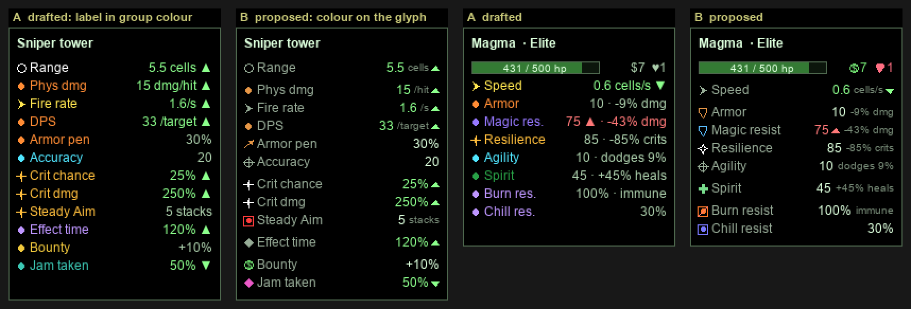

# Feature Request: Uniform stat presentation

## Summary

Every stat the player sees, on towers and enemies, reads the same way: its value with a unit, a short
human-readable meaning beside it where it fits, and a hover that explains it in detail. Value first,
meaning second: a row never shows only what a stat does without the number behind it.

## Current state (what exists today)

### Where stats show

| # | Surface | Built by | When | Numbers | Row hover |
|---|---|---|---|---|---|
| T1 | Toolbar tower button tooltip | `TowerSheetText.shopTooltip` | static | authored base; no delivery rows (rotation, projectile speed/size) | none |
| T2 | Info pane while placing | `TowerSheetText.shop` | static | authored base, all rows | none |
| T3 | Info pane, selected tower | `TowerSheetText.status` | live | `base → current`, green/red trend | none |
| T4 | Upgrade node tooltip / owned-perk icon tooltip | `UpgradeSheetText`, `NodeEffects.bonuses` → `TowerStat.describe` | static | the node's bonus: `Crit damage  +50%` | — |
| T5 | Tower buff/debuff icon tooltip | `TowerStatus.describe` | live | one sentence: `+20% damage, +20% range` | — |
| E1 | Wave-preview enemy hover | `EnemyStatText.preview` | static | the spawned rank's base | none |
| E2 | Info pane, selected enemy | `EnemyStatText.live` | live | current, green/red trend | **breakdown**: Base, one line per trait or effect kind (already merged per kind, without a stack count), Now |
| E3 | Effect icon tooltip on an enemy | `EnemyStatText.effectRows` | live | Time left `2.5 s`, Stacks `2 / 3`, Absorbs `40 / 80`, Slows `30%` | — |
| R | `README.md` tables | hand-written | static | prose (`+25 armor`, `crits x2.0`) | — |

The board draws no stat: only health bars, rank badges and trait/effect markers.

### Tower stats

`TowerStat` holds 39 stats with a label and a `Unit`, but the tower sheet (T1–T3) shows a separate,
fixed list, `TowerStatRow`:

| Row (T1–T3) | Shown as | Unit on screen | From |
|---|---|---|---|
| Range | `3.5` | none (cells) | `RANGE` |
| Physical / Magic damage | `12` | none (points per hit) | `DAMAGE`, typed by capability |
| Fire rate | `1.3/s` | `/s` | cooldown × `1 + ATTACK_SPEED` |
| Rotation (Radar) | `3 s/turn` | `s/turn` | revolution time |
| Crit chance | `15%` | `%` | `CRIT_CHANCE`; only when non-zero |
| Splash radius (Burst, Mortar) | `1.2` | none (cells) | `AREA_RADIUS` |
| Projectile speed (Mortar, Hive) | `4 cells/s` | `cells/s` | shell/missile speed |
| Projectile size (Mortar, Hive) | `1.5x` | `x` | shell/missile size |

Every other `TowerStat` has no row anywhere. It shows only as a *change* — an upgrade node's bonus
(T4) or a buff's sentence (T5) — so after buying `+50% crit damage` the player can't see the crit
damage the tower now has:

- **Universal, never shown as a value:** Crit damage (`CRIT_MULTIPLIER`), Armor penetration (%),
  Armor ignored (flat), Magic penetration, Flat penetration, Accuracy, Bounty, Effect duration, Buff
  duration, Disruption taken, Wither interval. Jamming has no row: the Jammed icon's tooltip says it in
  a sentence (`-30% attack speed, -1 range, 20% miss chance`), and those numbers are the enemy's raw
  penalty, before the tower's Disruption taken scales it (`AbstractTower.jammedCondition` reads
  `TowerStats.disruption()`; the stats themselves apply `× DISRUPTION_TAKEN`). Under a Beacon the
  tooltip overstates the jam it describes.
- **What a tower gives others is never a value on its own sheet.** A Beacon shows Buff strength; the
  `+20% damage, +20% range` it hands out appears only on the receiving tower's Aura icon, and in the
  node bonuses as `Nearby damage +20%`.
- **Per-tower, never shown as a value:** Dead zone, Blast edge damage, Saturation cap and inner
  stacks, Shell size/speed as stats, Bracketing step, Cone width, Wave speed, Burn duration, Stoke
  step and grace, Burn pool cap, Scorched rate, Toll cap/rate/linger, Freeze duration, Nest, Missiles
  a shot, Pings, Steady Aim stacks, Buff strength.

### Enemy stats

`EnemyStat` holds 17 stats with no label; `EnemyStatText.statText` names and formats them. E1/E2 show
Speed always and any other stat off its default; the three effect resists and Stealth never get a row
(traits show them).

| Stat | Label | Shown as | Value or meaning |
|---|---|---|---|
| Health | health bar | `431 / 431` in the bar, `$5` bounty beside it | value |
| Move speed | Speed | `24 px/s` | value (pixels, unlike every tower distance in cells) |
| Armor | Armor | `30` | value only — not what 30 does |
| Magic resist | Magic resist | `25` | value only |
| Plating | Plating | `-2/hit` | value (as a loss) |
| Insulation | Insulation | `-2/hit` | value (as a loss) |
| Physical/Magic damage taken | Physical taken / Magic taken | `115%` | value |
| Periodic damage taken | Over time taken | `115%` | value |
| Resilience | Resilience | `-30% crits` / `+20% crits`; `Crit immune` at 100 | **meaning only** |
| Agility | Agility | `25, dodges 20%` | value **and** meaning — the model the request asks for |
| Spirit | Spirit | `+20% heals, debuffs 1.2x faster` | **meaning only** |
| Healing received | Heals received | `50%` | value |
| Regeneration | Regenerates | `1/s` | value |
| Chill/Burn/Freeze resist | — (trait icon) | ward on the icon; `Chill immune` at 1 | not a row |
| Stealth | — (buff icon) | `Stealthed` | not a row |
| Dodges (live tally) | Dodged | `3 hits` | value |

### Inconsistencies found

1. **Three number formatters.** `SheetNumbers.decimal` (one decimal), `TowerStat.Unit` (two),
   `TermNumbers.number` (two). The same 1.25 cells reads `1.3` on the sheet and `1.25` in a node.
2. **One stat, several names.** Splash radius (row) / Blast radius (`AREA_RADIUS`); Projectile speed /
   Shell speed; Fire rate `1.3/s` (row) / Attack speed `+25%` (node); Crit damage as `+50%` (node) /
   `x2.0` (README); Regeneration / "Regenerates"; Periodic damage taken / "Over time taken".
3. **Units missing or mixed.** Range, damage and splash radius have no unit; enemy speed is `px/s`
   while projectile speed is `cells/s`.
4. **Value vs meaning mixed.** Armor shows value only; Resilience and Spirit meaning only; Agility
   both; Stealth and Crit immune a label only.
5. **Multipliers read two ways.** An enemy breakdown writes a multiplier as `x0.5`; a tower bonus
   writes the same multiplier as `-50%`.
6. **Hovers are uneven.** Only live enemy rows (E2) open a hover, and it shows the arithmetic
   (base, sources, now), not what the stat does. Tower rows and preview rows open nothing.
7. **Tower sheet hides most stats** (above): what an upgrade changed often has no row to change.

## What this feature adds

One presentation for every stat, on towers and enemies, on live entities (a placed tower, a selected
enemy) and catalog ones (toolbar tooltip, placing sheet, wave preview):

- Each stat row reads **glyph · short label · value with unit and short meaning**: the painted glyph
  in the colour the board already gives the thing, the value bright, the label muted, unit and meaning
  dim. It opens a hover explaining the stat with a breakdown of what changed it.
- Sheets show many more stats: every stat off its default, so what an upgrade changed always has a
  row; a DPS row on every tower that fires; what a support tower gives; an enemy's lives cost.
- Stat names in prose become hoverable mentions, like effects and traits already are; prose, Aura and
  Jammed tooltips use the same names, numbers and change forms as rows.
- Upgrade nodes show what a stat would become, not only the change.
- Every number on a sheet, stat or not, uses one number format and one set of units.
- Out of scope: the board (no stat is drawn on it), the dev panel, balance reports, a held key for
  formulas.

## Constraints and open risks

- `td.term` / `TermText` are the vocabulary layer, and stats have no `Term` today; prose mentions
  need stats to be mentionable like effects are.
- `TowerStatRow` exists apart from `TowerStat` because some rows are not one stat (fire rate is a
  cooldown × attack speed; damage type comes from a capability). One name per stat touches both.
- Today only enemies record a per-source breakdown (`StatBreakdown`), merged per trait or effect kind
  but without a stack count. A tower's stats are resolved from its own modifiers, received auras and
  disruption without keeping which source gave what.
- Upgrade-node previews need a tower's stats resolved as if a node were bought, from its lasting
  stats only, without buying it.
- Disruption is applied as an additive attack-speed and range penalty scaled by Disruption taken; the
  Jammed tooltip today shows it unscaled (see Current state).
- `EnemyDefinition.livesOnLeak` exists (with `ALL_LIVES` for level-ending bosses) but is not part of
  `EnemyInspection`.
- The Info pane is ~170 px wide; whether a stat's meaning fits inline is checked once per stat, at its
  widest realistic value and the narrowest pane.
- More rows and a hover on each, rebuilt with every frame for a live tower or enemy, fall under the
  frame-build budget (≤ 1 ms, ≤ 512 KB p99); hovers must survive a rebuild (they do today for enemy
  rows via `TooltipLayer.sheetChanged`).
- Today `Row.toned` colours the glyph and the label; rows painted by this feature colour the glyph
  only, and that holds for every sheet row, traits and effects included.
- Hover is already shown one way: `SheetPane.highlight` fills whatever hover target is under the mouse
  (row, icon, mention). Nothing in this feature adds another hover cue.
- Row glyphs are painted by `Java2DFrameRenderer.paintRowGlyph`; the grammar below adds about ten
  shapes. The status bar already paints cash and lives pictograms.
- Tests: wording stays out of tests that assert built-in text ("test mechanics, never content"); the
  uniformity guard is a rule every stat keeps, like `TermWordingTest`.
- `README.md` describes stats in prose; it moves to the full names and units in the same change.

## Decisions made

Round 1 settled the first set, round 2 reworded and extended it, round 3 (visual) settled colour,
glyphs and text. The list below is the current state; later rounds overrode earlier ones in place.

**Rows**

1. **Row shape.** Painted glyph · short label · value, then its unit and short meaning. No separator:
   the unit and meaning are dim, so `Armor  10 -9% dmg` reads as one value and its gloss. Examples:
   `Armor 30 -23% dmg`, `Magic resist 25 -20% dmg`, `Agility 25 dodges 20%`,
   `Resilience 30 -30% crits`, `Spirit 20 +20% heals`. Where the value already is the meaning it shows
   once: `Plating -2 dmg/hit`.
2. **Hover on every row.** Full name, one sentence on what the stat does (no arithmetic), then on a
   live row a breakdown: Base; each kind of source once with its combined effect and a stack count
   (`Sunder ×3  -15`), only sources that change this stat; additive sources summed in a `together`
   subtotal, multipliers after it, each source where it really combines; Now.
3. **Which rows show.** A tower's core rows by how it deals damage: a hit tower Range, Damage
   `/hit`, Fire rate (Radar: Sweep time in place of Fire rate); a field tower Range, Damage `/s`; a
   passive tower Range, then a **Gives** group of what it hands out, in the same row format. An
   enemy's core row is Speed. Any other stat shows when its base or current value is off its default.
   Two also show at their default: Crit damage while Crit chance > 0, and Effect time on a tower that
   applies any effect. Each such pair is a row in the stat table, not code per stat.
4. **Live sheets** show the resulting value only; the tower `base → current` arrow goes. Tower rows get
   the same breakdown hover as enemy rows.
5. **Catalog sheets** (toolbar tooltip, placing sheet, wave preview) use the same rows and format with
   base values, no trend, a hover without a breakdown. The toolbar tooltip shows every row.
6. **A stat at its floor** still shows while its base is off default, its meaning dropped: `Armor 0 ▼`.
7. **A row shows the sheet value.** Stacks and per-hit bonuses (Steady Aim, bonus damage against a
   kind, procs) are named in the row's hover (`Steady Aim +5% a shot, 3 now`) and stay on their icons
   and perk text.
8. **DPS.** Every tower with a Fire rate shows `DPS  21 /target`: damage × fire rate × average crit,
   before armor. Its hover names what it leaves out: splash count, burns and effects, procs, misses.
   The Scorcher counting its burn, and a live per-wave DPS, are deferred: `TODO.md`, "The planned DPS
   row undersells burn and splash towers".
9. **Effect resists get rows** (`Freeze resist 100% immune`); trait icons keep their ward. Resilience
   100 reads `100 crit immune`. Stealth stays an icon only: a state, not a number.
10. **Overflow.** A meaning that doesn't fit stays in the hover; value, unit and arrow are never cut.
    Inline or hover-only is fixed per stat in the stat table, never decided at runtime, so a row never
    blinks. Tower rows carry an inline meaning only where the number alone misleads (Wither).
11. **Fixed row order in groups, no headers, a 4 px gap between groups**, on every sheet. Tower:
    reach → damage → crit → effects → delivery → economy → gives. Enemy: speed → defence against hits →
    damage taken → healing → resists.

**Names, numbers, units**

12. **One name per stat, two fixed forms**: a short form on rows and node bonuses, a full form on hover
    titles, mentions and the README; no other spelling anywhere. The short form is whole words with no
    full stops, and is the full name whenever that fits in 12 characters (`Magic resist`,
    `Crit damage`, `Regeneration`). Generic names: Fire rate (replacing Attack speed), Blast radius,
    Projectile speed / size, DoT taken, Regeneration; shell and missile stay in prose. The damage row
    keeps its type: `Phys damage` / `Magic damage`.
13. **A change reads by its kind**, on towers and enemies alike: flat in the stat's unit (`+0.5 cells`,
    `-10`), additive percent `+25%`, multiplier `x0.7`, set `= 0`, cap `at most 75%`.
14. **A factor value reads as a percent**: `Crit damage 250%`, `Effect time 120%`, `DoT taken 115%`.
    `x` only ever marks a multiplier change.
15. **One number format**: at most one decimal, two below 1, trailing zeros dropped; percents whole.
    From 10,000 abbreviated (`12.3k`, `1.2M`); health bars always in full.
16. **Units**: cells, s, /s, dmg, hp (hp/s), °, $, lives. Nothing per tick, nothing in px; enemy speed
    is cells/s. A unit never repeats its label: `Phys damage 15 /hit`, `DPS 33 /target`,
    `Fire rate 1.6 /s`; `Plating -2 dmg/hit` keeps `dmg` because its label doesn't say damage. Which
    unit a stat writes is fixed in the stat table.
17. **Every number on a sheet** follows 15 and 16, stat or not: health bar `431 / 500 hp`, bounty,
    sell price, XP, `Kills 12 · 1234 dmg`, effect rows (`Time left 2.5 s`, `Absorbs 40 / 80 hp`),
    upgrade prices and refunds. Their layout stays; they get no hover.
18. **Lives on leak** beside the bounty, catalog and live, with the status bar's painted cash and lives
    pictograms: `[$]5 [♥]1`; a level-ending boss `[♥]all`.

**Look**

19. **Trend.** The value's colour says better (green) or worse (red) *for the player*, on towers and
    enemies. Each stat is higher-better, lower-better or neutral; a changed neutral value keeps the
    plain value colour. Trend colours are palette roles.
20. **Arrow.** A changed value carries a painted ▲ or ▼ for which way the number moved; colour says
    whether that is good. A risen dead zone reads `2 cells ▲` in red. Neutral stats get the arrow too.
21. **Colour says what a thing is.** A stat's glyph takes the colour the board already gives that
    thing: physical `#E69646`, magic `#5ABEFF`, the white crit spark, an effect's own marker colour,
    heal green, jam pink, aura, cash, lives. A stat the board doesn't colour gets the neutral unmarked
    glyph. No new hue. Only the glyph is coloured; label and value never take a stat's colour.
22. **Text hierarchy**, on every row type: value bright (`#DCFFDC`, or its trend colour), label muted
    (`#96AA96`), unit and meaning dim at the prose size (11 px).
23. **Glyph grammar.** Every glyph is painted, none comes from a font. Filled is what a tower brings;
    hollow is the enemy's counter to it (spark / hollow spark, pierce / shield, crosshair with a filled
    centre / hollow crosshair). A stat that belongs to an effect wears that effect's face; a timed stat
    the board's filled diamond. The table below gives each stat its glyph and tone.
24. **The highlight under the mouse says a thing can be hovered.** `SheetPane`'s existing highlight
    marks every hover target (row, icon, mention) the same way; nothing carries a static hover mark,
    and nothing is coloured to say it hovers.

**Hovers, mentions, prose**

25. **Stat mentions.** A stat named in any prose is a hoverable mention, like an effect mention: its
    glyph, then the word in the stat's colour (the neutral text colour for an unmarked stat). It opens
    the stat's meaning hover (no breakdown).
26. **Prose follows the same rules**: full names, number format and change forms in effect
    descriptions and upgrade sentences. The Aura and Jammed tooltips list their changes as stat rows,
    the jam scaled by Disruption taken.
27. **Upgrade nodes** show the change and the result on the selected tower's lasting stats (base,
    upgrades, auras; no jam, no timed buff): `Fire rate +25% 1.3 → 1.6 /s`. While jammed, the row is
    lower than the preview's left side; accepted. An owned perk's icon shows the change only.

**Process**

28. **The stat table below is part of this request**, reviewed before planning.
29. **A rule test guards uniformity**: every stat has both names, a unit, an inline meaning or
    hover-only, a direction, a group, a glyph and a tone, and its widest row fits the narrowest pane.
30. **README** moves to the full names and units; the **board** stays out of scope; **no** held key for
    formulas in v1. The astral/quantum theme idea plays no part here.

## Stat table

Columns: **Short** (row, node bonus) · **Full** (hover, mention, README) · **Value** (format and unit;
the unit is dim) · **Inline** (the dim meaning after the value; — means hover-only) · **Dir** (▲ higher
is better for the player, ▼ lower is better, ◇ neutral) · **Glyph** · **Tone** (an existing palette
colour; *unmarked* is the neutral glyph colour) · **Shows**. The group is the row's place in the order
(decision 11). Meanings and fits are checked against the pane by the rule test (29).

### Glyphs

| Glyph | Shape | Used by |
|---|---|---|
| Ring | hollow circle (today's `RING`) | Range |
| Ring + centre | ring with a dot | Blast radius, Blast edge |
| Broken ring | ring with a gap | Dead zone |
| Wedge | a cone slice | Cone width |
| Dot | filled dot (today's `DOT`) | Damage |
| Damage chevron | chevron in the damage colour | DPS, Bracketing |
| Chevron | today's `CHEVRON` | Fire rate, Sweep time, enemy Speed |
| Pierce | short arrow through a line | the penetrations |
| Crosshair, filled centre | ring + cross + centre dot | Accuracy (tower brings) |
| Crosshair | ring + cross | Agility (enemy counters) |
| Spark | the board's crit spark | Crit chance, Crit damage |
| Hollow spark | outline of the spark | Resilience |
| Hollow shield | shield outline | Armor, Magic resist |
| Filled shield | solid shield | Plating, Insulation |
| Cracked shield | shield with a crack | the damage-taken stats |
| Plus | painted plus | Spirit, Healing, Regeneration |
| Filled diamond | the board's timed-effect mark (today's `FILLED_DIAMOND`) | Effect time, Buff time, Disruption taken |
| Effect face | the effect's term face, as mentions draw it | stats that belong to one effect |
| Effect face + ward | the trait icon's ward | effect resists |
| Comet | dot with a short trail | Projectile speed / size, Flame wave speed |
| Pip | today's `PIP` | Nest, Missiles, Pings |
| Aura ring | ring | Buff strength |
| Cash, Lives | the status bar's pictograms | Bounty; bounty and lives beside the health bar |

### Tower rows

| Stat | Short | Full | Value | Inline | Dir | Glyph | Tone | Shows |
|---|---|---|---|---|---|---|---|---|
| `RANGE` | Range | Range | `4.5 cells` | — | ▲ | Ring | unmarked | core |
| `DEAD_ZONE` | Dead zone | Dead zone | `1.5 cells` | — | ▼ | Broken ring | unmarked | off default |
| `AREA_RADIUS` | Blast radius | Blast radius | `1.2 cells` | — | ▲ | Ring + centre | unmarked | off default |
| `BLAST_EDGE` | Blast edge | Blast edge damage | `40%` | — | ▲ | Ring + centre | unmarked | off default |
| `CONE_WIDTH` | Cone width | Cone width | `90°` | — | ◇ | Wedge | unmarked | off default |
| `DAMAGE` | Phys damage / Magic damage | Physical / Magic damage | `12 /hit`; field `7 /s` | — | ▲ | Dot | damage type | core |
| Fire rate (cooldown × `ATTACK_SPEED`) | Fire rate | Fire rate | `1.3 /s` | — | ▲ | Chevron | unmarked | core (hit towers) |
| Sweep (Radar's turn) | Sweep time | Sweep time | `3 s` | — | ▼ | Chevron | unmarked | core (Radar) |
| DPS (derived) | DPS | Damage per second | `21 /target` | — | ▲ | Damage chevron | damage type | with Fire rate |
| `BRACKET_DAMAGE_STEP` | Bracketing | Bracketing step | `+10%` | — | ▲ | Damage chevron | physical | off default |
| `CRIT_CHANCE` | Crit chance | Critical chance | `25%` | — | ▲ | Spark | crit spark | off default |
| `CRIT_MULTIPLIER` | Crit damage | Critical damage | `250%` | — | ▲ | Spark | crit spark | also at default while Crit chance > 0 |
| `AIM_STACKS` | Steady Aim | Steady Aim stacks | `5 stacks` | — | ▲ | Effect face | Steady Aim | off default |
| `ARMOR_PENETRATION` | Armor pen | Armor penetration | `30%` | — | ▲ | Pierce | physical | off default |
| `ARMOR_PENETRATION_FLAT` | Armor pierce | Armor ignored | `10` | — | ▲ | Pierce | physical | off default |
| `MAGIC_PENETRATION` | Magic pen | Magic penetration | `30%` | — | ▲ | Pierce | magic | off default |
| `FLAT_PENETRATION` | Flat pen | Flat penetration | `50%` | — | ▲ | Pierce | unmarked | off default |
| `ACCURACY` | Accuracy | Accuracy | `20` | — | ▲ | Crosshair, filled centre | unmarked | off default |
| `EFFECT_DURATION` | Effect time | Effect duration | `120%` | — | ▲ | Filled diamond | unmarked | also at default on a tower that applies an effect |
| `BUFF_DURATION` | Buff time | Buff duration | `120%` | — | ▲ | Filled diamond | tower buff | off default |
| `BURN_DURATION` | Burn time | Burn duration | `4 s` | — | ▲ | Effect face | Burn | off default |
| `STOKE_STEP` | Stoke step | Stoke step | `+10%` | — | ▲ | Effect face | Stoke | off default |
| `STOKE_GRACE` | Stoke grace | Stoke kept after leaving | `1.5 s` | — | ▲ | Effect face | Stoke | off default |
| `BURN_POOL_CAP` | Burn cap | Burn pool cap | `200%` | — | ▲ | Effect face | Burn | off default |
| `BURN_MARK_RATE` | Scorch rate | Scorch rate | `150%` | — | ▲ | Effect face | Scorch | off default |
| `FREEZE_DURATION` | Freeze time | Freeze duration | `1.5 s` | — | ▲ | Effect face | Freeze | off default |
| `SATURATION_CAP` | Saturation | Saturation cap | `5 stacks` | — | ▲ | Effect face | Saturation | off default |
| `SATURATION_INNER_STACKS` | Inner sat | Saturation in the inner half | `2 stacks` | — | ▲ | Effect face | Saturation | off default |
| `TOLL_CAP` | Toll cap | Toll cap | `10 stacks` | — | ▲ | Effect face | Toll | off default |
| `TOLL_RATE` | Toll rate | Toll a second | `2 /s` | — | ▲ | Effect face | Toll | off default |
| `TOLL_LINGER` | Toll linger | Toll lingers | `2 s` | — | ▲ | Effect face | Toll | off default |
| `WITHER_INTERVAL` | Wither | Wither interval | `3 s` | `Vulnerable` | ▼ | Effect face | Vulnerable | off default |
| `PROJECTILE_SPEED` | Proj speed | Projectile speed | `4 cells/s` | — | ▲ | Comet | unmarked | off default (Mortar, Hive: base sets it) |
| `PROJECTILE_SIZE` | Proj size | Projectile size | `150%` | — | ◇ | Comet | unmarked | off default |
| `WAVE_SPEED` | Wave speed | Flame wave speed | `120%` | — | ▲ | Comet | unmarked | off default |
| `NEST_CAPACITY` | Nest | Nest capacity | `6 missiles` | — | ▲ | Pip | unmarked | off default |
| `MISSILES_PER_LAUNCH` | Missiles | Missiles a shot | `3` | — | ▲ | Pip | unmarked | off default |
| `PING_COUNT` | Pings | Pings | `2` | — | ▲ | Pip | unmarked | off default |
| `BOUNTY` | Bounty | Bounty bonus | `+10%` | — | ▲ | Cash | cash | off default |
| `DISRUPTION_TAKEN` | Jam taken | Disruption taken | `50%` | — | ▼ | Filled diamond | disruption | off default |
| `AURA_POWER` | Buff power | Buff strength | `120%` | — | ▲ | Aura ring | aura | off default |
| Gives (an emitter's modifiers) | the stat's own short form | the stat's own full form | the change: `Damage +20%` | — | ▲ | the stat's own | the stat's own | an emitting tower |

### Enemy rows

| Stat | Short | Full | Value | Inline | Dir | Glyph | Tone | Shows |
|---|---|---|---|---|---|---|---|---|
| `MOVE_SPEED` | Speed | Move speed | `1.2 cells/s` | — | ▼ | Chevron | unmarked | core |
| `ARMOR` | Armor | Armor | `30` | `-23% dmg` | ▼ | Hollow shield | physical | off default |
| `MAGIC_RESIST` | Magic resist | Magic resist | `25` | `-20% dmg` | ▼ | Hollow shield | magic | off default |
| `PLATING` | Plating | Plating | `-2 dmg/hit` | (the value) | ▼ | Filled shield | physical | off default |
| `INSULATION` | Insulation | Insulation | `-2 dmg/hit` | (the value) | ▼ | Filled shield | magic | off default |
| `RESILIENCE` | Resilience | Resilience | `30` | `-30% crits`; `+20% crits` below 0; `crit immune` at 100 | ▼ | Hollow spark | crit spark | off default |
| `AGILITY` | Agility | Agility | `25` | `dodges 20%` | ▼ | Crosshair | unmarked | off default |
| `PHYSICAL_DAMAGE_TAKEN` | Phys taken | Physical damage taken | `115%` | — | ▲ | Cracked shield | physical | off default |
| `MAGIC_DAMAGE_TAKEN` | Magic taken | Magic damage taken | `115%` | — | ▲ | Cracked shield | magic | off default |
| `PERIODIC_DAMAGE_TAKEN` | DoT taken | Damage over time taken | `115%` | — | ▲ | Cracked shield | unmarked | off default |
| `SPIRIT` | Spirit | Spirit | `20` | `+20% heals` | ▼ | Plus | heal | off default |
| `HEALING_RECEIVED` | Healing | Healing received | `50%` | — | ▼ | Plus | heal | off default |
| `REGENERATION` | Regeneration | Regeneration | `1 hp/s` | — | ▼ | Plus | heal | off default |
| `CHILL_RESIST` | Chill resist | Chill resist | `50%` | `immune` at 100% only | ▼ | Effect face + ward | Chill | off default |
| `BURN_RESIST` | Burn resist | Burn resist | `50%` | `immune` at 100% only | ▼ | Effect face + ward | Burn | off default |
| `FREEZE_RESIST` | Freeze resist | Freeze resist | `50%` | `immune` at 100% only | ▼ | Effect face + ward | Freeze | off default |
| `STEALTH` | — | Stealth | — | — | — | — | — | never: Invisibility icon |

Not stats, on the same sheets (decision 17): health bar `hp`, bounty and lives pictograms, Dodged
`3 hits`, tower XP and rank, `Kills · dmg`.

## Open questions

None. The request is ready for planning.

## Review — round 2 (outcomes)

How other games show stats; jTD's takeaway in the last column.

| Game | What it does | Takeaway for jTD |
|---|---|---|
| World of Warcraft | Character sheet: `Haste 12%`, hover `840 rating: +12% haste — increases attack and cast speed`. Item hovers compare against what is equipped, gains green and losses red, side by side. | Value + meaning + hover; node previews. |
| League of Legends | Stat panel of icon + number: the icon coloured, the number white. Hover: `Armor 30 — reduces physical damage taken by 23%`. Bonus shown apart from base: `60 (+40)`. | Glyph-only colour (21); additive percents of base (2). |
| Dota 2 | Damage `53–57 +12`: base white, bonus green, a penalty red. Armor's hover shows physical resistance %. | A second cue beside colour (20). |
| Diablo III / IV | Item compare uses ▲▼ arrows in green/red; a derived DPS headline. `Armor 5,000 — 70% physical damage reduction`. | Arrows (20); DPS row (8). |
| Path of Exile | `Evasion 1,200 — estimated chance to evade 45%`. Modified values blue whatever the direction. | Considered, not taken: colour means better/worse (19). |
| Kingdom Rush | Icon + short number rows on tower and enemy cards; every enemy card shows **Lives**. | Lives on leak (18). |
| Slay the Spire / Hearthstone | A keyword in card text opens its definition beside the card. | Stat mentions (25). |

| Item | Outcome |
|---|---|
| ✅ D1 One name or two | One name, a short and a full form (12). |
| ✅ D2 Factor values | Percent; `x` only for a multiplier change (14). |
| ✅ D3 Colour direction | Better/worse for the player; neutral allowed (19). |
| ✅ D4 Colour-only cue | Painted ▲▼ for the value's direction (20). |
| ✅ D5 Preview base | Lasting stats, no jam or timed buff (27). |
| ✅ D6 Additive sums | Sources, a `together` subtotal, then multipliers (2). |
| ✅ D7 Core rows | By delivery; passive towers show Gives (3). |
| ✅ D8 Stack counts | New data in the breakdown (2; Constraints). |
| ✅ M1 Non-stat numbers | Same format and units, layout kept (17). |
| ✅ M2 Lives on leak | Beside the bounty (18). |
| ✅ M3 DPS | Every tower with a Fire rate, per target (8); burn and live DPS in `TODO.md`. |
| ✅ M4 Transient bonuses | Sheet value; the hover names them (7). |
| ✅ M5 What a support tower gives | Gives group (3). |
| ✅ M6 Prose | Same rules; Aura and Jammed as rows (26). |
| ✅ M7 One look per stat | Round 2 picked LoL colours per group; round 3 replaced that with the board's colours on the glyph only (21, 23). |
| ✅ M8 At the floor | Shows, meaning dropped (6). |
| ✅ W1 Meanings deferred | Stat table in this request (28). |
| ✅ W2 Overflow | Meaning to the hover, fixed per stat (10). |
| ✅ W3 Pairs | Crit damage and Effect time (3). |
| ✅ W4 Guard | Rule test (29). |
| ✅ W5 Detail key | Not in v1 (30). |

## Review — round 3 (visual, outcomes)

The mock renders a late-game Sniper and an Elite Magma at the pane's real width with the game's own
colours and font (Arial is what `Dialog` resolves to on Windows): **A** is the round-2 draft (label in
a new LoL-like colour per group), **B** the counter-proposal round 3 adopted. Shown at 2x. B draws its
unit and meaning at 10 px; decision 22 sets 11 px.

**Why the draft was replaced.** Twelve label colours on a 170 px pane read as a 90s web page. Its warm
hues were one colour to the eye (CIEDE2000 amber/gold 7.1, yellow/gold 7.5, amber/yellow 13.5), and
they collided with colours the board already owns: physical orange vs Burn 5.5, yellow vs Haste 3.8,
gold vs Exposed 3.5, white-gold vs the Beacon aura 1.9, blue-violet vs Chill 5.3. LoL itself colours
the stat icon, not the text, and the board's physical and magic colours already match LoL's. The
label was brighter than the value, the meaning read as a second value, units repeated the label, and
typed symbols (▲ ▼ ♥ $ ✚) render differently per OS. (Measured on the nearest plausible pick for each
named colour, since the draft gave none.)

| Item | Outcome |
|---|---|
| ✅ V1 Where colour goes | The glyph only, on every sheet row (21). |
| ✅ V2 Which colours | The board's own colours; no new hue; replaces round 2's LoL colours (21). |
| ✅ Mentions | Glyph + word in the stat's colour, like effect mentions (25). |
| ✅ Hover cue | The existing highlight under the mouse; no static mark (24). |
| ✅ V3 Glyph grammar | Adopted, with accuracy/agility as a filled/hollow pair (23). |
| ✅ V4 Text hierarchy | Value bright, label muted, unit and meaning dim at 11 px (22). |
| ✅ V5 Meaning and unit | No separator; a unit never repeats its label (1, 16). |
| ✅ V6 Symbols | All painted; status-bar pictograms for cash and lives (18, 23). |
| ✅ V7 Neutral accent | Dropped (19). |
| ✅ V8 Trend colour | Green/red kept; the theme idea set aside (19, 30). |
| ✅ V9 Short labels | Whole words, full name when it fits 12 characters (12). |
| ✅ V10 Group gaps | 4 px between groups (11). |
| ✅ Q1 Shown at default | Crit damage and Effect time (3). |
| ✅ Q2 Tower meanings | Inline only where the number misleads (10). |
| ✅ Q3 Delivery/Support colours | Moot: no new colours (21). |
