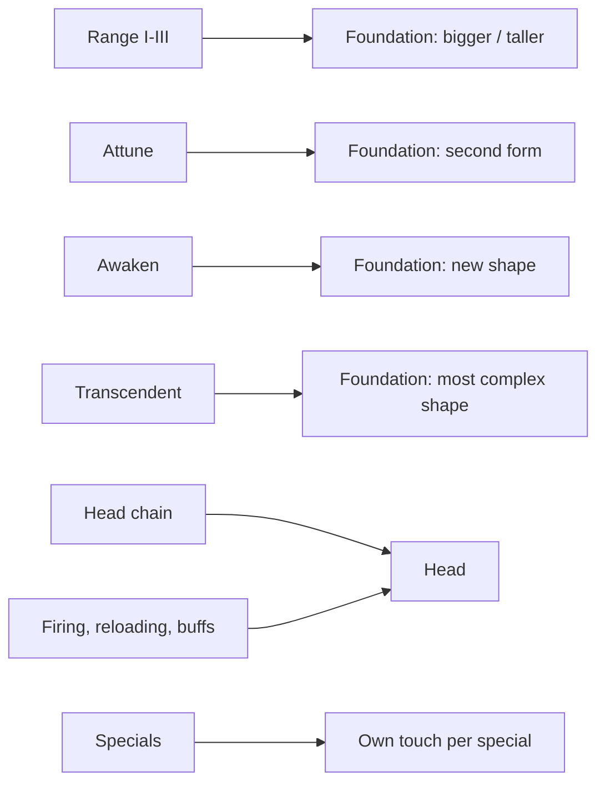

# Feature Request: Tower Visual Revamp

**Status:** draft, 2026-10-21. Sniper and Burst are written; the other six towers follow before
planning starts.

## Summary

Make the board calmer and the towers nicer to look at. Every tower becomes a small piece of art in two
parts: a **foundation** that never moves and shows what the tower has grown into, and a **head** that
aims and reacts when it fires or reloads. Upgrades stop being marks around the tower (pips, chevrons,
halos, rank diamonds) and become the tower's own shape. Shots get a sense of flight. The toolbar gets
new icons to match. The art follows the style the term icons, effect pictograms and header strip set:
flat vector, few colours, one clear silhouette.

The feature changes visuals, not mechanics. The only rules it may change are shot timing: how fast a
shot flies, the path it takes and when it lands. Abilities, perks and numbers stay.

## Current state (what exists today)

### What a tower draws

Every tower is drawn by `TowerSpriteFrameBuilder` (sprite and head) and `TowerEffectFrameBuilder`
(transients), painted by `Java2DFrameRenderer`:

| Layer | Today | Where |
|---|---|---|
| Body | One closed flat shape per type (`towerBodyShape`): Sniper triangle, Burst ring, Radar spiral, Obelisk star, Beacon pulsar, Mortar diamond, Hive kite, Scorcher flame. Fill at alpha 130/255, solid outline. 0.42 of a cell. Never turns. | `paintTowerBody` |
| Head | One shape per type (`turretHeadShape`), 0.24 of a cell, rotated to the aim. Sniper: a short bar (gold once Transcendent). Burst: a square block. Obelisk: a spinning star. Beacon: a pulsing circle (0.8x to 1.25x). Radar: its sweep. | `paintTurretHead` |
| Slot pips | One dot per owned node under the tower, grouped by slot in slot colours; Transcendent's pip is a gold diamond. | `paintSlotPips` |
| Ready chevrons | One up chevron per slot with an affordable, ungated node, in that slot's colour, above the tower. | `paintSlotReadyChevrons` |
| Enchant halo | A ring that pulses for as long as the tower owns any special. | `paintEnchantHalo` |
| Transcendent halo | A ring of gold dashes, one turn every 12 s. | `paintTranscendentHalo` |
| Rank pips | One silver diamond per rank above Recruit (Seasoned, Expert, Hero), stacked beside the tower. | `paintRankPips` |
| Rank-up glow | A ring that widens and fades over 30 ticks after a rank-up. | `paintRankUpGlow` |
| Jammed | A small marker in the top-right corner while disrupted. | `TowerStatusDraw` |
| Selection | A pink range circle. | `paintTowerSprite` |

Always-running motion: the Beacon's two breathing rings, pulsing head and a line to every tower it
buffs; the Obelisk's three ripple rings and spinning head; the Radar's sweep; the enchant halo; the
Transcendent halo. Cosmetic loops run on `animationSeconds`, so they keep moving while paused.

The toolbar icon (`renderTowerIcon`) is the body shape alone, one solid colour, 32 px, no head
("a two-tone glyph smudges at icon size").

### Shots today

- **Sniper:** instant. The shot lands the tick it fires. Its trace is a line to where the shot ended,
  `3 × cooldown left` wide, so it thins over the **whole** 2.5 s reload. A crit's trace is white, a
  Silver Round's is silver and 1.5x wide, a Transcendent's tracer is white. With Attune, a red aim
  laser to the target, brighter with each Steady Aim stack. Railgun's trace runs to the end of its line.
  A Ricochet bounce lands in the same tick as the shot and draws nothing.
- **Burst:** instant. A beam to the target thinning over the cooldown, then a detonation that spreads as
  a ring for 8 ticks. A Stormcaller's arcs are zigzags drawn all at once with the blast; a Hexer's cast
  is a fading purple beam to each cursed enemy. Fork colours tint the beam and the blast.
- **Mortar shells** (`CannonballProjectile`) fly straight on screen, a dot with an optional streak.
  **Hive missiles** turn and leave smoke.
- A hexed enemy shows one rune per hex in a row above it (`HexRuneDraw`).
- Mines (Burst Range III) and the Hexer's cursed clouds are ground zones (`Zone.mine`, `Zone.cloud`).

### What tower state the board can already read

- Primed-shot buffs are `TowerStatus`es: Silver Round (Silver Rounds), Deadeye Round (Fourth Shot),
  Charged Shot (Momentum), Patience (Marksman's Eye, after a dodge). Different ones stack, so two can
  ride the same shot. Frenzy (Focused Optics II) and Haste (Momentum, on a kill) are attack-speed
  buffs. All show in the tower pane's Buffs row (`TowerBuffState`).
- A Burst knows its fork (`SplashTower.fork()`: none, Stormcaller, Hexer).
- Timed visuals follow one idiom: the entity records the tick something happened and the frame builder
  turns it into a 0..1 progress.

### Answers to questions raised with this request

- **Does Steady Aim stack?** Only past one with Marksman's Eye. Every Sniper counts stacks, but its cap
  (`AIM_STACKS`) is 1 by default, 3 with Marksman's Eye and 5 with Unbroken Aim. Stacks do nothing until
  Attune, which gives each stack +10% crit chance and +10 accuracy; Marksman's Eye adds +20% damage per
  stack. Focused Optics leaves the cap at 1, and its "+25% attack speed while it has Steady Aim" needs
  only that one stack. The README's "the longer it keeps firing, the likelier it crits" is true only
  for an attuned Marksman's Eye Sniper.
- **Potency and Mastery** are the Burst's extra line, levels III and IV, not behind Transcendent.
  Potency needs Arc or Hex owned, and Mastery comes after Potency, so the fork is always chosen when
  either is offered. Their text still describes both forks ("Stormcaller: …; Hexer: …").
- **The wrapped-term hover bug** (a term whose name wraps onto a second line highlights a box over
  both whole lines): `SheetPane` builds a mention's hover box as the union of its first and last
  character's rectangles, which for a wrapped term spans the full width of both lines.
- **The tooltip that doesn't grow**: after a purchase, an open upgrade-button tooltip takes the next
  node's sheet through `TooltipLayer.refreshButtons` → `TooltipPanel.show`; the new, longer text is
  clipped to the old size.

## What this feature adds

### Anatomy of a tower (all towers)

- **Foundation**: the static part (base, body, plinth). It never moves or turns.
  - **Range I–III** make it read bigger or taller, a step per level.
  - **Attune, Awaken, Transcendent** change its shape and complexity, a step per level.
  - Fuller than today: more opaque fill.
- **Head**: the moving part. It aims where it does today and has its own animation for firing and
  reloading, in the tower's style (recoil, a flare, a charge building).
- **Specials** each add their own touch, chosen per special and free in form: a laser, a different
  bullet, a changed head, a mark on the enemy.
- **Tower buffs** that change the next shot or the fire rate show on the head while held, and they
  combine: a head holding two primed shots shows both.

### A calmer board (all towers)

- Gone: slot pips, per-slot ready chevrons, the enchant halo, the Transcendent halo, the gold
  Transcendent barrel.
- **Upgrade available**: one small green up arrow on the tower when it has an affordable node whose
  gate is met. One mark, whatever the slot.
- **XP ranks**: see open question 1.
- Idle towers stay still or nearly so. Motion means something happened: a shot, a reload, a buff, an
  effect landing. Always-on loops (aura rings, ripples, pulsing heads) are cut back or replaced per tower.
- Kept: the selection range circle, the Jammed marker.

### Shot timing (all towers)

- A shot may take flight time where it lands instantly today, and its trace may fade faster.
- **Every projectile except missiles flies on an arc**: up, then dropping like a cannonball or a
  mortar shell. This covers the Burst's ball, the Mortar's shells and Ricochet's bounces. It reads as
  height: a shadow on the ground, a size that grows and shrinks, or both. Hive missiles stay as they
  are.
- Each timing change is listed per tower below and goes through `BalanceReport --compare`.

### Toolbar icons (all towers)

- A new icon per tower that matches its new board look: at most two colours, a simple, distinctive
  silhouette (foundation plus head, or one of them), as plain as today's.
- The shop sells the base tower, so forks (Stormcaller, Hexer) don't get toolbar icons.

### Sniper

A watchtower with a long rifle. Keeps its triangle and its green.

**Foundation**

| Owned | Look |
|---|---|
| base | a triangle, as today, more opaque |
| Attune | two triangles, one pointing up and one down |
| Awaken | a hexagon |
| Transcendent | a hexagon made of triangles |
| Range I–III | the watchtower reads taller with each step |

**Head**: a long rifle barrel, recognisably a sniper's (a scope is welcome). It recoils when it fires
and settles back as it reloads.

**Shot**

- The tracer flies: it leaves the muzzle and reaches the enemy over 2–3 ticks, fast but visible as
  travel, then fades quickly (well inside the reload, unlike today's trace that lasts it all).
- A crit is still a white line.
- See open question 2 for whether damage lands when the line connects.

**Specials and perks**

| Perk | Look |
|---|---|
| Tradecraft II | a very faint ring at 2/3 of the range, where its bonus starts (open question 4) |
| Silver Rounds | the Silver Round has its own line, not just a silver tint; the head looks loaded (a silver tip, a glint) while it holds a Silver Round |
| Spotter Uplink | **renamed Spotter**. A light red aiming laser to the target while that target is past 1x range (open question 5) |
| Focused Optics II | Frenzy shows on the head: the barrel shakes, red sparks come off it, or similar |
| Momentum | Haste looks like Frenzy: one look for "firing faster". Charged Shot has its own head cue and its own shot |
| Fourth Shot | the Deadeye Round has its own head cue and its own shot |
| Marksman's Eye | Patience is a primed shot too and follows the same rule |
| Executioner | an execution has its own visual on the enemy it kills |
| Ricochet | the bullet visibly bounces from enemy to enemy, each hop an arc like a lobbed grenade, taking time to fly |
| Headhunter | the head looks different while it aims at an Elite or a Boss |
| Sunder Rounds | no visual change |

Primed shots (Silver Round, Deadeye Round, Charged Shot, Patience) can stack on one shot, so their head
cues must combine: each readable alongside the others, never one replacing another.

### Burst (Stormcaller, Hexer)

A hole in the ground that throws heavy balls. Keeps its circle and its red.

**Foundation**

- A pit, still round, that looks like a hole in the ground rather than a ring.
- It reads as something very heavy: a gravity well, the ground bent toward it. **Attune, Awaken,
  Transcendent** make it denser, a step per level.
- **Range I–III** make it read bigger, a step per level.
- **A fork changes the look completely:**
  - **Stormcaller**: a tesla coil.
  - **Hexer**: a witch with a cauldron.
  - Both keep their fork colour and keep Attune/Awaken/Transcendent and Range readable in their own
    way.

**Head and firing**: the hole (or coil, or cauldron) is the moving part: it flares when it throws and
settles as it reloads. Whether a turning head stays is open question 6.

**Shot**

- A small red ball thrown out of the pit at the (random) target on a high arc, the blast where it lands.
  It replaces today's instant beam. See open question 3 for how it hits.
- **Stormcaller**: the same throw, an electric ball in its colour; flight speed and arc may differ.
- **Hexer**: the same throw, a brew blob in its colour; flight speed and arc may differ.
- **Arc** lightning chains hop by hop with a short delay between hops, instead of all at once (open
  question 7).
- **Hex** casting: the curse visibly flies through the air to its target. Each hex kind (Blight, Doom,
  Contagion, the Covens, Inversion, Sympathy, Reckoning) has its own colour.
- A hexed enemy wears an overlay that reads as a curse, in its hex's colour, replacing or growing out of
  today's rune row.

**Mines** (Range III)

| Fork | Mine |
|---|---|
| none | a red pond |
| Stormcaller | an electric charge |
| Hexer | a cursed pond |

**Text**: Potency's and Mastery's descriptions show only the chosen fork's half. Before a fork is chosen
they are not offered, so no case shows both.

### Radar, Mortar, Scorcher, Hive, Obelisk, Beacon

To be written in the next session, in the same shape: foundation by level, head and its animation, shot
timing, specials and buffs, and what each stops doing all the time (Beacon rings and links, Obelisk
ripples and spin, the Radar's sweep).

### Fixes carried by this feature

- **A wrapped term's hover** highlights only the term's own text on each line it covers, and hovering
  either part opens its tooltip.
- **An open tooltip whose content changes** (a button's tooltip after a purchase, a live pane's tooltip)
  resizes to its new content and stays inside the window.

### Out of scope

- Tower abilities, perks, stats and numbers. Only shot timing may change.
- Enemy art, effect markers above enemies, zones other than the Burst's mines.
- The panes and their icons (the term icon feature owns them), except the two fixes above.

## Interconnections

- `FEATURE-effect-icons-and-terms.md` (implemented) set the icon style this art follows and made
  primed shots and attack-speed buffs named tower buffs; their head cues draw from the same state.
- `FEATURE-effect-visuals.md` set the enemy marker colours; the hex overlay and the execution mark sit
  beside those markers.
- `FEATURE-tower-progression.md` defined the base line (Range, Attune → Awaken → Transcendent) whose
  steps the foundation now shows.
- The README's tower section describes the pips, the special glow and the rank diamonds, and its tower
  table describes the Burst as instant; both change with this feature.

## Constraints and open risks

- **Frame budget**: every buildable cell a tower on the last level, frame build ≤ 1 ms and ≤ 512 KB
  (`td.PerformanceHarness`). Richer sprites, layered foundations and in-flight balls multiply draw
  commands per tower.
- **Readability at board size**: a tower is under half a cell (0.42), a head a quarter. Each level's
  shape must still read at the smallest board scale, and the Sniper's six foundation forms must stay
  distinct from each other and from other towers.
- **Shot timing touches balance and tests**: a Burst blast, a Sniper shot or a Ricochet bounce that
  lands later can miss a kill, lose a target to a dodge or overkill. Tests that assert damage the tick a
  shot fires will need to tick on; keep that churn small and mechanical.
- **The Burst never missed**: today it is instant and cannot miss. A lobbed ball either keeps that
  (guided) or becomes a cousin of the Mortar's unguided shell (open question 3).
- **Two clocks**: animation driven by game state (recoil, flight, reload) must use the tick clock so it
  pauses and speeds with the game; wall-clock loops keep running while paused, which is what the calm
  board wants less of.
- The renderer holds every shape and colour, keyed by `Palette` roles, never by domain type; there are no
  image assets. The forked Burst looks (coil, cauldron) are the most complex vector art in the game so
  far.
- **Tower looks become tables** (ADR 0018, `TODO.md` "A board look is a switch in the painter"): this
  feature redraws every tower, so it moves the tower looks out of `Palette` and the painter's switches
  into a `TowerLook` role and a table checked complete when it loads, one role per commit, before
  drawing the new art into it.
- **A delayed hit carries the stats it was fired with** (`TODO.md` "An attack can read the stats its
  shot already spent"): a Sniper hit that lands when its tracer arrives, the lobbed ball and a Ricochet
  bounce in flight must not read the tower's live stats on landing, or a primed round spent at the shot
  is lost. Do that entry with the first shot-timing change.
- The board can show a primed shot, a target's rank or a running Frenzy only through state the tower
  publishes for the frame build; the engine stays headless.
- Renaming Spotter Uplink touches its term, texts and tests; its node id stays so saved games load.
- Removing slot pips removes the only on-board hint of how far a tower is upgraded per slot; the
  foundation has to carry that.

## Decisions made

- One feature for all eight towers. This document grows to all of them before planning.
- Visuals only, except shot timing (speed, path, when it lands).
- Remove pips, chevrons, halos and the gold barrel; one green up arrow says "an upgrade is ready".
- Foundation = base line (Range, Attune, Awaken, Transcendent); head = aim and fire animation; each
  special has its own touch.
- New toolbar icons, at most two colours.
- Spotter Uplink becomes **Spotter**.
- The two tooltip bugs ship with this feature.

## Open questions

⭐ marks the preferred option.

1. **XP ranks on the board.**
   - ⭐ Drop the rank diamonds; keep the brief rank-up glow as the one rank event. The rank lives in the
     pane.
   - Keep a rank mark folded into the foundation (a trim or notch per rank), no separate pips.
2. **Sniper: when does damage land?**
   - ⭐ When the tracer reaches the enemy (2–3 ticks), so what you see is what happened.
   - On the tick it fires, as today; the flying tracer is only a picture.
3. **Burst: how does the lobbed ball hit?**
   - ⭐ Guided: it lands on the target wherever it has moved, so the Burst still never misses and stays
     unlike the Mortar.
   - Unguided: it lands where the target stood, like a small Mortar shell.
4. **Tradecraft II's 2/3 ring.**
   - ⭐ Always shown, very faint.
   - Only while the tower is selected or being placed.
5. **The aim laser.** Today every attuned Sniper draws a red laser brightening with Steady Aim, which
   would blur Spotter's.
   - ⭐ Steady Aim moves onto the head (the scope's glint brightens per stack); the laser belongs to
     Spotter alone.
   - Keep both lasers, Spotter's in a different colour or style.
6. **Burst: a turning head?**
   - ⭐ None: it throws at random targets, so the pit itself is the moving part (a flare on fire).
   - A small head that turns toward the target as today.
7. **Arc lightning delay.**
   - ⭐ Each hop deals its damage when it arrives, a few ticks after the last.
   - All hops deal damage at once, as today; only the drawing is staggered.
8. **Ricochet bounces.** Do bounce hits land on arrival (⭐, matching question 2) or with the shot, as
   today?

---

## Appendix: the request as given

Typos fixed; the mine line's second "if hex" read as "if arc"; the screenshots of the two bugs are not
kept.

> Revamps the towers visually, keeping the recent visual style of terms, effects, abilities, header
> panel etc. Create new icons for the tower build panel, according to the tower visuals. Keep it
> similarly simple as now, max 2 colors, distinctive visuals, minimalist shape.
>
> Revamp visuals, not mechanics. Only certain shooting mechanics in terms of bullet speed, distance,
> time will be changed. But not tower abilities, perks.
>
> Remove all those upgrade symbols and upgrade circles of towers, they will have different visuals.
> Each base upgrade will change the non-movable background of the tower that looks like basement, a
> turret body, the static object. Range upgrades evoke that the tower is getting bigger or taller.
> Awaken and Transcendent change the shape / complexity of the basement. Tower head is the movable
> part, it should have some animation on shooting or reloading, depending on the style of the tower.
> Specials will enhance the tower visuals in different out-of-the-box ways, depending on the special.
>
> Goal is to make it visually nicer, but less distracting. Now with all those upgrade marks and aura
> pulses, it clutters the gameboard a lot. Available upgrade should still have some visual, such as a
> green arrow up, or some other symbol that is commonly used for such thing. Tower XP ranks may or may
> not have visuals, it depends whether they are useful.
>
> **Sniper tower**
> - keep triangle-like look and feel, but more like a watchtower. Base looks like current triangle,
>   attuned looks like two triangles, facing up and down. Add more opacity to the basement in general.
>   Awaken looks like hexagon, Transcendent like hexagon that is made of triangles.
> - a shot should look like it is flying, very fast, but it should take 2 or 3 ticks till the line
>   connects to the enemy, evoking the feel of very fast shot, and opacity decrease should be faster.
>   Critical is still a white line.
> - steady aim should stack, verify. Or does it stack only for upgraded sniper?
> - tower head should look more like a sniper. Longer weapon.
> - fix a bug that happens when an ability hover is on two lines
> - tradecraft II should add very light range marker showing 2/3 of the range
> - silver rounds - the 3rd shot should have different line visual, and also the tower weapon should
>   look differently when the tower has "next shot will be silver round" effect
> - Spotter uplink - rename to Spotter, add a light red aiming laser line when aiming at the enemy past
>   the 1x distance
> - Focused optics II - Frenzy on tower does some frenzy effect such as a tower weapon shaking,
>   emitting red dots, or similar
> - executioner - add visual to execution
> - charged shot also has its own visual and a tower head holding a charged shot does something. Beware
>   that head can be charged from multiple sources, silver rounds & charged shot for example, so this
>   effect should be possible to combine
> - Hasted tower should look similar as frenzy tower, similar visual representation
> - ricochet - bouncing should be animated, looking like a bullet (or grenade) bouncing between
>   targets, bounces should do an arc, looking like it is flying between targets, similar as the new
>   projectile creates a flying arc
> - headhunter tower head looks differently when firing at an elite/boss
> - sunder rounds - add to TODO.md that this should change, sunder armor should be applied to every
>   shot, not crits only
> - fix a bug - when upgrading a node and mouse is at the same button, the next upgrade node text is
>   written to the same popup, that is correct, but in case the text is longer, the popup does not
>   change the size, but it should
> - same as charged shot, also Deadeye Round, by Fourth shot, should add some visual to tower head or
>   the bullet path
>
> **Burst tower**
> - should keep circle visual, but look more like a hole to the ground that emits projectiles
> - the shot should become the projectile, a small red ball being shot from the ground hole at random
>   enemies
> - all projectiles (not missiles) should fly on a curve, like it was shot to the air and it starts to
>   drop down, like a cannon ball, mortar projectile, etc.
> - visual may be like a gravitational representation of the very heavy object, and
>   attune/awaken/transcendent will increase its "density" visually
> - arc and hex change the visual completely, hex looks like a witch with a cauldron, arc looks like a
>   tesla coil, still shooting the same projectiles, but with different color and possibly a different
>   speed and/or curve
> - mine should look like a red pond if neither hex/arc was bought, like an electric charge if arc,
>   like a cursed pond if hex
> - Mastery and potency - show the upgrade option based on the arc/hex path chosen only, not the other
>   one
> - arc lightning should chain with some delay
> - hex casting should look like a curse flying in space, each hex has different color, hexed enemy
>   has a hex overlay so that it is visible it was cursed, the overlay should symbolize the curse
