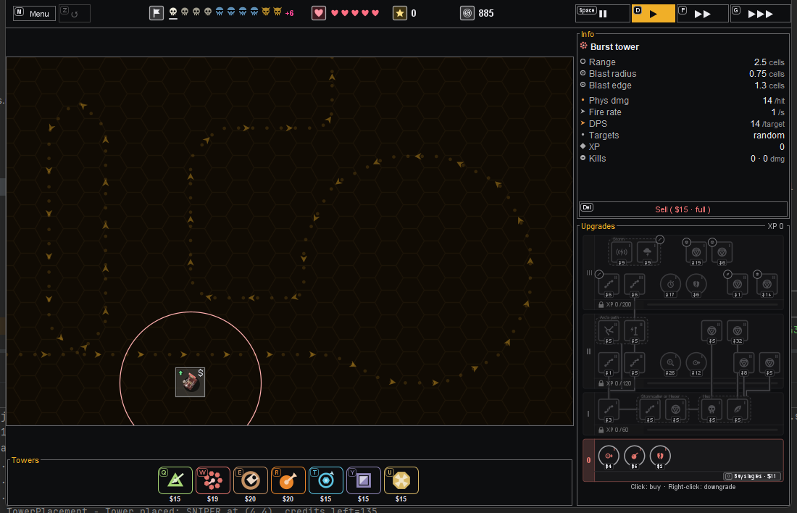
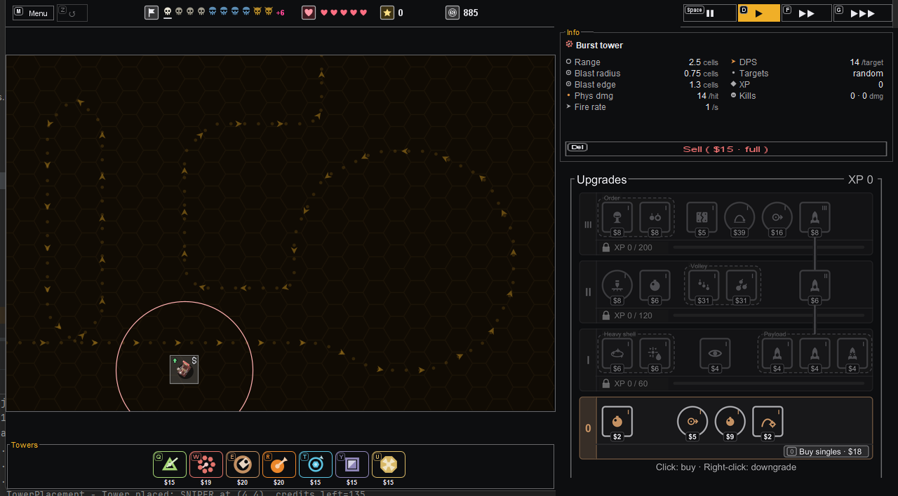

# Feature Request: The Upgrades panel at full size

## Summary

The retuned Upgrades panel reads well in its mock but is too small in the game: icons, prices and every word on
it. Draw it at the mock's size (1.5× its design) inside the right-hand column, without covering the board and
without shrinking it.

| Today, 1100 × 740 (the tree at about 0.9×) | Proposed, 1280 × 740 (Mortar at 1.5×, a composite) |
|---|---|
|  |  |

## Current state (what exists today)

- The right-hand column is a fixed 300 px wide (`PanelGameConsole.WIDTH`); the header's speed buttons are as wide,
  to stand above it. The game window opens at 1100 × 740 (`TowerDefense.GAME_WIDTH`, `GAME_HEIGHT`). A larger window
  gives all its extra room to the board; the column never widens.
- The column holds the Info panel, and below it the Waves panel or, while a tower is selected, the Upgrades panel
  (they share one cell and are toggled).
- The tree has a design size of 300 units wide. It scales to fit its room, capped at 1.15× (`PanelUpgradeTree`),
  and never scrolls. The Info panel above keeps at least 180 px. At 1100 × 740 the tree draws at about 0.9×.
- The painter's smallest fonts are 6 to 8 design units (frame names, price tags, the gate and button text), so at
  0.9× they are 5 to 7 px tall.
- Every tower's widest row has 6 nodes and takes the full 300 units, except the Scorcher's (5 nodes, about 215
  units). Four one-row tiers with the title line and footer take about 292 units.
- The Burst is the one tower with two-row tiers (II and III), about 380 units tall. Each of those tiers holds the
  Stormcaller side's 4 nodes, the Hexer side's 4 and 2 neutral ones. Tier I holds the Stormcaller-or-Hexer cluster.
- Until the upgrade panel retune, the Burst hid the side not picked and showed it while its fork node was hovered
  (`280b65a1`, `57d37921`). The retune made the fork a cluster like any other and showed every node (`1637a5ee`).
- The Info panel lists a tower's stats in one column, one row each, with the Sell button at its bottom. With a
  tower selected it has empty room above Sell.
- A 1600 × 1000 test window was clipped at about 1536 × 864 on the monitor this is played on, so 1280 × 740 fits it.

## What this feature adds

- **The tree at 1.5×** in the right-hand column on a 1280 × 740 window, for every tower. On a larger window it does
  not grow past about 1.5×; the extra room goes to the board. On a shorter window it scales down as today.
- **A wider right-hand column**, about 474 px, enough for 300 units at 1.5× plus its border. The speed buttons above
  it keep matching it.
- **The game window opens at 1280 × 740**, so the board keeps exactly today's size.
- **The Info panel shows a tower's stats in two columns**, so it is short enough to leave the tree its 1.5× height.
  It still fits its own content: nothing in it is cut or hidden.
- **The Burst fits one row per tier.** A node that needs one member of a cluster and a node that needs another
  member of the same cluster may share a slot: only one of them can ever be bought. The slot shows the node of the
  member picked. Before a pick it is an empty dashed slot, its hover says to pick a member of the cluster first, and
  hovering a member of the cluster shows that member's nodes in their slots, as a preview. The rule is the panel's, not the
  Burst's: any tower's layout may share a slot this way.
- **Larger small fonts.** Frame names, price tags, gate text and the button text rise to about 9 design units, so
  they stay readable at any scale.

### Out of scope

- Moving the Upgrades panel out of the column, overlaying the board, or into the bottom strip.
- Moving the Towers bar.
- Changing the panel's design: bands, strips, links, badges, lean and colours stay as the retune approved them.
- The look of the nodes themselves (`FEATURE-unified-buy-tiles.md`).

## Interconnections

- `shipped/FEATURE-upgrade-panel-retune.md` approved the panel's design and made the Burst's fork a cluster. Its
  "Every Burst node is shown from the start" and "carry no fork geometry and no hidden-branch markers" are reversed
  for the shared slots only. The Stormcaller-or-Hexer pick stays an ordinary cluster.
- `FEATURE-unified-buy-tiles.md` makes the nodes and the tower-building tiles one look. At 1.5× a node is about
  45 px, about the size of a tile in the Towers bar.
- `shipped/FEATURE-next-gen-splash-tower.md` describes the Burst's two sides.

## Constraints and open risks

- **The column's height is as tight as its width.** At 740 px the column has about 655 px. The tree at 1.5× takes
  about 438, which leaves the Info panel about 215. The Info panel in two columns has to fit that, Sell included.
- **A shared slot touches the hover rules.** Hovering marks what a click would buy, lock out or sell, and lights
  the links and badges between them. A node in a shared slot that isn't shown has no place to be marked or linked.
  Its prerequisites, links and badges need a defined behaviour while it is hidden and while it is previewed.
- **The layout rule test** (every node placed once, clusters together, nothing overlaps, everything fits the
  width) assumes one node per slot. Sharing a slot has to stay provable by a rule, never by a particular position.
- **A wider column changes everything that is laid out against 300 px**: the speed buttons, the Waves panel, the
  Info panel's sheets and tooltips placed beside the column.
- **Smaller windows.** Below 1280 the board shrinks to make room for the column (about 22% at 1100 wide). The
  window can still be resized, and the menu keeps its own size.
- Standing requirements: one look on every OS, painted from vectors; the panel scales and never scrolls; one
  component with no per-tower modes.

## Decisions made

- The panel stays in the right-hand column. Overlaying the board and the bottom strip were weighed and rejected:
  an overlay covers about half the board at 1280 wide, and the bottom strip needs the tree turned sideways, which
  drops the bottom-up bands and the lean.
- 1.5× is the target and roughly the cap. Readability beyond that comes from the font sizes, not more scale.
- The default window is 1280 × 740.
- On a wider window the column stays the same and the board takes the extra.
- Before the Burst's pick, a shared slot is empty and dashed, with a hover preview.

## Open questions

None blocking.
