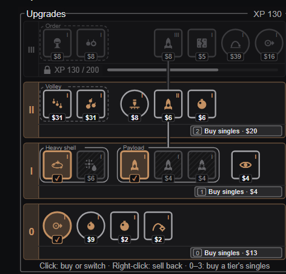
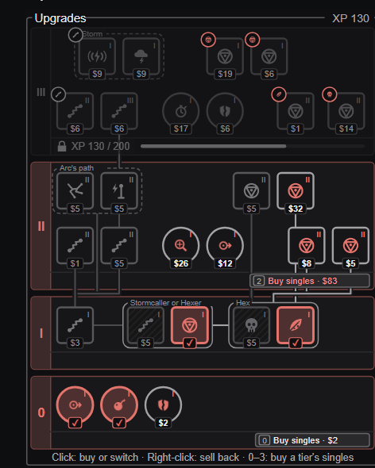
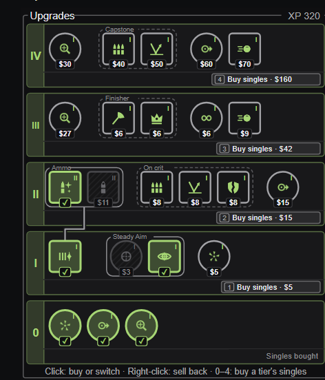

# Feature Request: Upgrade Panel Retune

Status: **implemented** (2026-11-18: `1637a5ee` the Burst's fork as a cluster, `66cc5f2b` the singles' keys,
`69fba824` the hand-placed layout and new painter, `50a67a25` the README, then the review's fixes). See *Review*.

## Summary

Make the Upgrades panel cleaner and easier to use. Each tier becomes one band with its numeral and its gate.
Every tower's panel works the same way, the Burst included. Each tier gets a button and a key that buy its single
nodes. Node positions are set by hand per tower, so builds can lean left and right. The panel leaves room for a
future Tier IV.

The design was approved on the live mock: <https://claude.ai/artifact/6cLNy3VRDpfHvgmoqAHeXR>. Renders of it are
kept beside this doc, in `upgrade-panel-retune/`:

| Mortar | Burst (skip-tier badges) | Sniper with a placeholder Tier IV |
|---|---|---|
|  |  |  |

The mock's glyphs, prices, clusters and prerequisites are the game's own. Its Burst layout is the approved one. Its
other towers don't lean yet (see *Build lean*).

## Current state (what exists today)

- `PanelUpgradeTree` paints the tree through `UpgradeTreePainter`. `UpgradeTreeLayout` works out every node's place
  from the tree's rows (`TierRow`, `RowPlace`), and no tower has a layout of its own. The design size is 300 × 380,
  scaled to fit the room, never scrolled.
- On top sits an XP line ("XP 0 / 60 to Tier I" and a bar). Each tier row shows that tier's tower foundation as a
  thumbnail (`TowerSprites.paintStill`), drained of colour while locked. A band between two rows carries the upper
  tier's label ("Tier II · XP 0 / 120").
- A tier whose shown nodes are all owned or switched away folds into a thin row of small nodes
  (`PanelUpgradeTree.relayout`, `settled`).
- Round means an ability (the node has sentences, `UpgradeNodeState.ability`) and square means a stat. Prices sit
  on a line under each node. Buyable nodes and their prices take the tier's colour, and nodes in the highest open
  tier carry a number chip.
- Links are straight lines from `UpgradeTree.previousInLine`: the highest-tier node a node requires. Where a node
  needs *any* member of a cluster (Mortar's Thick Mix, Burst's Agony, Contagion and Twin Hex, Aerie's Rich Brood),
  the link starts from one member. The Sniper's Ammo members both need Fourth Shot, so it draws two diagonal lines.
- Hovering a node marks the nodes a click would buy (PATH), lock out (CRACK) or sell (DROP), and lights the links
  between them (`PanelUpgradeTree.highlight`).
- **Keys:** `1`–`6` buy an upgrade in the selected tower's highest open tier, left to right
  (`TowerDefense` key handling, `UpgradeTree.keyOf`, the chips on the nodes). On the menu `1`–`9` start a level.
- **The Burst is the exception.** Its Stormcaller and Hexer are a *fork* (`UpgradeTree.withFork`), drawn inside
  Tier I's gate band with a split column. The nodes of the side not picked stay hidden until that side is picked or
  hovered, and `UpgradeTreeLayout` has fork-only geometry for this (`FORK_BAND`, `split`, `hidden`). The fork also
  feeds `SplashTower.fork()` and `forkOf`, which choose the Stormcaller or Hexer look and the side of each node, and
  the balance tools (`TowerBench`, `TowerReport`).
- Tiers can carry a paid unlock (`UpgradeTier.unlockPrice`, `UpgradeTree.unlockOf`, the pill in the gate band), but
  no tower uses one: every tree has `UpgradeTier.standard()`, all XP only.
- A right-click downgrade already skips its confirmation when the whole refund is full.
- `README.md` (Controls, Towers), `src/main/java/td/ui/CLAUDE.md` (the Upgrades panel lines, "a tier's thumbnail
  in the Upgrades panel is that tier's foundation") and `src/main/java/td/tower/CLAUDE.md` (the fork) describe how
  things work today.
- The `PreviewUpgrades` review tool (run-jtd skill) still renders the panels, but it stops before writing its page.
  It throws on `FEATURE-next-gen-splash-tower.md`: the term Static has the glyph `splash.head.arc.1`, which it
  doesn't recognise.

## What this feature adds

### Layout

- **Tier bands, bottom up.** Tier 0 at the bottom, then I, II, III, and IV later. Each band has a narrow strip on
  its left with the tier numeral (`0`, `I`, `II`, `III`, `IV`), in the tower's colour once the tier is open and
  grey while it is locked. This replaces the tier thumbnail.
- **A floor strip in every band.** While the tier is locked, the strip shows its gate: a lock, `XP 70 / 120` and a
  progress track. Gates are XP only, with no price and no nodes. Once the tier is open, the same strip shows a
  **Buy singles · $N** button with its key chip (the tier digit). The button appears once the tier has a single
  that can be bought now. "Singles bought" shows once every single is owned. A tier without singles shows nothing.
- **No top XP line.** The tower's XP goes on the panel's title line, on the right (`Upgrades ─── XP 70`).
- **No folding.** A fully bought tier keeps its full height.
- **Rows of fixed height.** A band is one or more node rows plus its strip. Four one-row tiers take roughly 290
  design units and five take roughly 360, so a Tier IV fits in today's 380. A tower may give a busy tier two rows,
  as the Burst does with Tiers II and III.
- **Hand-placed positions.** Each tower places its nodes itself: per tier, rows, and in each row every node or
  cluster at a slot. Nothing is derived from the tree's order any more. A tower without a hand-made layout isn't
  allowed. Every built-in tower gets one.

### Nodes

- **Shapes swap:** round is a stat, square is an ability.
- **Icons keep the tower colour, prices don't.** A buyable node's glyph is in the tower colour. Its price is a
  small tag on the node's bottom edge, in neutral white, red when it can't be afforded and grey when it isn't
  available. An owned node shows a tick there instead of a price, with a tinted fill and a border in the tower
  colour. A cluster's other member is hatched, as today. Nodes in a locked tier are greyed out but shown in full.
- **No per-node number chips.**

### Links

- **Orthogonal paths.** A link leaves the top of its source, runs in the channel above the source's row, turns,
  and climbs into the bottom of its target. Two nodes in one row are joined side to side.
- **From the cluster where the rule names the cluster.** A node that needs any member of a cluster hangs off that
  cluster's frame. A cluster whose members all need the same node gets one link into its frame.
- **A link that skips a tier is a badge**, not a line: a small circle with the prerequisite's glyph on the node's
  top-left corner. It is in the tower colour once the prerequisite is owned, grey before that.
- **Hover highlighting works as today**, over the new pieces too. The nodes a click would buy, lock out or sell are
  marked, and every link and badge between them lights up. A badge lights up when its prerequisite is on the
  hovered path.

### Buying a tier's singles

- A **single** is a node that isn't in any cluster. The tier's button, and its digit key (`0` for Tier 0, `1` for
  I, … `4` for IV), buy every single of that tier that can be bought now. It goes left to right and stops buying
  any node it can't afford. A single that needs a node not yet owned is skipped (Mortar's Thick Mix before a
  Payload).
- The digits buy whole tiers only. Per-node digit keys go away. On the menu, the digits still start levels.

### Every tower the same; the Burst's fork goes

- Stormcaller and Hexer become an ordinary Tier I cluster in their row. Tier I's gate is XP only, like every other
  gate.
- Every Burst node is shown from the start, like any tower's. A node of the side not picked shows as needing its
  prerequisite (grey, with its link or badge), not hidden.
- Nothing in the panel is special to one tower. The layout and painter carry no fork geometry and no hidden-branch
  markers.

### Build lean

Where a tower's tree holds two build strategies, its nodes lean apart: one build's nodes to the left, the other's to
the right, and neutral nodes (range, plain damage, nodes for both builds) in the middle. A cluster belongs wholly to
one place. The classification below comes from each node's wording. Where a tier has nothing of one build, that
side stays empty or neutral nodes fill it.

| Tower | Left | Middle | Right |
|---|---|---|---|
| Burst | Stormcaller side: Stormcaller, Arc, Arc's path, Conductor, Short Circuit, High Voltage, Feedback, Storm | Long Throw, Wide Charge, Flint Stones, Heavy Stones, Long Throw II, Quick Hands, Piercing Stones | Hexer side: Hexer, Hex, Deep Doom, Blight Cloud, Agony, Contagion, Soul Harvest, Hex of Inversion, Choking Blight, Twin Hex |
| Sniper | Crit: Rifling, Fourth Shot, Killshot, Ammo, On crit, Finisher | Long Barrel, Heavy Rounds, Long Barrel II, Heavy Rounds II, Steady Aim (one member each way) | Attack speed: Unbroken Aim, Momentum |
| Mortar | Heavy shell: Big Bore, Heavy shell, Overcharge, Big Bore II, Order (Fusion) | Elevation, Heavy Charge, Predictive Fire, Flare, Volley, Deep Crack, Quick Reload, Elevation II | Payload: Payload, Thick Mix, Lasting Mix |
| Aerie | Freeze: Deep Freeze, Feeding, Deep Freeze II, Around the ice | Long Flight, Swift Wings, Sharp Sting, Long Flight II, Release | Nest: Quick Brood, Wide Comb, Wide Comb II, Second missile, Rich Brood, Quick Brood II |
| Obelisk | Sundial: Sundial, Deep Shadow, Swift Shadow | Wide Field, Hum, Hum II, Wide Field II, The stone, Payoff | Field and Toll: Ward, Quick Toll, Deep Pull, Deep Pull II |
| Beacon | Enemy-facing: Spotlight, Edge of light | Steady Light, Afterglow, Sanctuary, Prism | Tower-facing: Lessons |
| Scorcher | (no clear split: both builds sit inside its clusters, Nozzle, Flame and Burning) | all, in tree order | — |

Links stay short when a node sits above what it needs. When the lean and the alignment pull apart, the lean wins
and the link bends.

### Out of scope

- Tier IV content. Only its room in the panel is planned. Fitting a tower whose tiers take two rows plus a Tier IV
  is left for when Tier IV is added.
- The hover sheets and confirmations, which stay as they are.
- Rebalancing any node.

## Interconnections

- `FEATURE-next-gen-upgrade-tiers.md` and the shipped `FEATURE-tower-upgrade-visual-revamp.md` set up today's
  bands, folding, fork band and thumbnails. This request reverses several of their decisions (folding, the fork
  gate, thumbnails, round = ability). Check `docs/adr/` for a recorded decision behind any of them before removing
  it, and supersede it there if one exists.
- `FEATURE-next-gen-splash-tower.md` describes the fork at Tier I's gate. The Stormcaller/Hexer identity (the
  tower's look, `SplashTower.fork()`, the balance tools) stays: only how the tree presents and gates the choice
  changes.
- `FEATURE-mortar-strider.md` (approved, not implemented) may change the Mortar's nodes. The Mortar's layout
  follows whichever tree is in the code when this lands.

## Constraints and open risks

- **The fork carries rules, not just geometry.** Today the fork's side nodes hide, and picking the other side
  "works only between waves and sells the old side's upgrades". A cluster switch already works only between waves
  and sells what came after the old member. Planning confirms the two rules match before the Burst moves to a
  cluster, and decides whether `withFork` survives as a domain concept for the tower's identity or folds into
  clusters. Save files name the same node ids either way.
- **Paid tier unlocks are unused.** "Gate is XP only" may mean the paid-unlock mechanism can go entirely; whether
  to delete it is planning's call (`TODO.md` or removal).
- **Hand-placed layouts are content.** They need a rule every layout keeps, tested like `TowerStatCatalogueTest`:
  every tree node is placed exactly once, clusters are placed together, nothing overlaps, and everything fits the
  width. Tests don't check particular positions.
- **Keys.** Digits `0`–`4` replace `1`–`6` on the board. A chip shows the binding its key runs (`td.ui` rule), so
  the tier button's chip and `GameKey`/`keyOf` must agree. Buying through a key is an EDT command that changes game
  state; the threading rules decide how it reaches the engine.
- **Two rows plus Tier IV.** A tower with two-row tiers plus Tier IV runs over 380 and scales down (Burst: about
  85%).
- Standing requirements: one look on every OS, painted from vectors (`jtd-ui-must-be-uniform-and-os-independent`);
  the panel scales and never scrolls; one component with no per-tower modes.
- The engine stays headless: the singles rule and the Burst's tree change belong in `td.tower.upgrade` or the
  tower, provable in `GameEngineTest`, never in the panel.

## Decisions made

- The design on the mock is approved, including the title-line XP, price tags on the node's edge, owned ticks, no
  per-node chips and greyed locked tiers.
- Keys `0`–`4` buy a whole tier's singles. There are no per-node shortcuts.
- When credits run short, buy left to right while they last.
- A single that needs a node not yet owned is skipped.
- A link that skips a tier is a badge, and hover highlighting covers badges as it covers links.
- Leaning builds left and right applies to every tower where a split is recognisable (table above). The Burst puts
  Stormcaller left, neutral nodes in the middle and Hexer right, as on the mock.
- Tier IV's fit for the Burst is decided when Tier IV is added.
- The right-click sell popup stays as it is (the full-refund skip already exists).

## Open questions

None blocking. The *Build lean* table is a reading of each node's wording. The implementer flags any row that
turns out wrong in play during the review step (step 6).

## Steps

Commit after each step (`mvn verify` green). Only step 6 runs the live game.

1. **One tree shape for every tower.** Turn the Burst's Stormcaller/Hexer into a Tier I cluster with an XP-only
   gate. Keep its identity (`SplashTower.fork()` and its users) and the switching rules, and settle the fork and
   paid-unlock questions under *Constraints*. `GameEngineTest` proves picking, switching between waves and selling
   the old side.
2. **Buy a tier's singles.** Add a domain operation that buys a tier's purchasable singles left to right within
   the credits, skipping any single whose prerequisite isn't owned. Bind keys `0`–`4` to it and remove the
   per-node digit keys (`keyOf`, the key handling). Tests: the order, stopping when credits run out, the skip, a
   locked tier buying nothing, a fully bought tier.
3. **Hand-placed layouts.** Replace the derived layout with a per-tower table of rows and slots, written from the
   *Build lean* table, plus the rule test from *Constraints*. Remove folding and the fork geometry.
4. **The new painter.** Band numeral strips, floor strips (gate or Buy singles with its chip), title-line XP, the
   swapped shapes, price tags and owned ticks, orthogonal links from nodes and cluster frames, skip-tier badges,
   and hover highlighting over links and badges. Remove the XP line, tier thumbnails and node chips. Check it with
   a headless render of every tower (fix `PreviewUpgrades`' splash-doc failure, or render through a scratch
   class).
5. **Docs.** `README.md` (Controls: `0`–`4`; Towers: the Burst's pick, the panel), `src/main/java/td/ui/CLAUDE.md`
   (the Upgrades panel and thumbnail lines), `src/main/java/td/tower/CLAUDE.md` if the fork changes, any ADR this
   supersedes, and `TODO.md` for any gap left behind.
6. **Review, self-feedback and one last iteration.**
   - Render every tower's panel fresh, part-bought and fully bought, and compare each against this doc and the
     mock. List every discrepancy: layout, lean, link routing, badge placement, colours, text, sizes and the fit
     at four and five tiers.
   - Run one live `run-jtd` pass: the digit keys and buttons, the chips, hover highlighting over links and badges,
     click, right-click and switching, and the panel at the console's smallest height.
   - Write the review as a *Review* section at the end of this doc. List what doesn't match, what feels off when
     playing (a lean that reads wrong, a crowded row, a link that is hard to follow), and what you would do
     differently, each item with a fix or a reason to keep it.
   - Make one iteration that fixes the list. Re-render, and update the *Review* section to say what was fixed and
     what was kept and why. Then mark this doc implemented.

## Review

Done after step 5: every tower's panel rendered headless fresh (with the Tier 0 button hovered), part-bought (with a
Tier II node hovered) and fully bought, compared with this doc and the mock, and one live `run-jtd` pass on the
Burst. The pass checked the digit keys (`0` bought Tier 0's singles; `1` bought nothing while Tier I was locked, and
once open bought Arc only after Stormcaller; `2` passed over Agony and Contagion without a Hex), the chips, hover
over links and badges, a pick, a switch with its confirmation, a right-click sale at full refund with no
confirmation, and the panel at a 560-pixel window.

### Matches

- Bands bottom up, the numeral strip in the tower's colour once open and grey while locked, the gate's XP and track
  on a locked tier's strip, the button with its tier digit on an open one, "Singles bought" once all are owned, and
  nothing on a tier without singles (the Beacon's Tiers I and II).
- The title line carries the XP. No tier folds. Round is a stat and square an ability. Glyphs keep the tower's colour,
  prices sit on neutral tags (red when short, grey when not available), and an owned node has a tick, a tinted fill and
  a border in the tower's colour. The other member of a cluster is hatched.
- Links run along the axes, from a cluster's frame where the rule names the cluster (Thick Mix, Agony, Contagion,
  Rich Brood) and into a frame where all its members share the need (Ammo, Hex, Release; the Burst's Storm by a badge on its frame). A need more than
  a tier below is a badge; a frame's badge sits on its top-right corner, clear of its name.
- Hover marks light links and badges: white for a buy, red and dashed for a sale or a switch's losses.
- The lean follows the table. The Burst keeps the mock's approved layout.
- Fit: four one-row tiers take 282 design units, so a one-row Tier IV (349) fits 380. The Burst takes 374; a Tier IV
  row would bring it to 441, about 86%, as the doc expected.

### Found, and what was done

1. **The cash mark of an unused node hid a frame's name** when the first member was owned (Edge of light, Burning).
   Fixed: frame names are painted after the nodes.
2. **The button went red whenever its total was over the credits**, though the key still buys what it can.
   Fixed: it goes red, with its hover footer, only when the credits cover none of what it offers.
3. **The panel kept its old 380 height**, leaving a strip of nothing under a four-tier tree. Fixed in step 4: the
   panel asks for the height its tree takes, so the Info panel above gets the rest.
4. **A frame's badge covered its name** in the first renders. Fixed in step 4: a frame's badges go on its top-right
   corner.
5. *Kept:* the Burst's Blight Cloud link runs behind Agony in the row below. The mock's approved layout puts them
   there, and the link reappears above Agony, so it still reads.
6. *Kept:* right after a large purchase, before any wave, every owned node carries the cash mark (it sells back in
   full). It is accurate and goes once a wave runs; making it smaller was enough.
7. *Kept:* at the console's smallest height the Burst scales to about 60%, where the strips' words are small. The
   panel never scrolls, and every word on a strip is also in the hover footer.
8. *Kept:* hovering a locked-out node says "0 steps · $0 · blocked: locked out". It predates this feature and the
   hover sheets were out of scope.
9. *Out of scope, flagged:* the paid tier unlock still exists in the tree (`TODO.md`), held off the built-in trees
   by a catalogue rule.

The *Build lean* table read well on every render; no row turned out wrong. The live game only confirmed the Burst,
so a lean that reads wrong in long play on another tower is a one-line change in `UpgradeTreePlans`.
