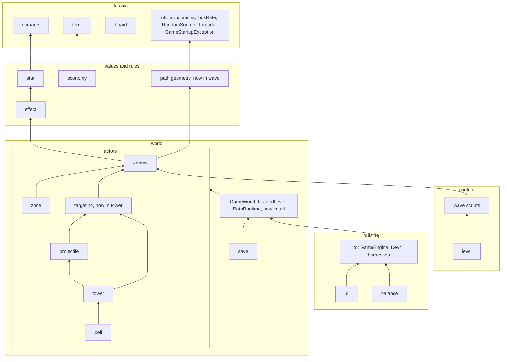

# Design review — phase 1 results and handoff

Status: **phase 1 done (prompt sections 0–3, analysis only, nothing in `src` changed)**. Phase 2
(sections 4–7: probes, verdicts, document patches) starts from this file. The prompt for it is
at the end, ready to paste.

Goal of the whole review: make jTD as modular, well designed (object design and a functional
style) and cheap to change as possible. A change is worth making only if it shows a benefit:
cheaper future changes, easier maintenance, better testability or better design.

Files here:

- `README.md` (this file): what was read, the book notes, the smell catalogue, the
  measurements, leads for phase 2 and the phase-2 prompt.
- `metrics.py`, `report.py`: the throwaway measuring scripts, kept so phase 2 can re-run them.
  `python docs/plans/design-review/metrics.py . target/design-review` writes `metrics.json`;
  `python docs/plans/design-review/report.py target/design-review/metrics.json pkg|cls|meth|gw|sw|lis|git|test`
  prints one section. They are regex-based, not a parser (see "Caveats").

---

## 1. What was read

**Project context (section 0):** root `CLAUDE.md` (including the new rule on numbers in
comments), all 11 package `CLAUDE.md` files, `docs/ARCHITECTURE.md`, `TODO.md`, `checkstyle.xml`,
`checkstyle-imports.xml`, every memory note, `git status`, and the last 30 commits.

**Uncommitted feature work at the time (phase 2 must not propose refactors in these files
without flagging the clash):** `GameEngine`, `DevEffects`, `effect` (`Effect`, `EffectKind`,
`EffectSentences`, `EffectTemplate`, new `SpellproofTemplate`, `UnyieldingTemplate`), `enemy`
(`AbilityEvaluator`, `AbilityTerm`, `AbilityText`, `BodyArchetype`, `DefinedEnemyMob`,
`EnemyCatalog`, `EnemyDefinition`, `MenderEnemy`, `MovementBehavior`, `PeriodicTrigger`,
`PulseMovement`, `RankGrowth`, `ShieldbearerEnemy`, new `GolemEnemy`, `MagmaEnemy`, `SwingCurve`,
`SwingMovement`), `level` (`CurlyPathLevel`, `WardenEnemy` moved here from `enemy`), `ui`
(`EffectPictograms`, `EnemyFrameBuilder`, `EnemyTermPictograms`, `Java2DFrameRenderer`,
`TermLooks`, `render/Palette`), `wave` (`WaveScript`, new `WaveScriptGrammar`, `ShapeKeyword`),
the `enemy` and `wave` `CLAUDE.md` files, `README.md` and `TODO.md`. Run `git status` again.

**The book (section 1):** Yourdon & Constantine, *Structured Design*, 2nd ed., 1978/1979
(PDF with an OCR text layer, 464 pages). Read across both sessions:

| Read in full or nearly | Read in part (intro, key sections, summary) | Not read |
|---|---|---|
| 6 coupling, 7 cohesion, 9 heuristics, 12.2 Parnas, 13 pathological connections, 19 generality, flexibility and reliability | 2 black boxes, 3 program structure, 5 complexity, 8 morphology, 10–11 transform and transaction analysis (intros), 12.1 Jackson/Warnier, 14 packaging, 15 optimization, 16 typology, 17 recursion, 18 homologous and incremental structures | 1, 4, the worked examples (10.8 FRANK, 11.2), 20 implementation, 21 management, the appendices |

Phase 2 should not need the book again; the notes below carry what matters. If it does:
download it into an empty scratchpad folder, run `pdftotext`, and remember that PDF page ≈
printed page + 17.

## 2. Book notes (paraphrased): concept, symptom in code, cheapest fix

| Concept (chapter) | What it says | Symptom to look for in jTD | Cheapest fix |
|---|---|---|---|
| Problem–structure match (2) | Cost is lowest when each piece of the system matches one small piece of the problem, and each link between pieces matches a link in the problem. | A class that serves several problem pieces; a link between classes that has no counterpart in the game's rules. | Split along problem pieces; drop the link. |
| Black box (2) | A black box is used without knowing its inside. Documenting a module's quirks does not make it a black box; it makes it a grey box. | `CLAUDE.md` rules that tell a *caller* about a module's internals: call order, "read X before Y", "callers must handle -1". | Encapsulate the quirk so the rule can go (a method that does both steps in order, a value instead of a sentinel). |
| Rule of black boxes (2) | When a capability is needed, name it as a black box and use it; design its inside later. | Code that inlines a capability another class already owns. | Extract and reuse. |
| Manager analogy (2, 8) | Managers decide and coordinate; workers do the work. A manager with ~7+ direct reports, or a chain of managers that only pass work on, is a smell. A manager hands a subordinate only what that subordinate needs. | High fan-out coordinators; pass-through classes; wide parameter objects. | Factor coordinators; narrow parameters. |
| Normal vs pathological connection (3, 13) | A normal connection goes through a module's interface; a pathological one reaches inside it (shared data, back doors). Pathological links multiply once one exists. | Reaching into another class's state; shared mutable data; side channels between packages. | Pass data through the interface. |
| Complexity (5) | Errors grow faster than size. Splitting helps only while the parts are independent, and over-splitting adds its own cost. People hold about seven things at once. | Very large classes and methods; tiny classes that only forward. | Split by independence, not by size alone. |
| Coupling ladder (6) | From worst to best: content, common (shared/global data), external, control (a flag telling the callee what to do), stamp (a whole structure where a part would do), data. Control information hidden in data is still control coupling. "Inversion of authority" is a subordinate telling its boss how to do the boss's job. | Flags and mode arguments; sentinel values; whole-world parameters used for one field; returned "what to do next" codes. | Split the callee per mode; pass the field; return a value, not an order. |
| Cohesion ladder (7) | From worst to best: coincidental, logical, temporal, procedural, communicational, sequential, functional. The test: one plain sentence describes the module. "And", "or", "first … then", "initialize", "all the X" point down the ladder. | Grab-bag packages and classes; `*Util`; classes described with "and". | Split by function; name by role. |
| Factoring, decisions high (8, 9) | In well-factored systems decisions sit high and detailed work low; each decision sits within the scope of control of the module that makes it ("scope of effect within scope of control"). A low module making a decision whose effects land elsewhere creates flags passed upward, duplicated decisions and pathological flow. Fix by moving the decision up, the affected module down, or merging. | Low-level classes deciding game-level outcomes; flags bubbling up; the same decision re-made in several places. | Move the decision to the coordinator; return facts upward, not orders. |
| Heuristics, not rules (9) | The heuristics are guides; applied blindly they produce bad designs. | Rules followed against their purpose. | Allow deviation with a stated reason. |
| Data-shaped design vs information hiding (12) | Jackson/Warnier: shape the program after the data. Parnas: hide each decision likely to change (a data format, a processing order) inside one unit, so changing it touches one unit. The book notes the tension: a program shaped by its data must change shape when the data does. Reconciled by Myers' "informational strength" module: one unit owns a format, offers several entry points, and others only know an identifier. | A text format whose knowledge is spread over several classes; a domain model shaped by its file format. | One reader/writer unit mirrors the format inside; the rest sees domain values only; an intermediate value type where the two shapes differ. |
| Recursion (17) | Recursion ends only if some call in the cycle is conditional. "Serially reusable" (no memory between calls) is weaker than "reenterable" (safe to enter again mid-call). Accidental recursion is the dangerous kind. | Triggers that can fire triggers; listeners that re-enter what fired them. | A stated terminator per chain; deferral; reenterable code or a guard. |
| Incremental modules (18) | Some modules naturally resume where they left off (coroutines). Written as ordinary routines they need a hidden "where was I" switch. A producer/consumer pair with a many-to-one or one-to-many ratio forces bookkeeping on whichever side is not in control. | Per-tick state machines whose resume state is spread over many fields; a `switch` on a stored step; counters bridging rate mismatches. | One explicit state value owned by the incremental module; let the side with the irregular ratio own the loop. |
| Generality and flexibility (19) | Generality has four separate parts: portability, how common the problem is, the range of inputs accepted, and flexibility. Flexibility grows when behaviour is controlled by data and not by code ("locus of control"), when a value is bound later, and when controls are brought to the surface. But putting *all* control into data ends in an interpreter. General modules come from *excluding* special cases (a smaller common core), not *including* a feature for everyone. Passing only the data elements a function needs makes it more general. Push one-off setup up to the caller. | Content as code where data would do; speculative options nobody uses; a whole record passed where three fields are read. | Move content to data where a second user exists; narrow interfaces; delete unused options. |
| Fault handling (19) | Detect, act, correct or recover. Detect as early as possible, at the interface where the data enters. Separate checking duplicates classification logic, so modules that must be robust check their own inputs ("firewalls"). Pathological data, not normal data, causes most failures. | Validation scattered deep inside; a malformed input that fails late or silently. | Validate at the boundary that parses; keep invariant checks in the value's constructor. |
| Optimization (15) | Correct and modular first; measure; recode the few hot modules; change structure for speed only as a last resort. | Structure bent for speed without a harness number. | Undo, or justify with `PerformanceHarness`. |
| Small modules, clean interfaces (19 summary) | The general-purpose system is many small single-purpose modules with very clean interfaces; the generality comes from combining them. | — | — |

## 3. Smell catalogue (section 2)

Each entry: the smell, its sources, and how phase 2 detects it. Book = B, Fowler *Refactoring*
2nd ed. = F, Beck *Tidy First?* = T, jTD rules = J.

| Smell | Sources | Detection |
|---|---|---|
| Content coupling: reaching inside another unit | B6/13, F Insider Trading, J "never expose a live collection" | Returned mutable collections; package-private access across classes; fields read through getters to decide for the owner. |
| Common/global coupling | B6, F Global Data, Mutable Data | `GameWorld` users; static mutable state (measured: none); shared mutable collections. |
| Control coupling | B6, F Flag Argument (Remove Flag Argument), J "no mode flags" | Boolean and enum parameters that pick a branch; sentinel returns (`-1`). |
| Stamp coupling / tramp data | B6, F Long Parameter List, Data Clumps | A wide type passed where one or two parts are read; a parameter passed on untouched. |
| Inversion of authority | B6 | A callee returning "what to do next"; callbacks that steer the caller. |
| Low cohesion, divergent change | B7, F Divergent Change, Large Class | Classes with many unrelated public methods; files changed for unrelated reasons (git). |
| Shotgun surgery | F Shotgun Surgery, B2 (a change touches many pieces) | Co-change pairs across packages; "Adding a …" checklists. |
| Repeated switches | F Repeated Switches, J visitor/sealed-switch rule | Switch sites per type. |
| Feature envy / tell-don't-ask | F Feature Envy, Message Chains | Methods using another object's getters more than their own fields; `a.b().c()` chains. |
| Middle man / pass-through | F Middle Man, B8 (managers that only pass work on) | Methods whose body is one delegation; `GameWorld` held but not used. |
| Speculative generality | F, B19 (inclusive generality) | Interfaces with one implementation and no test seam reason; unused options; a visitor with one visit method. |
| Scope of effect outside scope of control | B9 | Low classes deciding outcomes whose effects land elsewhere; flags passed upward. |
| Fan-out too high | B8/9 | Imports per file; constructor parameters; collaborators. |
| Grey box | B2 | `CLAUDE.md` lines telling callers about call order or internals. |
| Unguarded re-entrancy, accidental recursion | B17 | Listeners, hooks, procs, effects that trigger more of themselves. |
| Hidden resume state | B18, F Temporary Field | Many mutable fields in per-tick classes; `switch` on a stored step. |
| Format knowledge spread out | B12 (Parnas and Jackson), F Divergent Change | Several classes knowing one text format's tokens. |
| Content as code where data would do | B19 (locus of control), J "content is data" | Behaviour classes per content entry that differ only in numbers. |
| Late or scattered fault detection | B19 | Validation deep inside; silent fallbacks. |
| Long function, deep nesting | F Long Function, T guard clauses, explaining variables, chunk statements | Method length and nesting. |
| Mutable data where a value would do | F Mutable Data, Replace Derived Variable with Query; functional core | Mutable fields that could be derived; methods that both query and command. |
| Dead code, redundant comments | F Dead Code, T delete dead code, delete redundant comments | IDE inspections (`get_file_problems`). |
| Asymmetric code | T normalize symmetries, reading order, cohesion order | Same thing done two ways in one class or package. |

Tidy First timing for every verdict: tidy first only if it makes the very next change cheaper;
tidy after if it makes later changes cheaper; otherwise backlog or never. Beck bases this on
Constantine: the cost of software is roughly the cost of changing it, which is mostly coupling.

## 4. Measurements (section 3)

Scope: 710 main files (55.6k lines), 235 test files (29k lines), 666 commits (co-change uses the
last 400; commits touching more than 25 main files are skipped as sweeping).

### 4.1 Package dependencies

Nine of the 18 top-level packages form **one dependency cycle**: `cell`, `effect`, `enemy`,
`projectile`, `stat`, `tower`, `util`, `wave`, `zone`. Checkstyle's `ImportControl` only bans
AWT/Swing in the domain packages, so nothing enforces a layering.

What closes the cycle (imports between packages, by file count):

| Edge | Imports | Cause |
|---|---|---|
| everything → `util` | `ThreadConfined` 92, `TickRate` 52, `GameWorld` 50, `RandomSource` 12, `GameHost` 11, `GameStartupException` 8 | `td.util` holds both the leaf utilities and the composition root. |
| `util` → `tower`, `enemy`, `zone`, `wave`, `projectile`, `cell`, `stat`, `economy`, `board` | 1–3 each | `GameWorld`, `LoadedLevel`, `PathRuntime`, `PlaytestHooks` own the rosters. |
| `projectile` → `tower`, `zone` → `tower` | `tower.targeting` (`InRangeTargetQuery`, `NearestSelector`) | Targeting is shared but lives under `tower`. `CLAUDE.md` says "`projectile` never depends on `tower`"; it does, through this. |
| `enemy` → `wave` and `wave` → `enemy` | `enemy` uses `Vec2`, `Path`, `ArcLengthPath`, `PathPose` (5+3); `wave` uses `Rank`, `EnemyDefinition`, `SpawnParameters`, `EnemyCatalog` (9 files) | `td.wave` is two packages: path geometry and wave scripts. |
| `enemy` ↔ `zone` | `enemy` uses `Zone`, `ZoneKind`, `ZoneOwner`; `zone` uses `EnemyMob`, `EnemyRegistry` | Enemies leave zones and zones touch enemies. |
| `cell` → `tower` | `Tower` (2 files) | A cell holds its tower. |

Package fan-out / fan-in: `tower` 11/8, `ui` 14/1, `util` 10/10, `enemy` 9/9, `zone` 6/4,
`effect` 4/7, `wave` 3/8, `stat` 2/7, `damage` 0/10, `term` 0/6, `board` 0/5.

Inferred intended layering, if the cycle were broken (a proposal for phase 2 to confirm):



### 4.2 Classes and methods

Class size (non-blank lines): median 23, p90 129, p99 611, max 1365.

| Largest classes | Lines | Public methods | Churn (commits of 400) |
|---|---|---|---|
| `ui/Java2DFrameRenderer` | 1365 | 4 | 66 |
| `TowerDefense` | 792 | 17 | 32 |
| `enemy/DefinedEnemyMob` | 733 | 75 | 58 |
| `tower/AbstractTower` | 716 | 38 | 54 |
| `ui/PanelDev` | 683 | 31 | 25 |
| `balance/BalanceReport` | 671 | 1 | 15 |
| `balance/TowerLab` | 615 | 24 | 14 |
| `tower/PulseTower` | 611 | 37 | 39 |
| `tower/SplashTower` | 593 | 25 | 39 |
| `tower/CinderTower`, `MortarTower`, `SeekerTower`, `SniperTower` | 408–518 | 8–15 | 38–47 |
| `effect/ActiveEffects` | 494 | 25 | 45 |
| `GameEngine` | 431 | 35 | 25 |

Wide interfaces (the rule asks for 1–5 methods): `Tower` 44 (34 abstract, 10 default; already a
`TODO.md` entry), `HitReceiver` 23 (18 + 5), `Cell` 14, `AbilityContext` 9, `EnemyMob` 7 plus three
inherited interfaces.

Efferent coupling (distinct `td` imports per file): `SplashTower` 74, `SeekerTower` 62,
`MortarTower` 58, `SonarTower` 58, `CinderTower`/`PulseTower`/`SniperTower` 52, `AbstractTower` 43,
`Java2DFrameRenderer` 42, `TowerDefense` 36, `GameEngine` 34.

Mutable instance fields: `TowerDefense` 17, `AbstractTower` 17, `PanelDev` 17, `PulseTower` 15,
`RunRecorder` 14, `PanelTowerInfo` 13, `DefinedEnemyMob` 10, `PathMotion` 7, `GameEngine` 7,
`GameLoop` 7. **Static mutable fields: none.**

Longest methods (excluding record bodies, which the script counts as one block): `Java2DFrameRenderer.colorFor`
208 lines, `PanelDev.initComponents` 165, `EffectSentences.of` 136, `UpgradeTreeLayout` 120,
`TowerDefense.initComponents` 84, `PanelLevelSelect.buildCard` 77, `PictogramPath.read` 69.
Nesting depth 5: `TowerPlacement.mouseClicked`, `GameSaveText.read`, `WaveContent`,
`TowerLab.probedKinds`, `WaveCheckReport.Options`.

Constructors and parameters: the widest constructor is `Zone` (10), then `EnemyBodyDraw` (8),
`CannonballProjectile` (7). 40 records have 5 or more components, most built through factories
as the rules require. 132 methods take a `boolean` (71 public); most are record components
(data, not control). Candidates for control flags: `AbstractTower.report` (2 booleans),
`PulseTower.holdInside` (2), `TowerLab.partnerDamage` (2), `UpgradeOffer` (4 in its constructor).

### 4.3 `GameWorld` usage

`GameWorld` has 24 public methods; 50 files reference it.

| Accessors a file calls | Files |
|---|---|
| 0 (holds or forwards the world) | 12: `EnemyCatalog`, `Tower`, `TowerFactory`, `PanelGameConsole`, and 8 `UpgradeCondition` types (deliberate, see `ARCHITECTURE.md` §3) |
| 1 | 14: mostly `ui` (`economy` or `level`), `AbilitySpawnFactory` (`getEnemyCatalog`), `UpgradeNode` and `PathPlanner` (`playtestRules`), `UpgradeTree` (`level`) |
| 2–5 | 16, including most tower leaves (`enemies`, `getBoard`, plus `zones`/`projectiles`/`towers`) |
| 6+ | `GameEngine` 17, `DefinedEnemyMob` 10, `DevControls` 8, `BoardRenderer` 8, `AbstractTower` 7, `TowerDefense` 6 |

`DefinedEnemyMob`, a leaf actor, uses 10 accessors including `economy`, `damageTally`,
`disruptions`, `random` and `playtestRules`.

### 4.4 Dispatch

`instanceof` is banned in main by Checkstyle (0 there; 9 in tests). Switch sites per type (3+):
`EffectKind` 8, `Palette` 8, `AbilityAction` 7, `WaveSlot` 7, `PlayerAction` 6, `EnemyStat` 6,
`EffectStacking` 5, patterns over `Stacks`/`FuelPool` 5 each, `ShieldPool`, `EffectTarget`, `ZoneKind`,
`FieldMode`, `UpgradeSlot`, `StatusTerm` 4 each. Visitors: `TowerVisitor` (8 visit methods, 3
implementors), `ProjectileVisitor` (2, 1), `EnemyMobVisitor` (1 visit method, 2 implementors, one
concrete mob class).

### 4.5 Listeners and hooks (re-entrancy candidates)

Listener interfaces: `EconomyListener` (7 files), `PeriodicDamageListener`, `WalkEndListener`,
`WaveStartListener` (3 each), `ShieldListener` (2). 9 classes use `CopyOnWriteArrayList`. Hooks
beyond listeners, from the package rules: `Tower.onKill`, procs and hit bonuses, effect
interactions, hex payouts, Sympathy/Reckoning sharing, `EnemySpawner.add`/`replace`,
`ExperienceAwarder`. Terminators that exist today **only as prose** in `CLAUDE.md`: "a kill made
from inside the hook triggers nothing", "a listener that deals damage back must not be told about
its own damage", "a share tops the receiver up … so two carriers settle instead of climbing",
"listeners re-enter the ledger" (handled by firing outside the lock).

### 4.6 Text formats

`wave`: `WaveScript` (60 lines), `WaveScriptGrammar` (175, new and uncommitted), `WaveScriptSuggestions`
(120), `ShapeKeyword` (new). `save`: `GameSaveText.read` (40 lines, nesting 5). `ui`:
`PictogramPath.read` (69, a path-text format). `balance`: `PlayRecord`, `PlayerAction`
(action logs). Phase 2 checks whether each format's knowledge lives in one unit (probe 9).

### 4.7 Change history

Top-level packages touched per commit (400 commits): 0: 90 (docs only), 1: 159, 2: 64, 3: 39,
4: 23, 5+: 25. About a quarter of code commits touch three or more packages.

Hotspots (churn × size): `Java2DFrameRenderer` (66 commits × 1365 lines), `DefinedEnemyMob` (58 ×
733), `AbstractTower` (54 × 716), `TowerDefense` (32 × 792), the tower leaves (38–47 × 400–600),
`ActiveEffects` (45 × 494), `PanelDev`, `EnemyFrameBuilder`, `GameEngine`, `Palette` (51 × 210).

Cross-package pairs that change together: `DefinedEnemyMob` with `EnemyFrameBuilder` 18,
`Java2DFrameRenderer` 17, `Palette` 16, `EnemyStatText` 15, `ActiveEffects` 16; `EffectKind` with
`Java2DFrameRenderer` 16, `EnemyFrameBuilder` 15, `Palette` 15, `EnemyStatText` 13; `Effect` and
`ActiveEffects` with the same `ui` files 11–14. Package pairs: `tower`+`ui` 52 commits,
`td`+`ui` 35, `enemy`+`ui` 33, `effect`+`ui` 26, `enemy`+`tower` 23, `effect`+`enemy` 22.

Change scenarios already written down as `CLAUDE.md` checklists (a first cut of the
change-scenario table):

| Change | Files | Packages |
|---|---|---|
| New effect kind | `EffectKind`, `EffectSentences`, `Effect`, `EffectTemplate`, `ActiveEffects.magnitude`, `EnemyFrameBuilder.markerPaletteFor`, `Java2DFrameRenderer.colorFor`, `TermLooks.effect`, `EffectPictograms`, `DevEffects` | 3 (`effect`, `ui`, `td`) |
| New tower | leaf, `TowerFactory`, `TowerVisitor`, `TowerSpriteFrameBuilder`, `TowerEffectFrameBuilder`, `Palette`, `Java2DFrameRenderer` (3 methods), `README.md` | 3 (`tower`, `ui`, `ui.render`) |
| New body archetype | `BodyArchetype`, `EnemyFrameBuilder`, `Java2DFrameRenderer` (4 methods, 2 not compiler-forced), `wave/CLAUDE.md`, `README.md` | 2 |
| New trait | trait, `TraitMarker`, `EnemyFrameBuilder`, `Java2DFrameRenderer`, its term entry | 2 |

### 4.8 Tests

Fakes: 12 named fakes/recorders, each defined once (no duplicates). `instanceof` in tests: 9.
Test-to-main line ratio 0.52.

### 4.9 The documents themselves

- Package `CLAUDE.md` files total **64 KB** (`tower` 20 KB, `enemy` 13 KB, `effect` 10 KB, `ui` 7.6 KB,
  `wave` 5.8 KB); root 11.8 KB. `ARCHITECTURE.md` §10 still says "packages 142 KB to 22 KB", so
  they have tripled since the cut, and the section is stale.
- `tower/CLAUDE.md` describes individual towers' mechanics (Seeker nest, Mortar shells, Cinder,
  Aura); `enemy/CLAUDE.md` and `effect/CLAUDE.md` describe individual effects and enemies. That
  is content and feature narrative, against "constraints only".
- Lines naming an order or a caller duty ("before", "after", "first", "only when", "callers must"):
  `enemy` 20 of 53 rules, `tower` 17 of 65, root 13 of 46, `wave` 11 of 22, `effect` 10 of 33. By
  the book's black-box test these mark grey boxes: phase 2 should ask, for each, whether code
  could hold the order so the rule could go.
- Checkstyle enforces: naming, no star imports, no inline TODO, `IllegalCatch`, no AWT/Swing in
  the domain, no `instanceof` in main, wide records need a factory, no `Math.random`, `Hud` borders,
  AssertJ only, no `owns(...)` in tower code. Not enforced: package layering, parameter counts,
  interface width.

### 4.10 Caveats

The scripts use regular expressions, not a Java parser. Import edges miss same-package
references. Interface method counts include nested permitted types for sealed interfaces (the
figures above were corrected by hand for the interfaces listed). Field counts were unreliable and
are left out. Method lengths for records and enums count the whole body. Switch types are
inferred from the first `case` label. Treat the numbers as pointers to look at, not verdicts.

## 5. Leads for phase 2, by probe (not verdicts)

1. **Coupling:** the `util` hub and the 9-package cycle; the 14 one-accessor `GameWorld` users;
   `DefinedEnemyMob`'s 10 accessors; the control-flag candidates in 4.2.
2. **Cohesion:** `Java2DFrameRenderer` (every domain's art in one class, the top hotspot);
   `DefinedEnemyMob` (75 public methods); `td.wave` holding geometry and scripts; `td.util`
   holding leaves and the composition root.
3. **Scope of effect:** `DefinedEnemyMob` reaching `economy` (a leak charges the economy from inside
   the mob?); decisions in `TowerPlacement.mouseClicked` (nesting 5).
4. **Fan-out:** tower leaves with 52–74 imports; `Zone`'s 10-parameter constructor.
5. **Inversion of authority:** returned results such as `ShotResult`, `StrikeResult`,
   `AttackOutcome`, `Impact`: facts or orders?
6. **Information hiding:** the change-scenario table in 4.7; co-change of `effect`/`enemy` with
   `ui` (an effect's look is spread over four `ui` classes keyed by `EffectKind` switches).
7. **Re-entrancy:** the chains in 4.5, and whether each prose terminator has a test.
8. **Recursive data:** upgrade trees (`UpgradeTree`, `PathPlanner`), `TargetQuery`/`HitCondition`/`UpgradeCondition`
   combinators (`And`/`Or`), `TermText`, `StatModifiers`, `WaveScriptGrammar`.
9. **Formats:** 4.6.
10. **Activation kinds:** `FireClock`, `PathMotion` (7 mutable fields), the Seeker nest,
    `SonarSweep`, `GameLoop`, the per-tick ledgers (`Burning`, `TollTracker`, `BracketTracker`).
11. **Families:** the eight tower leaves (400–600 lines, 38–47 commits each); `ARCHITECTURE.md` §13
    rejected data-defined towers "for now".
12. **Fault handling:** `GameStartupException` boundaries; `GameLoop`'s circuit breaker; save
    loading that names what it could not rebuild.
13. **Physical vs logical:** the allocation-free `StatSheet` path; the frame build.
14. **Functional style:** the mutable-field list in 4.2; static mutable state is already zero.
15. **Object design:** `Tower` (44), `HitReceiver` (23), `Cell` (14); `EnemyMobVisitor` with one visit
    method over one concrete class; repeated switches in 4.4.

---

## 6. Prompt for phase 2 (paste into a new session)

````
# Task: design-quality review of jTD, phase 2 (analysis first, no edits)

Read `docs/plans/design-review/README.md` first, fully. It holds phase 1's results: what was
read, paraphrased notes from Yourdon & Constantine's *Structured Design*, the smell catalogue,
the measurements, and leads per probe. Do not redo phase 1. Re-run its scripts only to refresh a
number, or to measure something it did not.

Goal of the whole effort: make the codebase as modular, well designed (object design and a
functional style) and cheap to change as possible: easier maintenance, easier new content and
features, better testability, better design. A change is only worth making if it buys one of
those, and the benefit must be shown, not asserted. "Looks cleaner" is not a benefit.

This phase is READ-ONLY: do not edit, commit, rename or reformat anything in `src`, `CLAUDE.md`
files, `docs/ARCHITECTURE.md`, `TODO.md` or the Checkstyle files. The one file you write is this
review's own `docs/plans/design-review/README.md` (append the phase 2 results, keep phase 1 as it
is) so a further session can continue from it. Report in the console too, then stop and wait for
my decision.

## 0. Context

- Re-read root `CLAUDE.md`, the package `CLAUDE.md` files a finding touches, `docs/ARCHITECTURE.md`
  and the memory notes. Treat the memory notes as standing preferences (CLAUDE.md holds
  constraints only; minimize test churn; role noun last; no mode flags; earlier decisions are not
  binding; keep work cheap to maintain).
- Run `git status`. Compare it with the uncommitted-work list in the README; flag any proposal
  that touches a file with uncommitted changes.
- Prefer cheap deterministic tools: `rg`, `git log`, the README's scripts, the IDE's `idea` MCP
  tools (`search_symbol`, `analyze_calls`, `get_symbol_info`, `get_file_problems`) when the IDE is
  open. Do not spawn subagents without asking me.

## 4. Probe the code by design idea (every row gets a result, even "nothing found")

Treat the rows as equal in weight; do not spend more on one because it is listed first or sounds
more interesting. Start each from the README's lead for it. For each row report what you searched,
what you found (file:line), and a verdict from section 5.

| # | Idea | What to look for |
|---|---|---|
| 1 | Coupling ladder | Control coupling (flags, modes, enum args that steer a callee), common/stamp coupling (`GameWorld` consumers), content coupling (exposed internals), pathological reach-through across packages, the 9-package cycle and what would break it. |
| 2 | Cohesion ladder | Classes whose one-sentence description needs "and", "or", "handles", "manages"; grab-bags; packages holding two decisions (`util`, `wave`). |
| 3 | Scope of effect within scope of control | Decisions (game over, wave complete, kill/leak rulings, targeting eligibility, placement rejection) made by a low-level class whose effects reach classes it does not control. |
| 4 | Span of control, fan-out, fan-in | Classes with many collaborators or imports; utilities with high fan-in that carry hidden state; chains that only forward. |
| 5 | Inversion of authority | Callees telling callers what to do: returned commands, callbacks steering the caller, domain code calling back into the engine instead of returning a value. Classify each upward channel as sanctioned (listener, `GameHost`) or accidental. |
| 6 | Information hiding (Parnas) | For each package or major class, name the one decision it hides. Complete the change-scenario table (new tower, enemy, effect kind, trait, level, upgrade node, term, text-format field) from real code; any row spanning more than one package is a leak to explain. |
| 7 | Re-entrancy and termination | Every chain that can trigger more of itself in a tick: effects applying effects, procs firing procs, splash/chain damage, on-death abilities, listeners that fire listeners, callbacks mutating a collection being iterated. For each: trigger, terminator (depth, once-per-tick, deferral, nothing), thread, place in the `doTick` order, and whether a test pins the terminator. "Nothing stops it" is a finding even if it cannot loop today. |
| 8 | Recursive data handled without recursion | Tree/DAG types and combinators; nested conditionals mirroring data depth; per-level duplication; parallel arrays by level. Fixes: Composite, Interpreter, fold over a sealed type, visitor, algebra with identity and absorber. Gates: real base case and bounded depth; removes duplication or a branch; hot path vs the performance budget; traceable and testable on fixtures. Depth fixed at 2 or less, or clearer iteratively: reject. |
| 9 | Data-shaped formats (Jackson vs Parnas) | Each text format (`save`, wave scripts, pictogram paths, balance action logs): does one unit own the format and mirror its shape inside, with the rest of the code seeing domain values only? Where format and domain model differ, is there an intermediate value type? Do reader, writer, grammar and suggestions agree from one source? Does bad input fail at the boundary as the rules require? |
| 10 | Activation kinds, incremental modules | Classify: called in tick; listener possibly on another thread; incremental per-tick state machine. Flag direct calls across kinds, and incremental modules whose resume state is spread over fields instead of one explicit state value. |
| 11 | Families, generality, flexibility | Families of near-identical things: is the shared part data or code? Where adding one more member forces code changes beyond its own class, that is a flexibility defect; generality with no second user is speculative. |
| 12 | Reliability and fault handling | Where faults are detected (at the boundary or deep inside), who decides, whether invariants sit in constructors, whether failures are loud. |
| 13 | Physical vs logical modularity | Structure bent for speed without a harness number, or structure that would blow the budget. |
| 14 | Functional style | Pure core vs side effects: calculations that mutate shared state or fire events mid-way, methods that both query and command, mutable fields that could be derived, values that are not immutable. Show which test would need no fake afterwards. |
| 15 | Object design | Tell-don't-ask, Law of Demeter chains, conditionals that should be polymorphism or a sealed switch, inheritance outside the closed-set rule, anemic types, wide interfaces (`Tower`, `HitReceiver`, `Cell`), a visitor over one concrete class. |
| 16 | Grey boxes | Each `CLAUDE.md` rule that tells a caller about another unit's internals or call order: could code hold it so the rule can go? |
| 17 | Anything else | Extra probes from the book notes. |

## 5. Evaluate every candidate with one model

For each finding: where (file:line), the named smell or idea, the evidence (number, history, or
a concrete failing scenario), the proposed fix (a named refactoring or tidying), then:
- **Benefit**: which, concretely: (a) future-change cost (which recurring change gets cheaper; cite
  co-change evidence); (b) testability (which test becomes possible or simpler; fakes removed);
  (c) design (which coupling or cohesion level improves, by what step); (d) risk removed.
- **Proof**: for every Do-now and With-next-feature candidate, simulate the next likely change it
  claims to help and count files, classes and tests touched before vs after. No measurable
  difference means no benefit: downgrade it.
- **Cost**: files and tests touched (test churn is a cost), reviewer effort, performance risk,
  clash with uncommitted work, reversibility. A package move is cheap with the IDE but touches
  every importer: count them.
- **Verdict**: *Do now* · *Do with the next feature that touches it* · *Backlog* (draft the
  `TODO.md` entry with **Where** and **Approach**) · *Reject* (say why; "never" is legitimate).
Rank by benefit divided by cost. Prefer small, independently revertible steps.

## 6. Documents to improve (propose, don't write)

A. Review the existing rules first. For every rule in root and package `CLAUDE.md`: is it kept;
what does it buy; does it cost more than it returns; is it duplicated, contradicted or stale; is
it content or narrative rather than a constraint (the package files have grown to 64 KB). Propose
removals as readily as additions.

B. New rules, each only if its probe found something worth a rule: a decomposition criterion
(each unit hides one decision likely to change); a ranked coupling checklist with control and
common coupling needing a reason; scope of effect; a fan-out cap; inversion of authority for
domain packages; re-entrancy and termination; data-shaped formats (one unit owns a format and
mirrors it; an intermediate value type where shapes differ); a functional core; activation
kinds; a package layer map enforced in `checkstyle-imports.xml`; the visitor-vs-new-variant cost;
the `util` split; an exception clause (the design rules are heuristics; deviating needs a stated
reason in the commit). In `ARCHITECTURE.md`: the change-scenario table and a data-flow diagram
(Mermaid), and the stale §10 figures.

C. Placement and size. Root `CLAUDE.md` loads every session. Put each rule in the cheapest place
that enforces it: Checkstyle or a test → the package `CLAUDE.md` it governs → root → the reason
in `ARCHITECTURE.md`. Report the net line change of root `CLAUDE.md` and of the package files;
growth needs a reason.

For every gap offer two options (one may overturn an earlier decision) and mark each ✅ / ❓ / ❌
so I can review in rounds.

## 7. Output, then stop

In the console and appended to the README:
1. A 10-line summary.
2. The section-4 table, completed.
3. The ranked candidates with proofs, grouped Do now / With next feature / Backlog / Reject.
4. The existing-rule review, then proposed document patches as diffs (not applied), with the
   net line counts.
5. Questions only I can answer, in one AskUserQuestion batch, your recommendation first.
Then wait. After I approve, the implementation order is: docs and checks first, then tidyings
one commit each (imperative capitalized subject, no trailing period), `mvn verify` before each
commit, renames and moves through the IDE's `rename_refactoring`, `td.PerformanceHarness` after
any per-tick or per-frame change, one live `run-jtd` pass only if Swing wiring changed. A content
change adds no test; a test broken by a tidying is rewritten on a fixture, never by editing its
expected value.
````

---

# Phase 2 results (prompt sections 4–7, with phase 2b)

Status: **phases 2 and 2b done, analysis only.** Nothing in `src`, the `CLAUDE.md` files,
`ARCHITECTURE.md`, `TODO.md` or Checkstyle has changed. This part is rewritten to match the
decisions in 7.8 and 7.9 (rounds 1 to 3). Phase 2b added what a check against the goal found missing:
- the hotspot classes;
- interface width against the cost of fakes;
- a functional core for how towers fire;
- a re-test of `ARCHITECTURE.md` §3;
- a rule-by-rule review of every `CLAUDE.md` file and of `ARCHITECTURE.md`;
- positive design guidance for the docs.

The design document it led to, and the drafted split, are in 7.10.

## 7.1 Summary

1. **Two places break the root threading rule.**
   - `GameEngine`'s round state is five separate `volatile` fields. The EDT reads three of them one
     by one and writes them from the dev panel (F1). The pause bug in `TODO.md` lives in this state.
   - The hover highlight is three `volatile`s per cell, written by the EDT and read by the frame
     build (F9).
2. **A latent bug from a rule kept only in prose.** `SplashTower.fire` calls `beginShot()`, discards
   the stats it returns, and the blast reads the live `stats()`/`damageCurrent()`. A next-shot buff
   (dev panel grants, the generic `GrantStatus` proc) is spent before the blast it was meant for.
   The cause: leaves can read live stats in the middle of an attack (F15).
3. **Colours and shapes are content that sits in the painter.**
   - All 76 `Palette` commits in the last 400 also touched `Java2DFrameRenderer`. That accounts for
     47 of the 83 `tower`+`ui` commits.
   - `Palette` is one flat enum of about 206 roles, so four per-role shape switches can't be
     exhaustive and throw at paint time.
   - Look tables per role, which build on the separate-colour-table decision, make the compiler
     force every case (F16).
4. **`DefinedEnemyMob` serves three audiences** (the game, the renderer, the inspector) through 75
   public methods. 28 of them are one-line forwards. 8 of the 10 `EnemyInspection` commits also had
   to change the mob (F17).
5. **`FakeEnemyMob` copies production rules.** It is 395 lines with 33 overrides, and it
   re-implements the effect-stacking rule by hand, so tests can pass against a stale model (F18).
6. **One `ui` switch can be derived.** `TermLooks.effect`'s 50-kind switch follows exactly from
   `EffectCategory` and `helpsCarrier` (F3).
7. **Small items.** The dead `ShieldListener` channel goes (F4). The kill-hook guard gets a test
   (F5). `PathPlanner` gets a cycle guard (F6). The diminishing-returns ladder becomes data checked
   at startup (F14). A dead flag in `TowerLab` goes (T1).
8. **Modularity: the 9-package cycle is accepted by design.** `ARCHITECTURE.md` §3's argument
   against narrow contexts still holds with today's numbers: `tower` uses 11 distinct `GameWorld`
   accessors, the same as when §3 was written. Three boundaries are made checkable instead: D1, plus
   the inverted AWT/Swing ban, which also covers `save` and `term`, two packages the old list missed.
9. **The docs.**
   - Package `CLAUDE.md` files: 822 lines. Root: 169 lines.
   - The rule-by-rule review found content inventories, tuning numbers, two rules contradicting
     each other (`enemy` vs `ui` on `default` in exhaustive switches), a rule no test enforces, and a
     sentinel callers must remember.
   - `ARCHITECTURE.md` has drifted: §3 names a class that no longer exists, §12 claims a check that
     was dropped, and §10's sizes are stale.
   - Proposed: root about +15 lines, including a short "Design" section, the one thing the docs
     lack; package files about −90.
10. **Rejected:** the targeting move (your decision), narrow contexts per package, a fan-out cap,
    data-defined towers, and splitting `AbstractTower`'s fields or the renderer's painters further.

## 7.2 Section 4: the probe table

| # | Idea | Searched | Found (file:line) | Verdict |
|---|---|---|---|---|
| 1 | Coupling ladder | Package imports (script), `GameWorld` accessors per file, boolean parameters at their call sites | Cycle edges: `MissileProjectile.java:5`, `ZoneRoster.java:6` → `tower.targeting`; `InWedgeTargetQuery.java:6` → `tower.TurretAim`. Path geometry in `wave` imports nothing outside itself. `stat`/`effect` import only the `util` leaves. `AbstractTower.report` and `PulseTower.holdInside` take facts, not modes. `TowerLab.partnerDamage(…, withSubject, …)` passes `true` at all 3 call sites (`TowerLab.java:287-290`). | T1, D1, rule reword (decided), B-2, B-4 |
| 2 | Cohesion ladder | One-sentence test | `td.wave` = path geometry *and* wave scripts. `td.util` = leaves *and* the composition root. `Cell` = buildability and tower *and* the hover highlight (`Cell.java:13-24`). `Java2DFrameRenderer` = paints *and* holds every colour and shape. `DefinedEnemyMob` = lives *and* draws *and* explains itself (#18). | F9, F16, F17, B-2, B-4 |
| 3 | Scope of effect | Kill, leak, lives, round end, placement | `DefinedEnemyMob.kill`/`leak` (`:734`, `:931`) pay the bounty and clamp lives from inside the mob. Round outcome: correctly in `GameEngine.settleWave`. | B-1 |
| 4 | Span of control | Imports, constructor parameters | Tower leaves 52–74 imports, each from its own sub-package (a family). `Zone` has 10 parameters behind named factories. No pass-through chains. | R-1, R-6 |
| 5 | Inversion of authority | Returned results, upward callbacks | `ShotResult`, `Impact`, `HitOutcome` are facts. Upward channels are sanctioned listeners and `GameHost`. `ShieldListener` has no listener. | F4 |
| 6 | Information hiding | The change-scenario table (7.3) | Effect kind: 11 files, 3 packages. `TermLooks.java:71` re-derives `EffectKind` data. Colours and shapes are keyed on a flat enum in the painter (`Java2DFrameRenderer.java:203-430`). | F3, F16 |
| 7 | Re-entrancy | Hooks, listeners, procs, hexes, shares | Kill hook guarded (`AbstractTower.java:302`), **no test**. Reckoning: deferred to the next tick, pinned (`SplashTowerTest:559`). Sympathy: tops up, pinned (`:519`). Ledger: fires outside the lock. `PathPlanner.gather` (`:91`): recursion with no cycle guard, and `UpgradeTree.of` (`:34`) doesn't reject cycles. | F5, F6 |
| 8 | Recursive data | Combinators, trees, grammar | `TargetQuery`, `UpgradeCondition`, `HitCondition` are already algebras. The upgrade DAG is walked by real recursion. The wave grammar is recursive descent on an immutable cursor. | F6 only |
| 9 | Data-shaped formats | Save, wave script, pictograms, balance logs | The save text has one owning unit, mirrored, and fails at the boundary: fine. `WaveScriptSuggestions.positionAfter` (`:111`) is a second parser of the wave grammar. Ranks are strings while shapes are enum rows. | F10, F11, R-3 |
| 10 | Activation kinds | Per-tick classes' state, thread of each read | `FireClock`, `SeekerNest` and `PathMotion` own their resume state. `GameEngine` round state (`:66-73`): five `volatile`s, read separately and written by the EDT (`TowerDefense.java:431`, `:444`, `:614`, `:973`). | F1 |
| 11 | Families | Towers, effects, enemies | Effects and enemies are data. Towers are code by decision (§13). The renderer's content switches are the non-forced part of a new tower or body. | F16, R-2 |
| 12 | Fault handling | `throw` in classification, startup validation | `DiminishingReturns.of` (`:30`) throws in play for a new `HARD_CC` kind. Four renderer switches throw at paint time (`Java2DFrameRenderer.java:214`, `:271`, `:407`, `:1067`). `GameStartupException` and save loading are good. | F14, F16, F6 |
| 13 | Physical vs logical | Structure bent for speed | Nothing bent without a harness. `colorFor` allocates per call on the paint path; F16 removes that. | — |
| 14 | Functional style | Derivable state; query+command | Round state as a value with pure transitions (F1). `beginShot()` spends charges *and* returns stats, and the live stats stay readable afterwards (F15). | F1, F15, B-1 |
| 15 | Object design | Wide interfaces, visitors | `EnemyMobVisitor` acts as a cast (`AS_DEFINED = mob -> mob`, `DevControls.java:44`, `EnemySelection.java:22`), and the fake's `accept` throws. `Cell` has 14 methods, 6 of them the highlight. `Tower` 44 and `HitReceiver` 23 (#19). | F9, F17, F18, B-3 |
| 16 | Grey boxes | `CLAUDE.md` order and duty lines | `effect` per-tick order (internal to one method). The tower price-before-add duty (one caller). `ticksSinceDeath` returns `-1` and "callers must handle it" (`enemy/CLAUDE.md`, 2 callers). `beginShot`'s "use what it returns" (#14). | 7.5A, F15, F19 |
| 17 | Other (book) | Normal vs pathological links | `debugJumpToWave` writes engine state from the EDT, bypassing the request channel `requestNextWave` uses. | F1 |
| **2b** | | | | |
| 18 | Hotspot cohesion | Public methods by caller; one-line forwards; co-change | `DefinedEnemyMob`: 28 one-line forwards (`activeEffects` 11, `motion` 7, `moments` 6). Inspector-only queries (`breakdown`, `effectClockTicks`, `effectFullness`, `effectKindsByGain`, `diminishedFactors`) are called only from `EnemyInspection`, and 8 of its 10 commits also changed the mob. Renderer moments: `MobMoments` changed in 2 commits. `AbstractTower`'s 17 mutable fields are separate concerns: an upgrade memo (`armed*`), a shot counter, the XP remainder, the kill guard, the wither clock. No cohesive cluster to extract. `Java2DFrameRenderer`: 90 methods; besides `colorFor` (209) they are 20–60-line painters and shape factories. | F17, F16; R-9, R-10 |
| 19 | Interface width vs fake cost | Fake size, duplicated rules | `FakeEnemyMob`: 395 lines, 33 overrides, 23 commits in the last 400. Its `effectStacks` re-implements "add up to the highest cap", and `activeEffectKinds` adds `FREEZE` from a flag. `FakeTower`: 118 lines, 7 overrides. | F18 |
| 20 | Functional core of a tower's attack | `beginShot` callers; live-stat reads in attack code | `SplashTower.fire` (`:387`) and `:328` discard `beginShot()`'s stats; the blast reads `this.stats()` and `this.damageCurrent()` (`:437-438`). `MortarTower` reads `damageCurrent()` at the landing (`:359`, `:380`, `:455`, `:472`), as its spec requires. Next-shot statuses: `TowerStatus.nextShots` from Sniper nodes, `DevEffects`, and the generic `ProcPayload.GrantStatus` that any node may carry. | F15 |
| 21 | §3 re-test | `GameWorld` accessors per package | `tower` 25 files, 11 distinct accessors (0–7 per file); `ui` 14 files, 12; `enemy` 4 files, 11; `td` 6 files, 17. Matches §3's 11 for `tower`. | R-8 |
| 22 | The biggest co-change pair | `ui` files in the 83 `tower`+`ui` commits | `Java2DFrameRenderer` 47, `Palette` 39, `TowerEffectFrameBuilder` 25, `EnemyFrameBuilder` 25, `EnemyStatText` 21, `TowerSpriteFrameBuilder` 17, `PanelTowerInfo` 16. After the renderer and `Palette`, what remains is a new mechanic's own visuals and text: legitimate co-change. | F16 |

## 7.3 Change scenarios (checked against code and the package checklists)

| Change | Files today | Leak | After the planned changes |
|---|---|---|---|
| New effect kind | `EffectKind`, `EffectSentences`, `Effect`, `EffectTemplate` (if abilities author it), `ActiveEffects.magnitude`, `EnemyFrameBuilder.markerPaletteFor`, `Palette`, `colorFor`, `TermLooks.effect`, `EffectPictograms`, `DevEffects` | `TermLooks.effect`; `colorFor` | F3: −1. F16: the marker colour is one look row instead of `markerPaletteFor` + `Palette` + `colorFor`. |
| New enemy, existing body | `XxxEnemy` with `registerIn`, `EnemyCatalog.builtIn()`, `README.md`, `wave/CLAUDE.md` table | the `wave/CLAUDE.md` table (content) | −1 (the table goes) |
| New body archetype | `BodyArchetype`, `EnemyFrameBuilder.paletteFor`, `Palette`, `colorFor`, `enemyShape`, `paintEnemyFade` (2 not compiler-forced), `README.md` | 4 places in the painter, 2 fail only at paint time | F16-A: `BodyArchetype` + one look row, all forced. F16-B: unchanged, but a test catches the missing cases. |
| New tower | leaf, `TowerFactory`, `TowerVisitor`, `TowerSpriteFrameBuilder`, `TowerEffectFrameBuilder`, `Palette`, `colorFor`, `towerBodyShape`, `turretHeadShape`, `README.md`, a sub-package `CLAUDE.md` (decided) | three painter switches | F16-A: one tower look row |
| New trait | trait, `TraitMarker`, `EnemyFrameBuilder.traitMarkerPaletteFor`, `colorFor`, its term entry | `colorFor` | F16: one look row |
| New level | a `*Level` holder class, `BuiltInLevelCatalog.levels()`, `README.md` | none | same |
| New upgrade node | the tower's tree; a `*Mechanic` plus its `MechanicCatalogue` entry if it adds one | none | same |
| New term | the owning enum's row, `TermLooks`, a `*Pictograms` row | none | same |
| New inspector field on enemies | `EnemyInspection`, a public forward on `DefinedEnemyMob`, the `*SheetText` | the mob forward (8 of 10 commits) | F17: `EnemyInspection` + sheet text |
| New save field | `GameSaveText` (write, `fieldsOf`, read), `GameSave` | none | same |
| New wave-script keyword | `ShapeKeyword` row or `WaveScript` token, `WaveScriptGrammar`, `WaveScriptSuggestions.positionAfter`, `wave/CLAUDE.md` | `positionAfter` re-parses | F10: −1 |

What each unit hides (Parnas):

| Package or unit | The decision it hides |
|---|---|
| `damage` | how damage combines |
| `stat` | the stat formula |
| `effect` | how effects stack and interact |
| `enemy` | how a mob lives and walks |
| `tower` | how a tower attacks and grows |
| `tower.targeting` | whom an attack may pick |
| `projectile`, `zone` | what lives on after a shot |
| `economy` | money and lives |
| `wave` scripts | the wave language |
| `wave` geometry | where distance *d* is |
| `save` | the save text |
| `ui.render` | what a frame contains |
| `Java2DFrameRenderer` | how a frame is painted |

Where this breaks down:
- **Two decisions in one unit:** `wave`, `util`, `Java2DFrameRenderer` (how to paint *and* what each role looks like), `DefinedEnemyMob` (its life *and* its explanation).

## 7.4 Ranked candidates (benefit ÷ cost)

Benefit codes: (a) change cost, (b) testability, (c) design, (d) risk removed. Every Do-now item is
independent of the others and revertible on its own.

### Do now

**F15a. Fix the Splash's lost next-shot bonus, test first.** Smell: a rule kept only in prose (grey box), query+command.
- **Evidence:** `SplashTower.java:387` (and `:328`) discards `beginShot()`'s stats. The blast reads `this.stats()`/`this.damageCurrent()` (`:437-438`). A one-shot status is spent, and the stats republished without it, before the blast reads them.
- **Fix:** a `SplashTowerTest` sentence first. Grant a `TowerStatus.nextShots` damage status to a Splash, then assert that the blast lands it. The prediction is that it fails today. Then pass the shot's stats into `blast`. Mines have no shot and keep the live stats.
- **Benefit:** (d) a real defect, reachable from the dev panel today and from any future node that grants a next-shot status (`withProc` is generic node data).
- **Proof:** the test. If it passes today, the finding is wrong: drop F15a and keep F15b only as design.
- **Cost:** 1 main file, 1 test.

**D1 and the inverted AWT/Swing ban (decided).**
- **Fix:** `checkstyle-imports.xml`:
  - `damage` imports nothing in `td` but `util`;
  - `stat` imports only `damage` and `util`;
  - `effect` imports neither `tower` nor `enemy`;
  - AWT/Swing is banned for all of `td` except `ui`, `Main` and `TowerDefense`.

  All of these hold today.
- **Benefit:** (d). `save` and `term` gain the ban the root rule already claims for them.
- **Proof:** adding `import java.awt.Color;` to `td.save` passes `verify` today and fails after.
- **Cost:** about 15 XML lines. Check how ImportControl resolves overlapping blocks before relying on the order.

**F3. Derive `TermLooks.effect`'s frame from `EffectCategory` plus `helpsCarrier`.**
- **Evidence:** a script compared all 50 kinds; the mapping is exact.
- **Benefit:** (a) one fewer place per new effect kind; (d) no misfiled frame.
- **Cost:** 1 file, 1 doc line.

**F4. Delete the unused `ShieldListener` channel.**
- **Evidence:** no main-code listener since `5091124`.
- **Fix:** delete `ShieldListener`, `EnemyRoster`'s list and three methods, the call at `DefinedEnemyMob.java:694`, the test at `DefinedEnemyMobTest:160`, and the 2-line rule.
- **Cost:** 3 main files, 1 test, 1 doc.

**F5. Pin the kill-hook guard with a test.** Deleting `inKillHook` breaks 0 tests today and 1 after. Cost: 1 test.
- **Dropped:** the finding was wrong. `SeekerTowerTest.aShatterThatKillsAFrozenNeighbourDoesNotShatterItInTurn`
  (from `4335d96`) fails once the guard is disabled, so the guard was already pinned.

**T1. Remove `TowerLab.partnerDamage`'s `withSubject` flag** (true at every call site). Cost: 1 file.

**F16-B. A paint test over every look role** (if question 1 picks B).
- **Fix:** a headless test paints one fixture of each `BodyArchetype` and each `TowerFactory.Type` into a `BufferedImage` through `Java2DFrameRenderer`, so a missing shape or fade case fails in `mvn verify`, not in play.
- **Benefit:** (d); the late failure moves to test time.
- **Cost:** 1 test. It needs the EDT extension only if Swing is touched; painting a `BufferedImage` doesn't.

### With the next feature that touches it

**F1. One immutable `RoundState` behind one `volatile`; debug commands become requests the tick applies (decided).**
- **Fix:** `record RoundState(int wave, Phase phase, Set<Integer> leaked, long leaksAtStart)` with pure transitions. `isWaveReady()`/`outcome()` stay as views, so the 23 uses in `GameEngineTest` don't change.
- **Benefit:** (b) round rules tested on plain values; (d) torn reads and the EDT write race.
- **Proof:** the pause-bug fix today means reading 7 `waveReady` writes across 5 methods. After, it's one transition plus its unit test.
- **Cost:** `GameEngine`, `RoundState` and its test; `TowerDefense` optional.
- **Timing:** the first phase of the pause-bug fix.

**F16-A. Look tables per role, which is the separate-colour-table decision carried through to shapes.** Smell: shotgun surgery, repeated switches; book: content as code.
- **Evidence:** every one of the 76 recent `Palette` commits touched the renderer. Four role switches throw at paint time.
- **Fix:** split the flat `Palette` into role enums in `ui.render` (`EnemyLook`, `TowerLook`, `MarkerLook`, …, AWT-free). Each `ui` table (`EnemyLooks`: colour, body shape, fade; `TowerLooks`: colour, body, head) holds one row per role, built once into an `EnumMap` and checked complete when it loads. `colorFor` and the four switches go.
- **Benefit:** (a) a new body, tower or trait is one row; (d) every case is forced; (c) the painter only paints, and gets about 300 lines shorter.
- **Proof:** a new body archetype is 6 places (2 unforced) before and 2 places (forced) after.
- **Cost:** large and mechanical. Draw records change their colour field type (`EnemyBodyDraw.palette` and others), about 15 frame builders and draw records change, plus `AsciiBoardRenderer`. Do it in steps, one role per commit, at the next visual feature. `TODO.md` has a tower visual revamp.

**F17. `EnemyInspection` is built from the mob's parts; the forwards it alone uses go.** Smell: Middle Man, divergent change.
- **Evidence:** 8 of the 10 `EnemyInspection` commits also changed `DefinedEnemyMob`, and 5 public queries exist only for it.
- **Fix:** `EnemyInspection.of(...)`, package-private, takes `ActiveEffects`, the `StatSheet` and the mob's own fields directly. The 5 inspector-only methods leave the mob's public surface.
- **Benefit:** (a) an inspector field is 2 files, not 3; (c) the mob's surface shrinks from 75 to about 70, and `HitReceiver` loses what is display-only.
- **Proof:** replay the last inspection change (`git log -1 -- src/main/java/td/enemy/EnemyInspection.java`): it touched the mob. After, it wouldn't.
- **Cost:** `DefinedEnemyMob`, `EnemyInspection`, and whichever interface declares those methods, plus `FakeEnemyMob` if they are on `HitReceiver`.
- **Done** (`5631fa0`): six forwards went and four queries became package-private. None of them was on `HitReceiver`, so it doesn't shrink; its `TODO.md` entry now follows `Tower`'s approach.

**F18. `FakeEnemyMob` uses a real `ActiveEffects`.** Smell: duplicated logic in tests.
- **Fix:** the fake keeps its applied-effect record for assertions but answers effect queries from a real `ActiveEffects`. `effect` doesn't depend on `enemy`, so that works.
- **Benefit:** (b) tests run against the real stacking rule; the fake loses about 40 lines; (d) the fake can't drift from production.
- **Proof:** change the stacking cap rule in `ActiveEffects`. Today, tests on the fake don't notice; after, they do.
- **Cost:** `FakeEnemyMob`, plus any test that relied on the simplified model (unknown until run; minimizing test churn is a standing preference). Do it with B-3, which already questions the fakes.

**F19. `ticksSinceDeath`'s `-1` becomes a value.** Book: a sentinel that leaves a duty to the caller.
- **Fix:** `OptionalInt`, or a `Moment` value with `notYet()`.
- **Benefit:** the "callers must handle it" rule goes.
- **Cost:** `MobMoments`, 2 callers. Do it with F17.
- **Done** (`21a3093`): `OptionalInt`, for `EffectTransitions` too, which had the same sentinel. The frame build's per-kind queries take their window, so allocation per frame didn't change.

**F15b. An attack works on a `Shot`, not on the live stats.** Book: a functional core.
- **Fix:** `beginShot()` returns a `Shot` value (stats, number). The attack code of the 8 leaves takes it, and the live conveniences (`damageCurrent()`, `attackRate()`, `rangeReal()`) stop being reachable from attack paths. Mortar's landing-time reads stay deliberate (its spec), on a `Shot` stored with the shell.
- **Benefit:** (d) F15a's bug class becomes impossible, not merely fixed once; (c) "use what it returns" leaves the docs.
- **Proof:** a new tower's attack can't read post-spend stats by mistake: 0 rules to remember instead of 1.
- **Cost:** 8 leaves. Do it at the next tower feature, one leaf per commit.

**F9. The hover highlight is one `CellHighlight` snapshot published by `TowerPlacement`.** `Cell` goes from 14 methods to 8. Cost: 5 main files and 3 tests, plus one `run-jtd` pass.
- **Done** (`ad5ab83`), with the live pass: the hover, its affordability, the selection outline, and its clearing on sell and Esc.

**F10/F11. Wave-script suggestions ask the grammar; ranks become rows like `ShapeKeyword`.** Do at the next grammar change.

**F14. The diminishing-returns ladder is `EffectRule` data, checked when the enum loads.** Do at the next hard-CC kind.

**F6. `PathPlanner.gather` gets an in-progress set.** Do when upgrade requirements next change.
- **Done differently** (`c31c6b9`): the tree rejects a prerequisite cycle when it is built. Three more walks would hang on one: the tree's path, lock-out and line lookups.

### Backlog (draft `TODO.md` entries)

- **B-1. Settle a finished walk outside the mob.**
  - **Where:** `DefinedEnemyMob.kill`/`leak`.
  - **Approach:** `EnemyWalk` carries its fate, score and lives-on-leak; a `WalkSettlement` listener in `economy` applies them.
- **B-2. Split `td.util` into leaves and `td.world`.**
  - **Where:** `td.util`.
  - **Approach:** 120 importers. Only with a full layer map, which has been decided against for now.
- **B-3. The visitor-vs-sealed entry, amended.** `EnemyMobVisitor` acts as a cast in `DevControls`/`EnemySelection`. Lift `fate()` and the inspection onto `EnemyMob` (with F17). F18 makes the fake cheaper to keep.
- **B-4. Split path geometry out of `td.wave`.**
  - **Where:** `Vec2`, `Point`, `Path*`, `ArcLengthPath`, `smoothing`.
  - **Approach:** 70 importers. Only with a layer map.

### Reject

| | Proposal | Why not |
|---|---|---|
| R-1 | A fan-out cap | Families by design |
| R-2 | Data-defined towers | §13 |
| R-3 | Restructure `GameSaveText` | Already mirrors its format |
| R-4 | `applyStacks` durations as data | Constants only |
| R-5 | Split `Tower`/`HitReceiver` now | `TODO.md`; F17 and F18 shrink them first |
| R-6 | `Zone`'s constructor | Named factories |
| R-7 | Move `td.tower.targeting` | Your decision: reword the rule instead |
| R-8 | Narrow contexts per package in place of `GameWorld` | §3 holds: `tower` needs 11 accessors |
| R-9 | Split `AbstractTower`'s mutable fields | Separate small concerns, no cluster |
| R-10 | Split the renderer's painters per draw family | After F16-A the painter is one decision; a split buys cohesion only |

## 7.5 Section 6: documents

### A. Every rule reviewed

Every rule in every file was read. Only the rules that need a change are listed. A rule not listed
states a constraint the code holds.

| File | Rule | Problem | Proposal |
|---|---|---|---|
| root | "`projectile` never depends on `tower`" | False through targeting | Reword: "`projectile` uses only `tower.targeting` from `tower`" (decided; not enforced) |
| root | "`effect` belongs to neither… `stat` depends only on `damage`" | Prose for what D1 now checks | Keep the sentence: it is the reason, and Checkstyle names a violation |
| root | "interfaces of 1-5 methods" | `Tower` 44, `HitReceiver` 23, `Cell` 14 break it, with nothing saying so | Add "the wide domain interfaces in `TODO.md` are the known exceptions" |
| root | "Branch on domain type with a visitor (… `EnemyMobVisitor` …)" | There is one concrete mob, so the visitor is a cast | Drop `EnemyMobVisitor` from the example list once B-3 lands; until then, keep |
| root | "Build wide records through their factory or `td.fixtures`" | The check behind it was dropped (`94275fa`); `ARCHITECTURE.md` §12 still says it is enforced | Keep the rule; fix §12 |
| root | Threading section | Two violations (F1, F9) | Keep; add the EDT-command line (decided) |
| `enemy` | "Never branch on a mob's concrete type; use `EnemyMobVisitor`" | Contradicts "`DefinedEnemyMob` is the only concrete `EnemyMob`" | Rewrite with B-3 |
| `enemy` | Built-in trait list ("Built-in traits are `EffectResistTrait`…") | A content inventory that drifts | Delete (−3) |
| `enemy` | `RankGrowth` curve narration ("upward-bending curve… square root of health") | The formula's description; the code holds it | Keep only "a built-in ladder derives health and bounty from a `RankGrowth`; `withHealthAndPrice` overrides one rank" (−2) |
| `enemy` | "From Elite every built-in enemy has every base stat but plating and insulation above zero" | A rule over every built-in entry, which root says belongs in a test; `BuiltInEnemiesTest` has none | Add it to `BuiltInEnemiesTest`, or delete the line |
| `enemy` | `takeHit` pipeline narration (6 lines) | Describes `HitResolution`'s internals to callers | Move to `HitResolution`'s Javadoc; keep "callers credit `credited()`" (−5) |
| `enemy` | `ticksSinceDeath` is `-1`; "callers must handle it" | A grey box with a sentinel | Goes with F19 (−1) |
| `enemy` | "reads speed and regeneration *before* `ActiveEffects.tick()`" | Duplicates `effect`'s per-tick order | One home: a comment at `DefinedEnemyMob.doTick` (−2 here, −5 in `effect`) |
| `enemy` | `reportShielded` | Dead | Delete with F4 (−2) |
| `enemy` | "Adding a `BodyArchetype`" steps 2–4 | The `default` that step 3 describes is forbidden by `ui`'s exhaustive-switch rule; step 4 names the `wave` table, which goes | Rewrite with F16 (A: one look row; B: "the paint test names a missing case") |
| `enemy` | `EnemyInspection` content inventory (last bullet) | Lists fields | Delete (−3) |
| `ui` | "Every colour, shape and stroke … lives in `Java2DFrameRenderer`" | Contradicts the separate-table decision | "…in the look tables, keyed by a role, never by domain type" |
| `ui` | "Exhaustive switches with no `default` (… `colorFor` …)" | Breaks today at four sites | Holds after F16-A; until then, name the four as known exceptions |
| `ui` | The header strip bullet (which icons, which flash) | Feature description | Keep "a level's first numbers are a baseline, never a change"; cut the rest (−3) |
| `wave` | The 17-row token table | Duplicates `README.md` | Delete (−21) |
| `effect` | Tuning numbers ("0.8", "`100/50/25/0`", "Dazed `100/80/…`", "5 points", "a hundred") | Numbers the code holds | Name the constant instead |
| `effect` | Per-kind paragraphs | Content; `EffectSentences` is the source | Keep the cross-kind constraints only (−25) |
| `effect` | Per-tick order | A grey box internal to one method | Comment at `DefinedEnemyMob.doTick` (−5) |
| `effect` | "Adding a kind" step 4 | Lists `TermLooks.effect`, `colorFor` | Shrinks with F3 and F16 (−1) |
| `tower` | Per-tower paragraphs (about 60 lines) | Half constraint, half narrative | Move to sub-package `CLAUDE.md` files, constraints only (decided; about −62 here, +40 there) |
| `tower` | "records its price… after charging, before `TowerRoster.add`" | A caller duty with one caller | `TowerFactory.createTower` Javadoc (−2) |
| `tower` | "Every attack starts with `beginShot()` … use them, not `damageCurrent()`" | Broken by `SplashTower` (F15) | Keep until F15b; then delete (−2) |
| `level` | "Defaults: 100 credits, 5 lives" | Numbers the code holds | "Defaults are `LevelDefinition`'s constants" |
| `zone` | "pulses … (twice a second)" | A number | "on the zone pulse" |
| `stat`, `damage`, `economy`, `term` | — | Constraints, enforced or tested (`EconomyLedgerTest`, `TermWordingTest`) | Keep |

`ARCHITECTURE.md`, reviewed for the first time in this review:

| § | Problem | Proposal |
|---|---|---|
| 3 | "`TowerThree` is the only subscriber": that class is gone, and the subscriber is `PulseTower`. "Four fields of its own: board, path, enemyCatalog, random": it is now the loaded level and the random source. "41 methods to 14": it is 24 today. | Fix the facts. Add the 2026-10 re-test (11 accessors for `tower`) and the conclusion that the domain packages form one cycle through `GameWorld` by design, with only the boundaries in `checkstyle-imports.xml` enforced. |
| 10 | Sizes are stale ("packages 142 KB to 22 KB") | State the principle, no figures |
| 12 | Says `scripts/VerifyRules.java` enforces `no-wide-value-literals-in-tests` (dropped in `94275fa`) and cites "`CLAUDE.md` §10" (no numbered sections now). Its last rejected alternative argues "a rule that only exists as prose can drift", which §10 now overrules. | Rewrite in the present tense: what holds today and why |
| 6 | History (`AbstractEnemyMob`, "until September 2026") | Fine as the *why*; keep |
| all | Mixes history narrative with current rationale | A section states the decision, why, and the rejected alternatives in the present tense; history stays in git, cited by commit |
| new §15 | — | Change scenarios (7.3 without counts), the Parnas criterion, the data-flow diagram |

### B. Proposed patches (not applied), two options per gap

**Design guidance (new in 2b).** The docs say how to write code (values, visitors, threading). They
never say how to split it, which is the core of your goal. Each line below comes from a finding in
this review:

```diff
+## Design
+
+- Split by decision: each class or package hides one decision likely to change, and one plain
+  sentence without "and" says what it does. Two reasons to change mean two units.
+- Pass data, not orders: a callee gets the values it needs, never a flag that picks its branch;
+  one behaviour per component.
+- Decisions high, facts up: an actor reports what happened (a returned value, an event); whoever
+  owns the outcome (money, lives, the round) decides it.
+- A duty a caller must remember (an order of calls, a sentinel to check, stats to use instead of
+  others) is a missing method or value: put it in code, then delete the rule.
+- A switch that cannot be exhaustive means the type is too wide: split the type.
+- Generality by exclusion: no option, hook or parameter without a second user.
```

- **A ✅ (recommended):** root `CLAUDE.md`, +13 lines. It is the part of the docs every session
  loads, and every line is checkable at review. The reasoning goes in `ARCHITECTURE.md` §15.
- **B ❓:** `ARCHITECTURE.md` §15 only, plus one root line pointing at it. Cheaper per session, but
  nothing loads it when code is being split.

**Re-entrancy rule.** Evidence: F5.
- **A ✅ (recommended):** root, 2 lines.
- **B ❓:** `tower` and `enemy` only.

```diff
+- A hook, listener or proc that can trigger more of itself stops in code (a guard, deferral to
+  the next tick, or a once-per-target ledger), and a test pins the stop.
```

**Data-shaped formats.** Evidence: F10.
- **A ✅ (recommended):** root, 3 lines.
- **B ❓:** the `wave` and `save` files.

```diff
+- A text format has one unit that reads and writes it and mirrors its shape; everything else
+  sees domain values, with an intermediate value type where the two shapes differ. Tools that
+  read the format (suggestions, highlighting) ask that unit, never re-parse.
```

**Exception clause.** Book ch. 9.
- **A ✅ (recommended):** root, 1 line.
- **B ❌:** none.

```diff
+- The design rules are heuristics: a deviation states its reason in the commit body.
```

**EDT commands (decided).**

```diff
+- An EDT command that changes game state is a request the next tick consumes
+  (`requestNextWave`), never a write into engine state.
```

**Boundaries (decided).**

```diff
-  one using most of the world takes `GameWorld`. `projectile` never depends on `tower`; `effect`
-  belongs to neither `tower` nor `enemy`; `stat` depends only on `damage`.
+  one using most of the world takes `GameWorld`. `projectile` uses only `tower.targeting` from
+  `tower`; `effect` belongs to neither `tower` nor `enemy`; `stat` depends only on `damage`.
```

**Scope of effect.** Covered by the "Decisions high, facts up" line under Design option A. Without
A, no rule until B-1 lands.

**D1 and the inverted ban (decided).**

```xml
<import-control pkg="td" strategyOnMismatch="allowed">
    <disallow pkg="javax.swing"/>
    <disallow pkg="java.awt"/>
    <file name="Main"><allow pkg="javax.swing"/><allow pkg="java.awt"/></file>
    <file name="TowerDefense"><allow pkg="javax.swing"/><allow pkg="java.awt"/></file>
    <subpackage name="ui">
        <allow pkg="javax.swing"/>
        <allow pkg="java.awt"/>
        <subpackage name="render"><disallow pkg="java.awt"/></subpackage>
    </subpackage>
    <subpackage name="damage">
        <allow pkg="td.damage"/><allow pkg="td.util"/><disallow pkg="td"/>
    </subpackage>
    <subpackage name="stat">
        <allow pkg="td.stat"/><allow pkg="td.damage"/><allow pkg="td.util"/><disallow pkg="td"/>
    </subpackage>
    <subpackage name="effect">
        <disallow pkg="td.tower"/><disallow pkg="td.enemy"/>
    </subpackage>
</import-control>
```

Before applying, check whether a parent's `disallow` is overridden by a subpackage's `allow`.
ImportControl checks the most specific block first and falls back to the parent only on no match,
so it should be. `mvn verify` confirms it.

### C. Placement and net size

| File | Net lines | What |
|---|---|---|
| root `CLAUDE.md` | **+21** with Design A, +8 without | Design 13, re-entrancy 2, format 3, exception 1, EDT 2; the boundary sentence is reworded, not added; the interface-exception clause fits on its existing line |
| `enemy/CLAUDE.md` | about −21 | inventories, `takeHit` narration, the duplicated order, shield, the sentinel |
| `effect/CLAUDE.md` | about −31 | per-kind narrative, per-tick order, numbers |
| `wave/CLAUDE.md` | −21 | token table |
| `ui/CLAUDE.md` | about −3 | header narration; two rules reworded |
| `tower/CLAUDE.md` + sub-packages | about −22 | per-tower paragraphs moved, narrative cut, price duty moved |
| `level`, `zone` | 0 | numbers named instead |
| `checkstyle-imports.xml` | about +12 | four boundaries prose used to carry |
| `ARCHITECTURE.md` | about +25 | §3, §10, §12 fixed; §15 added |

The package files shrink by about 98 lines. Root grows by 21 with Design A: every new line comes
from a finding in this review, and the Design section is the one kind of guidance the docs lacked.

## 7.6 Implementation order once approved

1. Checks and docs: D1 with the inverted ban; the 7.5A and 7.5B edits that need no code; the
   `ARCHITECTURE.md` fixes. Commit the docs and Checkstyle separately.
2. F15a (test first), F3, F4, F5, T1, and F16-B if chosen. One commit each.
3. With the features that touch them:
   - the pause-bug fix starts with F1;
   - the next visual feature (the tower visual revamp) starts with F16-A, one role per commit;
   - the next tower feature brings F15b;
   - the next enemy-inspection change brings F17 + F19, then F18 with B-3;
   - F9, F10/F11, F14 and F6 as their areas change.
4. Write B-1 to B-4 into `TODO.md`. Amend the existing visitor entry with B-3.

Run `mvn verify` before each commit. Run `td.PerformanceHarness` after F1, F15b and F16-A. F9 changes
Swing wiring, so it gets one `run-jtd` pass.

## 7.8 Decisions

| Round | Item | Decision | Effect |
|---|---|---|---|
| 1 | Colours | A separate `ui` colour table, not colours on `Palette` | Carried through to F16: look tables per role (A) or a paint test (B), question 1 below |
| 1 | Debug round commands | A request the next tick applies | F1; the root Threading line |
| 1 | Package moves | None; reword the projectile rule; do not enforce it | R-7; the root reword; B-2 and B-4 stay in the backlog |
| 1 | Per-tower paragraphs | Sub-package `CLAUDE.md` files, constraints only | 7.5A |
| 2 | Checkstyle | Keep D1 and invert the AWT/Swing ban | 7.4 Do now. The history check: earlier checks were dropped for policing docs (`94275fa`), for being too narrow to be honest (`32cc0cb`) or for needing cross-file analysis; these are none of those. |

## 7.9 Decisions (round 3, phase 2b)

| Item | Decision | Effect |
|---|---|---|
| F16 | Look tables per role (F16-A) | F16-B, the paint test, is dropped as a separate step. F16-A starts with the tower visual revamp, one role per commit. |
| Design guidance | A new design document holding all software-design guidance: object design, the functional approach, SOLID as the codebase applies it, structured design. Root `CLAUDE.md` references it. It must settle future choices between designs and stay easy to maintain. UI and UX guides follow later. | `docs/DESIGN.md` is written (7.10). It replaces the Design, re-entrancy, format and scope-of-effect patches in 7.5B. The split from root `CLAUDE.md` and `ARCHITECTURE.md` is drafted in 7.10, not applied. |
| The Elite base-stat rule in `enemy/CLAUDE.md` | Delete the line | −2 lines in 7.5A |
| F18 | With B-3, the visitor/fakes entry | As planned |

## 7.10 The design document and the split

`docs/DESIGN.md` is written. It is the one new file of this phase besides this README. It is
organised around how to choose, not around rules:

| § | Content |
|---|---|
| 1 | The measure: count what the next likely change touches; a tie-break order |
| 2 | Decomposition: one decision per unit; the one-sentence test; what each package hides; where new code goes; the layers, and the cycle accepted by design |
| 3 | The coupling ladder in jTD terms; normal vs pathological connections; facts up, decisions with the owner; no inversion of authority; fan-out and forwarding |
| 4 | The cohesion ladder; audiences as a sign of hidden units |
| 5 | Black boxes vs grey boxes: a caller's duty is a missing method or value |
| 6 | Object design, SOLID as jTD applies it, a dispatch-choice table |
| 7 | The functional core: values, algebras, compute-then-apply, derive-don't-store, one state value, query vs command |
| 8 | Concurrency as a design choice (rules stay in root) |
| 9 | Flexibility and generality: content is data, generality by exclusion, late binding only with a second binding |
| 10 | Chains that trigger themselves: the terminators |
| 11 | Formats and fault handling at the boundary |
| 12 | Design for testability |
| 13 | Performance and structure |
| 14 | A quick guide: "when you need to … choose / avoid" |
| 15 | Where a rule goes, and how the guide stays true (no numbers or inventories; a rename fixes its example in the same commit; a new principle needs a finding or a decision) |

Its layer diagram was checked against today's imports. Every example names a type that exists.

### Drafted split (not applied)

**Root `CLAUDE.md`.** Design choices move out; operative rules stay.

```diff
-The *why* behind these rules is in `docs/ARCHITECTURE.md`; most tasks don't need it.
+Before a structural choice (a new type, package, interface, listener, switch, parameter, state
+field or text format), read `docs/DESIGN.md`. Why a specific decision was taken is in
+`docs/ARCHITECTURE.md`. Most tasks need neither.
```

```diff
 ## Working here
+- The design rules are heuristics: a deviation states its reason in the commit body.
```

```diff
-  one using most of the world takes `GameWorld`. `projectile` never depends on `tower`; `effect`
+  one using most of the world takes `GameWorld`. `projectile` uses only `tower.targeting` from
+  `tower`; `effect`
   belongs to neither `tower` nor `enemy`; `stat` depends only on `damage`.
```

```diff
 - Publish finished objects: fill a local, then assign. ...
+- An EDT command that changes game state is a request the next tick consumes
+  (`requestNextWave`), never a write into engine state.
```

```diff
-- Values that combine get an algebra: operation, identity, absorber if any (`Damage`,
-  `StatModifiers`, `TargetQuery`).
-- Services: constructor injection into `final` fields; one constructor, no init step. Small
-  classes; interfaces of 1-5 methods. Inherit only for a closed set of variants, with `final`
-  leaves and `private` base-class state.
+- Services: constructor injection into `final` fields; one constructor, no init step.
+  Interfaces of 1-5 methods; the wide domain interfaces in `TODO.md` are the known exceptions.
-- Branch on domain type with a visitor (`TowerVisitor`, `EnemyMobVisitor`,
-  `ProjectileVisitor`) or a `switch` over a sealed type, never `instanceof`.
-- Compose instead of hand-rolling: a tower's targeting combines `td.tower.targeting` filter and
-  selector pieces. Streams to transform, `reduce` to combine.
+- Streams to transform, `reduce` to combine.
```

Where each moved rule goes:
- **Algebras, inheritance only for a closed set, dispatch:** `DESIGN.md` §6 and §7.
- **`instanceof`:** Checkstyle still rejects it.
- **The targeting composition rule:** already in `tower/CLAUDE.md`.

Net: root about −2 lines. The four 7.5B lines on re-entrancy, formats, design and scope of effect
no longer go into root; they are `DESIGN.md` §3, §10 and §11.

**`ARCHITECTURE.md` becomes the record of decisions; principles move to `DESIGN.md`:**
- **Intro:** "This file records specific decisions: the decision, why, what was rejected. How to choose a design is in `DESIGN.md`."
- **§3:** fix the facts (the subscriber is `PulseTower`, not `TowerThree`; the world's own state is the loaded level and the random source; the method count drops). Add the re-test: the cycle is accepted by design. The general ISP limit now lives in `DESIGN.md` §6, which points back here.
- **§7, the algebras:** the pattern paragraph becomes a pointer to `DESIGN.md` §7. The specific records stay: `Damage` clamps at zero and refuses to merge types, and `EconomyDelta` fires one notification.
- **§1:** drop "around 700 lines", a number that drifts.
- **§10:** the principle without sizes.
- **§12:** rewrite in the present tense. Its general lesson (narrow factories and fixtures absorb change) is `DESIGN.md` §12. Keep the measured evidence as the record.
- **The §15 "change scenarios" proposal is withdrawn.** `DESIGN.md` §1 makes the package "Adding a …" checklists the record of what a change touches, so a second table would only drift.

**Package `CLAUDE.md` files:** no references to add. Root points to `DESIGN.md`, and the checklists
stay where they are. The future UI guide will be referenced from `ui/CLAUDE.md`.

### Updated implementation order

1. Review `docs/DESIGN.md` (this phase's draft), then apply the root and `ARCHITECTURE.md` split
   above in one commit with it.
2. Checkstyle: D1 and the inverted ban.
3. The package-doc edits in 7.5A, the Elite line included.
4. F15a (test first), F3, F4, F5, T1. One commit each.
5. With features: F1 (pause bug), F16-A (visual revamp), F15b (next tower feature), F17 + F19
   (next inspection change), F18 with B-3, F9, F10/F11, F14, F6.
6. `TODO.md`: B-1 to B-4; amend the visitor entry.

## 7.11 Status: the documents are done

Committed before any code work, as the implementation order intended (docs and checks first):

| Commit | What |
|---|---|
| `14a8884` | Checkstyle: D1 (`damage`, `stat`, `effect`) and the AWT/Swing ban inverted to cover every package but `td.ui`, `Main` and `TowerDefense`. Three probe files proved each rule rejects a violation. |
| `2a3fcdd` | `docs/DESIGN.md`; `docs/adr/` (index, template, records 0001–0020); `ARCHITECTURE.md` rewritten as an overview of the system as it is; root `CLAUDE.md` split (−1 net line); `README.md`'s documentation list. |
| this commit | The doc-only package edits in 7.5A (details below) and this status. |

The doc-only package edits:
- **`wave`:** the token table moved to `README.md`'s new "Wave script ids" section. `README.md` had no id list, so the table couldn't simply be deleted.
- **`enemy`:**
  - deleted: the built-in trait list, the Elite base-stat line, the `EnemyInspection` inventory;
  - shortened: the `RankGrowth` narration and the `takeHit` narration;
  - the per-tick order now has its one home here, merged from `effect`;
  - the `BodyArchetype` checklist points at `README.md`.
- **`effect`:**
  - tuning numbers replaced by wording that doesn't drift;
  - the `CRACKED` and `TARRED` specifics cut;
  - the per-tick order section replaced by a pointer to `enemy`.
- **`tower`:** the per-tower paragraphs moved verbatim into `tower/{sonar,splash,seeker,pulse,mortar,cinder,aura}/CLAUDE.md`, leaving a pointer in `tower/CLAUDE.md` because the leaf classes live in `td.tower`, where a sub-package file doesn't load. The "Adding a tower" checklist gained step 8. The 15% price number went.
- **`ui`:** the header-strip narration cut.
- **`level`, `zone`:** numbers replaced.

Net: package files −79 lines in the files that already existed. The seven new sub-package files hold
106 lines, the moved tower paragraphs plus a heading each, which load only for their tower.

**Left for the code commits they belong to**, because each rule stays true until its code changes
(root rule: a change that makes a line false fixes it in the same commit):

| Doc change | Its code change |
|---|---|
| The `enemy` `ShieldListener` rule | F4 |
| `effect`'s "Adding a kind" step 4 (`TermLooks.effect`, `colorFor`) | F3, F16-A |
| `ui`'s colour rule and its exhaustive-switch exceptions | F16-A |
| `tower`'s `beginShot` rule | F15b |
| `enemy`'s `ticksSinceDeath` sentinel | F19 (done) |
| The `EnemyMobVisitor` lines | B-3 |
| The tower price duty, moving to `TowerFactory.createTower` | with the next `TowerFactory` change |

**Known gaps in the docs:** none left. `TODO.md` now lists `HitReceiver` and `Cell` beside `Tower`
as the wide interfaces root `CLAUDE.md` refers to, and its two stale "`docs/ARCHITECTURE.md`
section 9" references (to the retired bare debug keys) point at the dev panel.

### Is the plan final?

Yes. Every question has an answer (7.8, 7.9), and the documents and checks it needed are
committed. What remains is code, in this order:

1. **Do now, one commit each:**
   - F15a (the Splash next-shot bug, failing test first; done);
   - F3 (`TermLooks` frames from the category; done);
   - F4 (delete `ShieldListener`, with its doc line; done);
   - F5 (the kill-hook guard test; dropped: the guard was already pinned, see F5);
   - T1 (`TowerLab`'s dead flag; done).
2. **With the feature that touches each:**
   - F1 + 0019 with the pause-bug fix (done);
   - F16-A + 0018 with the tower visual revamp;
   - F15b with the next tower feature;
   - F17 + F19 (done);
   - F18 with B-3;
   - F9 (done), F6 (done), and F10/F11 and F14 as their areas change.
3. **`TODO.md`:** B-1 to B-4, the amended visitor entry, and the `HitReceiver`/`Cell` interface
   exceptions (done).
