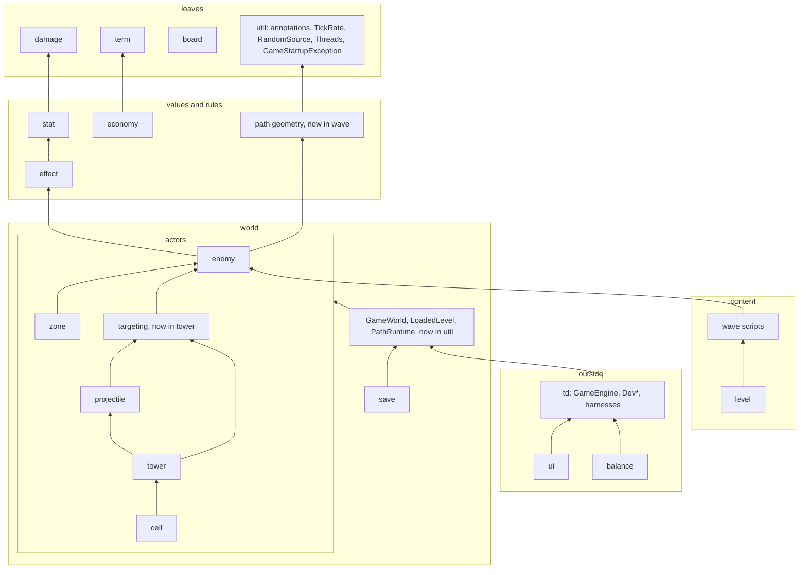

# Design review — phase 1 results and handoff

Status: **phase 1 done (prompt sections 0–3, analysis only, nothing in `src` changed)**. Phase 2
(sections 4–7: probes, verdicts, document patches) starts from this file. The prompt for it is
at the end, ready to paste.

Goal of the whole review: make jTD as modular, well designed (object design and a functional
style) and cheap to change as possible. A change is worth making only if it shows a benefit:
cheaper future changes, easier maintenance, better testability or better design.

Files here:

- `README.md` (this file): what was read, the book notes, the smell catalogue, the
  measurements, leads for phase 2 and the phase-2 prompt.
- `metrics.py`, `report.py`: the throwaway measuring scripts, kept so phase 2 can re-run them.
  `python docs/plans/design-review/metrics.py . target/design-review` writes `metrics.json`;
  `python docs/plans/design-review/report.py target/design-review/metrics.json pkg|cls|meth|gw|sw|lis|git|test`
  prints one section. They are regex-based, not a parser (see "Caveats").

---

## 1. What was read

**Project context (section 0):** root `CLAUDE.md` (including the new rule on numbers in
comments), all 11 package `CLAUDE.md` files, `docs/ARCHITECTURE.md`, `TODO.md`, `checkstyle.xml`,
`checkstyle-imports.xml`, every memory note, `git status`, and the last 30 commits.

**Uncommitted feature work at the time (phase 2 must not propose refactors in these files
without flagging the clash):** `GameEngine`, `DevEffects`, `effect` (`Effect`, `EffectKind`,
`EffectSentences`, `EffectTemplate`, new `SpellproofTemplate`, `UnyieldingTemplate`), `enemy`
(`AbilityEvaluator`, `AbilityTerm`, `AbilityText`, `BodyArchetype`, `DefinedEnemyMob`,
`EnemyCatalog`, `EnemyDefinition`, `MenderEnemy`, `MovementBehavior`, `PeriodicTrigger`,
`PulseMovement`, `RankGrowth`, `ShieldbearerEnemy`, new `GolemEnemy`, `MagmaEnemy`, `SwingCurve`,
`SwingMovement`), `level` (`CurlyPathLevel`, `WardenEnemy` moved here from `enemy`), `ui`
(`EffectPictograms`, `EnemyFrameBuilder`, `EnemyTermPictograms`, `Java2DFrameRenderer`,
`TermLooks`, `render/Palette`), `wave` (`WaveScript`, new `WaveScriptGrammar`, `ShapeKeyword`),
the `enemy` and `wave` `CLAUDE.md` files, `README.md` and `TODO.md`. Run `git status` again.

**The book (section 1):** Yourdon & Constantine, *Structured Design*, 2nd ed., 1978/1979
(PDF with an OCR text layer, 464 pages). Read across both sessions:

| Read in full or nearly | Read in part (intro, key sections, summary) | Not read |
|---|---|---|
| 6 coupling, 7 cohesion, 9 heuristics, 12.2 Parnas, 13 pathological connections, 19 generality, flexibility and reliability | 2 black boxes, 3 program structure, 5 complexity, 8 morphology, 10–11 transform and transaction analysis (intros), 12.1 Jackson/Warnier, 14 packaging, 15 optimization, 16 typology, 17 recursion, 18 homologous and incremental structures | 1, 4, the worked examples (10.8 FRANK, 11.2), 20 implementation, 21 management, the appendices |

Phase 2 should not need the book again; the notes below carry what matters. If it does:
download it into an empty scratchpad folder, run `pdftotext`, and remember that PDF page ≈
printed page + 17.

## 2. Book notes (paraphrased): concept, symptom in code, cheapest fix

| Concept (chapter) | What it says | Symptom to look for in jTD | Cheapest fix |
|---|---|---|---|
| Problem–structure match (2) | Cost is lowest when each piece of the system matches one small piece of the problem, and each link between pieces matches a link in the problem. | A class that serves several problem pieces; a link between classes that has no counterpart in the game's rules. | Split along problem pieces; drop the link. |
| Black box (2) | A black box is used without knowing its inside. Documenting a module's quirks does not make it a black box; it makes it a grey box. | `CLAUDE.md` rules that tell a *caller* about a module's internals: call order, "read X before Y", "callers must handle -1". | Encapsulate the quirk so the rule can go (a method that does both steps in order, a value instead of a sentinel). |
| Rule of black boxes (2) | When a capability is needed, name it as a black box and use it; design its inside later. | Code that inlines a capability another class already owns. | Extract and reuse. |
| Manager analogy (2, 8) | Managers decide and coordinate; workers do the work. A manager with ~7+ direct reports, or a chain of managers that only pass work on, is a smell. A manager hands a subordinate only what that subordinate needs. | High fan-out coordinators; pass-through classes; wide parameter objects. | Factor coordinators; narrow parameters. |
| Normal vs pathological connection (3, 13) | A normal connection goes through a module's interface; a pathological one reaches inside it (shared data, back doors). Pathological links multiply once one exists. | Reaching into another class's state; shared mutable data; side channels between packages. | Pass data through the interface. |
| Complexity (5) | Errors grow faster than size. Splitting helps only while the parts are independent, and over-splitting adds its own cost. People hold about seven things at once. | Very large classes and methods; tiny classes that only forward. | Split by independence, not by size alone. |
| Coupling ladder (6) | From worst to best: content, common (shared/global data), external, control (a flag telling the callee what to do), stamp (a whole structure where a part would do), data. Control information hidden in data is still control coupling. "Inversion of authority" is a subordinate telling its boss how to do the boss's job. | Flags and mode arguments; sentinel values; whole-world parameters used for one field; returned "what to do next" codes. | Split the callee per mode; pass the field; return a value, not an order. |
| Cohesion ladder (7) | From worst to best: coincidental, logical, temporal, procedural, communicational, sequential, functional. The test: one plain sentence describes the module. "And", "or", "first … then", "initialize", "all the X" point down the ladder. | Grab-bag packages and classes; `*Util`; classes described with "and". | Split by function; name by role. |
| Factoring, decisions high (8, 9) | In well-factored systems decisions sit high and detailed work low; each decision sits within the scope of control of the module that makes it ("scope of effect within scope of control"). A low module making a decision whose effects land elsewhere creates flags passed upward, duplicated decisions and pathological flow. Fix by moving the decision up, the affected module down, or merging. | Low-level classes deciding game-level outcomes; flags bubbling up; the same decision re-made in several places. | Move the decision to the coordinator; return facts upward, not orders. |
| Heuristics, not rules (9) | The heuristics are guides; applied blindly they produce bad designs. | Rules followed against their purpose. | Allow deviation with a stated reason. |
| Data-shaped design vs information hiding (12) | Jackson/Warnier: shape the program after the data. Parnas: hide each decision likely to change (a data format, a processing order) inside one unit, so changing it touches one unit. The book notes the tension: a program shaped by its data must change shape when the data does. Reconciled by Myers' "informational strength" module: one unit owns a format, offers several entry points, and others only know an identifier. | A text format whose knowledge is spread over several classes; a domain model shaped by its file format. | One reader/writer unit mirrors the format inside; the rest sees domain values only; an intermediate value type where the two shapes differ. |
| Recursion (17) | Recursion ends only if some call in the cycle is conditional. "Serially reusable" (no memory between calls) is weaker than "reenterable" (safe to enter again mid-call). Accidental recursion is the dangerous kind. | Triggers that can fire triggers; listeners that re-enter what fired them. | A stated terminator per chain; deferral; reenterable code or a guard. |
| Incremental modules (18) | Some modules naturally resume where they left off (coroutines). Written as ordinary routines they need a hidden "where was I" switch. A producer/consumer pair with a many-to-one or one-to-many ratio forces bookkeeping on whichever side is not in control. | Per-tick state machines whose resume state is spread over many fields; a `switch` on a stored step; counters bridging rate mismatches. | One explicit state value owned by the incremental module; let the side with the irregular ratio own the loop. |
| Generality and flexibility (19) | Generality has four separate parts: portability, how common the problem is, the range of inputs accepted, and flexibility. Flexibility grows when behaviour is controlled by data and not by code ("locus of control"), when a value is bound later, and when controls are brought to the surface. But putting *all* control into data ends in an interpreter. General modules come from *excluding* special cases (a smaller common core), not *including* a feature for everyone. Passing only the data elements a function needs makes it more general. Push one-off setup up to the caller. | Content as code where data would do; speculative options nobody uses; a whole record passed where three fields are read. | Move content to data where a second user exists; narrow interfaces; delete unused options. |
| Fault handling (19) | Detect, act, correct or recover. Detect as early as possible, at the interface where the data enters. Separate checking duplicates classification logic, so modules that must be robust check their own inputs ("firewalls"). Pathological data, not normal data, causes most failures. | Validation scattered deep inside; a malformed input that fails late or silently. | Validate at the boundary that parses; keep invariant checks in the value's constructor. |
| Optimization (15) | Correct and modular first; measure; recode the few hot modules; change structure for speed only as a last resort. | Structure bent for speed without a harness number. | Undo, or justify with `PerformanceHarness`. |
| Small modules, clean interfaces (19 summary) | The general-purpose system is many small single-purpose modules with very clean interfaces; the generality comes from combining them. | — | — |

## 3. Smell catalogue (section 2)

Each entry: the smell, its sources, and how phase 2 detects it. Book = B, Fowler *Refactoring*
2nd ed. = F, Beck *Tidy First?* = T, jTD rules = J.

| Smell | Sources | Detection |
|---|---|---|
| Content coupling: reaching inside another unit | B6/13, F Insider Trading, J "never expose a live collection" | Returned mutable collections; package-private access across classes; fields read through getters to decide for the owner. |
| Common/global coupling | B6, F Global Data, Mutable Data | `GameWorld` users; static mutable state (measured: none); shared mutable collections. |
| Control coupling | B6, F Flag Argument (Remove Flag Argument), J "no mode flags" | Boolean and enum parameters that pick a branch; sentinel returns (`-1`). |
| Stamp coupling / tramp data | B6, F Long Parameter List, Data Clumps | A wide type passed where one or two parts are read; a parameter passed on untouched. |
| Inversion of authority | B6 | A callee returning "what to do next"; callbacks that steer the caller. |
| Low cohesion, divergent change | B7, F Divergent Change, Large Class | Classes with many unrelated public methods; files changed for unrelated reasons (git). |
| Shotgun surgery | F Shotgun Surgery, B2 (a change touches many pieces) | Co-change pairs across packages; "Adding a …" checklists. |
| Repeated switches | F Repeated Switches, J visitor/sealed-switch rule | Switch sites per type. |
| Feature envy / tell-don't-ask | F Feature Envy, Message Chains | Methods using another object's getters more than their own fields; `a.b().c()` chains. |
| Middle man / pass-through | F Middle Man, B8 (managers that only pass work on) | Methods whose body is one delegation; `GameWorld` held but not used. |
| Speculative generality | F, B19 (inclusive generality) | Interfaces with one implementation and no test seam reason; unused options; a visitor with one visit method. |
| Scope of effect outside scope of control | B9 | Low classes deciding outcomes whose effects land elsewhere; flags passed upward. |
| Fan-out too high | B8/9 | Imports per file; constructor parameters; collaborators. |
| Grey box | B2 | `CLAUDE.md` lines telling callers about call order or internals. |
| Unguarded re-entrancy, accidental recursion | B17 | Listeners, hooks, procs, effects that trigger more of themselves. |
| Hidden resume state | B18, F Temporary Field | Many mutable fields in per-tick classes; `switch` on a stored step. |
| Format knowledge spread out | B12 (Parnas and Jackson), F Divergent Change | Several classes knowing one text format's tokens. |
| Content as code where data would do | B19 (locus of control), J "content is data" | Behaviour classes per content entry that differ only in numbers. |
| Late or scattered fault detection | B19 | Validation deep inside; silent fallbacks. |
| Long function, deep nesting | F Long Function, T guard clauses, explaining variables, chunk statements | Method length and nesting. |
| Mutable data where a value would do | F Mutable Data, Replace Derived Variable with Query; functional core | Mutable fields that could be derived; methods that both query and command. |
| Dead code, redundant comments | F Dead Code, T delete dead code, delete redundant comments | IDE inspections (`get_file_problems`). |
| Asymmetric code | T normalize symmetries, reading order, cohesion order | Same thing done two ways in one class or package. |

Tidy First timing for every verdict: tidy first only if it makes the very next change cheaper;
tidy after if it makes later changes cheaper; otherwise backlog or never. Beck bases this on
Constantine: the cost of software is roughly the cost of changing it, which is mostly coupling.

## 4. Measurements (section 3)

Scope: 710 main files (55.6k lines), 235 test files (29k lines), 666 commits (co-change uses the
last 400; commits touching more than 25 main files are skipped as sweeping).

### 4.1 Package dependencies

Nine of the 18 top-level packages form **one dependency cycle**: `cell`, `effect`, `enemy`,
`projectile`, `stat`, `tower`, `util`, `wave`, `zone`. Checkstyle's `ImportControl` only bans
AWT/Swing in the domain packages, so nothing enforces a layering.

What closes the cycle (imports between packages, by file count):

| Edge | Imports | Cause |
|---|---|---|
| everything → `util` | `ThreadConfined` 92, `TickRate` 52, `GameWorld` 50, `RandomSource` 12, `GameHost` 11, `GameStartupException` 8 | `td.util` holds both the leaf utilities and the composition root. |
| `util` → `tower`, `enemy`, `zone`, `wave`, `projectile`, `cell`, `stat`, `economy`, `board` | 1–3 each | `GameWorld`, `LoadedLevel`, `PathRuntime`, `PlaytestHooks` own the rosters. |
| `projectile` → `tower`, `zone` → `tower` | `tower.targeting` (`InRangeTargetQuery`, `NearestSelector`) | Targeting is shared but lives under `tower`. `CLAUDE.md` says "`projectile` never depends on `tower`"; it does, through this. |
| `enemy` → `wave` and `wave` → `enemy` | `enemy` uses `Vec2`, `Path`, `ArcLengthPath`, `PathPose` (5+3); `wave` uses `Rank`, `EnemyDefinition`, `SpawnParameters`, `EnemyCatalog` (9 files) | `td.wave` is two packages: path geometry and wave scripts. |
| `enemy` ↔ `zone` | `enemy` uses `Zone`, `ZoneKind`, `ZoneOwner`; `zone` uses `EnemyMob`, `EnemyRegistry` | Enemies leave zones and zones touch enemies. |
| `cell` → `tower` | `Tower` (2 files) | A cell holds its tower. |

Package fan-out / fan-in: `tower` 11/8, `ui` 14/1, `util` 10/10, `enemy` 9/9, `zone` 6/4,
`effect` 4/7, `wave` 3/8, `stat` 2/7, `damage` 0/10, `term` 0/6, `board` 0/5.

Inferred intended layering, if the cycle were broken (a proposal for phase 2 to confirm):



### 4.2 Classes and methods

Class size (non-blank lines): median 23, p90 129, p99 611, max 1365.

| Largest classes | Lines | Public methods | Churn (commits of 400) |
|---|---|---|---|
| `ui/Java2DFrameRenderer` | 1365 | 4 | 66 |
| `TowerDefense` | 792 | 17 | 32 |
| `enemy/DefinedEnemyMob` | 733 | 75 | 58 |
| `tower/AbstractTower` | 716 | 38 | 54 |
| `ui/PanelDev` | 683 | 31 | 25 |
| `balance/BalanceReport` | 671 | 1 | 15 |
| `balance/TowerLab` | 615 | 24 | 14 |
| `tower/PulseTower` | 611 | 37 | 39 |
| `tower/SplashTower` | 593 | 25 | 39 |
| `tower/CinderTower`, `MortarTower`, `SeekerTower`, `SniperTower` | 408–518 | 8–15 | 38–47 |
| `effect/ActiveEffects` | 494 | 25 | 45 |
| `GameEngine` | 431 | 35 | 25 |

Wide interfaces (the rule asks for 1–5 methods): `Tower` 44 (34 abstract, 10 default; already a
`TODO.md` entry), `HitReceiver` 23 (18 + 5), `Cell` 14, `AbilityContext` 9, `EnemyMob` 7 plus three
inherited interfaces.

Efferent coupling (distinct `td` imports per file): `SplashTower` 74, `SeekerTower` 62,
`MortarTower` 58, `SonarTower` 58, `CinderTower`/`PulseTower`/`SniperTower` 52, `AbstractTower` 43,
`Java2DFrameRenderer` 42, `TowerDefense` 36, `GameEngine` 34.

Mutable instance fields: `TowerDefense` 17, `AbstractTower` 17, `PanelDev` 17, `PulseTower` 15,
`RunRecorder` 14, `PanelTowerInfo` 13, `DefinedEnemyMob` 10, `PathMotion` 7, `GameEngine` 7,
`GameLoop` 7. **Static mutable fields: none.**

Longest methods (excluding record bodies, which the script counts as one block): `Java2DFrameRenderer.colorFor`
208 lines, `PanelDev.initComponents` 165, `EffectSentences.of` 136, `UpgradeTreeLayout` 120,
`TowerDefense.initComponents` 84, `PanelLevelSelect.buildCard` 77, `PictogramPath.read` 69.
Nesting depth 5: `TowerPlacement.mouseClicked`, `GameSaveText.read`, `WaveContent`,
`TowerLab.probedKinds`, `WaveCheckReport.Options`.

Constructors and parameters: the widest constructor is `Zone` (10), then `EnemyBodyDraw` (8),
`CannonballProjectile` (7). 40 records have 5 or more components, most built through factories
as the rules require. 132 methods take a `boolean` (71 public); most are record components
(data, not control). Candidates for control flags: `AbstractTower.report` (2 booleans),
`PulseTower.holdInside` (2), `TowerLab.partnerDamage` (2), `UpgradeOffer` (4 in its constructor).

### 4.3 `GameWorld` usage

`GameWorld` has 24 public methods; 50 files reference it.

| Accessors a file calls | Files |
|---|---|
| 0 (holds or forwards the world) | 12: `EnemyCatalog`, `Tower`, `TowerFactory`, `PanelGameConsole`, and 8 `UpgradeCondition` types (deliberate, see `ARCHITECTURE.md` §3) |
| 1 | 14: mostly `ui` (`economy` or `level`), `AbilitySpawnFactory` (`getEnemyCatalog`), `UpgradeNode` and `PathPlanner` (`playtestRules`), `UpgradeTree` (`level`) |
| 2–5 | 16, including most tower leaves (`enemies`, `getBoard`, plus `zones`/`projectiles`/`towers`) |
| 6+ | `GameEngine` 17, `DefinedEnemyMob` 10, `DevControls` 8, `BoardRenderer` 8, `AbstractTower` 7, `TowerDefense` 6 |

`DefinedEnemyMob`, a leaf actor, uses 10 accessors including `economy`, `damageTally`,
`disruptions`, `random` and `playtestRules`.

### 4.4 Dispatch

`instanceof` is banned in main by Checkstyle (0 there; 9 in tests). Switch sites per type (3+):
`EffectKind` 8, `Palette` 8, `AbilityAction` 7, `WaveSlot` 7, `PlayerAction` 6, `EnemyStat` 6,
`EffectStacking` 5, patterns over `Stacks`/`FuelPool` 5 each, `ShieldPool`, `EffectTarget`, `ZoneKind`,
`FieldMode`, `UpgradeSlot`, `StatusTerm` 4 each. Visitors: `TowerVisitor` (8 visit methods, 3
implementors), `ProjectileVisitor` (2, 1), `EnemyMobVisitor` (1 visit method, 2 implementors, one
concrete mob class).

### 4.5 Listeners and hooks (re-entrancy candidates)

Listener interfaces: `EconomyListener` (7 files), `PeriodicDamageListener`, `WalkEndListener`,
`WaveStartListener` (3 each), `ShieldListener` (2). 9 classes use `CopyOnWriteArrayList`. Hooks
beyond listeners, from the package rules: `Tower.onKill`, procs and hit bonuses, effect
interactions, hex payouts, Sympathy/Reckoning sharing, `EnemySpawner.add`/`replace`,
`ExperienceAwarder`. Terminators that exist today **only as prose** in `CLAUDE.md`: "a kill made
from inside the hook triggers nothing", "a listener that deals damage back must not be told about
its own damage", "a share tops the receiver up … so two carriers settle instead of climbing",
"listeners re-enter the ledger" (handled by firing outside the lock).

### 4.6 Text formats

`wave`: `WaveScript` (60 lines), `WaveScriptGrammar` (175, new and uncommitted), `WaveScriptSuggestions`
(120), `ShapeKeyword` (new). `save`: `GameSaveText.read` (40 lines, nesting 5). `ui`:
`PictogramPath.read` (69, a path-text format). `balance`: `PlayRecord`, `PlayerAction`
(action logs). Phase 2 checks whether each format's knowledge lives in one unit (probe 9).

### 4.7 Change history

Top-level packages touched per commit (400 commits): 0: 90 (docs only), 1: 159, 2: 64, 3: 39,
4: 23, 5+: 25. About a quarter of code commits touch three or more packages.

Hotspots (churn × size): `Java2DFrameRenderer` (66 commits × 1365 lines), `DefinedEnemyMob` (58 ×
733), `AbstractTower` (54 × 716), `TowerDefense` (32 × 792), the tower leaves (38–47 × 400–600),
`ActiveEffects` (45 × 494), `PanelDev`, `EnemyFrameBuilder`, `GameEngine`, `Palette` (51 × 210).

Cross-package pairs that change together: `DefinedEnemyMob` with `EnemyFrameBuilder` 18,
`Java2DFrameRenderer` 17, `Palette` 16, `EnemyStatText` 15, `ActiveEffects` 16; `EffectKind` with
`Java2DFrameRenderer` 16, `EnemyFrameBuilder` 15, `Palette` 15, `EnemyStatText` 13; `Effect` and
`ActiveEffects` with the same `ui` files 11–14. Package pairs: `tower`+`ui` 52 commits,
`td`+`ui` 35, `enemy`+`ui` 33, `effect`+`ui` 26, `enemy`+`tower` 23, `effect`+`enemy` 22.

Change scenarios already written down as `CLAUDE.md` checklists (a first cut of the
change-scenario table):

| Change | Files | Packages |
|---|---|---|
| New effect kind | `EffectKind`, `EffectSentences`, `Effect`, `EffectTemplate`, `ActiveEffects.magnitude`, `EnemyFrameBuilder.markerPaletteFor`, `Java2DFrameRenderer.colorFor`, `TermLooks.effect`, `EffectPictograms`, `DevEffects` | 3 (`effect`, `ui`, `td`) |
| New tower | leaf, `TowerFactory`, `TowerVisitor`, `TowerSpriteFrameBuilder`, `TowerEffectFrameBuilder`, `Palette`, `Java2DFrameRenderer` (3 methods), `README.md` | 3 (`tower`, `ui`, `ui.render`) |
| New body archetype | `BodyArchetype`, `EnemyFrameBuilder`, `Java2DFrameRenderer` (4 methods, 2 not compiler-forced), `wave/CLAUDE.md`, `README.md` | 2 |
| New trait | trait, `TraitMarker`, `EnemyFrameBuilder`, `Java2DFrameRenderer`, its term entry | 2 |

### 4.8 Tests

Fakes: 12 named fakes/recorders, each defined once (no duplicates). `instanceof` in tests: 9.
Test-to-main line ratio 0.52.

### 4.9 The documents themselves

- Package `CLAUDE.md` files total **64 KB** (`tower` 20 KB, `enemy` 13 KB, `effect` 10 KB, `ui` 7.6 KB,
  `wave` 5.8 KB); root 11.8 KB. `ARCHITECTURE.md` §10 still says "packages 142 KB to 22 KB", so
  they have tripled since the cut, and the section is stale.
- `tower/CLAUDE.md` describes individual towers' mechanics (Seeker nest, Mortar shells, Cinder,
  Aura); `enemy/CLAUDE.md` and `effect/CLAUDE.md` describe individual effects and enemies. That
  is content and feature narrative, against "constraints only".
- Lines naming an order or a caller duty ("before", "after", "first", "only when", "callers must"):
  `enemy` 20 of 53 rules, `tower` 17 of 65, root 13 of 46, `wave` 11 of 22, `effect` 10 of 33. By
  the book's black-box test these mark grey boxes: phase 2 should ask, for each, whether code
  could hold the order so the rule could go.
- Checkstyle enforces: naming, no star imports, no inline TODO, `IllegalCatch`, no AWT/Swing in
  the domain, no `instanceof` in main, wide records need a factory, no `Math.random`, `Hud` borders,
  AssertJ only, no `owns(...)` in tower code. Not enforced: package layering, parameter counts,
  interface width.

### 4.10 Caveats

The scripts use regular expressions, not a Java parser. Import edges miss same-package
references. Interface method counts include nested permitted types for sealed interfaces (the
figures above were corrected by hand for the interfaces listed). Field counts were unreliable and
are left out. Method lengths for records and enums count the whole body. Switch types are
inferred from the first `case` label. Treat the numbers as pointers to look at, not verdicts.

## 5. Leads for phase 2, by probe (not verdicts)

1. **Coupling:** the `util` hub and the 9-package cycle; the 14 one-accessor `GameWorld` users;
   `DefinedEnemyMob`'s 10 accessors; the control-flag candidates in 4.2.
2. **Cohesion:** `Java2DFrameRenderer` (every domain's art in one class, the top hotspot);
   `DefinedEnemyMob` (75 public methods); `td.wave` holding geometry and scripts; `td.util`
   holding leaves and the composition root.
3. **Scope of effect:** `DefinedEnemyMob` reaching `economy` (a leak charges the economy from inside
   the mob?); decisions in `TowerPlacement.mouseClicked` (nesting 5).
4. **Fan-out:** tower leaves with 52–74 imports; `Zone`'s 10-parameter constructor.
5. **Inversion of authority:** returned results such as `ShotResult`, `StrikeResult`,
   `AttackOutcome`, `Impact`: facts or orders?
6. **Information hiding:** the change-scenario table in 4.7; co-change of `effect`/`enemy` with
   `ui` (an effect's look is spread over four `ui` classes keyed by `EffectKind` switches).
7. **Re-entrancy:** the chains in 4.5, and whether each prose terminator has a test.
8. **Recursive data:** upgrade trees (`UpgradeTree`, `PathPlanner`), `TargetQuery`/`HitCondition`/`UpgradeCondition`
   combinators (`And`/`Or`), `TermText`, `StatModifiers`, `WaveScriptGrammar`.
9. **Formats:** 4.6.
10. **Activation kinds:** `FireClock`, `PathMotion` (7 mutable fields), the Seeker nest,
    `SonarSweep`, `GameLoop`, the per-tick ledgers (`Burning`, `TollTracker`, `BracketTracker`).
11. **Families:** the eight tower leaves (400–600 lines, 38–47 commits each); `ARCHITECTURE.md` §13
    rejected data-defined towers "for now".
12. **Fault handling:** `GameStartupException` boundaries; `GameLoop`'s circuit breaker; save
    loading that names what it could not rebuild.
13. **Physical vs logical:** the allocation-free `StatSheet` path; the frame build.
14. **Functional style:** the mutable-field list in 4.2; static mutable state is already zero.
15. **Object design:** `Tower` (44), `HitReceiver` (23), `Cell` (14); `EnemyMobVisitor` with one visit
    method over one concrete class; repeated switches in 4.4.

---

## 6. Prompt for phase 2 (paste into a new session)

````
# Task: design-quality review of jTD, phase 2 (analysis first, no edits)

Read `docs/plans/design-review/README.md` first, fully. It holds phase 1's results: what was
read, paraphrased notes from Yourdon & Constantine's *Structured Design*, the smell catalogue,
the measurements, and leads per probe. Do not redo phase 1. Re-run its scripts only to refresh a
number, or to measure something it did not.

Goal of the whole effort: make the codebase as modular, well designed (object design and a
functional style) and cheap to change as possible: easier maintenance, easier new content and
features, better testability, better design. A change is only worth making if it buys one of
those, and the benefit must be shown, not asserted. "Looks cleaner" is not a benefit.

This phase is READ-ONLY: do not edit, commit, rename or reformat anything in `src`, `CLAUDE.md`
files, `docs/ARCHITECTURE.md`, `TODO.md` or the Checkstyle files. The one file you write is this
review's own `docs/plans/design-review/README.md` (append the phase 2 results, keep phase 1 as it
is) so a further session can continue from it. Report in the console too, then stop and wait for
my decision.

## 0. Context

- Re-read root `CLAUDE.md`, the package `CLAUDE.md` files a finding touches, `docs/ARCHITECTURE.md`
  and the memory notes. Treat the memory notes as standing preferences (CLAUDE.md holds
  constraints only; minimize test churn; role noun last; no mode flags; earlier decisions are not
  binding; keep work cheap to maintain).
- Run `git status`. Compare it with the uncommitted-work list in the README; flag any proposal
  that touches a file with uncommitted changes.
- Prefer cheap deterministic tools: `rg`, `git log`, the README's scripts, the IDE's `idea` MCP
  tools (`search_symbol`, `analyze_calls`, `get_symbol_info`, `get_file_problems`) when the IDE is
  open. Do not spawn subagents without asking me.

## 4. Probe the code by design idea (every row gets a result, even "nothing found")

Treat the rows as equal in weight; do not spend more on one because it is listed first or sounds
more interesting. Start each from the README's lead for it. For each row report what you searched,
what you found (file:line), and a verdict from section 5.

| # | Idea | What to look for |
|---|---|---|
| 1 | Coupling ladder | Control coupling (flags, modes, enum args that steer a callee), common/stamp coupling (`GameWorld` consumers), content coupling (exposed internals), pathological reach-through across packages, the 9-package cycle and what would break it. |
| 2 | Cohesion ladder | Classes whose one-sentence description needs "and", "or", "handles", "manages"; grab-bags; packages holding two decisions (`util`, `wave`). |
| 3 | Scope of effect within scope of control | Decisions (game over, wave complete, kill/leak rulings, targeting eligibility, placement rejection) made by a low-level class whose effects reach classes it does not control. |
| 4 | Span of control, fan-out, fan-in | Classes with many collaborators or imports; utilities with high fan-in that carry hidden state; chains that only forward. |
| 5 | Inversion of authority | Callees telling callers what to do: returned commands, callbacks steering the caller, domain code calling back into the engine instead of returning a value. Classify each upward channel as sanctioned (listener, `GameHost`) or accidental. |
| 6 | Information hiding (Parnas) | For each package or major class, name the one decision it hides. Complete the change-scenario table (new tower, enemy, effect kind, trait, level, upgrade node, term, text-format field) from real code; any row spanning more than one package is a leak to explain. |
| 7 | Re-entrancy and termination | Every chain that can trigger more of itself in a tick: effects applying effects, procs firing procs, splash/chain damage, on-death abilities, listeners that fire listeners, callbacks mutating a collection being iterated. For each: trigger, terminator (depth, once-per-tick, deferral, nothing), thread, place in the `doTick` order, and whether a test pins the terminator. "Nothing stops it" is a finding even if it cannot loop today. |
| 8 | Recursive data handled without recursion | Tree/DAG types and combinators; nested conditionals mirroring data depth; per-level duplication; parallel arrays by level. Fixes: Composite, Interpreter, fold over a sealed type, visitor, algebra with identity and absorber. Gates: real base case and bounded depth; removes duplication or a branch; hot path vs the performance budget; traceable and testable on fixtures. Depth fixed at 2 or less, or clearer iteratively: reject. |
| 9 | Data-shaped formats (Jackson vs Parnas) | Each text format (`save`, wave scripts, pictogram paths, balance action logs): does one unit own the format and mirror its shape inside, with the rest of the code seeing domain values only? Where format and domain model differ, is there an intermediate value type? Do reader, writer, grammar and suggestions agree from one source? Does bad input fail at the boundary as the rules require? |
| 10 | Activation kinds, incremental modules | Classify: called in tick; listener possibly on another thread; incremental per-tick state machine. Flag direct calls across kinds, and incremental modules whose resume state is spread over fields instead of one explicit state value. |
| 11 | Families, generality, flexibility | Families of near-identical things: is the shared part data or code? Where adding one more member forces code changes beyond its own class, that is a flexibility defect; generality with no second user is speculative. |
| 12 | Reliability and fault handling | Where faults are detected (at the boundary or deep inside), who decides, whether invariants sit in constructors, whether failures are loud. |
| 13 | Physical vs logical modularity | Structure bent for speed without a harness number, or structure that would blow the budget. |
| 14 | Functional style | Pure core vs side effects: calculations that mutate shared state or fire events mid-way, methods that both query and command, mutable fields that could be derived, values that are not immutable. Show which test would need no fake afterwards. |
| 15 | Object design | Tell-don't-ask, Law of Demeter chains, conditionals that should be polymorphism or a sealed switch, inheritance outside the closed-set rule, anemic types, wide interfaces (`Tower`, `HitReceiver`, `Cell`), a visitor over one concrete class. |
| 16 | Grey boxes | Each `CLAUDE.md` rule that tells a caller about another unit's internals or call order: could code hold it so the rule can go? |
| 17 | Anything else | Extra probes from the book notes. |

## 5. Evaluate every candidate with one model

For each finding: where (file:line), the named smell or idea, the evidence (number, history, or
a concrete failing scenario), the proposed fix (a named refactoring or tidying), then:
- **Benefit**: which, concretely: (a) future-change cost (which recurring change gets cheaper; cite
  co-change evidence); (b) testability (which test becomes possible or simpler; fakes removed);
  (c) design (which coupling or cohesion level improves, by what step); (d) risk removed.
- **Proof**: for every Do-now and With-next-feature candidate, simulate the next likely change it
  claims to help and count files, classes and tests touched before vs after. No measurable
  difference means no benefit: downgrade it.
- **Cost**: files and tests touched (test churn is a cost), reviewer effort, performance risk,
  clash with uncommitted work, reversibility. A package move is cheap with the IDE but touches
  every importer: count them.
- **Verdict**: *Do now* · *Do with the next feature that touches it* · *Backlog* (draft the
  `TODO.md` entry with **Where** and **Approach**) · *Reject* (say why; "never" is legitimate).
Rank by benefit divided by cost. Prefer small, independently revertible steps.

## 6. Documents to improve (propose, don't write)

A. Review the existing rules first. For every rule in root and package `CLAUDE.md`: is it kept;
what does it buy; does it cost more than it returns; is it duplicated, contradicted or stale; is
it content or narrative rather than a constraint (the package files have grown to 64 KB). Propose
removals as readily as additions.

B. New rules, each only if its probe found something worth a rule: a decomposition criterion
(each unit hides one decision likely to change); a ranked coupling checklist with control and
common coupling needing a reason; scope of effect; a fan-out cap; inversion of authority for
domain packages; re-entrancy and termination; data-shaped formats (one unit owns a format and
mirrors it; an intermediate value type where shapes differ); a functional core; activation
kinds; a package layer map enforced in `checkstyle-imports.xml`; the visitor-vs-new-variant cost;
the `util` split; an exception clause (the design rules are heuristics; deviating needs a stated
reason in the commit). In `ARCHITECTURE.md`: the change-scenario table and a data-flow diagram
(Mermaid), and the stale §10 figures.

C. Placement and size. Root `CLAUDE.md` loads every session. Put each rule in the cheapest place
that enforces it: Checkstyle or a test → the package `CLAUDE.md` it governs → root → the reason
in `ARCHITECTURE.md`. Report the net line change of root `CLAUDE.md` and of the package files;
growth needs a reason.

For every gap offer two options (one may overturn an earlier decision) and mark each ✅ / ❓ / ❌
so I can review in rounds.

## 7. Output, then stop

In the console and appended to the README:
1. A 10-line summary.
2. The section-4 table, completed.
3. The ranked candidates with proofs, grouped Do now / With next feature / Backlog / Reject.
4. The existing-rule review, then proposed document patches as diffs (not applied), with the
   net line counts.
5. Questions only I can answer, in one AskUserQuestion batch, your recommendation first.
Then wait. After I approve, the implementation order is: docs and checks first, then tidyings
one commit each (imperative capitalized subject, no trailing period), `mvn verify` before each
commit, renames and moves through the IDE's `rename_refactoring`, `td.PerformanceHarness` after
any per-tick or per-frame change, one live `run-jtd` pass only if Swing wiring changed. A content
change adds no test; a test broken by a tidying is rewritten on a fixture, never by editing its
expected value.
````
