# Plan: Effect icons and terms (`docs/features/FEATURE-effect-icons-and-terms.md`)

**Status:** planned 2026-10-20 and 2026-10-21, reviewed 2026-10-21 (D19 to D21, phase 12 required). Implemented through phase 12.

**Companion files** in `docs/plans/effect-icons-and-terms/`:

| File | What it is |
|---|---|
| `pictograms.png` | Every pictogram this plan ships (197), each at 40 px and at 18 px (a row face is 20 px: see `faces.png` and `panes.png`) |
| `faces.png` | The live states of an icon face: plain, stacks, time sweep, pool bar, immune, resisted, perk numeral and progress, faded |
| `panes.png` | The tower pane, the enemy pane and two tooltips at real size, drawn with the real faces |
| `pictogram-tables.md` | The four `*Pictograms.java` classes, generated from the art, ready to paste |

The art was drawn and checked in a Java2D lab that uses the same parser and face painter this plan
specifies (section 3.7 and phase 6), so what the PNGs show is what the game will paint.

## How to use this plan

Read sections 1 to 4 once. Then do the phases in the order of section 4, one commit each.

- One phase (or lettered sub-phase) is one commit with the subject line it gives. `mvn verify` is
  green before every commit. The docs a phase names change in the same commit.
- Names in this plan are final: types, methods, keys, titles, colours. Do not rename them and do
  not add types the plan does not name. A step that says "copy" means copy exactly.
- Numbers in a sentence always come from a named constant or rule; the plan names it. Never type a
  number into a text that a constant already holds.
- The usual way through a step: make the change, run `mvn -q compile`, fix what the compiler names
  the way the step's mapping says.
- If a step cannot be done as written (a method is missing, a file moved), stop and ask. Do not
  invent a replacement mechanism.
- Root `CLAUDE.md` rules apply: `this.` on fields, records with 5+ components get a narrow factory
  and `withX` copies (`td.ui.render` excepted), no `instanceof` anywhere in `src/main`, hand-written fakes,
  behaviour-sentence test names, AssertJ, no comments that restate code, `@ThreadConfined` on any
  class with a mutable field.
- Phases that touch per-frame code (6 to 11) end with `td.PerformanceHarness`; it exits non-zero
  over budget. Fix the allocation, never the budget.
- Test churn: a test about the thing a phase changes is rewritten in that phase. Any other test is
  only touched where this plan lists it.

## 1. Why: the assessment

The panes describe the game in ad-hoc words: one row per stat, trait, effect, immunity and DR line
(`EnemyStatText`, `TowerSheetText`), adjectives built per row ("Unraveled x3", "Sundered"), and 139
`describe()` methods that return plain `String`. Five problems follow:

1. **No vocabulary.** An effect has no player-facing name, only an enum constant and per-row
   adjectives; abilities and tower mechanics have no names at all. Text cannot point at a thing.
2. **Words drift from numbers.** Effect meanings exist only as Javadoc; nothing generates a tooltip
   from the rules, so any tooltip typed by hand would go stale at the next balance pass.
3. **The panes don't scale.** A boss with five effects and three immunities fills the pane with rows.
4. **Tower state is invisible.** Steady Aim, streaks, primed shots, cycles, received buffs and Stoke
   live in game-loop-confined classes; `inspect()` runs on the EDT and cannot read them.
5. **Lines are implicit.** A node does not know its tier, so the panel cannot group owned nodes.

The fix: a small vocabulary core (`td.term`), each domain enum owning its terms and sentences, a
snapshot of tower state built with the frame, an icon face built from vector pictograms, and a
tooltip layer that understands mentions inside text.

## 2. Decisions

Product decisions the feature request left open, made here. Each is a short record: what, why, what
was rejected. They are not open for change during implementation.

### D1. One vocabulary, owned by the domain enums
- **Decision:** `td.term.Term` is an interface (key, title, sentence). Four enums implement it:
  `EffectKind` (`td.effect`), `TowerTerm` (`td.tower`), `TraitTerm` and `AbilityTerm` (`td.enemy`).
  Upgrade nodes are not terms: they show as perk icons, not as mentions.
- **Why:** a term's sentence must be built from its own rules, so it belongs where the rules are.
- **Rejected:** one big enum in `td.term` (duplicates `EffectKind`, moves names away from rules); a
  sealed `Term` in `td.term` (Java requires the permitted types in the same package, which would make
  `td.term` depend on every domain package and back).

### D2. Names
- **Decision:** the titles in appendices A, B and C. The feature's proposals are kept except:
  "Silvered" → **Silver Round** (reads like Deadeye Round: "every 3rd shot is a Silver Round"),
  "Stoked" → **Stoke** (the mechanic and the mark on the enemy are one term), "Bracketed" →
  **Bracketing** (same reason), primed shells **Napalm Shell / Tar Shell / Cryo Shell / Nuke Shell**,
  primed missiles **Cryo Missile / Arcane Missile / EMP Missile / Tracer Missile**, the Jammer's
  shield **Capacitor** (the Burst special already owns "Static Charge"), and "Still" → **Stasis**
  (the Obelisk's own word for it; "still" is an everyday word the wording test would flag everywhere).
- **Rejected:** a term per Seeker payload name ("Arcane Payload") — that is the perk's name; the
  buff must be a different word (perk text says when, buff says what).

### D3. Frame colours: six effect groups
- **Decision:** an icon's border is its group: **Control** (hard and soft CC), **Affliction**
  (damage over time), **Weakness** (stat debuffs), **Hex**, **Mark** (spotted, Reveal, Unveil) and
  **Boon** (what helps the enemy). Non-effects: **Trait**, **Ability**, **Tower buff**, **Tower
  debuff**, **Mechanic**; perks use their slot's colour. Colours in appendix E.
- **Why:** answers the open question; five or six border colours are learnable, nine are not, and
  `EffectCategory` mixes sides (Stealth holds Invisibility and Reveal).
- **Rejected:** one colour per `EffectCategory`.

### D4. A side for every effect
- **Decision:** `EffectRule` gains `Side side()`, default `DEBUFF`; `SHIELD`, `HEAL`, `INVISIBLE`
  and `SPRINTING` are `BUFF` (`.helpsCarrier()`). The Buffs and Debuffs rows split by it.

### D5. Sizes
- **Decision:** a row icon is a 20 × 20 px face; six fit beside a 48 px row label in the 184 px
  pane. A mention's icon is 13 × 13 px. Under a row icon, an 11 px label shows whole seconds left
  when under 10 s. Counts 9 px bold, perk numerals 8 px bold. Checked in `panes.png`.

### D6. Pictograms are path data
- **Decision:** each pictogram is a few layers of SVG path data on a 24-unit grid (format in 3.7),
  original art, in four `*Pictograms` tables. A key without art paints a two-letter monogram.
- **Rejected:** image files (the project has none and HiDPI needs vectors); an icon font; a
  third-party set (game-icons.net is CC BY and too detailed at 14 px; Lucide/Tabler lack game
  metaphors). The art borrows their conventions (24 grid, round joins) but no paths.

### D7. Live state on the face
- **Decision:** time sweep = elapsed share `1 - remaining / max(authored, remaining)` (`Effect`
  already keeps `authoredDurationTicks`, scaled with resistance); a pool's bar is its fuel over what a
  top-up can fill it to (`ActiveEffects.poolShare`); Chill's bar is its level over its cap (0.8);
  stack debuffs (Scorch, Sicken, Fracture) show stacks, no clock. While Freeze or Daze diminishing
  returns run after the effect ended, a faded icon stays in Debuffs.
- **Why:** answers "the sweep needs a starting duration" and "a pool needs a reference for full"
  with data that already exists.

### D8. A mention can carry what the term means here
- **Decision:** `TermText.Mention(term, detail)`. A tower's status mentions its term with the
  status's own description as detail, so "every 4th shot is a [Deadeye Round]" opens a tooltip with
  that shot's real numbers. Without detail, a mention's tooltip is `term.describe()`.

### D9. Primed shots are derived, never stored
- **Decision:** a perk that primes every Nth shot (`ProcTrigger.EveryNthShot` with a granted
  status, the Mortar's shell plan, the Hive's payload plan) shows progress `k/N` from the attack
  counter, and its buff shows as primed when the next attack is the Nth. No gameplay changes.
- **Rejected:** granting the status one shot early (changes when stats change; churns tests).

### D10. The tower sheet is built with the frame
- **Decision:** `BoardRenderer` builds the selected tower's sheet on the game loop, like the enemy's,
  and publishes it in `RenderFrame.towerSheet`. Tower buffs are read only there.

### D11. Stat breakdowns are part of the inspection
- **Decision:** `EnemyInspection` carries a `StatBreakdown` for each stat whose row shows, built
  from per-source contributions when the inspection is taken (selected enemy only, once a frame).
- **Rejected:** a hover request round-trip to the game loop (more moving parts for ~2 KB a frame).

### D12. "Perk" keeps its code meaning until the last phase
- **Decision:** phases 1 to 11 keep `Perk` (a mechanic's code). New code never calls an owned node a
  perk; it says node or line (`UpgradeLine`; never a type named `*Perk*` for a node). Phase 12, the
  feature's last, renames the code concept to `Mechanic`, after which "perk" is only the player's word.
- **Rejected:** leaving both meanings in place (the feature request names them drifting apart as a risk).

### D13. Lines come from tiers
- **Decision:** `UpgradeNode` records its `UpgradeTier`. A node continues the line of the
  prerequisite whose tier is its tier's previous step. A line's icon shows the art of its furthest
  owned node when that is a level IV or special node, else the art of the line's first node.

### D14. The wording rule is a test
- **Decision:** `TermWordingTest` collects every text the game builds (sentences, perks, procs,
  traits, abilities, descriptions, gates) and fails when a plain span contains a term title or a
  listed inflection ("Unraveled", "Frozen", "Burning", …) as a word.

### D15. Tooltips
- **Decision:** the game's own panels on the frame's `JLayeredPane.POPUP_LAYER`, opened 150 ms after
  the pointer rests on a target, placed left of it (toward the board), clamped into the window,
  chained, never the same term twice (D20), all closed 250 ms after the pointer leaves every source and
  tooltip. A live tooltip re-reads its content by `TooltipKey` from each new sheet and dims to
  "Expired" when the key is gone.

### D16. What leaves the tower pane
- **Decision:** behaviour rows go (`BehaviourLine`, `BehaviourMarker` are deleted). Targeting stays
  as one value row, "Targets", because it is a setting a special changes, not prose.

### D17. Abilities get names; their sentences are derived
- **Decision:** every authored `Ability` carries an `AbilityTerm` (appendix C). Its tooltip sentence
  is built from its trigger and action ("Once, below 50% health: gains [Shield] of 300 against
  physical for 5 s").

### D18. One role sentence per enemy
- **Decision:** an enemy's description becomes one role sentence, the same at every rank
  (appendix F). Everything else is on its icons.

### D19. Upgrades panel hover is a tooltip
- **Decision:** hovering an upgrade button opens a tooltip beside it; the info pane keeps the tower.
  The tooltip belongs to the button, not to the node: after a purchase it shows the button's new
  offer at once, and closes when the button hides. A button's tooltip never shows "Expired".
- **Rejected:** dimming to "Expired" after a purchase (one more mouse move to see the next level).

### D20. A chain compares terms, not keys
- **Decision:** a `TooltipKey` names the term it is about, if any. A chain refuses a target whose term
  a shallower tooltip already shows, whatever the key's kind ("effect:", "term:", "trait:", …), so
  Freeze → Chill → Burn → [Freeze] opens nothing. The tooltip a source has open itself may be swapped
  for another key of the same term (a resisted Chill trait, then the active Chill).
- **Rejected:** comparing raw keys (an icon's key and a mention's key for the same term differ).

### D21. A sheet that changes keeps what is on screen
- **Decision:** a tooltip skips a sheet equal to the one it shows; a pane re-finds what is under a
  resting pointer after every new sheet; a frame's tower sheet names its tower's position, and the pane
  ignores one built for another tower.
- **Why:** live sheets change up to 20 times a second (a tick's sweep) and the Upgrades panel
  refreshes on every render pulse (~60/s); a frame built before a selection change can still carry the
  old tower.

## 3. Target architecture

### 3.1 Vocabulary

| Word | Meaning | Type |
|---|---|---|
| Term | A named thing with one title, one key, one sentence | `td.term.Term` |
| Term text | Words that may mention terms | `td.term.TermText` (spans `Plain`, `Mention`) |
| Side | Whether something helps or harms its carrier | `td.term.Side` (`BUFF`, `DEBUFF`) |
| Effect term | An effect kind | `td.effect.EffectKind implements Term` |
| Tower term | A tower buff, debuff or named mechanic | `td.tower.TowerTerm implements Term` |
| Trait term / ability term | An enemy trait / ability name | `td.enemy.TraitTerm`, `td.enemy.AbilityTerm` |
| Trait entry | One trait slot for the player: term, resisted share, sentence | `td.enemy.TraitEntry` |
| Ability entry | One ability for the player: term, sentence | `td.enemy.AbilityEntry` |
| Stat breakdown | Base, one part per source, current | `td.enemy.StatBreakdown`, `StatPart` |
| Tower buff state | One buff or debuff a tower carries now | `td.tower.TowerBuffState` |
| Upgrade line | The owned nodes of one line, and its tip | `td.tower.upgrade.UpgradeLine` |
| Applied effect | An effect a tower can apply, with one line per source | `td.tower.AppliedEffect` |
| Enemy mark | Memory a tower keeps about one enemy (Stoke) | `td.tower.EnemyMark` |
| Pictogram | Layers of path data on a 24-unit grid | `td.ui.Pictogram` |
| Term look | A term's pictogram key, tone and frame | `td.ui.TermLook` (from `td.ui.TermLooks`) |
| Icon face | What one icon shows: art, colours, live state | `td.ui.render.IconFace` |
| Sheet icon | An icon in a sheet with its tooltip | `td.ui.render.SheetIcon` |
| Tooltip key | What a tooltip is about, stable across frames | `td.ui.render.TooltipKey` |
| Hover target | What the pointer rests on in a sheet | `td.ui.HoverTarget` |

### 3.2 Packages

`td.term` is new neutral ground, like `td.stat`: it depends on nothing in `td`. Arrows point from the
user to what it uses.

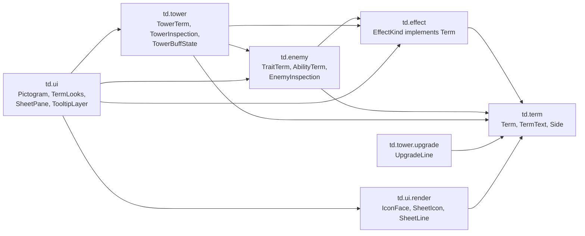

### 3.3 The term model

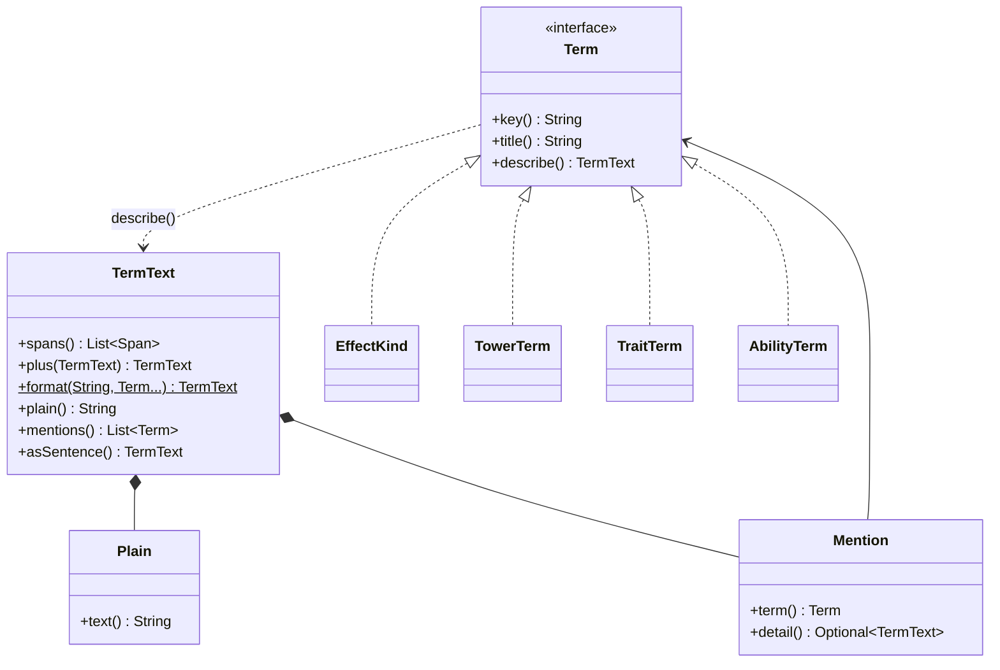

### 3.4 Where the data comes from (functional core, imperative shell)

Everything left of the EDT is a pure function of a snapshot except the snapshot itself. The EDT
never reads live state; it lays out what the frame carries.

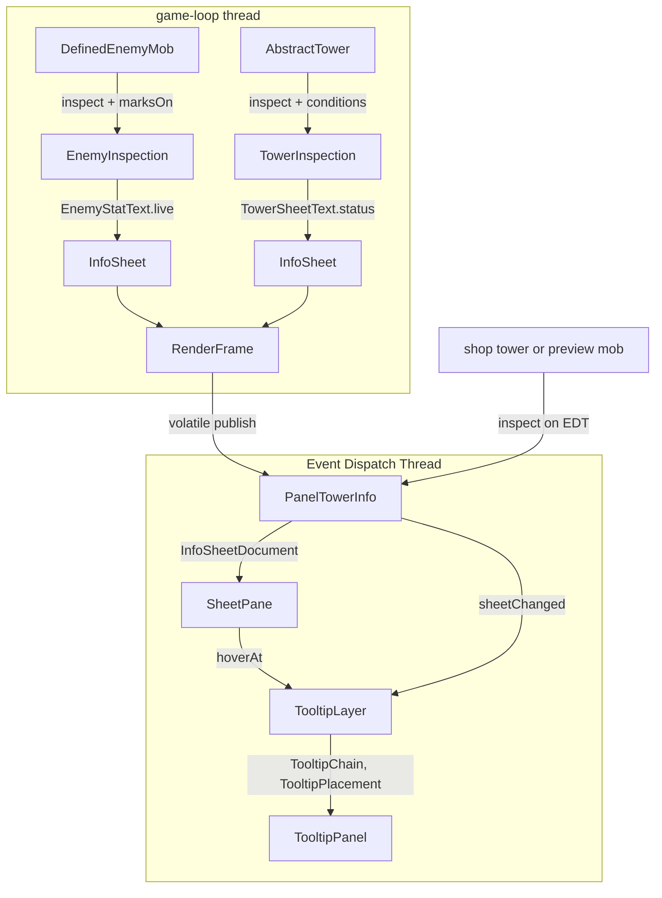

Pure, unit-tested pieces: `TermText`, every `describe()`, `EnemyStatText`, `TowerSheetText`,
`UpgradeSheetText`, `TermSheets`, `IconRowLayout`, `TooltipPlacement`, `TooltipChain`,
`Pictogram.parse`. The shells (`SheetPane`, `TooltipLayer`, `TooltipPanel`, panels) only wire them.

### 3.5 Hovering a mention, chaining a tooltip

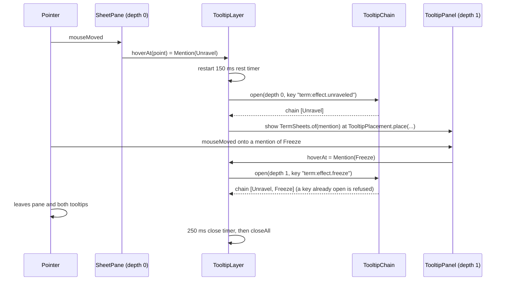

### 3.6 A tooltip's life

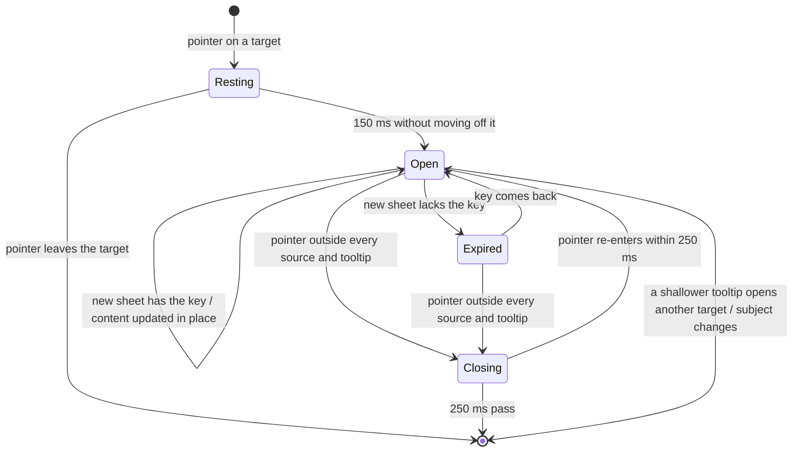

### 3.7 Pictogram format and face

A pictogram spec is layers separated by ` ; `. A layer is an op letter, an optional `@degrees`
rotation about the centre (12, 12), a space, and SVG path data. Path data supports
`M L H V C S Q T A Z` (absolute and relative) plus `O cx cy r` for a full circle. `=key` instead of
layers reuses another pictogram.

| Op | Paints | With |
|---|---|---|
| `F` | fill, non-zero winding | ink |
| `E` | fill, even-odd (holes) | ink |
| `S` | stroke 2.25 units, round caps and joins | ink |
| `T` | stroke 1.5 units, round caps and joins | ink |
| `D` | fill | ink at alpha 115 |
| `K` | fill (knock-out) | the face's fill colour |
| `X` | stroke 1.75 units (knock-out) | the face's fill colour |

Colours: **ink** = tone mixed 30% toward white (50% when the tone's luminance is under 0.3); **fill**
= tone mixed 24% from black. The 20 px face: rounded square (corner arc 4) filled, the symbol in a
14.5 px box at (2.75, 2.75), then the time sweep (black alpha 150, a pie from 12 o'clock clockwise,
clipped to the square), the pool bar (2.2 px high, 2.5 px from the edges, 4.6 px above the bottom),
the immunity slash (a fill-coloured 3.4 px line under a 1.7 px line in `TERM_IMMUNE`, corner to
corner 3.6 px in; dashed `2.2/1.6` for a partial resistance), the frame (1.25 px), then the numeral
top-left and the corner text bottom-right (outlined in black). A faded face paints at alpha 0.38.
Mentions paint the same face at 13 px with no live state. See `faces.png`.

### 3.8 Object design rules for the new types

- Value types are records with a narrow factory and `withX` copies; absence is `Optional`,
  `OptionalInt`, `OptionalDouble` or an empty list, never `null` (the `td.ui` frame-builder `null`
  exception does not extend to the new types).
- Every sentence builder is a pure static function of data (`EffectSentences.of(kind)`,
  `AbilityText.of(ability, words)`, `TowerStatus.describe()`), so tests call it directly.
- Swing classes (`SheetPane`, `TooltipPanel`, `TooltipLayer`) contain no decisions: what is hovered,
  where a tooltip goes and which tooltips stay open are answered by pure classes
  (`IconRowLayout`, `TooltipPlacement`, `TooltipChain`) they call.
- A new exhaustive `switch` has no `default`: adding a term then fails to compile until it has a
  sentence and a look.

### 3.9 Rejected alternatives (architecture)

| Alternative | Why not |
|---|---|
| Let the EDT call `tower.conditions()` | Statuses, Steady Aim and perk state are game-loop confined; D10 |
| Lay icon rows out with `JTextPane` paragraphs (hanging indent, tab stop) | `ParagraphView` tab bases and break weights for icon views are fragile; one painted icon per row with its own layout math is exact and testable |
| `javax.swing.ToolTipManager` / `JToolTip` / `JPopupMenu` | Platform look, no chaining, no stickiness; the UI rule forbids the platform look |
| Hand-typed tooltip sentences per effect | Go stale at the next balance pass; feature constraint |
| A breakdown request from the EDT to the game loop | Two volatile hand-offs for data that costs ~2 KB a frame; D11 |

## 4. Phase overview

| Phase | Commit subject | What it adds |
|---|---|---|
| 1 | Add the term vocabulary core | `td.term`: `Term`, `TermText`, `Side`, `TermNumbers` |
| 2 | Name every effect kind and describe it from its rule | `EffectKind implements Term`, effect sides, sentences, what keeps a kind out, pool share |
| 3a | Name enemy traits and abilities | `TraitTerm`, `AbilityTerm`, `Ability.term`, `TraitEntry`, `AbilityEntry`, `AbilityText` |
| 3b | Snapshot what the enemy pane will show | `EnemyInspection`: base stats, ordered effects with clocks and bars, faded DR, immunities, entries, breakdowns, marks |
| 4a | Name tower buffs and mechanics | `TowerTerm`, `TowerStatus.term`, `TowerStatus.describe`, counters named on focus bonuses |
| 4b | Group owned upgrade nodes into lines | `UpgradeNode.tier`, `UpgradeTier.level/previous`, `UpgradeLine`, `UpgradeTree.lines` |
| 4c | Snapshot a tower's buffs, debuffs, progress and marks | `TowerBuffState`, `AbstractTower.conditions()`, `NodeProgress`, `Perk.condition`, `Tower.marksOn` |
| 4d | List the effects each tower applies | `AppliedEffect`, `Perk.applies`, `Tower.applies()`, targeting label |
| 5a | Write procs, hit bonuses and gates as term text | `TermText` from every proc/hit/condition record and `Perk.describe()` |
| 5b–5i | Rewrite the Sniper's / Burst's / Mortar's / Obelisk's / Hive's / Radar's / Scorcher's / Beacon's texts under the wording rule | one tower each, appendix D |
| 5j | Give every enemy one role sentence | appendix F |
| 5k | Guard the wording rule with a test | `TermWordingTest`, README glossary |
| 6 | Paint pictograms and icon faces | `Pictogram`, `PictogramCatalogue`, four tables, `TermLooks`, `IconFace`, `TermIconPainter`, palettes, `PreviewIcons` |
| 7 | Lay out icon rows and mentions and find what is hovered | `SheetLine` additions, `SheetIcon`, `TooltipKey`, `IconRowLayout`, `InfoSheetDocument`, `SheetPane`, `HoverTarget`, `TermSheets` |
| 8 | Open chained tooltips over the game | `TooltipChain`, `TooltipPlacement`, `TooltipPanel`, `TooltipLayer` |
| 9 | Show the enemy as stats and icon rows | `EnemyStatText` rewrite, marks in the frame, deletions |
| 10 | Show the tower as stats and icon rows, built with the frame | `TowerSheetText` rewrite, `RenderFrame.towerSheet`, deletions |
| 11 | Offer upgrades as perk buttons with tooltips | `PanelUpgradeTree`, `UpgradeSheetText`, `Hud` icon rows |
| 12 | Rename the code's perks to mechanics | rename only |

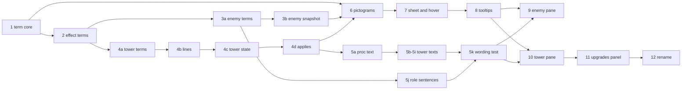

Do them in table order. The domain (1 to 5) comes first so the UI phases consume finished data;
until phase 9, the old panes keep working through the bridges each phase names.

---

## Phase 1: Add the term vocabulary core

### 1.1 `src/main/java/td/term/Side.java`

```java
package td.term;

/** Whom something works for, seen from whatever carries it. */
public enum Side {
    BUFF,
    DEBUFF
}
```

### 1.2 `src/main/java/td/term/Term.java`

```java
package td.term;

/**
 * A named thing of the game: an effect, a tower buff or mechanic, an enemy trait or ability. Each has one title the
 * player reads everywhere and one sentence that says what it does.
 */
public interface Term {

    /** Unique across all terms and stable, lower case: {@code "effect.chill"}. The UI keys its art by it. */
    String key();

    /** The one name text uses: {@code "Chill"}. */
    String title();

    /** What it does, its numbers read from its own rules; lower-case first, no full stop. */
    TermText describe();
}
```

### 1.3 `src/main/java/td/term/TermText.java`

Copy exactly:

```java
package td.term;

import java.util.ArrayList;
import java.util.List;
import java.util.Locale;
import java.util.Optional;
import java.util.stream.Stream;

/**
 * Words that may mention terms: plain runs and mentions in reading order. {@link #plus} joins two texts and
 * {@link #empty()} is its identity. Texts are written lower-case first with no full stop so they compose;
 * {@link #asSentence()} finishes one for display.
 */
public record TermText(List<Span> spans) {

    private static final TermText EMPTY = new TermText(List.of());
    private static final String SLOT = "{}";

    public TermText {
        spans = List.copyOf(spans);
    }

    /** One run of a text. */
    public sealed interface Span permits Plain, Mention {
    }

    /** Words that name nothing. */
    public record Plain(String text) implements Span {
    }

    /**
     * A term named in the text, shown as its icon and title.
     *
     * @param detail what the term means here, when that is more than its own sentence
     */
    public record Mention(Term term, Optional<TermText> detail) implements Span {

        /** What a tooltip on this mention says. */
        public TermText meaning() {
            return this.detail.orElseGet(this.term::describe);
        }
    }

    public static TermText empty() {
        return EMPTY;
    }

    public static TermText of(String plain) {
        return plain.isEmpty() ? EMPTY : new TermText(List.of(new Plain(plain)));
    }

    public static TermText of(Term term) {
        return new TermText(List.of(new Mention(term, Optional.empty())));
    }

    /** {@code term}, whose tooltip here says {@code detail} instead of the term's own sentence. */
    public static TermText of(Term term, TermText detail) {
        return new TermText(List.of(new Mention(term, Optional.of(detail))));
    }

    /**
     * {@code template} with each {@code "{}"} replaced by the next of {@code terms} as a mention.
     *
     * @throws IllegalArgumentException when the slots and the terms don't pair up
     */
    public static TermText format(String template, Term... terms) {
        TermText text = EMPTY;
        int from = 0;
        for (Term term : terms) {
            int slot = template.indexOf(SLOT, from);
            if (slot < 0) {
                throw new IllegalArgumentException("More terms than slots in: " + template);
            }
            text = text.plus(template.substring(from, slot)).plus(term);
            from = slot + SLOT.length();
        }
        if (template.indexOf(SLOT, from) >= 0) {
            throw new IllegalArgumentException("More slots than terms in: " + template);
        }
        return text.plus(template.substring(from));
    }

    /** {@code parts} with {@code separator} between each two; empty parts are left out. */
    public static TermText join(String separator, List<TermText> parts) {
        TermText text = EMPTY;
        for (TermText part : parts) {
            if (part.isEmpty()) {
                continue;
            }
            text = text.isEmpty() ? part : text.plus(separator).plus(part);
        }
        return text;
    }

    public TermText plus(TermText more) {
        if (more.isEmpty()) {
            return this;
        }
        if (this.isEmpty()) {
            return more;
        }
        List<Span> joined = new ArrayList<>(this.spans);
        Optional<String> last = plainText(joined.getLast());
        Optional<String> first = plainText(more.spans.getFirst());
        if (last.isPresent() && first.isPresent()) {
            joined.set(joined.size() - 1, new Plain(last.get() + first.get()));
            joined.addAll(more.spans.subList(1, more.spans.size()));
        } else {
            joined.addAll(more.spans);
        }
        return new TermText(joined);
    }

    public TermText plus(String plain) {
        return this.plus(of(plain));
    }

    public TermText plus(Term term) {
        return this.plus(of(term));
    }

    public boolean isEmpty() {
        return this.spans.isEmpty();
    }

    /** The text with each mention as its title: for tests, logs and button faces. */
    public String plain() {
        StringBuilder text = new StringBuilder();
        for (Span span : this.spans) {
            text.append(switch (span) {
                case Plain plain -> plain.text();
                case Mention mention -> mention.term().title();
            });
        }
        return text.toString();
    }

    /** Every term mentioned, in order. */
    public List<Term> mentions() {
        return this.spans.stream().flatMap(span -> switch (span) {
            case Mention mention -> Stream.of(mention.term());
            case Plain _ -> Stream.<Term>empty();
        }).toList();
    }

    /** The first letter upper-case. */
    public TermText capitalized() {
        Optional<String> first = this.isEmpty() ? Optional.empty() : plainText(this.spans.getFirst());
        if (first.isEmpty() || first.get().isEmpty()) {
            return this;
        }
        String text = first.get();
        List<Span> spans = new ArrayList<>(this.spans);
        spans.set(0, new Plain(text.substring(0, 1).toUpperCase(Locale.ROOT) + text.substring(1)));
        return new TermText(spans);
    }

    /** A plain span's words; empty for a mention. */
    private static Optional<String> plainText(Span span) {
        return switch (span) {
            case Plain plain -> Optional.of(plain.text());
            case Mention _ -> Optional.empty();
        };
    }

    /** Capitalized, ending in a full stop unless it already ends a sentence. */
    public TermText asSentence() {
        TermText capitalized = this.capitalized();
        if (this.isEmpty()) {
            return capitalized;
        }
        String plain = this.plain();
        char last = plain.charAt(plain.length() - 1);
        return last == '.' || last == '!' || last == '?' ? capitalized : capitalized.plus(".");
    }
}
```

Checkstyle bans every `instanceof` in `src/main`, so spans are told apart by `switch` over the sealed
`Span` (`plainText`, `plain`, `mentions`). Do not suppress the check.

### 1.4 `src/main/java/td/term/TermNumbers.java`

One formatter for every number in a text, so all sentences read alike.

```java
package td.term;

import java.math.BigDecimal;
import java.util.Locale;

/** How texts write numbers: {@code "15%"}, {@code "1.5"}, {@code "2 s"}, {@code "x1.5"}, {@code "3rd"}. */
public final class TermNumbers {

    private TermNumbers() {
    }

    /** {@code 0.15} as {@code "15%"}. */
    public static String percent(float fraction) {
        return Math.round(fraction * 100) + "%";
    }

    /** {@code 0.15} as {@code "+15%"}, {@code -0.4} as {@code "-40%"}. */
    public static String signedPercent(float fraction) {
        int rounded = Math.round(fraction * 100);
        return (rounded > 0 ? "+" : "") + rounded + "%";
    }

    /** {@code value} to two decimals without trailing zeros: {@code "1.5"}, {@code "4"}. */
    public static String number(float value) {
        return new BigDecimal(String.format(Locale.ROOT, "%.2f", value)).stripTrailingZeros().toPlainString();
    }

    /** {@code -5} as {@code "-5"}, {@code 5} as {@code "+5"}. */
    public static String signed(float value) {
        return (value > 0f ? "+" : "") + number(value);
    }

    /** {@code seconds} with its unit: {@code "2 s"}, {@code "0.5 s"}. */
    public static String seconds(float seconds) {
        return number(seconds) + " s";
    }

    /** A multiple: {@code "x2"}, {@code "x1.5"}. */
    public static String times(float factor) {
        return "x" + number(factor);
    }

    /** {@code "1st"}, {@code "2nd"}, {@code "3rd"}, {@code "11th"}. */
    public static String ordinal(int n) {
        int lastTwo = n % 100;
        if (lastTwo >= 11 && lastTwo <= 13) {
            return n + "th";
        }
        return n + switch (n % 10) {
            case 1 -> "st";
            case 2 -> "nd";
            case 3 -> "rd";
            default -> "th";
        };
    }

    /** A distance in cells with its unit: {@code "1 cell"}, {@code "1.5 cells"}. */
    public static String cells(float cells) {
        return number(cells) + (cells == 1f ? " cell" : " cells");
    }
}
```

Seconds from ticks are always `ticks / TickRate.TICKS_PER_SECOND` at the call site; `td.term` does
not depend on `td.util`.

### Tests (`src/test/java/td/term/`)

- `FakeTerm` (record implementing `Term`: `key`, `title`, `TermText sentence`; `describe()` returns
  `sentence`), used by the two tests below and later by `td.ui` tests through `td.fixtures` once a
  second package needs it.
- `TermTextTest`: `formatPutsAMentionInEachSlotInOrder`, `formatRejectsSlotsAndTermsThatDoNotPairUp`,
  `plusJoinsAdjacentPlainRunsIntoOne`, `emptyIsTheIdentityOfPlus`, `plainShowsAMentionAsItsTitle`,
  `aMentionWithoutDetailMeansItsTermsOwnSentence`, `aMentionWithDetailMeansTheDetail`,
  `asSentenceCapitalizesTheFirstWordAndEndsWithAFullStop`, `joinLeavesEmptyPartsOut`.
- `TermNumbersTest`: `percentsRoundToWholeNumbers`, `numbersDropTrailingZeros`,
  `ordinalsUseTheEnglishSuffixes`, `oneCellIsSingular`.

### Docs

- Root `CLAUDE.md`, Packages paragraph: add `` `term` (the game's vocabulary: terms and the text that
  mentions them) `` after `stat`.
- New `src/main/java/td/term/CLAUDE.md`:

```markdown
# `td.term`

- Neutral ground: depends on nothing in `td`. Every player-facing name is a `Term` owned by a domain
  enum (`EffectKind`, `TowerTerm`, `TraitTerm`, `AbilityTerm`); keys are `family.constant` in lower case.
- Player text is `TermText`, never a `String` that names a term. Wording rule: a mention uses the
  term's title, never a verb or adjective made from it ("applies Unravel", "immune to Freeze").
  `TermWordingTest` enforces it.
- Texts are lower-case first with no full stop; the UI finishes them with `asSentence()`. A number in
  a text comes from the constant or rule that holds it, written with `TermNumbers`.
```

### Done when

`mvn verify` is green; nothing outside `td.term` changed except the root `CLAUDE.md` line.

---

## Phase 2: Name every effect kind and describe it from its rule

### 2.1 `EffectRule` gets a side

- Add the component `Side side` as the **last** component. Every copy method inside `EffectRule`
  passes `this.side` through. `of(category)` passes `Side.DEBUFF`.
- Add:

```java
    /** This kind, working for the enemy that carries it. */
    public EffectRule helpsCarrier() {
        return new EffectRule(this.category, this.resistedBy, this.stacking, this.stackCap, this.pacing, this.perStack,
                this.tags, Side.BUFF);
    }
```

- Add `.helpsCarrier()` to the rows `SHIELD`, `HEAL`, `INVISIBLE`, `SPRINTING`. No other row.

### 2.2 `EffectKind implements Term`

- The constructor becomes `EffectKind(String title, EffectRule rule)`. Give each row its title from
  appendix A, first argument: `CHILL("Chill", EffectRule.of(...)...)`.
- Add a `private final String title;` field (constants, collaborators, mutable state order).
- Methods:

```java
    @Override
    public String key() {
        return "effect." + this.name().toLowerCase(Locale.ROOT);
    }

    @Override
    public String title() {
        return this.title;
    }

    @Override
    public TermText describe() {
        return EffectSentences.of(this);
    }

    /** Whether it works for the enemy that carries it or against it. */
    public Side side() {
        return this.rule.side();
    }
```

### 2.3 Numbers the sentences need, made reachable

Change only visibility or add the accessor named; no value changes.

| Where | Change |
|---|---|
| `ActiveEffects.MAX_CHILL`, `POISON_MAX_SLOW`, `BURN_CHILL_DAMPENING` | `private static final` → package-private `static final` |
| `EffectInteractions.FREEZE_BURST_FLOOR` | → package-private |
| `DiminishingReturns` | add `static List<Float> stepsOf(EffectKind kind)`: the ladder for `FREEZE` or `DAZED` as an unmodifiable list, empty for any other kind |
| `DefinedEnemyMob.DISCHARGE_SHARE` | move to `Effect` as `public static final float CHARGE_DISCHARGE_SHARE = 0.3f;` with its Javadoc; `DefinedEnemyMob` reads `Effect.CHARGE_DISCHARGE_SHARE` |

### 2.4 `src/main/java/td/effect/EffectSentences.java`

A package-private final class with one method:

```java
    /** {@code kind}'s sentence, every number read from its rule, the interaction tables or its constants. */
    static TermText of(EffectKind kind) {
        return switch (kind) {
            case CHILL -> ...;
            // one case per kind, no default
        };
    }
```

Write each case from appendix A, column "Sentence". `[Title]` is a mention of that kind
(`TermText.format` with `{}` slots), and `⟨…⟩` is a number from the named source written with
`TermNumbers`. Helpers inside `EffectSentences` (private static):

```java
    /** The flat per-stack modifier {@code kind} puts on {@code stat}. */
    private static float perStack(EffectKind kind, EnemyStat stat) {
        return kind.rule().perStack().get(stat).flat();
    }

    private static String seconds(int ticks) {
        return TermNumbers.seconds(ticks / TickRate.TICKS_PER_SECOND);
    }

    /** "100%, 50%, 25%, then none" from a diminishing-returns ladder. */
    private static String ladder(EffectKind kind) {
        List<String> steps = DiminishingReturns.stepsOf(kind).stream()
                .filter(step -> step > 0f).map(TermNumbers::percent).toList();
        return String.join(", ", steps) + ", then none";
    }
```

For `SYMPATHY`, build the list of shared kinds from the rules, not by hand:

```java
            case SYMPATHY -> TermText.format("once a second, its ").plus(TermText.join(", ",
                            Arrays.stream(EffectKind.values()).filter(EffectKind::sharedBySympathy).map(TermText::of).toList()))
                    .plus(" are copied, up to what it has, to the other enemies nearby that carry a hex from the same tower");
```

### 2.5 What keeps a kind out, and how full a pool is

In `EffectInteractions` add:

```java
    /** The first of the {@code active} kinds, in kind order, that keeps {@code kind} out or holds it off. */
    static Optional<EffectKind> keptOutBy(EffectKind kind, Set<EffectKind> active) {
        for (EffectKind other : EffectKind.values()) {
            if (active.contains(other) && (BLOCKED_BY.getOrDefault(kind, Set.of()).contains(other)
                    || HELD_OFF_BY.getOrDefault(kind, Set.of()).contains(other))) {
                return Optional.of(other);
            }
        }
        return Optional.empty();
    }
```

In `ActiveEffects` add three queries (with Javadoc as given):

```java
    /** The active kind that keeps {@code kind} out now, if one does. */
    public Optional<EffectKind> keptOutBy(EffectKind kind) {
        return EffectInteractions.keptOutBy(kind, this.active.keySet());
    }

    /**
     * How full a fading level or pool is, from 0 to 1: a chill's level over its cap, a pool's fuel over what a
     * top-up can fill it to. Empty for every other kind.
     */
    public OptionalDouble fullness(EffectKind kind) {
        Effect effect = this.active.get(kind);
        if (effect == null) {
            return OptionalDouble.empty();
        }
        return switch (kind.rule().stacking()) {
            case LEVEL -> OptionalDouble.of(chillLevel(effect) / MAX_CHILL);
            case POOL -> OptionalDouble.of(Math.min(1f,
                    effect.fuelLevel() / (effect.tuning().capFactor() * effect.peakL0() * this.poolFactor())));
            case REFRESH, SHARED_CLOCK, EARNED -> OptionalDouble.empty();
        };
    }

    /**
     * The ticks the active {@code kind}'s clock started from: what it was authored for, or what is left if more;
     * empty for a kind with no clock.
     */
    public OptionalInt clockTicks(EffectKind kind) {
        Effect effect = this.active.get(kind);
        if (effect == null || kind.isDecaying()) {
            return OptionalInt.empty();
        }
        return OptionalInt.of(Math.max(effect.authoredDurationTicks(), effect.remainingTicks()));
    }
```

### 2.6 README

In `README.md`'s Status effects table, replace each name in the first column by its title from
appendix A (Chilled → Chill, Poisoned → Poison, Doomed → Doom, …). The other columns change in 5k.

### Tests (`src/test/java/td/effect/EffectTermsTest.java`)

- `everyKindHasAUniqueKeyAndTitle`
- `everyKindHasASentenceWithItsSlotsFilled` (non-empty `plain()`, no `{}` left)
- `aStackingKindsSentenceQuotesItsOwnRule`: Vulnerable's `plain()` contains
  `TermNumbers.percent(perStack)` and `maxStacks()` computed from `EffectKind.VULNERABLE.rule()`,
  not literals.
- `onlyShieldHealInvisibilityAndSprintHelpTheirCarrier`
- `sympathyNamesEveryKindItShares` (its mentions equal the kinds with `sharedBySympathy()`)
- In `ActiveEffectsTest`: `aFreezeKeepsABurnOutAndSaysSo`, `aFreshBurnIsHalfAsFullAsATopUpCanMakeIt`,
  `aRefreshedStackKeepsTheLongerClock`.

### Done when

Green; the game looks unchanged (no UI reads the new data yet).

---

## Phase 3a: Name enemy traits and abilities

### 3a.1 `src/main/java/td/enemy/TraitTerm.java` and `AbilityTerm.java`

Two enums implementing `Term`, each constant `NAME("Title", "sentence")` with the generic sentence
from appendix C (plain text, no mentions, so a constructor `String` is enough:
`describe()` returns `TermText.of(this.sentence)`). `key()` is `"trait."` / `"ability."` plus
`name().toLowerCase(Locale.ROOT)`.

### 3a.2 `Ability` carries its term

`Ability` becomes `record Ability(AbilityTerm term, AbilityTrigger trigger, AbilityAction action)`.
Fix every `new Ability(` the compiler names with the term from appendix C's table "Which ability is
which" (file, line pattern, term). In tests (`EnemyDefinitionTest` and the others the compiler
names, 8 call sites) pass `AbilityTerm.GUARD`; those tests are not about names.

### 3a.3 `TraitEntry`, `AbilityEntry`

```java
package td.enemy;

/**
 * One trait slot as the player sees it: the term its icon shows, how much of that term it resists (0 for a trait
 * that resists nothing, 1 for an immunity) and what it does.
 */
public record TraitEntry(Term term, float resisted, TermText text) {

    public static TraitEntry of(Term term, TermText text) {
        return new TraitEntry(term, 0f, text);
    }

    public boolean immune() {
        return this.resisted >= 1f;
    }
}
```

```java
package td.enemy;

/** One ability as the player sees it: its name and when and what it does. */
public record AbilityEntry(AbilityTerm term, TermText text) {
}
```

Add `TraitEntry entry();` to `TraitTemplate` (next to `describe()`, which stays until phase 9).
Implement it in every template (texts from appendix C, "Trait entries"):

| Template | `entry()` |
|---|---|
| `EffectResistTrait` | term: the `EffectKind` whose `resistedBy()` is `this.stat`; resisted: `this.amount`; text per appendix C |
| `RegenerationTrait` | `TraitEntry.of(TraitTerm.REGENERATION, …)` |
| `HurtSpeedTrait` | `TraitTerm.ADRENALINE` |
| `HurtAgilityTrait` | `TraitTerm.ELUSIVE` |
| `AdaptiveResist` | `TraitTerm.ADAPTATION`, the most it can reach |
| `AdaptiveResist.Adapted` | `TraitTerm.ADAPTATION`, what it settled on |

For `EffectResistTrait`, add to `EffectKind`:

```java
    /** The kind {@code resistance} shortens; throws for a stat that resists no kind. */
    public static EffectKind resistedThrough(EnemyStat resistance) {
        return Arrays.stream(values()).filter(kind -> kind.resistedBy().equals(Optional.of(resistance))).findFirst()
                .orElseThrow(() -> new IllegalArgumentException(resistance + " resists no effect"));
    }
```

### 3a.4 `src/main/java/td/enemy/AbilityText.java`

Package-private final class; pure.

```java
/** What an ability says: when it fires, a colon, and what it does, every number from its own data. */
final class AbilityText {

    /** What a sentence needs from the world: the board's cell size and enemy names by id. */
    record Words(float cellSize, Function<String, String> enemyName) {
    }

    static TermText of(Ability ability, Words words) {
        return TermText.of(when(ability.trigger()) + ": ").plus(what(ability.action(), words));
    }
    ...
}
```

`when` is a `switch` over the sealed `AbilityTrigger`, `what` a `switch` over `AbilityAction` and,
for `ApplyEffectAction`, over `EffectTarget` and the sealed `EffectTemplate`. Phrases (seconds
from ticks with `TickRate.TICKS_PER_SECOND`, all through `TermNumbers`):

| Trigger | Phrase |
|---|---|
| `PeriodicTrigger(t)` | `every ⟨seconds(t)⟩` |
| `OnceTrigger(d)` | `once, after ⟨seconds(d)⟩` |
| `HealthThresholdTrigger(f)` | `once, below ⟨percent(f)⟩ health` |
| `OnDeathTrigger` | `when it dies` |
| `TimeSinceLastHitTrigger(w)` | `after ⟨seconds(w)⟩ without being hit` |
| `OnCriticalHitTakenTrigger` | `each time it survives a crit` |
| `OnFirstDamageTakenTrigger` | `the first time it is hit` |
| `OnDodgeTrigger` | `each time it dodges` |

| Action | Phrase |
|---|---|
| `ApplyEffectAction(template, SelfTarget)` | `gains ` + effect phrase |
| `ApplyEffectAction(template, RadiusTarget(r))` | `gives every other enemy within ⟨number(r / cellSize)⟩ cells ` + effect phrase |
| `SpawnEnemiesAction(id, shape, false)` | `calls ⟨shape.members()⟩ ⟨enemyName(id)⟩` |
| `SpawnEnemiesAction(id, shape, true)` | `turns into ⟨enemyName(id)⟩` |

| Template | Effect phrase |
|---|---|
| `ShieldTemplate(p, t, r)` | `[Shield] of ⟨number(p)⟩` + (` against physical` / ` against magic` when restricted) + ` for ⟨seconds(t)⟩` |
| `HealTemplate(p, t)` | `[Heal] of ⟨number(p × t)⟩ over ⟨seconds(t)⟩` |
| `SprintTemplate(t)` | `[Sprint] for ⟨seconds(t)⟩` |
| `InvisibleTemplate(t)` | `[Invisibility] for ⟨seconds(t)⟩` |

Also:

```java
    /** A Jammer's disruption, as the trait the player sees. */
    static TermText jam(DisruptionAura aura, float cellSize) {
        return TermText.of("towers within " + TermNumbers.cells(aura.radius() / cellSize) + ": "
                + TermNumbers.signedPercent(-aura.attackSpeedPenalty()) + " attack speed, "
                + TermNumbers.signed(-aura.rangePenaltyCells()) + " range");
    }
```

### Tests (`src/test/java/td/enemy/AbilityTextTest.java`, `TraitEntryTest.java`)

- `aThresholdShieldSaysWhenWhatHowMuchAndAgainstWhat`: the Armored boss's Brace reads
  `once, below 50% health: gains Shield of 300 against physical for 5 s` (`plain()`), built from the
  catalog's definition, and its only mention is `EffectKind.SHIELD`.
- `anAreaHealSaysHowFarItReachesInCells` (Mender's Mend, cell size from `WorldFixtures`).
- `aSpawnNamesWhatItCalls` (Mite boss Brood names "Mite Broodling").
- `everyBuiltInAbilityHasATerm` (every definition at every rank of `EnemyCatalog.builtIn()`; also
  proves the table in appendix C was applied everywhere).
- `aFullResistanceIsTheEffectFullyResisted`, `aPartialResistanceKeepsItsShare`,
  `anAdaptiveResistShowsTheMostItCanReach`.

### Docs

`td/enemy/CLAUDE.md`, section Traits and abilities: replace the paragraph starting "A new `Trait`
also needs a `TraitMarker`" with: "A new `Trait` also needs a `TraitMarker` and an `entry()`: the
term its icon shows and its sentence. A new ability names its `AbilityTerm`."

---

## Phase 3b: Snapshot what the enemy pane will show

All additions to `EnemyInspection` and `EffectState` are `withX` copies; nothing existing is removed
until phase 9.

### 3b.1 The mob exposes what the snapshot needs

In `DefinedEnemyMob`:

- Keep the `BaseStats<EnemyStat> base` built in the constructor in a new `private final` field and
  add `public float baseStat(EnemyStat stat)`.
- Add `public List<EffectKind> effectKindsByGain()`: every kind that is active or whose diminishing
  returns run, ordered by the tick it was last gained (oldest first, ties in kind order). Add to
  `EffectTransitions`: `List<EffectKind> inGainedOrder(Collection<EffectKind> kinds)`.
- Add `public StatBreakdown breakdown(EnemyStat stat)` (3b.3).
- Add `public Optional<EffectKind> keptOutBy(EffectKind kind)`, `public OptionalDouble
  effectFullness(EffectKind kind)`, `public OptionalInt effectClockTicks(EffectKind kind)`
  delegating to `ActiveEffects`.

### 3b.2 `EffectState` grows

Add components, each with a `withX` copy, defaults in `of(...)`:

| Component | Default | Meaning |
|---|---|---|
| `OptionalInt clockTicks` | empty | what the clock started from (D7) |
| `OptionalDouble fullness` | empty | a level's or pool's bar |
| `boolean faded` | `false` | only its diminishing returns are left |
| `OptionalDouble nextShare` | empty | the share the next fresh application would last (Freeze, Daze) |

`EnemyInspection.of(mob)` now builds `effects` from `mob.effectKindsByGain()`: an active kind with all
fields; a kind whose DR runs but is not active as `faded`. A kind in `mob.diminishedFactors()` gets
`withNextShare(factor)` whether active or faded.

### 3b.3 Stat breakdowns

New records in `td.enemy`:

```java
/** One source's part in a stat: the trait or effect, and what it does to the stat. */
public record StatPart(Term source, StatModifier modifier) {
}

/** A stat's base, each source that changes it, and what it comes to. */
public record StatBreakdown(EnemyStat stat, float base, List<StatPart> parts, float current) {

    public StatBreakdown {
        parts = List.copyOf(parts);
    }
}
```

New in `td.stat`:

```java
/** Records what contributions do to one stat, as one modifier: for a breakdown, never per tick. */
public final class StatRecorder<S extends Enum<S> & StatKey> implements StatAccumulator<S> {
    // add: plus(modifier); multiply(f): plus(StatModifier.times(f)); restoreFlat(a): plus(StatModifier.flat(a));
    // capAtShareOfBase(s): plus(StatModifier.capAtShareOfBase(s)); other stats are ignored.

    /** What {@code contribution} does to {@code stat}. */
    public static <S extends Enum<S> & StatKey> StatModifier of(S stat, Consumer<StatAccumulator<S>> contribution) {...}
}
```

`StatRecorder` holds a mutable field, so it is `@ThreadConfined(GAME_LOOP)`; `of(...)` makes a
fresh one each call.

In `ActiveEffects`, split the body of `contributeTo`'s loop into
`private void contribute(EffectKind kind, Effect effect, Set<EffectKind> kinds, StatAccumulator<EnemyStat> accumulator)`
and add:

```java
    /**
     * What the active {@code kind} alone adds to the stats now, for a breakdown: its own modifiers, what the burning
     * pools carry when it is the first burning kind, and the implied Expose when it is a Reveal.
     */
    public void contributionOf(EffectKind kind, StatAccumulator<EnemyStat> accumulator) { ... }
```

`contributeTo` keeps its order and behaviour (it calls `contribute` for each kind); run the existing
`ActiveEffects` and `StatSheet` tests unchanged to prove it.

`DefinedEnemyMob.breakdown(stat)`: one `StatPart` per trait whose `modifiers(context).get(stat)` is
not `StatModifier.none()` (source: `trait.entry().term()`), then one per active kind whose
`StatRecorder.of(stat, acc -> activeEffects.contributionOf(kind, acc))` is not none (source: the
kind), base `baseStat(stat)`, current `stats().value(stat)`.

### 3b.4 The inspection's new fields

Add to `EnemyInspection` (all `withX`; `of(mob)` fills them):

| Field | From |
|---|---|
| `Map<EnemyStat, Float> baseStats` | `mob.baseStat(stat)` for every stat |
| `List<Immunity> immunities` | `record Immunity(EffectKind kind, Optional<EffectKind> keptOutBy)`, one per `mob.blockedEffectKinds()` kind with `mob.keptOutBy(kind)` |
| `List<TraitEntry> traitEntries` | each trait slot's `template().entry()`, then a `TraitTerm.JAM` entry from the definition's disruption aura if it has one (`AbilityText.jam`) |
| `List<AbilityEntry> abilityEntries` | each `definition.abilities()` through `AbilityText.of` with `Words(world cell size, id → catalog display name, or the id if the catalog lacks it)` |
| `Map<EnemyStat, StatBreakdown> breakdowns` | `mob.breakdown(stat)` for every stat that shows (3b.5) |
| `List<EnemyMark> marks` | empty; `withMarks` is filled by the frame build in phase 9 |

`EnemyMark` (td.enemy): `record EnemyMark(Term term, int steps, int maxSteps, String source)` — memory a
tower keeps about this enemy, named for the player by the tower's display name.

### 3b.5 Which stats show

Add `public static boolean shows(EnemyStat stat, float base, float current)` to a new
`td.enemy.StatRows` (final class, pure): `MOVE_SPEED` always; `CHILL_RESIST`, `BURN_RESIST`,
`FREEZE_RESIST` and `STEALTH` never (traits and buffs show them); any other stat when `base` or
`current` differs from `stat.defaultBase()`.

### Tests (`src/test/java/td/enemy/EnemyInspectionTest.java`)

- `effectsAreListedInTheOrderTheyWereGained` (apply Chill, then Burn, then Chill again after it ended:
  Burn first)
- `aFreezeThatEndedStaysFadedWhileItsDiminishingReturnsRun` (with `nextShare` 0.5)
- `aBurnReportsHowFullItsPoolIs`
- `aTimedEffectReportsTheTicksItsClockStartedFrom`
- `anEffectKeptOutNamesWhatKeepsItOut` (Freeze keeps Burn out)
- `theArmorBreakdownListsBaseEachSourceAndResult` (Armored + 2 Sunder stacks)
- `aSpeedBreakdownRecordsChillAsAMultiplier`
- `abilitiesAndTraitsBecomeNamedEntries` (Armored boss: Brace, Reinforce; Yeti: Freeze immune)
- `onlyStatsOffTheirDefaultShowAndSpeedAlways`

### Docs

`td/enemy/CLAUDE.md` Display section: add "`EnemyInspection` also carries base stats, effects in the
order gained (with their clock, fullness and DR), immunities and their cause, trait and ability
entries, and a `StatBreakdown` for each shown stat; `StatRows.shows` decides which."

---

## Phase 4a: Name tower buffs and mechanics

### 4a.1 `src/main/java/td/tower/TowerTerm.java`

An enum implementing `Term`; each constant `NAME("Title", Side.X, "sentence", mentions...)` (the
constructor's last parameter is `EffectKind... mentions`, kept as a `List`) from appendix B, in appendix B's
order. `describe()` returns `TermText.format(sentence, mentions...)`: appendix B gives each sentence with
`{}` slots and the kinds to mention. `key()` is `"tower." +
name().toLowerCase(Locale.ROOT)`. Add `public Side side()`.

### 4a.2 A status is a term

`TowerStatus`: the component `String id` becomes `TowerTerm term` (same position). Granting the same
term restarts it, as the same id did. Factories: `timed(TowerTerm term, …)`, `nextShots(TowerTerm term,
…)`. `ActiveTowerStatuses.indexOf` compares terms.

Add to `TowerStatus`:

```java
    /**
     * What it does, every number from its modifiers: "+150% crit damage, guaranteed crit; spent by the next shot",
     * "+100% attack speed for 5 s".
     */
    public TermText describe() { ... }
```

Parts, in order, joined with `", "`: for each stat in `this.modifiers.stats()`: `stat.describe(
this.modifiers.get(stat)) + " " + stat.label().toLowerCase(Locale.ROOT)`; then each capability's
`label().toLowerCase(Locale.ROOT)`. Then `"; "` and the length: one shot `spent by the next shot`;
more `for the next ⟨n⟩ shots`; timed `for ⟨seconds(durationTicks)⟩`.

Production ids → terms:

| File | Old id | Term |
|---|---|---|
| `SniperTower` | `"sniper.frenzy"` | `FRENZY` |
| `SniperTower` | `"sniper.patience"` | `PATIENCE` |
| `SniperTower` | `"sniper.silver"` | `SILVER_ROUND` |
| `SniperTower` | `"sniper.momentum.charge"` | `CHARGED_SHOT` |
| `SniperTower` | `"sniper.momentum.haste"` | `HASTE` |
| `SniperTower` | `"sniper.fourth"` | `DEADEYE_ROUND` |
| `AuraTower` | `"aura.rally"` | `RALLY` |

Test ids → terms (these tests are not about names): `AbstractTowerTest` `"sharp"` → `DEADEYE_ROUND`;
`ActiveTowerStatusesTest` `"haste"` → `HASTE`, `"frenzy"` → `FRENZY`; `AuraTowerTest` and `FireRateTest`
`"test"` → `HASTE`; `ProcRunnerTest` `"silver"` → `SILVER_ROUND`; `SniperTowerTest` `"frenzy"` →
`FRENZY`, `"one"` → `PATIENCE`; `DescriptionTest` `"fifth"` → `DEADEYE_ROUND` (rewritten in 5a anyway).

### 4a.3 Focus bonuses name their counter

`HitScaling.PerFocus(int max)` → `PerFocus(TowerTerm counter, int max)`; `HitCondition.FocusAtLeast(int
focus)` → `FocusAtLeast(TowerTerm counter, int focus)`. Production: every Sniper use passes
`TowerTerm.STEADY_AIM`, the Hive's Hunter's Mark passes `TowerTerm.FOCUS`. Tests the compiler names:
pass `TowerTerm.STEADY_AIM`.

### Tests

- `TowerTermsTest`: `everyTowerTermHasAUniqueKeyAndTitle`, `noTitleIsAlsoAnEffectsTitle`.
- `TowerStatusTest`: `aOneShotStatusSaysWhatItDoesAndThatTheShotSpendsIt`,
  `aTimedStatusSaysHowLongItLasts`.

---

## Phase 4b: Group owned upgrade nodes into lines

### 4b.1 `UpgradeTier`

Add, as `switch` methods with no `default`:

| Method | Values |
|---|---|
| `int level()` | `RANGE_1..3` → 1..3; `ATTUNE` 1, `AWAKEN` 2, `TRANSCENDENT` 3; `HEAD_1..4` → 1..4; `EXTRA_1..4` → 1..4; `SPECIAL` 0 |
| `Optional<UpgradeTier> previous()` | `RANGE_2`→`RANGE_1`, `RANGE_3`→`RANGE_2`, `AWAKEN`→`ATTUNE`, `TRANSCENDENT`→`AWAKEN`, `HEAD_2`→`HEAD_1`, `HEAD_3`→`HEAD_2`, `HEAD_4`→`HEAD_3`, `EXTRA_2`→`EXTRA_1`, `EXTRA_3`→`EXTRA_2`, `EXTRA_4`→`EXTRA_3`; all others empty |
| `static UpgradeTier startOf(UpgradeSlot slot)` | `BASE` → `ATTUNE`, `HEAD` → `HEAD_1`, `SPECIAL` → `SPECIAL` |

`node(...)` ends with `.withTier(this)`.

### 4b.2 `UpgradeNode` records its tier

Add the component `UpgradeTier tier` as the last component; every copy inside `UpgradeNode` passes
it on; `of(...)` passes `UpgradeTier.startOf(slot)`; add `withTier(UpgradeTier tier)`. Tests build
nodes through `of` and need no change.

### 4b.3 `src/main/java/td/tower/upgrade/UpgradeLine.java`

```java
/**
 * The nodes a tower owns of one line, in purchase order: a head chain with its level IV, the extra line, the Range
 * line, the Attune chain, or one special.
 */
public record UpgradeLine(UpgradeNode first, List<UpgradeNode> owned) {

    public UpgradeLine {
        owned = List.copyOf(owned);
    }

    /** The owned node furthest along the line. */
    public UpgradeNode tip() {
        return this.owned.stream().max(Comparator.comparingInt(node -> node.tier().level())).orElseThrow();
    }

    /** 1 to 4; 0 for a special, which has no level. */
    public int level() {
        return this.tip().tier().level();
    }

    /** The node whose art the line shows: a level IV or special tip its own, every other line its first node's. */
    public UpgradeNode artNode() {
        UpgradeTier tier = this.tip().tier();
        return tier == UpgradeTier.HEAD_4 || tier == UpgradeTier.SPECIAL ? this.tip() : this.first;
    }
}
```

### 4b.4 `UpgradeTree.lines`

```java
    /** {@code owned}'s nodes grouped by line, in the order each line's first node was bought. */
    public List<UpgradeLine> lines(UpgradeState owned) { ... }

    /** The node that starts {@code node}'s line: back along the prerequisite one tier step before, while there is one. */
    UpgradeNode firstOf(UpgradeNode node) { ... }
```

`firstOf`: while `node.tier().previous()` is present, find the node in `this.nodes` with that tier
whose id is in `node.requires().requiredNodes()`; if found, continue from it; otherwise stop.
`lines`: a `LinkedHashMap<UpgradeNode, List<UpgradeNode>>` keyed by `firstOf` over `owned.owned()`.

### Tests (`src/test/java/td/tower/upgrade/UpgradeLinesTest.java`)

Use `UpgradePaths` and real trees (`TowerFactory` through `td.fixtures`):

- `aChainsOwnedNodesFormOneLineAtItsFurthestLevel` (Sniper Focused Optics I, II → level 2, art
  Focused Optics I)
- `aLevelFourNodeContinuesItsChainWithItsOwnArt` (Railgun: level 4, art Railgun)
- `theExtraLineKeepsOneArtToLevelFour` (Tradecraft … Spotter Uplink → art Tradecraft)
- `awakenAndTranscendentContinueAttune`
- `eachSpecialIsALineOfItsOwn`
- `linesKeepTheOrderTheirFirstNodeWasBought`

---

## Phase 4c: Snapshot a tower's buffs, debuffs, progress and marks

### 4c.1 New value types in `td.tower`

```java
/**
 * One buff or debuff a tower carries now, as its pane shows it.
 *
 * @param stacks         a count to show; 0 for none
 * @param remainingTicks ticks left on its clock; empty for one without a clock
 * @param clockTicks     what that clock started from
 * @param detail         what it does now, its numbers from the thing that grants it
 */
public record TowerBuffState(Term term, Side side, int stacks, OptionalInt remainingTicks, int clockTicks,
                             TermText detail) {

    public static TowerBuffState of(TowerTerm term, TermText detail) {
        return new TowerBuffState(term, term.side(), 0, OptionalInt.empty(), 0, detail);
    }

    public TowerBuffState withStacks(int stacks) { ... }

    public TowerBuffState withClock(int remainingTicks, int clockTicks) { ... }
}
```

```java
/** How far a counting node is toward its next go: {@code count} of {@code of}. */
public record NodeProgress(String nodeId, int count, int of) {
}
```

### 4c.2 `AbstractTower`

- `ActiveTowerStatuses`: `Held` gains `int clockTicks` (the scaled duration at grant). Add
  `List<TowerBuffState> states(int nowTick)`: each held status as `TowerBuffState.of(term,
  status.describe())`, shot statuses `withStacks(shotsLeft)` when more than one, timed ones
  `withClock(endsAt - nowTick, clockTicks)`.
- Declare `List<TowerBuffState> conditions()` and `List<NodeProgress> progress()` on `Tower`, and add
  to `AbstractTower`, documented "Game loop only: reads statuses and perk state":

```java
    /** Every buff and debuff this tower carries now, buffs first. */
    @Override
    public final List<TowerBuffState> conditions() { ... }

    /** How far each counting node it owns is toward its next go. */
    @Override
    public final List<NodeProgress> progress() { ... }

    /** Buffs and debuffs of the tower's own: its rhythms and its perks' states. None by default. */
    protected List<TowerBuffState> ownConditions() {
        return List.of();
    }

    /** Counting nodes of the tower's own, beyond every-Nth-shot procs. None by default. */
    protected List<NodeProgress> ownProgress() {
        return List.of();
    }
```

`conditions()` concatenates, in this order: `statuses.states(currentTick)`; one primed state per owned
proc with trigger `EveryNthShot(n)` and payload `GrantStatus(status)` when `(shotsBegun + 1) % n == 0`
(`TowerBuffState.of(status.term(), status.describe())`); `ownConditions()`; an `AURA` state when any
other tower's `buffFor(this)` is not none (`withStacks(count)` when more than one; detail: each stat of
`this.stats().received()` as `describe + label`, joined with `", "`); a `JAMMED` state when
`stats().disruption()` is not none (detail: its attack speed and range penalty). Then sort: buffs
before debuffs, keeping order within each.

`progress()`: one `NodeProgress(node.id(), shotsBegun % n, n)` per owned node whose proc has trigger
`EveryNthShot(n)`; then `ownProgress()`.

Add to `ProcTrigger.EveryNthShot` nothing; read `n()` from the record.

### 4c.3 `Perk.condition()`

```java
    /** A buff this perk's state gives the tower now, if any. */
    default Optional<TowerBuffState> condition() {
        return Optional.empty();
    }
```

### 4c.4 Per tower

| Tower | `ownConditions()` | `ownProgress()` |
|---|---|---|
| Sniper | `STEADY_AIM` when `focus.stacks() > 0`: stacks, clock `AimFocus.ticksUntilFade()` of `AimFocus.STACK_TICKS` (make `STACK_TICKS` public, add `ticksUntilFade()` = `STACK_TICKS - ticksSinceShot`); detail: each owned hit bonus whose scaling is `PerFocus(STEADY_AIM, _)`: its `adjustment().describe()` (5a makes it text), joined with `"; "`, then `"; up to " + aim stack cap + " stacks"`. Then every perk's `condition()` | none |
| Hive | `FOCUS` when `streak.current() > 0` (add `TargetStreak.current()` = `hits` if `target` is alive, else 0); `NEST` when the nest is active and holds missiles: stacks `nest.stored()`, detail `⟨stored⟩ of ⟨capacity⟩ missiles stored`; the primed missile: `payloads().loadFor(missilesLaunched + 1)` present → its term (appendix B, "Payload terms") with `TermText.of(load.payload().describe())` (5f: `load.payload().effect()`); then perks | one per owned payload node: `NodeProgress(id, k, PayloadPlan.EVERY)` where `k = (missilesLaunched) % PayloadPlan.EVERY` |
| Mortar | `BRACKETING` when the tracker's marker step > 0: stacks step, detail from the spec's damage and radius step; the primed shell: `shells().typeOf(shellsFired + 1)` not `PLAIN` → its term (appendix B, "Shell terms") with `TermText.of(type.describe())` (5d: `type.describe()`, now text); then perks | the nuke node: `NodeProgress(id, shellsFired % nukeEvery, nukeEvery)`; each special shell node: `NodeProgress(id, shellsFired % ShellPlan.CYCLE, ShellPlan.CYCLE)` |
| Obelisk | `EVENT_HORIZON` when growth > 0: stacks `deathsThisWave`, detail `+⟨percent(growth)⟩ field width until the wave ends`; `INTERFERENCE` when `interference < 1`: detail `⟨signedPercent(interference - 1)⟩ damage`; `LEY_LINE` when it casts or hosts a line: detail `casting to an Obelisk` / `hosting ⟨n⟩ lines`; then perks | none |
| Burst | perks only | the founding hex node: `NodeProgress(id, shotsFired % HexSpec.CAST_EVERY, HexSpec.CAST_EVERY)`; Mines: `shotsFired % mines.every()`; Thunderstrike: `shotNumber() % INTERVAL` (make the constants package-visible where needed) |
| Radar, Scorcher, Beacon | perks only | none |

`CritStreakPerk.condition()`: `CRIT_STREAK` with stacks `streak` when `streak > 0`, detail
`the next crit deals ⟨signedPercent(CRIT_DAMAGE_PER_STREAK × streak)⟩ crit damage`.

### 4c.5 Marks on enemies

`Tower.marksOn(EnemyMob enemy)` → `List<EnemyMark>`, default `List.of()`, game loop only.
`CinderTower`: when its `burning` map holds the enemy with `steps > 0`, one
`EnemyMark(TowerTerm.STOKE, steps, spec maxSteps, displayName())`.

### 4c.6 `TowerInspection`

Add (all `withX`): `List<UpgradeLine> lines` (from `upgradeTree().lines(upgrades())` in `inspect()`),
`List<TowerBuffState> conditions` (empty from `inspect()`; the frame build adds `conditions()`), `List<NodeProgress>
progress` (likewise from `progress()`), `String targeting` (4d), `List<AppliedEffect> applies` (4d).

### Tests

- `SniperTowerTest`: `steadyAimShowsItsStacksAndTheTimeToItsNextFade`,
  `fourthShotCountsTowardItsDeadeyeRoundAndPrimesItForTheFourthShot`.
- `AbstractTowerTest`: `aHeldShotStatusShowsTheShotsItHasLeft`, `aTimedStatusShowsItsClock`,
  `aJammedTowerCarriesJammedAsADebuff`, `buffsComeBeforeDebuffs`.
- `MortarTowerTest`: `theNextSpecialShellIsPrimed`; `SeekerTowerTest`: `theNextPayloadMissileIsPrimed`.
- `CinderTowerTest`: `aStokedEnemyCarriesTheScorchersStokeAsAMark`.
- `AuraTowerTest`: `aBuffedTowerCarriesAuraWithWhatItReceives`.

---

## Phase 4d: List the effects each tower applies

### 4d.1 `src/main/java/td/tower/AppliedEffect.java`

```java
/** A term a tower can put on enemies or give towers, with one line per source on this tower saying how. */
public record AppliedEffect(Term term, List<Source> sources) {

    public AppliedEffect {
        sources = List.copyOf(sources);
    }

    /** What applies it: the tower itself or one of its nodes, by name, and how. */
    public record Source(String name, TermText how) {
    }
}
```

### 4d.2 Where applies come from

`Tower.applies()` → `List<AppliedEffect>`, built in `AbstractTower` by merging, in this order, keyed
by term (first seen keeps its place):

1. `baseApplies()` (protected, default `List.of()`): the tower's own, source name its display name.
2. For each owned node in purchase order: each proc whose payload is `ApplyStacks(kind, _)` →
   `kind`; `Charge` → `EffectKind.CHARGED`; `GrantStatus` with `term.side() == BUFF` on another
   tower is not a proc (skip). Source: the node's display name, how: until 5a,
   `TermText.of(proc.describe().label() + " " + proc.describe().value())`; 5a makes it `proc.describe()`.
3. For each owned node, each of its perks' `applies()` (new on `Perk`: `default Set<Term> applies()
   { return Set.of(); }`), source: the node's display name, how: until 5a `TermText.of(perk.describe())`,
   then `perk.describe()`.

`baseApplies()` per tower: Hive `FREEZE` ("freezes the enemy it hits for ⟨seconds⟩" — text in
appendix D); Scorcher `BURN`; Mortar `CRACKED`; Obelisk `DRAGGED`; Beacon `TowerTerm.AURA` (how: what
its emission gives). Perks that override `applies()` are listed in appendix D's column "Applies"; this
phase writes all of that column and appendix D's base "how" texts, adding the helpers it uses:
`ShellType.term()` and `Payload.term()` (appendix B; 4c.4 already needs them), `Payload.applies()` and
`FieldMode.applies()` (appendix D.4, D.5), and `HexPerk.applies()` returning `Set.of(hex.kind())`.

### 4d.3 Targeting label

`protected String targetingLabel()` in `AbstractTower`, default `""`, overridden with exactly what
each tower's "Targets"/"Aims at"/"Hits" behaviour row says today (Sniper `chosenAim().label()`, Burst
`most crowded`/`random`, Mortar `first`, Obelisk `all in range`, Hive `spec.aim().label()`, Radar
`all it sweeps`/`most health`, Scorcher `nearest`). `inspect()` fills `targeting`.

### Tests

- `AbstractTowerTest`: `appliesListsEachEffectOnceWithEverySourceOnTheTower`.
- `SniperTowerTest`: `hollowPointMakesTheSniperApplyVulnerable`.
- `AuraTowerTest`: `aBeaconAppliesItsAuraAndRallyToTowers`.

---

## Phase 5a: Write procs, hit bonuses and gates as term text

After this phase every proc, hit bonus, capability, gate and perk says itself as `TermText`. The texts of
the perks themselves only change type here (`TermText.of(<the old expression>)`); their words change in
5b–5i. The panels keep working through two bridges named below, removed in phase 11.

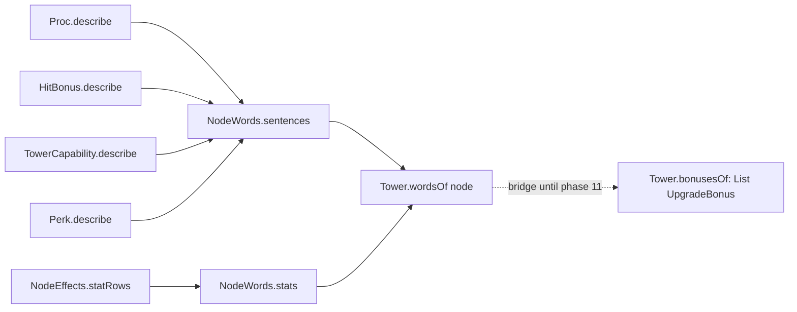

### 5a.1 `src/main/java/td/tower/proc/ProcText.java` (replaces `Words`)

Delete `Words.java`. Add:

```java
package td.tower.proc;

import td.effect.EffectKind;
import td.enemy.Rank;
import td.term.Term;
import td.term.TermText;
import td.tower.TowerTerm;

import java.util.Arrays;
import java.util.Collection;
import java.util.List;
import java.util.Locale;
import java.util.Set;
import java.util.function.Function;

/** How this package's records put hits, effect kinds and ranks into words. */
final class ProcText {

    private ProcText() {
    }

    /** One hit of {@code kind}: "shot", "beam hit", "[Arc]". */
    static TermText noun(HitKind kind) {
        return switch (kind) {
            case DIRECT -> TermText.of("shot");
            case PIERCE -> TermText.of("piercing hit");
            case BOUNCE -> TermText.of("bounce");
            case BLAST -> TermText.of("blast");
            case SHRAPNEL -> TermText.of(TowerTerm.SHRAPNEL).plus(" hit");
            case ARC -> TermText.of(TowerTerm.ARC);
            case BEAM -> TermText.of("beam hit");
            case MISSILE -> TermText.of("missile");
            case ZAP -> TermText.of("zap");
            case WAVE -> TermText.of("wave");
            case FIELD -> TermText.of("field pulse");
        };
    }

    /** Hits of {@code kind}: "shots", "beam hits", "[Arc] hits". */
    static TermText plural(HitKind kind) {
        return switch (kind) {
            case DIRECT -> TermText.of("shots");
            case PIERCE -> TermText.of("piercing hits");
            case BOUNCE -> TermText.of("bounces");
            case BLAST -> TermText.of("blasts");
            case SHRAPNEL -> TermText.of(TowerTerm.SHRAPNEL).plus(" hits");
            case ARC -> TermText.of(TowerTerm.ARC).plus(" hits");
            case BEAM -> TermText.of("beam hits");
            case MISSILE -> TermText.of("missiles");
            case ZAP -> TermText.of("zaps");
            case WAVE -> TermText.of("waves");
            case FIELD -> TermText.of("field pulses");
        };
    }

    /** {@code kinds} in enum order, each through {@code word}, listed with {@code last}: "shots and bounces". */
    static TermText hits(Set<HitKind> kinds, String last, Function<HitKind, TermText> word) {
        return listed(kinds.stream().sorted().map(word).toList(), last);
    }

    /** {@code kinds} in enum order as mentions: "[Freeze] or [Daze]". */
    static TermText kinds(Collection<EffectKind> kinds, String last) {
        return listed(kinds.stream().sorted().map(TermText::of).toList(), last);
    }

    /** "a, b and c". */
    static TermText listed(List<TermText> parts, String last) {
        if (parts.size() <= 1) {
            return parts.isEmpty() ? TermText.empty() : parts.getFirst();
        }
        return TermText.join(", ", parts.subList(0, parts.size() - 1)).plus(" " + last + " ").plus(parts.getLast());
    }

    /** "Elite and Boss": {@code rank} and every rank above it. */
    static String ranksFrom(Rank rank) {
        List<TermText> ranks = Arrays.stream(Rank.values()).filter(r -> r.compareTo(rank) >= 0)
                .map(r -> TermText.of(r.name().charAt(0) + r.name().substring(1).toLowerCase(Locale.ROOT))).toList();
        return listed(ranks, "and").plain();
    }

    /** "a" or "an", whichever reads before {@code term}'s title. */
    static String article(Term term) {
        return "AEIOU".indexOf(term.title().charAt(0)) >= 0 ? "an" : "a";
    }
}
```

`ProcText` needs `td.tower.proc` → `td.tower` (`TowerTerm`); the package already imports `td.tower`
types (`TowerStatus`, `TowerStat`).

### 5a.2 Triggers, conditions, payloads, procs

`ProcTrigger`: replace `String describe()` with the method below and add `countsShots()`:

```java
    /** When it fires, said of {@code noun}, the hit its proc's conditions name, or empty for any hit. */
    TermText describe(TermText noun);

    /** Whether it counts the tower's shots, so a one-shot status it grants is that shot. */
    default boolean countsShots() {
        return false;
    }
```

| Record | `describe(noun)` |
|---|---|
| `OnHit` | `noun` empty: `each hit`; else `each ` + noun |
| `OnCrit` | empty: `a crit`; else `a crit ` + noun |
| `OnKill` | empty: `a kill`; else `a ` + noun + ` that kills` |
| `OnDodge` | `a dodged ` + (noun empty ? `shot` : noun) |
| `EveryNthShot(n)` | `every ⟨ordinal(n)⟩ shot` (noun unused); `countsShots()` returns `true` |

`ProcCondition`: `describe()` returns `TermText`; add `Set<HitKind> hitKinds()`.

| Record | `describe()` | `hitKinds()` |
|---|---|---|
| `HitKindIn(kinds)` | `TermText.empty()` (the trigger's noun says it) | `kinds` |
| `TargetHasAnyOf(kinds)` | `on an enemy with ` + `ProcText.kinds(kinds, "or")` | `Set.of()` |

`ProcPayload`: `describe()` returns `TermText`; add

```java
    /** How it reads on a counted shot: a one-shot status is that shot. */
    default TermText describeForTheShot() {
        return this.describe();
    }
```

| Record | `describe()` | `describeForTheShot()` |
|---|---|---|
| `ApplyStacks(kind, n)` | n = 1: `applies a stack of [kind]`; else `applies ⟨n⟩ stacks of [kind]` | default |
| `Charge(ticks)` | `applies [Charge] for ⟨seconds⟩` (`EffectKind.CHARGED`) | default |
| `GrantStatus(status)` | `grants ` + `TermText.of(status.term(), status.describe())` | `status.shots() == 1`: `is ` + `ProcText.article(term)` + ` ` + the same mention; else `describe()` |
| `Dispel()` | `removes [Shield] and [Heal]` | default |
| `BreakShield(share)` | `takes ⟨percent(share)⟩ of what [Shield] has left` | default |

Seconds: `TermNumbers.seconds(ticks / TickRate.TICKS_PER_SECOND)`; drop the private `seconds` helper.

`Proc.describe()` returns `TermText`:

```java
    /** "a crit shot applies a stack of [Sunder]", "every 4th shot is a [Deadeye Round]". */
    public TermText describe() {
        Set<HitKind> kinds = EnumSet.noneOf(HitKind.class);
        this.conditions.forEach(condition -> kinds.addAll(condition.hitKinds()));
        TermText noun = kinds.isEmpty() ? TermText.empty() : ProcText.hits(kinds, "or", ProcText::noun);
        TermText on = TermText.join(" ", this.conditions.stream().map(ProcCondition::describe).toList());
        TermText when = this.trigger.describe(noun);
        TermText head = on.isEmpty() ? when : when.plus(" ").plus(on);
        return head.plus(" ").plus(this.trigger.countsShots() ? this.payload.describeForTheShot() : this.payload.describe());
    }
```

### 5a.3 Hit bonuses

`HitAdjustment.describe()` stays `String`, now lower case, the parts in the same order:
`+40% damage`, `+50% crit chance`, `+150% crit damage`, `+25% attack speed`, `+10 accuracy`, joined
with `", "` (`TermNumbers.signedPercent`, `TermNumbers.signed` for accuracy).

`HitScaling`: replace `String describe()` with `TermText around(TermText adjustment)`:

| Record | `around(a)` |
|---|---|
| `Once` | `a` |
| `PerFocus(counter, max)` | `a` + ` per stack of [counter]` + (max > 0 ? `, up to ⟨max⟩` : ``) |
| `PerRangeShare` | `up to ` + `a` + `, growing to full at max range` |
| `PerStackOf(kind)` | `a` + ` per stack of [kind]` |

`HitCondition.describe()` returns `TermText`:

| Record | `describe()` |
|---|---|
| `Always` | empty |
| `FreshTarget` | `on the first shot at a target` |
| `FocusAtLeast(counter, n)` | n = 1: `while it has [counter]`; else `with ⟨n⟩ or more stacks of [counter]` |
| `TargetRankAtLeast(rank)` | `against ` + `ProcText.ranksFrom(rank)` + ` enemies` |
| `TargetHealthBelow(share)` | `under ⟨percent(share)⟩ health` (only ever used after a rank, inside `All`) |
| `TargetStopped` | `against an enemy with ` + `ProcText.kinds(EffectKind.stopping(), "or")` |
| `TargetHasAnyOf(kinds)` | `against an enemy with ` + `ProcText.kinds(kinds, "or")` |
| `BeyondRangeShare(share)` | the same fraction words as today: `past 2/3 of range` |
| `HitKindIn(kinds)` | `on ` + `ProcText.hits(kinds, "and", ProcText::plural)` |
| `All(conditions)` | `TermText.join(" ", parts)` |

`HitBonus.describe()` returns `TermText`:

```java
    /** "+75% damage against Elite and Boss enemies", "+20% damage per stack of [Focus], up to 5". */
    public TermText describe() {
        TermText when = this.when.describe();
        TermText what = this.scaling.around(TermText.of(this.adjustment.describe()));
        return when.isEmpty() ? what : what.plus(" ").plus(when);
    }
```

Delete `Description.java`.

### 5a.4 Capabilities

Add to `TowerCapability` (keep `label()`, which `TowerStatus.describe` uses):

```java
    /** What it does, as a node's sentence. */
    public TermText describe() {
        return switch (this) {
            case GUARANTEED_CRIT -> TermText.of("every hit is a crit");
            case MAGIC_DAMAGE -> TermText.of("deals magic damage");
            case CRITS_PIERCE_SHIELDS -> TermText.format("a crit passes through {}", EffectKind.SHIELD);
        };
    }
```

### 5a.5 What a node says: `NodeEffects`, `NodeWords`, `Tower.wordsOf`

In `NodeEffects` split `bonuses()` into:

```java
    /** The value rows: one per stat changed, one per stat emitted, and whom it targets. */
    public List<UpgradeBonus> statRows() { ... }

    /** The sentences: each capability, hit bonus and proc, then the note. */
    public List<TermText> sentences() { ... }

    /** Bridge for the Upgrades panel until it shows sentences: the rows, then each sentence as a label. */
    public List<UpgradeBonus> bonuses() {
        List<UpgradeBonus> bonuses = new ArrayList<>(this.statRows());
        this.sentences().forEach(text -> bonuses.add(new UpgradeBonus(text.capitalized().plain(), "")));
        return bonuses;
    }
```

`statRows()` holds today's stat, emission and `Targets` rows in today's order. `sentences()`: capabilities
in enum order (`capability.describe()`), then `bonus.describe()` per hit bonus, `proc.describe()` per
proc, then `TermText.of(note)` when the note is not empty. Delete the private `row(Description)`.

New `src/main/java/td/tower/NodeWords.java`:

```java
package td.tower;

/**
 * What one upgrade node says to the player: its name, its value rows, its sentences (its data's and its
 * perks'), and, once bought, the nodes it was chosen over.
 */
public record NodeWords(String name, List<UpgradeBonus> stats, List<TermText> sentences, List<String> chosenOver) {

    public NodeWords {
        stats = List.copyOf(stats);
        sentences = List.copyOf(sentences);
        chosenOver = List.copyOf(chosenOver);
    }

    public static NodeWords of(String name, List<UpgradeBonus> stats, List<TermText> sentences) {
        return new NodeWords(name, stats, sentences, List.of());
    }

    public NodeWords withChosenOver(List<String> names) {
        return new NodeWords(this.name, this.stats, this.sentences, names);
    }
}
```

`Tower` gains `NodeWords wordsOf(UpgradeNode node);`. `AbstractTower`:

```java
    @Override
    public NodeWords wordsOf(UpgradeNode node) {
        List<TermText> sentences = new ArrayList<>(node.effects().sentences());
        sentences.addAll(this.perkCatalogue().describe(node));
        return NodeWords.of(node.displayName(), node.effects().statRows(), sentences);
    }
```

`bonusesOf(node)` stays as the bridge, now `node.bonuses()` plus each perk text as
`new UpgradeBonus(text.capitalized().plain(), "")`. It goes in phase 11.

### 5a.6 Perks say term text

- `Perk.describe()` returns `TermText`; its Javadoc example becomes
  `"every 4th shell is a [Nuke Shell]"`.
- `PerkCatalogue.describe(node)` returns `List<TermText>`.
- Every perk class: `return TermText.of(<the expression it returns today>);`. Nothing else in a perk
  changes in this phase.
- `AbstractTower.applies()` (4d): a proc source's how is now `proc.describe()`, a perk source's
  `perk.describe()`. `Hex.describe()`, `Payload.describe()`, `ShellType.describe()` and
  `FieldMode.describe()` stay `String` until their tower's phase.

### 5a.7 Gates

`UpgradeCondition.describe()` and `progress(tower, context)` return `TermText`. Each implementation
returns `TermText.of(<its string today>)`; `AndCondition` and `OrCondition` build theirs with
`plus(" and ")`, `plus(", ")`, `plus(" or ")` around the parts.

`PurposeCondition` becomes `record PurposeCondition(TermText deed, int threshold)`:

```java
    @Override
    public TermText describe() {
        return TermText.of(this.threshold + " ").plus(this.deed);
    }

    /** "shots with [Steady Aim] 12/20". */
    @Override
    public TermText progress(Tower tower, GameWorld context) {
        return this.deed.plus(" " + Math.min(tower.experience().deeds(), this.threshold) + "/" + this.threshold);
    }
```

Deeds (each tower's `*_DEED` constant becomes a `TermText`):

| Tower | Old deed | New deed |
|---|---|---|
| Sniper | `"Steady Aim shots"` (written inline twice: make one `AIM_DEED` constant) | `TermText.format("shots with {}", TowerTerm.STEADY_AIM)` |
| Burst | `"Saturated blasts"` | `TermText.format("blasts on {}", EffectKind.SATURATED)` |
| Mortar | `"Bracketed shells"` | `TermText.format("shells with {}", TowerTerm.BRACKETING)` |
| Obelisk | `"Seconds at full Toll"` | `TermText.format("seconds at full {}", EffectKind.TOLL)` |
| Hive | `"Freezes"` | `TermText.format("times {} landed", EffectKind.FREEZE)` |
| Radar | `"Pings"` | `TermText.format("times {} fired", TowerTerm.PING)` |
| Scorcher | `"Stoking waves"` | `TermText.format("waves that raise {}", TowerTerm.STOKE)` |

Bridges in `td.ui`: `UpgradeOffer.of` passes `node.gate().progress(tower, world).plain()`; any other
`describe()`/`progress()` the compiler names in `td.ui` takes `.plain()`.

### Tests

- Rewrite `DescriptionTest` as `src/test/java/td/tower/proc/ProcTextTest.java` (same four cases, now
  sentences, comparing `plain()` and the mentions):
  `aConditionNamesTheRanksItCovers` (`+40% damage against Elite and Boss enemies`),
  `aScalingSaysWhatItCountsPer` (`+10% damage per stack of Toll`, mentions `[TOLL]`),
  `aPayloadSaysWhatItApplies` (`a crit shot applies a stack of Vulnerable`),
  `aOneShotStatusOnACountedShotIsThatShot` (`every 5th shot is a Deadeye Round`; its mention's
  `meaning()` equals the status's `describe()`), plus `aKillTriggerNamesTheHitThatKills`
  (`a shot that kills grants Haste`) and `aTargetConditionSaysWhatTheEnemyCarries`
  (`each hit on an enemy with Shield takes 25% of what Shield has left`).
- `UpgradeNodeTest`: the three Sniper-node tests assert `node.effects().sentences()` (`plain()` of each):
  Momentum `a crit shot grants Charged Shot`, `a shot that kills grants Haste` (and `statRows()` holds
  `Targets` / `highest rank`); Headhunter `+75% damage against Elite and Boss enemies`; Hollow Point
  `each shot applies a stack of Vulnerable`, Fourth Shot `every 4th shot is a Deadeye Round`, Shatter Shot
  `+100% crit chance, +100% crit damage against an enemy with Freeze or Daze`. The stat-only tests keep
  `bonuses()` and pass unchanged. `bonusesEndWithTheExtraEffectInWordsAfterAnyBuffAxes` and
  `aNegativeAxisIsABonusWithAMinusSign` pass unchanged through the bridge.
- `BuffedTowersConditionTest`, `ClusterConditionTest`, `NeighbourOfTypeConditionTest`,
  `UpgradeConditionTest`: append `.plain()` to each `describe()`/`progress(...)`; the expected strings stay.
- `MortarTowerTest` (`gate().describe()` line): `.describe().plain()` contains `15 shells with Bracketing`.
- New `PurposeConditionTest`: `aDeedProgressMentionsItsTerm` (Sniper Focused Optics III's gate:
  `progress` mentions `TowerTerm.STEADY_AIM`, `plain()` `shots with Steady Aim 0/20`).

### Done when

Green; the Upgrades panel shows proc and hit-bonus rows as one sentence each (e.g. "Every 4th shot is a
Deadeye Round"), everything else unchanged.

---

## Phases 5b–5i: Rewrite each tower's texts under the wording rule

One phase per tower, in this order, each one commit:

| Phase | Commit subject | Package(s) |
|---|---|---|
| 5b | Rewrite the Sniper's texts under the wording rule | `td.tower.sniper`, `SniperTower` |
| 5c | Rewrite the Burst's texts under the wording rule | `td.tower.splash`, `SplashTower` |
| 5d | Rewrite the Mortar's texts under the wording rule | `td.tower.mortar`, `MortarTower` |
| 5e | Rewrite the Obelisk's texts under the wording rule | `td.tower.pulse`, `PulseTower` |
| 5f | Rewrite the Hive's texts under the wording rule | `td.tower.seeker`, `SeekerTower` |
| 5g | Rewrite the Radar's texts under the wording rule | `td.tower.sonar`, `SonarTower` |
| 5h | Rewrite the Scorcher's texts under the wording rule | `td.tower.cinder`, `CinderTower` |
| 5i | Rewrite the Beacon's texts under the wording rule | `td.tower.aura`, `AuraTower` |

Each phase does the same five steps for its tower:

1. **Perk texts.** Rewrite every `describe()` in the package to appendix D's text for it. Write it
   with `TermText.format` (one `{}` per mention, in reading order) and `plus`. `⟨…⟩` in appendix D is
   the expression the perk uses today for that number, now written with `TermNumbers` instead of
   `PerkText` (`PerkText.percent` → `TermNumbers.percent`, `PerkText.seconds(t)` →
   `TermNumbers.seconds(t / TickRate.TICKS_PER_SECOND)`, `PerkText.cells(c) + " cells"` and
   `PerkText.distance(c)` → `TermNumbers.cells(c)`, `PerkText.times` → `TermNumbers.times`,
   `PerkText.ordinal` → `TermNumbers.ordinal`, `"+" + percent` → `TermNumbers.signedPercent`).
   `[Title | detail]` is `TermText.of(term, detail)`, a mention whose tooltip says `detail`.
2. **Helper texts.** `Hex`, `Payload`, `ShellType`, `FieldMode` (whichever the tower has) get
   `TermText describe()` per appendix D.
3. **Shop description.** `description()` per appendix D's line for the tower (most stay). The Applies
   column and the base "how" texts were written in 4d; fix one only if the compiler or a test names it.
4. **Tests.** The tower's `…SaysWhatItDoes` test (one per tower, listed under its section in appendix D)
   asserts the new words: `assertThat(plain(tower.wordsOf(UpgradePaths.named(tower, "<Node>")).sentences()))
   .contains("<appendix D text, rendered>")`, where `plain` is a test helper
   `static List<String> plain(List<TermText> texts)` mapping `TermText::plain`, written once in
   `td.fixtures.TowerFixtures`. Any other test the compiler or a changed text names is fixed by
   asserting the new words, never by loosening the assertion.

Run `mvn verify` after each. Nothing about gameplay changes; `BalanceReport` needn't run.

---

## Phase 5j: Give every enemy one role sentence

- For each enemy in appendix F: its starting definition's `withDescription(...)` takes the role
  sentence; delete every `withDescription(...)` in its `thenAt(...)` ranks. A rank still changes
  everything else it changes.
- `WardenEnemy.warden(...)`: the description is `"A " + lead + "."`; the eggs take appendix F's two egg
  sentences. Keep each Warden's `lead` argument.
- `CurlyPathLevel.warding(...)`: drop the `withDescription(...)` that appends the ward sentence; the
  Ward ability is on the Traits row.
- `TwistedHourglassLevel`: the Reaver's starting description is appendix F's; delete the Elite one.
- `README.md`'s Enemies table is the manual, not the game's text: it stays as it is.

### Tests

`src/test/java/td/enemy/RoleSentenceTest.java`: `everyBuiltInEnemyHasOneRoleSentenceAtEveryRank`
(for each catalog definition and rank, `description()` is not empty and equal across ranks; ends with
a full stop).

---

## Phase 5k: Guard the wording rule with a test

### 5k.1 `src/test/java/td/enemy/TermWordingTest.java`

It lives in `td.enemy` because it reads `AbilityText` and trait templates, which are package-private
there; towers it reads through their public API.

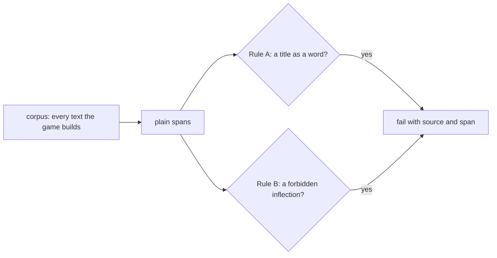

**Corpus** (each entry: a source label for the failure message, the text, and whether it is a tower
text):

| Source | Texts | Tower text |
|---|---|---|
| Terms | `describe()` of every `EffectKind`, `TraitTerm`, `AbilityTerm` | no |
| Tower terms | `describe()` of every `TowerTerm` | yes |
| Nodes | for each `TowerFactory.Type`, a tower from `TowerFactory` on `WorldFixtures.newWorld()`; for each node of `upgradeTree().nodes()`: `wordsOf(node).sentences()` and `node.gate().describe()` | yes |
| Applies | that tower's `applies()`: each source's `how()` | yes |
| Shop | that tower's `inspect().description()` (as `TermText.of`) | yes |
| Enemies | for each definition of `EnemyCatalog.builtIn()` at each rank: `description()` (as `TermText.of`); each trait slot's `template().entry().text()`; each ability through `AbilityText.of(ability, words)` with `WorldFixtures`' cell size | no; ability sentences are exempt from Rule A's tower titles (enemy names such as "Frenzy Spawnling" contain "Frenzy") |

**Rule A.** No plain span contains, as a case-sensitive whole word or phrase (`\b` + quoted title +
`\b`), the title of an `EffectKind` or a `TraitTerm`; a tower text is checked against `TowerTerm`
titles too.

**Rule B.** No plain span contains, as a case-insensitive whole word, one of: chilled, chills,
burning, burns, burned, frozen, freezes, shielded, healing, revealed, reveals, poisoned, scorched,
sickened, sundered, exposed, exposes, marked, marks, resonating, fractured, dazed, dazes, saturated,
saturates, charged, doomed, blighted, contagious, rimed, ashen, inverted, sympathetic, reckoned,
silenced, silences, anchored, unraveled, unravels, corroded, dragged, condemned, condemns, stilled,
unveiled, cracked, cracks, tarred, bleeding, bleeds, sprinting, sprints.

Test methods: `noPlainTextNamesATermWithoutMentioningIt`, `noPlainTextUsesAWordMadeFromATerm`. Each
collects every violation first and fails once with all of them listed (`source: "span"`), so one run
shows the whole fix list.

If the test finds a text that appendix D did not cover, rewrite that text by the same rules in this
commit.

### 5k.2 README glossary

Replace `README.md`'s Status effects table with a glossary: columns **Effect** (title), **Group**
(appendix A), **Side** (Buff/Debuff), **What it does** (the sentence from appendix A as the game
renders it at default numbers). Keep the paragraph above it, reworded: "An enemy shows one marker per
kind of effect it carries; selecting it shows each effect as an icon whose tooltip says what it does."
Add a short **Tower terms** table under it (title, side, sentence) from appendix B.

### Done when

Green; `grep -rn "PerkText" src/main/java/td/tower/*/` finds nothing (only `AuraTower`'s behaviour rows
still use it, until phase 10 deletes them).

---

## Phase 6: Paint pictograms and icon faces

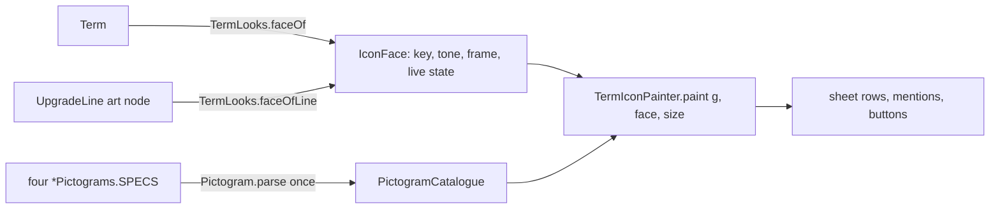

### 6.1 Palette

Add to `Palette` (after `DISRUPTION`) and the matching cases to `Java2DFrameRenderer.colorFor`, the colours
from appendix E's table "New palette roles". Each needs a one-line Javadoc saying what it colours.

### 6.2 `src/main/java/td/ui/render/IconFace.java`

```java
package td.ui.render;

import java.util.OptionalDouble;

/**
 * What one term icon shows, without AWT: its art, its colours and its live state.
 *
 * @param pictogram the art's key; a key without art paints {@code monogram}
 * @param corner    bottom-right text: a stack count or a node's progress; empty for none
 * @param numeral   top-left text: a perk line's level; empty for none
 * @param elapsed   the share of its clock gone, 0 to 1, shown as a dim sweep; 0 for none
 * @param bar       how full its pool or level is, 0 to 1; empty for no bar
 * @param below     the label under the face, whole seconds left; empty for none
 */
public record IconFace(String pictogram, String monogram, Palette tone, Palette frame, String corner, String numeral,
                       float elapsed, OptionalDouble bar, Ward ward, boolean faded, String below) {

    /** What keeps the term out: nothing, all of it, or a share. */
    public enum Ward {
        NONE,
        IMMUNE,
        RESISTED
    }

    public static IconFace of(String pictogram, String monogram, Palette tone, Palette frame) {
        return new IconFace(pictogram, monogram, tone, frame, "", "", 0f, OptionalDouble.empty(), Ward.NONE, false, "");
    }

    public IconFace withCorner(String corner) { ... }

    public IconFace withNumeral(String numeral) { ... }

    public IconFace withElapsed(float elapsed) { ... }

    public IconFace withBar(double bar) { ... }

    public IconFace withWard(Ward ward) { ... }

    /** Painted at a third of its alpha: only its diminishing returns are left. */
    public IconFace asFaded() { ... }

    public IconFace withBelow(String below) { ... }
}
```

### 6.3 `Pictogram`, `PictogramPath`, `PictogramCatalogue`, the four tables (`td.ui`)

- `PictogramPath.java`: a package-private final class; copy the lab's nested `PictogramPath` from
  `docs/plans/effect-icons-and-terms/lab/IconLab.java` exactly (the `M L H V C S Q T A Z` subset,
  relative and absolute, the arc-to-cubic conversion and `O cx cy r`), with a private constructor and
  `static Path2D.Float parse(String data)`. Malformed data throws `IllegalArgumentException` naming
  the data.
- `Pictogram.java`:

```java
package td.ui;

/** A term's symbol: layers of path data on a {@value #UNIT}-unit grid, each painted one way. */
record Pictogram(List<Layer> layers) {

    static final float UNIT = 24f;
    private static final double CENTRE = UNIT / 2;

    Pictogram {
        layers = List.copyOf(layers);
    }

    /** How a layer paints: with the ink, the dim ink, or the face's fill (a knock-out). */
    enum Op {
        FILL, EVEN_ODD, STROKE, THIN, DIM, KNOCK_OUT, KNOCK_OUT_STROKE;

        static Op of(char letter) {
            return switch (letter) {
                case 'F' -> FILL;
                case 'E' -> EVEN_ODD;
                case 'S' -> STROKE;
                case 'T' -> THIN;
                case 'D' -> DIM;
                case 'K' -> KNOCK_OUT;
                case 'X' -> KNOCK_OUT_STROKE;
                default -> throw new IllegalArgumentException("No pictogram op " + letter);
            };
        }
    }

    record Layer(Op op, Shape shape) {
    }

    /**
     * {@code spec}'s layers, " ; " between them, each "op[@degrees] path"; "=key" is {@code byKey}'s pictogram.
     *
     * @throws IllegalArgumentException for a malformed layer or path
     */
    static Pictogram parse(String spec, Function<String, Pictogram> byKey) {
        String trimmed = spec.strip();
        if (trimmed.startsWith("=")) {
            return byKey.apply(trimmed.substring(1).strip());
        }
        List<Layer> layers = new ArrayList<>();
        for (String text : trimmed.split(";")) {
            String layer = text.strip();
            int space = layer.indexOf(' ');
            if (space < 1) {
                throw new IllegalArgumentException("Malformed pictogram layer: " + layer);
            }
            String head = layer.substring(0, space);
            int at = head.indexOf('@');
            Shape shape = PictogramPath.parse(layer.substring(space + 1));
            if (at > 0) {
                double degrees = Double.parseDouble(head.substring(at + 1));
                shape = AffineTransform.getRotateInstance(Math.toRadians(degrees), CENTRE, CENTRE).createTransformedShape(shape);
            }
            layers.add(new Layer(Op.of(head.charAt(0)), shape));
        }
        return new Pictogram(layers);
    }
}
```

- `EffectPictograms.java`, `TowerTermPictograms.java`, `EnemyTermPictograms.java`, `PerkPictograms.java`:
  paste the four classes from `docs/plans/effect-icons-and-terms/pictogram-tables.md` unchanged.
- `PictogramCatalogue.java`:

```java
package td.ui;

/** Every pictogram by key, parsed once from the four tables; "=key" entries reuse an earlier one. */
final class PictogramCatalogue {

    private static final Map<String, Pictogram> BY_KEY = build();

    private PictogramCatalogue() {
    }

    static Optional<Pictogram> of(String key) {
        return Optional.ofNullable(BY_KEY.get(key));
    }

    static Set<String> keys() {
        return BY_KEY.keySet();
    }

    private static Map<String, Pictogram> build() {
        Map<String, Pictogram> byKey = new HashMap<>();
        Stream.of(EffectPictograms.SPECS, TowerTermPictograms.SPECS, EnemyTermPictograms.SPECS, PerkPictograms.SPECS)
                .flatMap(List::stream)
                .forEach(entry -> byKey.put(entry.getKey(), Pictogram.parse(entry.getValue(),
                        key -> Objects.requireNonNull(byKey.get(key), () -> "No earlier pictogram " + key))));
        return Map.copyOf(byKey);
    }
}
```

### 6.4 `TermLook` and `TermLooks` (`td.ui`)

```java
/** How a term looks besides its art, which its key names: the tone that fills and inks it, and its frame. */
record TermLook(Palette tone, Palette frame) {
}
```

```java
/**
 * The face of every term and perk line with no live state. A term's art is keyed by its key; its look comes
 * from one exhaustive switch per term family (appendix E), built into one map so no caller branches on a type.
 */
public final class TermLooks {

    private static final Map<String, TermLook> BY_KEY = build();
    private static final String[] NUMERALS = {"", "I", "II", "III", "IV"};

    private TermLooks() {
    }

    public static IconFace faceOf(Term term) {
        TermLook look = Objects.requireNonNull(BY_KEY.get(term.key()), () -> "No look for " + term.key());
        return IconFace.of(term.key(), monogram(term.title()), look.tone(), look.frame());
    }

    /** The face of a perk line of {@code type} whose art is {@code artNode}'s, at {@code level}; 0 shows no numeral. */
    public static IconFace faceOfLine(TowerFactory.Type type, UpgradeNode artNode, int level) {
        IconFace face = IconFace.of(artNode.id(), monogram(artNode.displayName()), perkTone(type, artNode),
                TowerSpriteFrameBuilder.slotPaletteFor(artNode.slot()));
        return level > 0 ? face.withNumeral(NUMERALS[level]) : face;
    }

    static String monogram(String title) {
        return title.length() <= 2 ? title : title.substring(0, 2);
    }

    private static Map<String, TermLook> build() {
        Map<String, TermLook> looks = new HashMap<>();
        Arrays.stream(EffectKind.values()).forEach(kind -> looks.put(kind.key(), effect(kind)));
        Arrays.stream(TowerTerm.values()).forEach(term -> looks.put(term.key(), tower(term)));
        Arrays.stream(TraitTerm.values()).forEach(term -> looks.put(term.key(), trait(term)));
        Arrays.stream(AbilityTerm.values()).forEach(term -> looks.put(term.key(), ability(term)));
        return Map.copyOf(looks);
    }

    private static TermLook effect(EffectKind kind) {
        return new TermLook(EnemyFrameBuilder.markerPaletteFor(kind), switch (kind) {
            // one case per kind, its group's frame from appendix A, no default
        });
    }

    private static TermLook tower(TowerTerm term) { /* appendix E, "Tower terms" */ }

    private static TermLook trait(TraitTerm term) { /* appendix E, "Traits" */ }

    private static TermLook ability(AbilityTerm term) { /* appendix E, "Abilities" */ }

    private static Palette perkTone(TowerFactory.Type type, UpgradeNode node) { /* appendix E, "Perk lines" */ }
}
```

`TowerSpriteFrameBuilder.slotPaletteFor` and `bodyPaletteFor` are already static in `td.ui`.

### 6.5 `src/main/java/td/ui/TermIconPainter.java`

A public final class with a private constructor. Copy the lab's `TermFace.paint`, `paintSymbol`,
`outlined`, `ink`, `shade` (call it `fill`) and `mix` (`lab/IconLab.java`) with these changes:

| Lab | Production |
|---|---|
| paints into a new `BufferedImage` | `public static void paint(Graphics2D g, IconFace face, int size)`: works on `g.create()`, top-left at the origin, the time label in the `LABEL` px under the face; disposes its copy |
| fixed `SIZE = 20` geometry | every length times `size / 20f`: corner arc 4, symbol box 14.5 at (2.75, 2.75), bar 2.2 high 2.5 in and 4.6 up, slash 3.6 in, stroke widths 3.4, 1.7, 1.25 (frame never under 1) |
| colours from the art file | `Java2DFrameRenderer.colorFor(face.tone())`, `colorFor(face.frame())`, `TERM_IMMUNE` for the slash |
| `Icon.layers()` | `PictogramCatalogue.of(face.pictogram())`; when empty, the monogram in bold at `size * 0.55f` |
| `FaceState` | the `IconFace` fields: `corner`, `elapsed`, `bar`, `ward` (`IMMUNE` solid slash, `RESISTED` dashed `2.2/1.6`), `numeral`, `faded` (alpha 0.38), `below` |
| fonts | count 9 bold, numeral 8 bold, label 9 plain (Dialog); corner and numeral only when `size >= BUTTON` |

Constants and one more method:

```java
    public static final int ROW = 20;
    public static final int BUTTON = 16;
    public static final int MENTION = 13;
    /** The height of the time label under a row face. */
    public static final int LABEL = 11;

    /** The colour a mention's title is written in: the tone lifted the way the symbol's ink is. */
    static Color ink(Palette tone) { ... }
```

### 6.6 `PreviewIcons` (`.claude/skills/run-jtd/PreviewIcons.java`)

A headless tool like `PreviewEnemy`: `java -cp "$CP" PreviewIcons [out.png]` (default
`.claude/skills/run-jtd/shots/icons.png`). It paints, 8 to a row, each face at 40 px and at 20 px with its
title under it, a section per term family and one for the perk lines:

1. every `EffectKind`, `TowerTerm`, `TraitTerm` and `AbilityTerm`, through `TermLooks.faceOf`;
2. for every `TowerFactory.Type` (a tower from `TowerFactory.createTower(type, new GameWorld(GameHost.noOp()),
   0, 0)`), every node of its `upgradeTree().nodes()` whose tier is `RANGE_1`, `ATTUNE`, `HEAD_1`,
   `EXTRA_1`, `HEAD_4` or `SPECIAL` (the nodes a line can take its art from), through
   `TermLooks.faceOfLine(type, node, node.tier().level())`.

Paint with `TermIconPainter.paint` on a `BufferedImage`, black background, as `PreviewEnemy` does. Add a
"PreviewIcons - every term's face" section to `SKILL.md` with that command line.

### Tests (`src/test/java/td/ui/`)

- `PictogramTest`: `eachOpLetterPaintsItsWay`, `aRotationTurnsAboutTheCentre` (a `@90` layer of
  `M12 2V6` ends near (20, 12)), `aCircleIsAFullEllipse`, `anEqualsSpecReusesAnotherPictogram`,
  `malformedPathDataIsRejected`.
- `PictogramCatalogueTest`: `everyTermHasAPictogram` (every key of the four enums is in `keys()`),
  `everyArtNodeHasAPictogram` (for every tower type, the id of every node of the art tiers above),
  `everySpecParses`.
- `TermLooksTest`: `anEffectsToneIsItsBoardMarker`, `anEffectsFrameIsItsGroup` (Chill control,
  Burn affliction, Shield boon, Expose mark, Doom hex, Sunder weakness), `aTowerBuffAndDebuffHaveTheirFrames`,
  `aBurstArcLineTakesTheStormcallerBody`, `aLineFaceShowsItsLevelAsARomanNumeral`.
- `TermIconPainterTest`: `anImmuneFaceDrawsItsSlashAcrossTheDiagonal` (paint into a 20 × 31
  `BufferedImage`; the pixel at (10, 10) is close to `TERM_IMMUNE`), `aFaceWithoutArtPaintsItsMonogram`.

### Docs

`td/ui/CLAUDE.md`, Render pipeline: add "A term's icon is an `IconFace` (AWT-free) that `TermIconPainter`
alone paints; its art is a `Pictogram` keyed by the term's key in `PictogramCatalogue`, its colours come
from `TermLooks`. A new term needs a row in a `*Pictograms` table (or it shows its monogram) and a case in
`TermLooks`."

### Done when

Green; `PreviewIcons` renders the same symbols as `docs/plans/effect-icons-and-terms/pictograms.png`
(compare by eye once: the art files were retoned to the palette roles, appendix E.7, so nothing differs);
`PerformanceHarness` passes (nothing per-frame changed yet).

---

## Phase 7: Lay out icon rows and mentions and find what is hovered

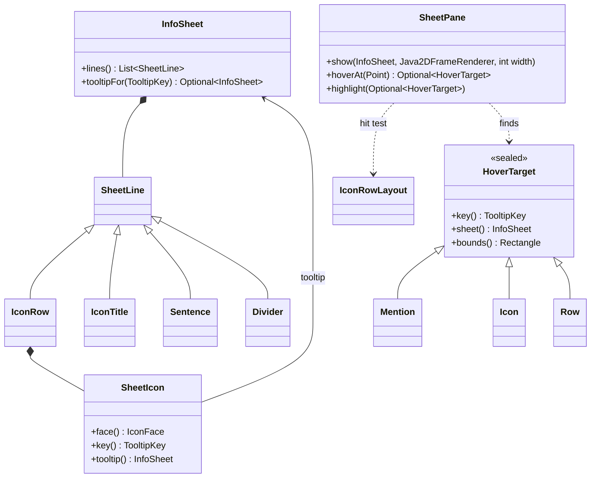

### 7.1 Sheet values (`td.ui.render`, AWT-free)

```java
/**
 * What a tooltip is about, the same from one frame to the next: "effect:effect.chill", "stat:ARMOR".
 *
 * @param term the key of the term it shows, if it shows one: what a chain compares (D20)
 */
public record TooltipKey(String id, Optional<String> term) {

    /** A tooltip about no term: a stat, a perk line, an upgrade button. */
    public static TooltipKey of(String kind, String name) {
        return new TooltipKey(kind + ":" + name, Optional.empty());
    }

    /** A tooltip about {@code term}: "effect:effect.chill". */
    public static TooltipKey ofTerm(String kind, Term term) {
        return new TooltipKey(kind + ":" + term.key(), Optional.of(term.key()));
    }

    /** One of several {@code kind} tooltips about {@code term}, told apart by {@code index}: "trait:0:effect.chill". */
    public static TooltipKey ofTerm(String kind, int index, Term term) {
        return new TooltipKey(kind + ":" + index + ":" + term.key(), Optional.of(term.key()));
    }

    /** Whether this and {@code other} show the same thing: the same term, or the same id when neither has one. */
    public boolean sameSubject(TooltipKey other) {
        return this.term.isPresent() ? this.term.equals(other.term) : this.id.equals(other.id);
    }
}

/** An icon in a sheet and the tooltip it opens. */
public record SheetIcon(IconFace face, TooltipKey key, InfoSheet tooltip) {
}

/** The tooltip a row opens. */
public record SheetTooltip(TooltipKey key, InfoSheet sheet) {
}
```

`SheetLine` additions and changes:

| Line | Shape | Lays out as |
|---|---|---|
| `IconRow(String label, List<SheetIcon> icons)` | new; `icons` copied | one embedded icon: the label (dim, 10 px) in a 48 px column, the faces beside it by `IconRowLayout` |
| `IconTitle(IconFace face, String name, Palette tone, String value)` | new | a 20 px face, the name bold in the tone's ink, the value on the right tab |
| `Sentence(TermText text, Optional<Glyph> glyph, Optional<Palette> tone)` | new; factories `of(TermText)` and `marked(Glyph, Palette, TermText)` | running text that wraps; mentions as 13 px face + title in the tone's ink |
| `Divider()` | new | a 1 px line in `Hud.BORDER_IDLE` across the width, 3 px above and below |
| `Prose(TermText text)` | was `Prose(String)` | as `Sentence`, dimmed and 11 px; callers pass `TermText.of(...)` |
| `Row` | gains the last component `Optional<SheetTooltip> tooltip`, empty in every factory; `withTrend` keeps it; new `withTooltip(TooltipKey key, InfoSheet sheet)` | as today; every run of the row carries the hover |

`SheetLine` gets one default method, overridden by the two lines that open tooltips, and `InfoSheet` asks
its lines:

```java
    // SheetLine
    /** The tooltip this line opens under {@code key}, if it opens one. */
    default Optional<InfoSheet> tooltipFor(TooltipKey key) {
        return Optional.empty();
    }

    // SheetLine.IconRow
    @Override
    public Optional<InfoSheet> tooltipFor(TooltipKey key) {
        return this.icons.stream().filter(icon -> icon.key().equals(key)).map(SheetIcon::tooltip).findFirst();
    }

    // SheetLine.Row
    @Override
    public Optional<InfoSheet> tooltipFor(TooltipKey key) {
        return this.tooltip.filter(tooltip -> tooltip.key().equals(key)).map(SheetTooltip::sheet);
    }

    // InfoSheet
    /** The tooltip an icon or row of this sheet opens under {@code key}. */
    public Optional<InfoSheet> tooltipFor(TooltipKey key) {
        return this.lines.stream().map(line -> line.tooltipFor(key)).flatMap(Optional::stream).findFirst();
    }
```

Fix the two `Prose` call sites (`EnemyStatText.preview`, `TowerSheetText.shop`) with `TermText.of`.

### 7.2 `src/main/java/td/ui/IconRowLayout.java`

```java
package td.ui;

/** Where an icon row puts its faces, and which face a point is on. Pure. */
record IconRowLayout(int count, int perLine, boolean timeLabels) {

    static final int LABEL_WIDTH = 48;
    static final int GAP = 2;
    static final int LINE_GAP = 3;

    /** {@code count} faces beside the label in {@code width} px; with {@code timeLabels}, every line leaves room for one. */
    static IconRowLayout of(int count, boolean timeLabels, int width) {
        int perLine = Math.max(1, (width - LABEL_WIDTH + GAP) / (TermIconPainter.ROW + GAP));
        return new IconRowLayout(count, perLine, timeLabels);
    }

    int lines() {
        return Math.max(1, (this.count + this.perLine - 1) / this.perLine);
    }

    int lineHeight() {
        return TermIconPainter.ROW + (this.timeLabels ? TermIconPainter.LABEL : 0) + LINE_GAP;
    }

    int height() {
        return this.lines() * this.lineHeight() - LINE_GAP;
    }

    /** The top-left corner of face {@code index}. */
    Point cell(int index) {
        return new Point(LABEL_WIDTH + (index % this.perLine) * (TermIconPainter.ROW + GAP),
                (index / this.perLine) * this.lineHeight());
    }

    /** The face under {@code (x, y)}, relative to the row's top-left; empty between faces or past the last. */
    OptionalInt iconAt(int x, int y) {
        for (int i = 0; i < this.count; i++) {
            Point cell = this.cell(i);
            if (x >= cell.x && x < cell.x + TermIconPainter.ROW && y >= cell.y && y < cell.y + TermIconPainter.ROW) {
                return OptionalInt.of(i);
            }
        }
        return OptionalInt.empty();
    }
}
```

In the 184 px pane: `(184 - 48 + 2) / 22 = 6` faces a line (`panes.png`).

### 7.3 `InfoSheetDocument`

- The hover attribute: a package-private `enum HoverKey { INSTANCE }`; its values are a
  package-private sealed `HoverRun` with three records: `MentionRun(TermText.Mention mention)`,
  `IconRowRun(SheetLine.IconRow row, IconRowLayout layout)`, `RowRun(SheetLine.Row row)`. One run object is
  shared by every character it covers.
- `IconRow`: `IconRowLayout.of(icons.size(), anyBelow, this.width)` where `anyBelow` is any face with a
  non-empty `below`; insert one `PaintedIcon(this.width, layout.height(), painter)` with
  `HoverKey.INSTANCE → new IconRowRun(row, layout)`. The painter translates by `(-width / 2, -height / 2)`
  (a `PaintedIcon` paints about its centre), writes the label in `PROSE_COLOR` at 10 px, vertically
  centred on the first line, then `TermIconPainter.paint(g, icon.face(), ROW)` at each `cell(i)`.
- `IconTitle`: a `PaintedIcon(ROW, ROW, …)` of the face, then ` ` + name in bold in
  `TermIconPainter.ink(tone)`, then `\t` + value in `VALUE_COLOR`.
- `Sentence` and `Prose`: the optional glyph as `row` paints it; then per span: `Plain` → its text
  (`Hud.FOREGROUND` for a sentence, `PROSE_COLOR` 11 px for prose); `Mention` → a
  `PaintedIcon(MENTION, MENTION, …)` of `TermLooks.faceOf(term)` then the title in
  `TermIconPainter.ink(face.tone())`, both runs carrying the same `MentionRun`.
- `Divider`: a `PaintedIcon(this.width, 7, …)` drawing a 1 px horizontal line through its middle.
- `Row` with a tooltip: every run of it carries one `RowRun`.

### 7.4 `HoverTarget`, `SheetPane`, `TermSheets` (`td.ui`)

```java
/** What the pointer rests on in a sheet, where it is, and the tooltip it opens. */
sealed interface HoverTarget {

    TooltipKey key();

    InfoSheet sheet();

    /** In the pane's coordinates. */
    Rectangle bounds();

    record Mention(TermText.Mention mention, Rectangle bounds) implements HoverTarget {
        public TooltipKey key() { return TooltipKey.ofTerm("term", this.mention.term()); }
        public InfoSheet sheet() { return TermSheets.of(this.mention); }
    }

    record Icon(SheetIcon icon, Rectangle bounds) implements HoverTarget {
        public TooltipKey key() { return this.icon.key(); }
        public InfoSheet sheet() { return this.icon.tooltip(); }
    }

    record Row(SheetLine.Row row, Rectangle bounds) implements HoverTarget {
        public TooltipKey key() { return this.row.tooltip().orElseThrow().key(); }
        public InfoSheet sheet() { return this.row.tooltip().orElseThrow().sheet(); }
    }
}
```

Each record copies `bounds` in its compact constructor (`bounds = new Rectangle(bounds)`).

`SheetPane extends JTextPane`, `@ThreadConfined(EVENT_DISPATCH_THREAD)`, package-private final:

- Constructor: not editable, black background, `Hud.FOREGROUND` text, no border, not focusable.
- `void show(InfoSheet sheet, Java2DFrameRenderer renderer, int width)`: sets
  `InfoSheetDocument.of(sheet, renderer, width, getFontMetrics(getFont()))`, caret 0, then
  `highlight(this.lastPoint.flatMap(this::hoverAt))`, so a resting pointer keeps its highlight on the
  new sheet (D21). `lastPoint` (`Optional<Point>`, empty at first) is the point the last `hoverAt` call
  was given, and goes empty on `clearPointer()`, which the layer calls on `mouseExited`.
- `Optional<HoverTarget> hoverAt(Point point)` (remembers `point` as `lastPoint`):
  1. `pos = viewToModel2D(point)`; `element = getStyledDocument().getCharacterElement(pos)`; `run =
     element.getAttributes().getAttribute(HoverKey.INSTANCE)`.
  2. `MentionRun`: bounds = the union of `modelToView2D` boxes of the neighbouring elements carrying the
     same run object (`==`); present only when the bounds contain the point.
  3. `IconRowRun`: the icon's box is `modelToView2D(element.getStartOffset())` (its x and y; an icon view
     returns its own allocation), `layout.height()` high; `layout.iconAt(point - box origin)` → the
     `SheetIcon` with bounds = its cell moved by the box origin.
  4. `RowRun` with a tooltip: bounds = the paragraph's box (union of start and end views); else empty.
- `void highlight(Optional<HoverTarget> target)`: remembers it and repaints.
- `paintComponent`: `super.paintComponent(g)`, then over the highlighted bounds a rounded rectangle of white
  at alpha 36 (the "brightens on hover" of the feature).

`TermSheets` (package-private final, pure):

```java
    /** A mention's tooltip: its term's face and title, and what it means here. */
    static InfoSheet of(TermText.Mention mention) {
        return of(mention.term(), mention.meaning(), List.of());
    }

    /** {@code term}'s tooltip: its title line, {@code meaning} as a sentence, then {@code more}. */
    static InfoSheet of(Term term, TermText meaning, List<SheetLine> more) {
        List<SheetLine> lines = new ArrayList<>();
        lines.add(title(term, ""));
        lines.add(SheetLine.Sentence.of(meaning.asSentence()));
        lines.addAll(more);
        return new InfoSheet(lines);
    }

    static SheetLine.IconTitle title(Term term, String value) {
        IconFace face = TermLooks.faceOf(term);
        return new SheetLine.IconTitle(face, term.title(), face.tone(), value);
    }
```

`PanelTowerInfo`'s `JTextPane jTextPane1` becomes a `SheetPane sheetPane`; `layOutSheet` calls
`show(...)`; `replaceText` keeps plain text working (`setStyledDocument(new DefaultStyledDocument())` +
`setText`).

### Tests

- `IconRowLayoutTest`: `sixFacesFitBesideTheLabelInTheInfoPane` (width 184 → 6),
  `aSeventhFaceWrapsToASecondLine`, `aTimeLabelAddsItsHeightToEveryLine`, `aPointBetweenFacesHitsNone`,
  `aPointOnTheThirdFaceHitsIt`.
- `TermSheetsTest`: `aMentionsTooltipIsItsTitleThenItsMeaningAsASentence`,
  `aMentionWithDetailShowsTheDetailNotTheTermsOwnSentence`.
- `InfoSheetTest` (`td.ui.render`): `tooltipForFindsAnIconsSheetByKey`, `tooltipForFindsARowsSheet`,
  `anUnknownKeyHasNoTooltip`.
- `TooltipKeyTest` (`td.ui.render`): `keysOfOneTermShareTheirSubjectWhateverTheirKind`,
  `keysWithoutATermShareTheirSubjectOnlyByTheirId`.
- `InfoSheetDocumentTest`: `aMentionIsItsFaceThenItsTitleInItsInk` (two runs, the first an icon, the
  second the title, both with the same `MentionRun`), `anIconRowIsOneEmbeddedIconAsTallAsItsLayout`.
- `SheetPaneTest`: `hoverAtFindsTheMentionUnderThePoint` (a `SheetPane` sized 184 × 200, a sheet with
  one sentence "applies [Unravel]", the point inside the title's box). If `JTextPane` cannot lay out in
  the headless test JVM, leave this test out and say so in the commit message; the live check covers it.

### Done when

Green; the panes look unchanged (no sheet holds the new lines yet).

---

## Phase 8: Open chained tooltips over the game

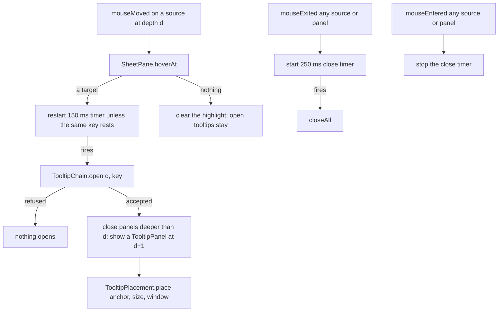

### 8.1 `src/main/java/td/ui/TooltipChain.java` (pure)

```java
/** The open tooltips, shallowest first, by key; depth 0 is the pane, depth n the n-th tooltip. */
record TooltipChain(List<TooltipKey> keys) {

    private static final TooltipChain EMPTY = new TooltipChain(List.of());

    TooltipChain {
        keys = List.copyOf(keys);
    }

    static TooltipChain empty() {
        return EMPTY;
    }

    /**
     * The chain with {@code key} opened from a source at {@code depth}, everything deeper closed; empty when that
     * source already shows {@code key}, or a shallower tooltip shows its subject, since a chain never opens one
     * term twice (D20).
     */
    Optional<TooltipChain> open(int depth, TooltipKey key) {
        if (depth > this.keys.size()) {
            throw new IllegalArgumentException("No source at depth " + depth);
        }
        boolean shownHere = depth < this.keys.size() && this.keys.get(depth).equals(key);
        boolean shownShallower = this.keys.subList(0, depth).stream().anyMatch(open -> open.sameSubject(key));
        if (shownHere || shownShallower) {
            return Optional.empty();
        }
        List<TooltipKey> next = new ArrayList<>(this.keys.subList(0, depth));
        next.add(key);
        return Optional.of(new TooltipChain(next));
    }

    /** Only the tooltips shallower than {@code depth}. */
    TooltipChain closedFrom(int depth) {
        return new TooltipChain(this.keys.subList(0, Math.min(depth, this.keys.size())));
    }
}
```

### 8.2 `src/main/java/td/ui/TooltipPlacement.java` (pure)

```java
/** Where a tooltip goes: left of its anchor, toward the board, else right; top-aligned; inside the window. */
final class TooltipPlacement {

    static final int GAP = 4;
    static final int MARGIN = 6;

    private TooltipPlacement() {
    }

    static Point place(Rectangle anchor, Dimension size, Rectangle window) {
        int x = anchor.x - GAP - size.width;
        if (x < window.x + MARGIN) {
            x = anchor.x + anchor.width + GAP;
        }
        x = Math.clamp(x, window.x + MARGIN, Math.max(window.x + MARGIN, window.x + window.width - MARGIN - size.width));
        int y = Math.clamp(anchor.y, window.y + MARGIN, Math.max(window.y + MARGIN, window.y + window.height - MARGIN - size.height));
        return new Point(x, y);
    }
}
```

### 8.3 `src/main/java/td/ui/TooltipPanel.java`

A package-private final `JPanel`, `@ThreadConfined(EVENT_DISPATCH_THREAD)`:

- Background `(8, 14, 8)`, border `BorderFactory.createCompoundBorder(Hud.outlineBorder(), new
  EmptyBorder(4, 6, 4, 6))`, `BorderLayout` with one `SheetPane` in the centre (its background the same).
- `MAX_WIDTH = 240` (outer).
- `void show(InfoSheet sheet)`: does nothing when `sheet` equals the sheet it shows and it is not
  expired (D21). Otherwise lays the sheet out at the inner width `MAX_WIDTH - insets`, then
  measures the unwrapped preferred width of the pane and, if narrower, lays out again at that width;
  `setSize(getPreferredSize())`; clears the expired state.
- `void showExpired()`: shows the last sheet plus `new SheetLine.Prose(TermText.of("Expired"))`, and
  paints itself (override `paint`) at `AlphaComposite` 0.45.
- `SheetPane pane()` for the layer to watch.

### 8.4 `src/main/java/td/ui/TooltipLayer.java`

Package-private final, `@ThreadConfined(EVENT_DISPATCH_THREAD)`; all Swing state, no decisions:

```java
/**
 * The game's tooltips on the frame's popup layer. Opens one where the pointer rests on a target, chains one from a
 * target inside a tooltip, keeps them while the pointer is over a source or a tooltip and closes them all a moment
 * after it leaves; an open tooltip follows its key through new sheets.
 */
final class TooltipLayer {

    static final int OPEN_DELAY_MS = 150;
    static final int CLOSE_DELAY_MS = 250;
    ...
    TooltipLayer(JLayeredPane layer) { ... }

    /** A pane whose sheet can change; it is the depth-0 source of the tooltips its targets open. */
    void watch(SheetPane pane) { ... }

    /**
     * A button, a depth-0 source, whose hover opens the tooltip {@code tooltip} gives for it now, if any. The
     * tooltip belongs to the button: it follows whatever the button offers (D19).
     */
    void watchButton(HudButton button, Supplier<Optional<SheetTooltip>> tooltip) { ... }

    /** The watched buttons' offers may have changed: an open button tooltip shows its button's current one. */
    void refreshButtons() { ... }

    /** {@code source} now shows {@code sheet}: a tooltip it opened takes its key's new content, or shows Expired. */
    void sheetChanged(SheetPane source, InfoSheet sheet) { ... }

    void closeAll() { ... }
}
```

State: the `TooltipChain`; per open depth a `TooltipPanel` and its source (a `SheetPane` or a button);
the pending target (depth, `HoverTarget` or button key + sheet, anchor component); two
`javax.swing.Timer`s (`setRepeats(false)`).

| Event | Does |
|---|---|
| `mouseMoved` on a watched pane at depth d | `target = pane.hoverAt(p)`; highlight it; a target whose key differs from the pending one restarts the open timer; no target stops it |
| open timer fires | `chain.open(d, key)`: refused → nothing; accepted → remove panels deeper than d, create a `TooltipPanel`, `show(target.sheet())`, `layer.add(panel, JLayeredPane.POPUP_LAYER)`, place it with `TooltipPlacement.place(SwingUtilities.convertRectangle(source, bounds, layer), panel.getSize(), new Rectangle(0, 0, layer.getWidth(), layer.getHeight()))`, `watch(panel.pane())` at depth d + 1 |
| `mouseEntered` on a button | the pending target is the button's `SheetTooltip` (when the supplier gives one), anchor the button's bounds; restart the open timer |
| `refreshButtons()` | for each panel a button opened: the supplier gives a tooltip → `show` its sheet (an equal sheet is skipped); it gives none (the button hid) → close that panel and every deeper one (`chain.closedFrom(d)`) |
| `mouseExited` on any watched pane, button or panel | start the close timer (restart if running); a pane also gets `clearPointer()` |
| `mouseEntered` on any watched pane, button or panel | stop the close timer |
| close timer fires | `closeAll()` |
| `sheetChanged(source, sheet)` | for the first panel, when `source` opened it: `sheet.tooltipFor(key)` present → `show` it; absent and the key is not a `term:` key → `showExpired()`. A deeper panel whose source is a panel re-resolves the same way from its source panel's current sheet; `term:` tooltips never change |
| `closeAll()` | remove every panel, empty chain, stop both timers, clear highlights, `layer.repaint()` |

### 8.5 Wiring

- `TowerDefense`: after `initComponents()`, `TooltipLayer tooltips = new TooltipLayer(getLayeredPane());`
  then `this.gameConsole.setTooltips(tooltips);`. `stopLoopThen`/level teardown and the menu switch call
  `tooltips.closeAll()`.
- `PanelGameConsole.setTooltips(TooltipLayer)`: passes it to `PanelTowerInfo.setTooltips` and
  `PanelUpgradeTree.setTooltips` (the latter only stores it until phase 11).
- `PanelTowerInfo`: `setTooltips` calls `watch(this.sheetPane)`. In `replaceSheet`, when the new sheet's
  first line differs from the last sheet's first line (another enemy, tower or shop entry), call
  `closeAll()` before showing it; otherwise call `sheetChanged(this.sheetPane, sheet)` after showing it.
  `setExternalText` and `unselectTower` call `closeAll()`.

### Tests

- `TooltipChainTest`: `aKeyOpensAtTheDepthOfItsSource`, `openingFromAShallowerSourceClosesTheDeeperOnes`,
  `aKeyAlreadyOpenShallowerIsRefused`, `theSameKeyAtTheSameDepthIsRefused`,
  `aTermOpenShallowerUnderAnotherKindOfKeyIsRefused` (`effect:effect.freeze` open, then
  `term:effect.freeze` from depth 2), `aSourceMaySwapItsTooltipForAnotherKeyOfTheSameTerm`,
  `closedFromKeepsOnlyTheShallowerOnes`.
- `TooltipPlacementTest`: `aTooltipGoesLeftOfItsAnchorWithAGap`, `withNoRoomOnTheLeftItGoesRight`,
  `itStaysSixPixelsInsideTheWindow`, `itAlignsWithTheAnchorsTop`.

Timers, listeners and the layer are Swing wiring: the end-of-feature live check covers them.

### Docs

`td/ui/CLAUDE.md`, Swing: add "Tooltips are `TooltipPanel`s on the frame's popup layer, owned by one
`TooltipLayer`; what is hovered, where a tooltip goes and which stay open are answered by `SheetPane.hoverAt`,
`TooltipPlacement` and `TooltipChain`. Never use `setToolTipText` for game content."

### Done when

Green; the game behaves as before (no sheet has hover targets until phase 9).

---

## Phase 9: Show the enemy as stats and icon rows

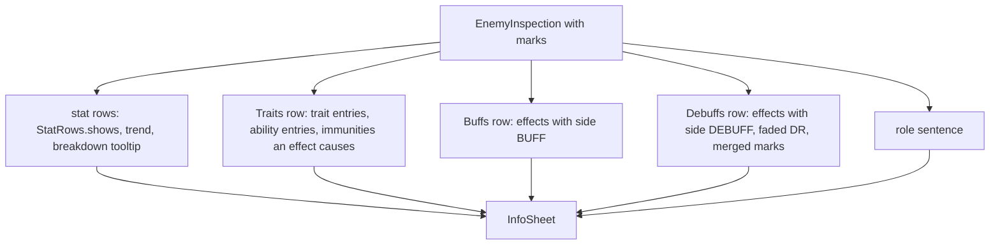

### 9.1 `EnemyStatText` rewrite

Keep `header`, `statText`, `StatText`, `debuffPaceText`, `resilienceText`, `resistText`, `platingText`.
Delete `statAndTraitRows`, `toned`, `differsFromDefault`, `pairedWith`, `pairText`, `effectRow`,
`diminishingLabel`. The class Javadoc becomes: "Turns an `EnemyInspection` into the enemy pane: stat rows,
then the Traits, Buffs and Debuffs icon rows, then its role sentence. Pure: no Swing, no live mob."

```java
    /** The wave-preview hover: identity, full health, its stats, the Traits row and its role sentence. */
    static InfoSheet preview(EnemyInspection inspection) {
        List<SheetLine> lines = new ArrayList<>();
        lines.add(header(inspection));
        lines.add(new SheetLine.HealthBar(inspection.maxHealth(), inspection.maxHealth(), "$" + inspection.bounty(), false));
        lines.add(new SheetLine.Gap());
        lines.addAll(statRows(inspection, false));
        iconRow("Traits", traitIcons(inspection)).ifPresent(lines::add);
        role(inspection, lines);
        return new InfoSheet(lines);
    }

    /** The live inspector: health and fate, stats with breakdowns, the three icon rows, the role sentence. */
    static InfoSheet live(EnemyInspection inspection) {
        List<SheetLine> lines = new ArrayList<>();
        lines.add(header(inspection));
        lines.add(/* the health bar by fate, as today */);
        lines.add(new SheetLine.Gap());
        lines.addAll(statRows(inspection, true));
        if (inspection.dodges() > 0) {
            lines.add(Row.plain(Glyph.DOT, "Dodged", inspection.dodges() == 1 ? "1 hit" : inspection.dodges() + " hits"));
        }
        iconRow("Traits", traitIcons(inspection)).ifPresent(lines::add);
        iconRow("Buffs", effectIcons(inspection, Side.BUFF)).ifPresent(lines::add);
        iconRow("Debuffs", debuffIcons(inspection)).ifPresent(lines::add);
        role(inspection, lines);
        return new InfoSheet(lines);
    }
```

`iconRow(label, icons)`: empty when `icons` is empty, else `new SheetLine.IconRow(label, icons)`.
`role`: when `description()` is not empty, a `Gap` and `new SheetLine.Prose(TermText.of(description))`.

**Stat rows** (`statRows(inspection, live)`): `MOVE_SPEED` first, then every other `EnemyStat` in enum
order, each where `StatRows.shows(stat, base, current)` (base from `baseStats()`, current from `stat()`).
One row per stat (no merged pairs). Glyph `CHEVRON` for speed, `DOT` otherwise; label and value from
`statText(stat, current)`; trend from:

```java
    /** Whether a lower {@code stat} is better for the player: a slower, softer, less evasive enemy. */
    static boolean lowerIsBetterForPlayer(EnemyStat stat) {
        return switch (stat) {
            case ARMOR, MAGIC_RESIST, PLATING, INSULATION, MOVE_SPEED, RESILIENCE, AGILITY, SPIRIT, HEALING_RECEIVED,
                    REGENERATION, CHILL_RESIST, BURN_RESIST, FREEZE_RESIST, STEALTH -> true;
            case PHYSICAL_DAMAGE_TAKEN, MAGIC_DAMAGE_TAKEN, PERIODIC_DAMAGE_TAKEN -> false;
        };
    }
```

`Trend.NONE` when `current == base`; else `BETTER` when `(current < base) == lowerIsBetterForPlayer(stat)`,
`WORSE` otherwise. On the live sheet, a row whose stat has a breakdown takes
`withTooltip(TooltipKey.of("stat", stat.name()), breakdownSheet(breakdown))`:

| Line | Content |
|---|---|
| `Row.plain(glyph, statText(stat, current).label(), "")` | the stat's name |
| `Row.plain(Glyph.DOT, "Base", statText(stat, base).value())` | |
| one `Sentence.of(TermText.of(part.source()).plus(": " + modifierText(stat, part.modifier())))` per part | each source as a term |
| `Row.plain(Glyph.DOT, "Now", statText(stat, current).value())` | |

```java
    /** What one source does to {@code stat}, in the stat's own unit: "-10", "x0.5", "= 0", "at most 75% of base". */
    static String modifierText(EnemyStat stat, StatModifier modifier) {
        List<String> parts = new ArrayList<>();
        if (modifier.hasSetValue()) {
            parts.add("= " + statText(stat, modifier.setTo()).value());
        }
        if (modifier.flat() != 0f) {
            parts.add(signedIn(stat, modifier.flat()));
        }
        if (modifier.percentAdd() != 0f) {
            parts.add(SheetNumbers.signedPercent(modifier.percentAdd()));
        }
        if (modifier.multiply() != 1f) {
            parts.add("x" + SheetNumbers.decimal(modifier.multiply()));
        }
        if (modifier.hasCap()) {
            parts.add("at most " + SheetNumbers.percent(modifier.capShareOfBase()) + " of base");
        }
        return String.join(", ", parts);
    }

    private static String signedIn(EnemyStat stat, float amount) {
        String sign = amount > 0f ? "+" : "";
        return switch (stat) {
            case PHYSICAL_DAMAGE_TAKEN, MAGIC_DAMAGE_TAKEN, PERIODIC_DAMAGE_TAKEN, HEALING_RECEIVED, CHILL_RESIST,
                    BURN_RESIST, FREEZE_RESIST -> SheetNumbers.signedPercent(amount);
            case PLATING, INSULATION -> sign + SheetNumbers.decimal(DamageUnits.inPoints(amount));
            case REGENERATION -> sign + SheetNumbers.decimal(DamageUnits.inPoints(amount) * TickRate.TICKS_PER_SECOND) + "/s";
            case MOVE_SPEED -> sign + SheetNumbers.decimal(amount * TickRate.TICKS_PER_SECOND) + " px/s";
            case ARMOR, MAGIC_RESIST, RESILIENCE, AGILITY, SPIRIT, STEALTH -> sign + Math.round(amount);
        };
    }
```

**Traits row** (`traitIcons`), in this order:

1. Each `traitEntries()` entry `i`: `TermLooks.faceOf(entry.term())`, `withWard(IMMUNE)` when
   `entry.immune()`, `withWard(RESISTED)` when `0 < resisted < 1`; key `TooltipKey.ofTerm("trait", i,
   entry.term())`; tooltip `TermSheets.of(entry.term(), entry.text(), List.of())`.
2. Each `abilityEntries()` entry `i`: its face; key `TooltipKey.ofTerm("ability", i, entry.term())`;
   tooltip `TermSheets.of(entry.term(), entry.text(), List.of())`.
3. Each `immunities()` immunity whose `keptOutBy` is present and whose kind no immune trait entry
   already shows: the kind's face `withWard(IMMUNE)`; key `TooltipKey.ofTerm("immune", kind)`; tooltip
   `TermSheets.of(kind, TermText.format("immune to {} while it has {}", kind, keptOutBy.get()), List.of())`.

**Effect icons** (`effectIcons(inspection, side)`, in `effects()` order, kinds whose `side()` matches):

| Face | When |
|---|---|
| `asFaded()` | `faded()` |
| `withCorner(stacks)` | `kind.maxStacks() > 0` and `stacks() > 1` (Drag: `stacks() + "%"`) |
| `withElapsed(1 - remaining / clock)` | `remainingTicks()` and `clockTicks()` both present |
| `withBelow((int) Math.ceil(remaining / TICKS_PER_SECOND) + "s")` | remaining under `10 * TICKS_PER_SECOND` |
| `withBar(fullness)` | `fullness()` present |
| `withBar(remaining / max)` | `SHIELD`, from `shield()` |

Key `TooltipKey.ofTerm("effect", kind)`; tooltip `TermSheets.of(kind, kind.describe(), more)` where
`more` is, in order and only when it applies: `Row.plain(DOT, "Time left", "%.1f s")`;
`Row.plain(DOT, "Stacks", stacks + " / " + kind.maxStacks())`; for `SHIELD` `Row.plain(DOT, "Absorbs",
round(remaining) + " / " + round(max))`; for `CHILL` `Row.plain(DOT, "Slows", percent(level))`; when
`nextShare()` is present, `Sentence.of(TermText.of(share > 0 ? "the next one lasts " + percent(share) :
"the next one is kept out").asSentence())`.

**Debuffs row** (`debuffIcons`): `effectIcons(inspection, Side.DEBUFF)` then the marks, grouped by term
in first-seen order: one icon per term, its face `withCorner` the highest `steps`; key
`TooltipKey.ofTerm("mark", term)`; tooltip `TermSheets.of(term, term.describe(), rows)` with one
`Row.plain(DOT, mark.source(), mark.steps() + " / " + mark.maxSteps())` per mark.

### 9.2 Marks reach the sheet (`BoardRenderer`)

```java
        Optional<InfoSheet> enemySheet = inspection
                .map(found -> selected.map(mob -> found.withMarks(this.marksOn(mob))).orElse(found))
                .map(EnemyStatText::live);
```

with

```java
    /** What every tower remembers about {@code mob}, for its pane. */
    private List<EnemyMark> marksOn(EnemyMob mob) {
        List<EnemyMark> marks = new ArrayList<>();
        this.world.towers().all().forEach(tower -> marks.addAll(tower.marksOn(mob)));
        return marks;
    }
```

and pass `enemySheet` to `new RenderFrame(...)` where `inspection.map(EnemyStatText::live)` is today.

### 9.3 What goes

| Delete | Then |
|---|---|
| `TraitLine` | the compiler names the users |
| `TraitTemplate.describe()` and every implementation (`EffectResistTrait`, `RegenerationTrait`, `HurtSpeedTrait`, `HurtAgilityTrait`, `AdaptiveResist`, `AdaptiveResist.Adapted`; `GhostInvisibilityTest.RevealTrait`) | `TraitText` if nothing uses it any more |
| `TraitMarker.isShownAs` / the shown-as data | keep `TraitMarker` itself: the board's trait diamonds use it |
| `EnemyInspection` components `blocked`, `diminished`, `traitLines` | `immunities` and `EffectState.nextShare` replace them; fix `of(mob)` and every `withX` |

### 9.4 Measure it (`PerformanceHarness`)

In `playPass`, select an enemy the way a click does and build the frame with its sheet, inside the
measured window:

```java
            if (engine.inspectSelectedEnemy().isEmpty()) {
                firstAlive(engine).ifPresent(enemy -> engine.requestEnemySelectionAt((int) enemy.getX(), (int) enemy.getY()));
            }
            ...
            renderer.buildFrame(t, 0.5, t / (double) TickRate.TICKS_PER_SECOND, engine.inspectSelectedEnemy());
```

`firstAlive` returns the first enemy of `getGameWorld().enemies().getEnemies()` that is not dead. Use the
position accessors `EnemySelection` uses if they are named differently. Run the harness (today: frame
build p99 0.25 ms of 1 ms, frame allocation p99 128 KB of 512 KB); over budget, make the sheet build
allocate less (reuse `TermLooks` faces, avoid `String.format`), never raise a budget.

### Tests

`EnemyStatTextTest` is about this class: rewrite it. Build every inspection from a real mob (as the
current tests do), never by hand. Keep `aPlainEnemyShowsOnlyItsSpeed`,
`theHeaderShowsTheBodyGlyphNameAndRankBadge`, `agilityReadsAsPointsWithItsDodgeChance`,
`theLiveViewCountsTheHitsAnEnemyDodged`, `armorAndMagicResistReadAsPoints`,
`resilienceReadsAsCritsGainedOrLostAndAHundredIsCritImmune`, `spiritThatChangesTheDebuffPaceSaysSoInWords`
(adjusting rows, not meaning); delete the others; add:

- `aStatOffItsDefaultIsARowWhateverSetsIt` (Armored: an Armor row, no trait row)
- `aStatBetterForThePlayerThanItsBaseIsBetter` (Armored with 2 Sunder stacks: Armor `BETTER`)
- `aChilledEnemysSpeedIsBetterForThePlayer`
- `aStatRowOpensItsBreakdown` (that Armor row's tooltip: Base 40, a sentence mentioning Sunder with -10, Now 30)
- `traitsAbilitiesAndImmunitiesShareTheTraitsRow` (Yeti: a slashed Freeze, Hunker)
- `anImmunityAnEffectCausesNamesThatEffect` (frozen: a slashed Burn whose tooltip mentions Freeze)
- `buffsAndDebuffsSplitBySide` (a Shield in Buffs, a Chill in Debuffs)
- `aStackingDebuffShowsItsStacks`
- `aTimedEffectSweepsAndShowsWholeSecondsUnderTen`
- `aPoolShowsABarAndNoClock` (Burn)
- `aFreezeWhoseDiminishingReturnsRunStaysFadedAndSaysWhatTheNextLasts`
- `stokeFromTwoTowersIsOneIconWithTheHighestSteps` (an inspection `withMarks` of two marks)
- `thePreviewShowsStatsTraitsAndTheRoleSentenceButNoBuffsOrDebuffs`

`BoardRendererTest`: `aSelectedEnemysSheetCarriesWhatTowersRememberOfIt` (a Scorcher has stoked the enemy:
the frame's sheet has a Stoke icon in Debuffs).

### Docs

- `td/ui/CLAUDE.md`, the Info-pane bullet: replace "one row per thing on the board, with the glyph and
  colour the board draws for it, each fitting one line" with "stat rows, then icon rows (Traits, Buffs,
  Debuffs; on a tower Perks, Buffs, Debuffs, Applies), each icon a `SheetIcon` carrying its tooltip
  sheet".
- `td/effect/CLAUDE.md`, "Adding a kind" step 4: the cases the compiler forces are now
  `EnemyFrameBuilder.markerPaletteFor`, `Java2DFrameRenderer.colorFor`, `EffectSentences.of`,
  `TermLooks.effect` and `ActiveEffects.magnitude`; add step 5 "an `EffectPictograms` row (else it shows
  its monogram)".

### Done when

Green; `PerformanceHarness` within budget; `PreviewBoard` with a selected enemy is not needed (the pane is
Swing): the live check comes at the end.

---

## Phase 10: Show the tower as stats and icon rows, built with the frame

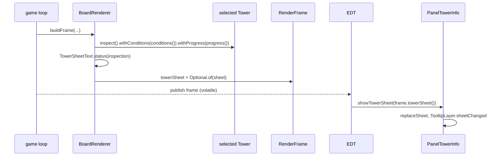

### 10.1 What the inspection carries

- `TowerInspection` gains `Map<String, NodeWords> words` (`withWords`), filled in `inspect()` for every
  owned node: `wordsOf(node).withChosenOver(names)`, where `names` are the display names of every
  `passedOver()` node of the `upgradeTree().decisions(upgrades)` whose `chosen()` is that node.
- Delete `TowerInspection.behaviours` and `withBehaviours`.

### 10.2 `TowerSheetText` rewrite

```java
    /** The toolbar's sheet: price, authored stats, whom it targets, what it applies, then what no row says. */
    static InfoSheet shop(TowerInspection tower) {
        List<SheetLine> lines = new ArrayList<>();
        lines.add(title(tower, "$" + tower.price()));
        lines.add(new SheetLine.Gap());
        tower.stats().forEach(stat -> lines.add(statRow(stat.stat(), TowerStatLine.fixed(stat.stat(), stat.base()))));
        targets(tower).ifPresent(lines::add);
        iconRow("Applies", appliesIcons(tower)).ifPresent(lines::add);
        if (!tower.description().isEmpty()) {
            lines.add(new SheetLine.Gap());
            lines.add(new SheetLine.Prose(TermText.of(tower.description())));
        }
        return new InfoSheet(lines);
    }

    /** A placed tower: current stats, whom it targets, its perks, buffs, debuffs and applies, then its record. */
    static InfoSheet status(TowerInspection tower) {
        List<SheetLine> lines = new ArrayList<>();
        lines.add(title(tower, ""));
        lines.add(new SheetLine.Gap());
        tower.stats().forEach(stat -> lines.add(statRow(stat.stat(), stat)));
        targets(tower).ifPresent(lines::add);
        iconRow("Perks", perkIcons(tower)).ifPresent(lines::add);
        iconRow("Buffs", conditionIcons(tower, Side.BUFF)).ifPresent(lines::add);
        iconRow("Debuffs", conditionIcons(tower, Side.DEBUFF)).ifPresent(lines::add);
        iconRow("Applies", appliesIcons(tower)).ifPresent(lines::add);
        lines.add(/* the XP row, as today */);
        lines.add(/* the Kills row, as today */);
        return new InfoSheet(lines);
    }
```

`statRow` and `title` stay. The Jammed and Aura rows go (they are the `JAMMED` and `AURA` icons now).
`targets`: `Row.plain(Glyph.DOT, "Targets", tower.targeting())` when `targeting()` is not empty.

| Icons | Face | Key | Tooltip |
|---|---|---|---|
| `perkIcons`, one per `lines()` line | `TermLooks.faceOfLine(type, line.artNode(), line.level())`, `withCorner(count + "/" + of)` from the last `progress()` entry whose node is in `line.owned()` | `TooltipKey.of("perk", line.first().id())` | `IconTitle(face without corner, line.tip().displayName(), face.tone(), "")`; then per owned node, when the line owns more than one, `Row.toned(Glyph.PIP, slotPaletteFor(node.slot()), words.name(), "")`; its `words.stats()` as `Row.plain(DOT, label, value)`; its `words.sentences()` as `Sentence.of(text.asSentence())`; each `chosenOver` name as `Sentence.marked(Glyph.LOCK, slotPaletteFor(node.slot()), TermText.of("chosen over " + name))` |
| `conditionIcons(side)`, one per `conditions()` state of that side | `TermLooks.faceOf(term)`, `withCorner(stacks)` when > 0, `withElapsed(1 - remaining / clock)` and `withBelow` (as for effects) when `remainingTicks()` is present | `TooltipKey.ofTerm("condition", term)` | `TermSheets.of(term, state.detail(), more)`: `Row "Time left"` and `Row "Stacks"` when they apply |
| `appliesIcons`, one per `applies()` entry | `TermLooks.faceOf(term)` | `TooltipKey.ofTerm("applies", term)` | `TermSheets.of(term, term.describe(), more)`: a `Divider`, then per source `Sentence.of(TermText.of(source.name() + ": ").plus(source.how()).asSentence())` |

### 10.3 The sheet is built with the frame

- New in `td.ui.render`:

```java
/** The selected tower's sheet, and where that tower stands, so a frame built before a selection change shows nothing. */
public record TowerSheet(int x, int y, InfoSheet sheet) {
}
```

- `RenderFrame` gains `Optional<TowerSheet> towerSheet` right after `enemyInspection`; every
  `new RenderFrame(` the compiler names passes `Optional.empty()` except `BoardRenderer`.
- `BoardRenderer.buildFrame`:

```java
        Optional<TowerSheet> towerSheet = this.world.towers().all().stream().filter(Tower::isSelected).findFirst()
                .map(tower -> new TowerSheet(tower.getX(), tower.getY(), TowerSheetText.status(tower.inspect()
                        .withConditions(tower.conditions()).withProgress(tower.progress()))));
```

- `PanelTowerInfo`: delete `refreshSelected()`; add `showTowerSheet(TowerSheet sheet)`, which replaces the
  sheet only while a tower is selected, no external text is shown, and the selected tower's `getX()` and
  `getY()` equal the sheet's (D21). `setTower(t)` shows `TowerSheetText.status(t.inspect())` at once, so
  the pane is never empty before the next frame.
- `TowerDefense.repaintPublishedFrame`: `frame.towerSheet().ifPresent(towerInfo::showTowerSheet)` before
  `showEnemyInspection()`. `PanelGameConsole.refreshSelected()` keeps only `panelUpgradeTree.refresh()`;
  remove `panelUpgradeTree.onBought(panelTowerInfo::refreshSelected)`.
- `PerformanceHarness.playPass`: after `fillBoard`, select the first tower and give it a full build, so
  the measured frame builds the largest tower sheet (every line, perk tooltip and source), not a bare
  tower's:

```java
        Tower inspected = engine.getTowers().getFirst();
        engine.getGameWorld().playtestRules().setUpgradeGatesIgnored(true);
        List<UpgradeNode> offered = inspected.offeredUpgrades(engine.getGameWorld());
        while (!offered.isEmpty() && inspected.buyUpgrade(offered.getFirst())) {
            offered = inspected.offeredUpgrades(engine.getGameWorld());
        }
        inspected.setSelected(true);
```

  In zones mode the gates are already ignored; the rest is the same.
- **Over budget** after the steps in 9.4: `AbstractTower` keeps its last `lines`, `words` and `applies`
  with the `UpgradeState` they were built from in one `volatile` record, and `inspect()` reuses them while
  `upgrades()` equals that state (they change only on a purchase). This is the one fallback; never raise a
  budget.

### 10.4 What goes

- `BehaviourLine`, `BehaviourMarker`; `behaviours()` in `AbstractTower` and the eight towers;
  `behavioursWithUpgrades`, `line(...)`, `markerFor(...)` in `AbstractTower`; the `behaviour()` default in
  `AuraPerk`, `CinderPerk`, `MortarPerk`, `PulsePerk`, `SeekerPerk`, `SniperPerk`, `SonarPerk`,
  `SplashPerk` and its overrides in `ArcaneWarheadPerk`, `CommandPingPerk`, `MarkOnSweepPerk`,
  `WideBandPerk`; `TowerSheetText.behaviourRow`.
- `PerkText` once `grep -rn PerkText src` finds nothing else (the Beacon's behaviour rows were its last
  user); a straggler switches to `TermNumbers`.
- `TowerLab.reveals`: `return sample.applies().stream().anyMatch(applied -> applied.term().equals(EffectKind.REVEALED));`
  and its Javadoc "Whether {@code type} owning {@code node}'s line applies Reveal."
- `td/tower/CLAUDE.md`, "Adding a tower" step 6: "`targetingLabel()` and `baseApplies()`, and, for the
  shop only, a `description()` saying what no row does."

### Tests

- `TowerSheetTextTest` is about this class: rewrite it from towers built and upgraded through the real
  API (`UpgradePaths`), the inspection taken as the frame takes it. Keep
  `theShopOpensWithTheTowersOwnGlyphItsNameAndItsPrice`, `theShopShowsWhatTheNextCopyCostsWithTheCopiesAlreadyBuilt`,
  `damageIsNamedAndColouredByItsType`, `aSonarShowsARotationAndCritChanceShowsOnlyWhereATowerHasAny`,
  `theStatusTitleLeavesTheSellValueToTheButtonAndLeavesOutTheDescription`, `theStatusCountsKillsAndDamageDealtOnOneRow`,
  `theStatusShowsTheTowersXpAndTheRankItOpened`, `anUpgradeShowsInTheStatsItRaisesWhileTheUpgradesPanelNamesIt`,
  `theShopNeverListsUpgrades`; replace the others with:
  `theShopListsStatsWhomItTargetsAndWhatItAppliesThenWhatNoRowSays`,
  `aBuffedTowerCarriesAuraAsABuffIcon`, `aJammedTowerCarriesJammedAsADebuffIcon`,
  `eachOwnedLineIsOnePerkIconAtItsLevel` (Sniper Focused Optics I, II: one icon, numeral II),
  `aPerkTooltipListsTheLinesNodesAndWhatTheyWereChosenOver`, `aCountingPerkShowsItsProgress`
  (Fourth Shot after 2 shots: "2/4"), `steadyAimShowsItsStacksAsABuff`,
  `anAppliedEffectsTooltipSaysEachSourceOnTheTower`.
- `MortarTowerTest.theInfoRowsNameTheSpecialShellPattern` becomes `napalmMakesTheMortarApplyBurn`
  (`applies()` has `EffectKind.BURN` with a source named "Napalm").
- `SplashTowerTest.unattunedItAimsAtRandomAndBuildsNoSaturation`: its last line becomes
  `assertThat(tower.inspect().targeting()).isEqualTo("random");`.
- `BoardRendererTest`: `aSelectedTowersSheetIsBuiltWithTheFrame` (select a tower: the frame's
  `towerSheet` is present, holds its title and stands where the tower stands),
  `noTowerSheetWithoutASelection`.

### Done when

Green; `PerformanceHarness` within budget.

---

## Phase 11: Offer upgrades as perk buttons with tooltips

### 11.1 A button can show an icon beside its row text (`Hud`)

In `Hud.paintControl`, when the button has an icon **and** its text has a tab: paint the icon at
`ROW_PADDING` from the left, vertically centred, and the row face in what is left
(`rowFace(left, right, width - iconWidth - ICON_GAP, metrics)`, drawn from `ROW_PADDING + iconWidth +
ICON_GAP`, `ICON_GAP = 4`). An icon without a tab stays centred; text without an icon stays as today.
`HudRowFaceTest` needs no change.

### 11.2 `UpgradeOffer` and the tree

- `UpgradeTree` adds `public UpgradeNode artNodeOf(UpgradeNode node)`: `node` itself when its tier is
  `HEAD_4` or `SPECIAL`, else `firstOf(node)`; and makes `firstOf` public.
- `UpgradeOffer`: `bonuses` becomes `NodeWords words` (`tower.wordsOf(node)`); `conditionProgress` becomes
  `TermText` (`node.gate().progress(tower, world)`); add `IconFace face`
  (`TermLooks.faceOfLine(tower.getType(), tree.artNodeOf(node), node.tier().level())`) and
  `Optional<String> addsTo` (the display name of `tree.firstOf(node)` when `node.tier().level() > 1`).
  `progress()` returns `TermText`: `xpMet ? conditionProgress : TermText.of(xpProgress)`.

### 11.3 `UpgradeSheetText`

```java
    /**
     * The node's face, name and price; a ✔/✘ line for its XP and one for its gate; what it locks out; then what
     * it adds: its value rows and its sentences.
     */
    static InfoSheet hover(UpgradeOffer offer) {
        UpgradeNode node = offer.node();
        List<SheetLine> lines = new ArrayList<>();
        lines.add(new SheetLine.IconTitle(offer.face(), node.displayName(), offer.face().tone(), "$" + node.price()));
        if (node.xp() > 0) {
            lines.add(gate(offer.xpMet(), TermText.of(offer.xpProgress())));
        }
        if (!node.gate().equals(UpgradeCondition.always())) {
            lines.add(gate(offer.conditionMet(), offer.conditionProgress()));
        }
        // the lock rows, as today
        lines.add(new SheetLine.Gap());
        offer.addsTo().ifPresent(first -> lines.add(SheetLine.Sentence.of(TermText.of("Adds to " + first + ":"))));
        offer.words().stats().forEach(row -> lines.add(Row.plain(Glyph.DOT, row.label(), row.value())));
        offer.words().sentences().forEach(text -> lines.add(SheetLine.Sentence.of(text.asSentence())));
        return new InfoSheet(lines);
    }

    private static SheetLine gate(boolean met, TermText progress) {
        return met ? SheetLine.Sentence.marked(Glyph.CHECK, Palette.UPGRADE_GATE_MET, progress)
                : SheetLine.Sentence.marked(Glyph.CROSS, Palette.UPGRADE_GATE_UNMET, progress);
    }
```

- `buttonText(offer)`: `offer.progress().plain()` where it used `offer.progress()`; otherwise unchanged.
- `slotHeader(slot, owned, offered)`: drop the owned tip's name:

```java
    /** "Head" while the slot offers a node or holds one, else why it is closed: "Head: needs Attune". */
    static String slotHeader(UpgradeSlot slot, UpgradeState owned, boolean offered) {
        String name = SheetNumbers.titleCase(slot);
        if (offered || owned.countIn(slot) > 0) {
            return name;
        }
        return switch (slot) {
            case BASE -> name;
            case HEAD -> owned.owns(StandardBaseSlot.ATTUNE_ID) ? name : name + ": needs Attune";
            case SPECIAL -> owned.owns(StandardBaseSlot.AWAKEN_ID) ? name + ": choose a chain first" : name + ": needs Awaken";
        };
    }
```

- Delete `decisionRows`.

### 11.4 `PanelUpgradeTree`

- Each button: `button.setIcon(new PaintedIcon(BUTTON, BUTTON, g2 -> { g2.translate(-BUTTON / 2.0, -BUTTON / 2.0);
  TermIconPainter.paint(g2, offer.face(), BUTTON); }))` in `refresh()`; `setIcon(null)` on a hidden button.
- `setTooltips(TooltipLayer tooltips)`: for every button, `tooltips.watchButton(button, () ->
  Optional.ofNullable(this.slotOffers[slot][i]).map(offer -> new SheetTooltip(TooltipKey.of("button",
  slot + ":" + i), UpgradeSheetText.hover(offer))))`: the key is the button's place, so after a purchase
  its open tooltip shows the next offer (D19). `refresh()` ends with `tooltips.refreshButtons()`.
- Delete the decision-row labels (`decisionRows`, `DECISIONS_PER_SLOT`, `DECISION_FONT_SIZE`,
  `refreshDecisionRows`), `onHover`, `onHoverEnd`, `onBought` and the button mouse listener.
- `PanelGameConsole`: delete the three `panelUpgradeTree.on…` lines. `PanelTowerInfo`: delete
  `showUpgradeHover`, `clearUpgradeHover` and the `hovering` flag (D19: the pane keeps the tower).

### 11.5 What goes

`Tower.bonusesOf`, `AbstractTower.bonusesOf`, `UpgradeNode.bonuses()`, `NodeEffects.bonuses()` (the
bridges from 5a). `TowerStatCatalogueTest.everyNodeSaysWhatItDoes` asserts `wordsOf(node)` has a stat or a
sentence. `UpgradeNodeTest`'s stat tests assert `effects().statRows()`.

### Tests

`UpgradeSheetTextTest` is about this class: keep the button, choice-label and XP-label tests; rewrite
`theHoverShowsNameAndPriceInTheSlotColourThenTheGateThenOneRowPerBonus` as
`theHoverShowsTheFaceNamePriceGatesThenWhatItAdds`, `aNodesPerkRowFollowsItsStatRows` as
`aNodesSentencesFollowItsStatRows`, the two slot-header tests as `aSlotOnOfferOrHoldingANodeIsJustItsName`
and `aClosedSlotsHeaderSaysWhatOpensIt`; delete `aMadeChoiceGetsARowPerNodeItLockedOut` (the perk
tooltip says it, tested in phase 10); add `aLinesNextLevelSaysWhatItAddsTo`.

### Docs

`td/ui/CLAUDE.md`, Swing: "An upgrade button paints its perk icon beside its row text; its hover is a
tooltip, never the info pane."

### Done when

Green; `PerformanceHarness` within budget.

---

## Phase 12: Rename the code's perks to mechanics

The feature's last phase (D12). With the IDE open, rename with `rename_refactoring` (`idea` MCP server):
`Perk` → `Mechanic`, `PerkCatalogue` → `MechanicCatalogue`, `OwnedPerks` → `OwnedMechanics`,
`BaseSlotPerks` → `BaseSlotMechanics`, each tower's `*Perk` interface and class → `*Mechanic`
(`SniperPerk` → `SniperMechanic`, `CritStreakPerk` → `CritStreakMechanic`, …), `perkCatalogue()` →
`mechanicCatalogue()`, fields and locals named `perks` → `mechanics`. Then fix every `CLAUDE.md` line that
uses "perk" for the code concept. Commit subject: "Rename the code's perks to mechanics". No behaviour
changes; `mvn verify` green.

---

## Verification (end of feature)

Every rule above has a test. One `run-jtd` pass after phase 12 checks what no test can assert: Swing
timing, placement and legibility.

| # | Do | See |
|---|---|---|
| 1 | Start level 0, spawn an Armored elite, place a Burst and a Hive near the path, click the enemy | Stat rows with an Armor row; Traits row with Brace; after hits, Debuffs with stack counts and sweeps; six faces a line |
| 2 | Rest the pointer on a debuff icon | A tooltip opens after a short beat, left of the pane, inside the window, with numbers |
| 3 | Move into that tooltip and rest on a mention in its sentence | A second tooltip opens beside the first; the first stays; resting on the first tooltip's own term opens nothing |
| 4 | Keep a timed effect's tooltip open until it runs out | It dims and says "Expired" |
| 5 | Move the pointer off everything | All tooltips close a moment later |
| 6 | Select a Sniper with Fourth Shot bought; let it fire | Perks row with numerals and a "k/4" corner; Deadeye Round appears in Buffs on the 4th shot; Steady Aim shows stacks |
| 7 | Hover an upgrade button, then click it with the tooltip open | Its face beside its name and price; a tooltip beside the button that switches to the next offer after the purchase; slot headers read "Special: needs Awaken" until Awaken |
| 8 | Screenshot the panes | They match `docs/plans/effect-icons-and-terms/panes.png` in layout and size |

## Critical files

`td/term/*` (new), `td/effect/EffectKind.java`, `EffectSentences.java`, `ActiveEffects.java`,
`EffectInteractions.java`, `td/enemy/EnemyInspection.java`, `AbilityText.java`, `DefinedEnemyMob.java`,
`td/tower/TowerTerm.java`, `AbstractTower.java`, `TowerInspection.java`, `TowerStatus.java`,
`td/tower/proc/*`, `td/tower/upgrade/UpgradeNode.java`, `NodeEffects.java`, `UpgradeTree.java`,
`UpgradeLine.java`, every perk class, `td/ui/EnemyStatText.java`, `TowerSheetText.java`,
`UpgradeSheetText.java`, `InfoSheetDocument.java`, `SheetPane.java`, `TooltipLayer.java`,
`TermIconPainter.java`, `TermLooks.java`, `td/ui/render/SheetLine.java`, `IconFace.java`, `RenderFrame.java`,
`BoardRenderer.java`, `PanelTowerInfo.java`, `PanelUpgradeTree.java`, `TowerDefense.java`.

## Deferred (not in this feature)

- Icons on the board (enemies keep their diamonds; towers their pips) and tooltips for damage types, tower
  names and stats other than the breakdown.
- The Ley Line pin toggle's `setToolTipText` (a control hint, not game content).
- A tooltip for a node the tower cannot reach (hidden nodes stay hidden).

---

## Appendix A: Effect titles, groups, sides and sentences

How to read the Sentence column (phase 2.4 writes each as one `case` of `EffectSentences.of`):

- `[Title]` is a mention of that kind; `{burning}`, `{pools}`, `{earned}` and `{shared}` are mention
  lists built from the rules, never typed: `{burning}` = every kind with `isBurning()`, `{pools}` = every
  kind with `isFuelPool()`, `{earned}` = `EffectInteractions.earnedBy(kind)`, `{shared}` = every kind
  with `sharedBySympathy()`; each listed with `", "` and a last `" and "` (`" or "` where the cell says).
- `⟨…⟩` is a number, written with `TermNumbers` (`percent`, `signedPercent`, `signed`, `seconds`,
  `times`). `ps(STAT)` is `perStack(kind, STAT)` (the flat per-stack amount); `mod(STAT)` is
  `kind.rule().perStack().get(STAT)` for its other parts; `cap` is `kind.maxStacks()`; `sec(t)` is
  `seconds(t)` from ticks. Interaction numbers call `EffectInteractions` with `EnumSet.of(kind)`:
  `rimeWeight = freezeLengthFactor(EnumSet.of(RIME), 1f) - 1f`, `undertowChill =
  freezeLengthFactor(EnumSet.of(UNDERTOW), 0f) - 1f`, `ashPool = poolFactor(EnumSet.of(ASH))`, `ashChill =
  chillTaken(EnumSet.of(ASH))`, `tarFire = fireStartFactor(EnumSet.of(TARRED))`, `tarFreeze =
  freezeExtraTicks(EnumSet.of(TARRED))`.

Groups (D3) give the frame: **Control**, **Affliction**, **Weakness**, **Hex**, **Mark**, **Boon**.

| Kind | Title | Group | Side | Sentence |
|---|---|---|---|---|
| `CHILL` | Chill | Control | Debuff | slows by its level, up to ⟨percent(MAX_CHILL)⟩, and fades; at its most it takes ⟨percent(BURN_CHILL_DAMPENING)⟩ off the damage of {burning} |
| `BURN` | Burn | Affliction | Debuff | damage over time that fades; a top-up adds less the fuller it is, up to ⟨times(PoolTuning.standard().capFactor())⟩ its strongest application; it adds a stack of {earned} every ⟨sec(Effect.STACK_INTERVAL_TICKS)⟩ while it lasts, and [Freeze] puts it out, landing at least ⟨percent(FREEZE_BURST_FLOOR)⟩ of what is left at once |
| `FREEZE` | Freeze | Control | Debuff | stops it where it stands and keeps its abilities from firing; it removes [Chill] and lasts longer by its level, and puts out {burning}; within ⟨sec(DiminishingReturns.WINDOW_TICKS)⟩, each fresh one lasts ⟨ladder(FREEZE)⟩ |
| `SHIELD` | Shield | Boon | Buff | absorbs damage until its amount is spent or it runs out |
| `INVISIBLE` | Invisibility | Boon | Buff | towers can't aim at it, though damage on an area still reaches it |
| `HEAL` | Heal | Boon | Buff | restores health over time |
| `VULNERABLE` | Vulnerable | Weakness | Debuff | each stack: ⟨signedPercent(ps(PHYSICAL_DAMAGE_TAKEN))⟩ physical and magic damage taken, up to ⟨cap⟩ stacks |
| `REVEALED` | Reveal | Mark | Debuff | every tower can see and aim at it, and it counts as having [Expose] |
| `POISON` | Poison | Affliction | Debuff | damage over time that fades, and a slow of up to ⟨percent(POISON_MAX_SLOW)⟩ while it is full; it adds a stack of {earned} every ⟨sec(Effect.STACK_INTERVAL_TICKS)⟩ while it lasts |
| `SCORCHED` | Scorch | Weakness | Debuff | each stack: ⟨signed(ps(RESILIENCE))⟩ resilience, up to ⟨cap⟩; once nothing adds more, it loses a stack every ⟨sec(STACK_DECAY_INTERVAL_TICKS)⟩, sooner with more spirit |
| `SICKENED` | Sicken | Weakness | Debuff | each stack: ⟨signed(ps(SPIRIT))⟩ spirit, up to ⟨cap⟩; once nothing adds more, it loses a stack every ⟨sec(STACK_DECAY_INTERVAL_TICKS)⟩, sooner with more spirit |
| `SUNDERED` | Sunder | Weakness | Debuff | each stack: ⟨signed(ps(ARMOR))⟩ armor, up to ⟨cap⟩ stacks |
| `EXPOSED` | Expose | Mark | Debuff | ⟨signed(ps(RESILIENCE))⟩ resilience: crits find it more often and hit it harder |
| `MARKED` | Mark | Mark | Debuff | the next hit on it is a crit, which spends this |
| `PRIORITY` | Priority | Mark | Debuff | ⟨signedPercent(ps(PHYSICAL_DAMAGE_TAKEN))⟩ physical and magic damage taken, and a tower that picks one target picks it |
| `RESONATING` | Resonance | Weakness | Debuff | each stack: ⟨signedPercent(ps(MAGIC_DAMAGE_TAKEN))⟩ magic damage taken, up to ⟨cap⟩ stacks |
| `FRACTURED` | Fracture | Weakness | Debuff | each stack: ⟨signed(ps(RESILIENCE))⟩ resilience, up to ⟨cap⟩; it loses a stack every ⟨sec(STACK_DECAY_INTERVAL_TICKS)⟩ |
| `DAZED` | Daze | Control | Debuff | stops it and keeps its abilities from firing, like [Freeze], but leaves its [Burn] and [Chill]; within ⟨sec(DiminishingReturns.WINDOW_TICKS)⟩, each fresh one lasts ⟨ladder(DAZED)⟩ |
| `SATURATED` | Saturation | Weakness | Debuff | each stack makes a Burst's blasts hit it harder |
| `CHARGED` | Charge | Mark | Debuff | the next hit on it from another tower lands ⟨percent(Effect.CHARGE_DISCHARGE_SHARE)⟩ of that hit again as magic, twice that on a crit, for the tower that applied it |
| `DOOM` | Doom | Hex | Debuff | when it ends, it takes a share of all the damage it took while it lasted |
| `BLIGHT` | Blight | Hex | Debuff | it has [Poison] for as long as this lasts |
| `CONTAGION` | Contagion | Hex | Debuff | when it dies, its hexes and debuffs jump to the enemies nearest it |
| `RIME` | Rime | Hex | Debuff | a [Freeze] on it buys ⟨times(rimeWeight)⟩ the extra time from [Chill], and lands all of its {burning, "or"} at once instead of putting it out; [Ash] replaces it |
| `ASH` | Ash | Hex | Debuff | its {pools} hold ⟨times(ashPool)⟩ as much and add their stacks ⟨times(ashPool)⟩ as fast; it takes only ⟨percent(ashChill)⟩ of a [Chill], and [Freeze] can't take hold; [Rime] replaces it |
| `INVERSION` | Inversion | Hex | Debuff | a [Heal] or [Shield] it receives is dealt to it as damage instead, and it can't gain [Invisibility] |
| `SYMPATHY` | Sympathy | Hex | Debuff | once a second, its {shared} are copied, up to what it has, to the other enemies nearby that carry a hex from the same tower |
| `RECKONING` | Reckoning | Hex | Debuff | when it dies, each [Doom] from the same tower near it releases at once and starts again |
| `SILENCED` | Silence | Control | Debuff | its abilities don't fire; abilities on death and auras still do |
| `ANCHORED` | Anchor | Control | Debuff | it can't be sped up, and its speed is held to ⟨percent(mod(MOVE_SPEED).capShareOfBase())⟩ of its base |
| `UNRAVELED` | Unravel | Weakness | Debuff | each stack: ⟨signed(ps(MAGIC_RESIST))⟩ magic resist, up to ⟨cap⟩ stacks |
| `BRITTLE` | Brittle | Weakness | Debuff | while it has [Freeze]: ⟨signedPercent(ps(PHYSICAL_DAMAGE_TAKEN))⟩ physical damage taken |
| `TOLL` | Toll | Weakness | Debuff | time spent in an Obelisk's field, a stack a second; it sets how strongly the field holds it, and goes soon after it leaves |
| `CORRODED` | Corrode | Weakness | Debuff | each stack: ⟨signed(ps(ARMOR))⟩ armor and magic resist, up to ⟨cap⟩ stacks |
| `DRAGGED` | Drag | Control | Debuff | each stack takes ⟨percent(-mod(MOVE_SPEED).percentAdd())⟩ of its speed, up to ⟨cap⟩ stacks; it is no [Chill], and nothing resists it |
| `UNDERTOW` | Undertow | Control | Debuff | a [Freeze] counts it as ⟨percent(undertowChill)⟩ [Chill] |
| `CONDEMNED` | Condemn | Weakness | Debuff | each stack: ⟨signedPercent(ps(PHYSICAL_DAMAGE_TAKEN))⟩ physical and magic damage taken, up to ⟨cap⟩ stacks |
| `STILLED` | Stasis | Weakness | Debuff | while it also has [Daze], the field holding it takes its [Toll] away |
| `UNVEILED` | Unveil | Mark | Debuff | it can't gain [Invisibility] |
| `DEAD_ZONE` | Dead Zone | Weakness | Debuff | [Heal] and [Shield] can't take hold |
| `FALLOUT` | Fallout | Weakness | Debuff | [Heal] can't take hold; [Shield] still can |
| `FRAIL` | Frail | Weakness | Debuff | each stack: ⟨signedPercent(ps(PHYSICAL_DAMAGE_TAKEN))⟩ physical and magic damage taken, up to ⟨cap⟩ stacks |
| `CRACKED` | Crack | Weakness | Debuff | ⟨signed(DamageUnits.inPoints(ps(PLATING)))⟩ plating and ⟨signed(DamageUnits.inPoints(ps(INSULATION)))⟩ insulation |
| `TARRED` | Tar | Weakness | Debuff | ⟨signedPercent(mod(MOVE_SPEED).multiply() - 1f)⟩ speed; a {burning, "or"} it catches starts at ⟨times(tarFire)⟩, and a [Freeze] lasts ⟨sec(tarFreeze)⟩ longer |
| `BLEEDING` | Bleed | Affliction | Debuff | physical damage for every cell it travels; standing still, it takes none |
| `SOULFIRE` | Soulfire | Affliction | Debuff | damage over time in a pool of its own beside [Burn] and [Poison]; nothing resists it, it adds a stack of {earned} every ⟨sec(Effect.STACK_INTERVAL_TICKS)⟩ while it lasts, and [Freeze] puts it out |
| `SPRINTING` | Sprint | Boon | Buff | ⟨signedPercent(mod(MOVE_SPEED).percentAdd())⟩ speed |

`ladder(kind)` is phase 2.4's helper: "100%, 50%, 25%, then none". Doom, Saturation, Toll and the hexes
are numberless on purpose: their numbers belong to the tower that applies them, and its perk texts and
mention details say them (appendix D).

Phase 2.4's Sympathy snippet ends `"to the other enemies nearby that carry a hex from the same tower"`, as
in the table.

---

## Appendix B: Tower terms

`TowerTerm` constants in this order. A sentence mentions only `EffectKind`s (a `TowerTerm` constant can't
name a later one in its own constructor). `{}` slots take the Mentions in order.

| Constant | Title | Side | Sentence | Mentions |
|---|---|---|---|---|
| `STEADY_AIM` | Steady Aim | Buff | each shot adds a stack, kept across targets and kills; ⟨seconds(AimFocus.STACK_TICKS / TICKS_PER_SECOND)⟩ after the last shot a stack fades, then the next | |
| `CRIT_STREAK` | Crit Streak | Buff | crits in a row make the next crit hit harder | |
| `FOCUS` | Focus | Buff | hits on one target build it; it starts over on a new target | |
| `FRENZY` | Frenzy | Buff | faster attacks for the next few shots | |
| `HASTE` | Haste | Buff | faster attacks for a while | |
| `CHARGED_SHOT` | Charged Shot | Buff | the next shot hits far harder and ignores armor and plating | |
| `PATIENCE` | Patience | Buff | the next shot is a crit | |
| `DEADEYE_ROUND` | Deadeye Round | Buff | a shot that is a crit and hits harder | |
| `SILVER_ROUND` | Silver Round | Buff | a shot of magic damage that ignores some magic resist | |
| `BRACKETING` | Bracketing | Buff | each shell landing near the last hits harder and wider, a step at a time; a shell elsewhere clears it | |
| `NAPALM_SHELL` | Napalm Shell | Buff | a shell whose blast is magic and leaves flames that apply {} | `BURN` |
| `TAR_SHELL` | Tar Shell | Buff | a shell that leaves tar applying {} and {} | `TARRED`, `POISON` |
| `CRYO_SHELL` | Cryo Shell | Buff | a shell that leaves frost applying {}, and {} to an enemy that stays | `CHILL`, `FREEZE` |
| `NUKE_SHELL` | Nuke Shell | Buff | a shell that hits far harder and wider and leaves {} | `FALLOUT` |
| `CRYO_MISSILE` | Cryo Missile | Buff | a missile that applies {} | `FREEZE` |
| `ARCANE_MISSILE` | Arcane Missile | Buff | a missile that applies {} instead of {} | `UNRAVELED`, `FREEZE` |
| `EMP_MISSILE` | EMP Missile | Buff | a missile that removes {} and {} and applies {} | `SHIELD`, `HEAL`, `SILENCED` |
| `TRACER_MISSILE` | Tracer Missile | Buff | a missile that applies {} and {} | `REVEALED`, `MARKED` |
| `EVENT_HORIZON` | Event Horizon | Buff | each death inside the field widens it until the wave ends | |
| `RALLY` | Rally | Buff | faster attacks for a while, from a Beacon's rally spot | |
| `AURA` | Aura | Buff | a Beacon in range raises its damage and range, and takes some of the jam enemies put on it | |
| `LEY_LINE` | Ley Line | Buff | a beam between two Obelisks; an enemy on it gets both fields' rules | |
| `NEST` | Nest | Buff | missiles stored to launch one after another when a target comes | |
| `JAMMED` | Jammed | Debuff | an enemy nearby slows its attacks and shortens its range | |
| `INTERFERENCE` | Interference | Debuff | other Obelisk fields overlapping this one take some of its damage away | |
| `STOKE` | Stoke | Debuff | each wave on an enemy with this tower's {} raises that {} a step; the steps go when it ends | `BURN`, `BURN` |
| `KINSHIP` | Kinship | Buff | towers a Beacon buffs earn more XP for each other tower type in range | |
| `PING` | Ping | Buff | each revolution, the Radar applies {} to the enemy with the most health its beam passes | `EXPOSED` |
| `SHATTER` | Shatter | Buff | an enemy with {} breaks apart and hurts the enemies around it | `FREEZE` |
| `ARC` | Arc | Buff | lightning that jumps from a blast to enemies past its edge, as magic | |
| `HEX` | Hex | Buff | a curse a Burst casts instead of a blast; each kind does its own thing | |
| `SHRAPNEL` | Shrapnel | Buff | fragments that fly past a shell's blast | |
| `BOMBLET` | Bomblet | Buff | a small bomb a shell drops on the path | |

`STEADY_AIM`'s number is computed in its constructor argument (`AimFocus.STACK_TICKS` made public in
4c.4). The last seven are mechanics (grey frame, appendix E); Stoke is the mark a Scorcher keeps on an
enemy (4c.5), shown in that enemy's Debuffs.

**Shell terms** (4c.4): `ShellType.NAPALM` → `NAPALM_SHELL`, `TAR` → `TAR_SHELL`, `CRYO` →
`CRYO_SHELL`, `NUKE` → `NUKE_SHELL`. Add `TowerTerm term()` to `ShellType` (`PLAIN` throws: it is never
primed).

**Payload terms** (4c.4): `CryoPayload` → `CRYO_MISSILE`, `ArcanePayload` → `ARCANE_MISSILE`,
`EmpPayload` → `EMP_MISSILE`, `TracerPayload` → `TRACER_MISSILE`, through `Payload.term()`, added in 4c.

---

## Appendix C: Enemy terms

### C.1 Traits (`TraitTerm`)

| Constant | Title | Sentence |
|---|---|---|
| `REGENERATION` | Regeneration | heals itself over time |
| `ADRENALINE` | Adrenaline | moves faster the more it is hurt |
| `ELUSIVE` | Elusive | dodges more the more it is hurt |
| `ADAPTATION` | Adaptation | resists whichever damage type has hit its kind most this level |
| `JAM` | Jam | weakens the towers near it |

### C.2 Abilities (`AbilityTerm`)

| Constant | Title | Sentence |
|---|---|---|
| `BRACE` | Brace | shields itself against physical hits once badly hurt |
| `CAPACITOR` | Capacitor | builds a charge that shields it against magic, again and again |
| `BULWARK` | Bulwark | shields itself against magic once badly hurt |
| `SHIELD_WALL` | Shield Wall | shields the allies near it against physical hits |
| `GUARD` | Guard | shields itself against physical hits, again and again |
| `ARCANE_WARD` | Arcane Ward | wards itself against magic from time to time |
| `AEGIS` | Aegis | shields the allies near it once badly hurt |
| `HARDEN` | Harden | answers each crit it survives with a shield |
| `PANIC` | Panic | throws up a shield once badly hurt |
| `WARD` | Ward | shields the allies near it from time to time |
| `MEND` | Mend | heals the allies near it |
| `RECOVER` | Recover | heals itself when it is left alone |
| `LAST_RITES` | Last Rites | heals the allies near it as it dies |
| `SHED_SKIN` | Shed Skin | sheds its skin to heal once badly hurt |
| `HUNKER` | Hunker | hunkers down to heal once badly hurt |
| `BOLT` | Bolt | bursts into speed the first time it is hit |
| `SIDESTEP` | Sidestep | speeds off each time it dodges |
| `SECOND_WIND` | Second Wind | speeds up once badly hurt |
| `FADE` | Fade | turns invisible the first time it is hit |
| `SHROUD` | Shroud | hides the allies near it |
| `PHASE` | Phase | turns invisible from time to time |
| `VANISH` | Vanish | turns invisible each time it dodges |
| `REINFORCE` | Reinforce | calls reinforcements |
| `SWARM` | Swarm | calls spawnlings once badly hurt |
| `BROOD` | Brood | bursts into broodlings when it dies |
| `SPLIT` | Split | splits in two when it dies |
| `LAY_EGG` | Lay Egg | leaves an egg when it dies |
| `HATCH` | Hatch | hatches unless it is destroyed in time |

### C.3 Trait entries (`TraitTemplate.entry()`, 3a.3)

| Template | Term | Resisted | Text |
|---|---|---|---|
| `EffectResistTrait(stat, amount)`, `amount >= 1` | `EffectKind.resistedThrough(stat)` | `amount` | `immune to [Kind]` |
| `EffectResistTrait(stat, amount)`, `amount < 1` | same | `amount` | `[Kind] lasts ⟨percent(amount)⟩ less on it` |
| `RegenerationTrait(p)` | `REGENERATION` | 0 | `heals ⟨number(p)⟩ health a second` |
| `HurtSpeedTrait(m)` | `ADRENALINE` | 0 | `moves faster as it is hurt, up to ⟨times(m)⟩ its speed near death` |
| `HurtAgilityTrait(a)` | `ELUSIVE` | 0 | `gains agility as it is hurt, up to ⟨signed(round(a))⟩ near death` |
| `AdaptiveResist(resisted, even, full)` | `ADAPTATION` | 0 | resisted present: `settles on up to ⟨signed(round(max(even, full)))⟩ ⟨armor / magic resist⟩, more the more of this level's damage was ⟨physical / magic⟩`; empty: `settles on up to ⟨…⟩ armor or magic resist against whichever damage type this level has dealt most` |
| `AdaptiveResist.Adapted(armor, type)` | `ADAPTATION` | 0 | `settled on ⟨signed(round(armor))⟩ ⟨armor / magic resist⟩ against this level's damage` |
| the definition's `DisruptionAura` | `JAM` | 0 | `AbilityText.jam(aura, cellSize)` |

### C.4 Which ability is which (3a.2)

| File | The ability | Term |
|---|---|---|
| `enemy/ArmoredEnemy.java` | `brace(...)` (`named("brace", …)`, threshold self-shield) | `BRACE` |
| `enemy/ArmoredEnemy.java` | the Boss's periodic `SpawnEnemiesAction("sSpawn", …)` | `REINFORCE` |
| `enemy/CourierEnemy.java` | `OnFirstDamageTakenTrigger` + `SprintTemplate` | `BOLT` |
| `enemy/CourierEnemy.java` | `OnDodgeTrigger` + `SprintTemplate` (Boss) | `SIDESTEP` |
| `enemy/FrenziedEnemy.java` | `HealthThresholdTrigger(0.5f)` + `SprintTemplate` (Elite) | `SECOND_WIND` |
| `enemy/FrenziedEnemy.java` | `HealthThresholdTrigger(0.5f)` + `SpawnEnemiesAction("tSpawn", …)` (Boss) | `SWARM` |
| `enemy/FrenziedEnemy.java` | `TimeSinceLastHitTrigger(200)` + `HealTemplate` (Boss) | `RECOVER` |
| `enemy/FrenziedEnemy.java` | the Frenzy Spawnling's `OnDeathTrigger` + `HealTemplate` + `RadiusTarget` | `LAST_RITES` |
| `enemy/GhostEnemy.java` | `fade(...)` | `FADE` |
| `enemy/GhostEnemy.java` | `PeriodicTrigger(SHROUD_TICKS)` + `InvisibleTemplate` + `RadiusTarget` (Elite) | `SHROUD` |
| `enemy/GhostEnemy.java` | `PeriodicTrigger(200)` + `InvisibleTemplate` + `SelfTarget` (Boss) | `PHASE` |
| `enemy/JammerEnemy.java` | `named("staticCharge", …)` | `CAPACITOR` |
| `enemy/JuggernautEnemy.java` | `HealthThresholdTrigger(0.5f)` + `ShieldTemplate.magicOnly` (Boss) | `BULWARK` |
| `enemy/MenderEnemy.java` | `named("heal", …)` | `MEND` |
| `enemy/MenderEnemy.java` | `named("selfHeal", …)` | `RECOVER` |
| `enemy/MenderEnemy.java` | the Boss's `OnDeathTrigger` + `HealTemplate` + `RadiusTarget` | `LAST_RITES` |
| `enemy/MiteEnemy.java` | the Boss's `OnDeathTrigger` + `SpawnEnemiesAction("miteBrood", …)` | `BROOD` |
| `enemy/SalamanderEnemy.java` | `named("shed", …)` | `SHED_SKIN` |
| `enemy/ShieldbearerEnemy.java` | `named("shield", …)` | `SHIELD_WALL` |
| `enemy/ShieldbearerEnemy.java` | `named("selfShield", …)` | `GUARD` |
| `enemy/SkirmisherEnemy.java` | `OnDodgeTrigger` + `SprintTemplate` | `SIDESTEP` |
| `enemy/SkirmisherEnemy.java` | `OnDodgeTrigger` + `InvisibleTemplate` (Boss) | `VANISH` |
| `enemy/WardenEnemy.java` | `hatchInto(...)`: `OnceTrigger(160)` + `SpawnEnemiesAction(…, true)` | `HATCH` |
| `enemy/WardenEnemy.java` | `PeriodicTrigger(300)` + `SpawnEnemiesAction("c", …)` | `REINFORCE` |
| `enemy/WardenEnemy.java` | `PeriodicTrigger(400)` + `ShieldTemplate.magicOnly` | `ARCANE_WARD` |
| `enemy/WardenEnemy.java` | `HealthThresholdTrigger(0.5f)` + `ShieldTemplate` + `RadiusTarget` | `AEGIS` |
| `enemy/WardenEnemy.java` | `TimeSinceLastHitTrigger(200)` + `HealTemplate` | `RECOVER` |
| `enemy/WardenEnemy.java` | `OnCriticalHitTakenTrigger` + `ShieldTemplate` | `HARDEN` |
| `enemy/WardenEnemy.java` | `OnDeathTrigger` + `SpawnEnemiesAction(eggId, …)` | `LAY_EGG` |
| `enemy/YetiEnemy.java` | `named("hunker", …)` | `HUNKER` |
| `level/CurlyPathLevel.java` | `named("ward", …)` | `WARD` |
| `level/TwistedHourglassLevel.java` | `panicShield(...)` | `PANIC` |
| `level/TwistedHourglassLevel.java` | `named("splitOnDeath", …)` | `SPLIT` |

---

## Appendix D: The text pass, per tower

Notation: `[Title]` a mention; `[Title | detail]` a mention whose tooltip says `detail`
(`TermText.of(term, detail)`); `⟨expr⟩` the perk's own expression for that number, written with
`TermNumbers` (5b–5i step 1). Texts are lower-case first with no full stop. "Applies" lists what the
class's `applies()` returns; phase 4d writes that column and each tower's base applies, 5b–5i the texts.
A blank cell returns none.

### D.1 Sniper (5b)

| Class (node) | Text | Applies |
|---|---|---|
| `WeakSpotPerk` (Focused Optics III) | a shot that doesn't crit ignores plating, insulation and ⟨Math.round(ARMOR_IGNORED)⟩ armor | |
| `RailgunPerk` (Railgun) | the shot pierces every enemy on the line through its target, ⟨cells(PIERCE.extraReachCells())⟩ past max range; each one after the first takes ⟨percent(1f - PIERCE.falloff())⟩ less | |
| `ExecutionerPerk` (Executioner) | a shot that leaves an enemy other than a boss under ⟨percent(EXECUTE_BELOW)⟩ health kills it; an execution counts as a crit | |
| `CritStreakPerk` (Tradecraft) | each crit adds a stack of [Crit Streak \| each stack gives the next crit ⟨signedPercent(CRIT_DAMAGE_PER_STREAK)⟩ crit damage], up to ⟨MAX_STREAK⟩; a shot that doesn't crit clears it | |
| `SpotterUplinkPerk` (Spotter Uplink) | may shoot an enemy with [Mark] or [Reveal] within ⟨times(REACH)⟩ its range | |
| `RicochetPerk` (Ricochet) | a crit or a kill bounces to the nearest enemy within ⟨cells(BOUNCE_RADIUS_CELLS)⟩ for ⟨percent(SHARE)⟩ of the damage, up to ⟨BOUNCES⟩ bounces; each bounce can crit | |

Base applies: none. Shop description: none. Test `SniperTowerTest.ricochetSaysWhatItDoes`: "a crit or a
kill bounces to the nearest enemy within 1.5 cells for 60% of the damage, up to 3 bounces; each bounce can
crit".

### D.2 Burst (5c)

| Class (node) | Text | Applies |
|---|---|---|
| `FireControlPerk` (Attune) | aims at the enemy with the most neighbours in the blast, and each blast that catches an enemy applies [Saturation] to it | `SATURATED` |
| `MinesPerk` (Range III) | every ⟨ordinal(EVERY)⟩ blast leaves a mine on the path for ⟨seconds(LIFETIME_TICKS)⟩, up to ⟨MAX⟩ at once, that the next enemy to step on it sets off as one blast | |
| `ArcPerk` (Arc) | the blast carries past its edge as an [Arc]: ⟨ArcSpec.BASE_JUMPS⟩ jumps at ⟨percent(ArcSpec.BASE_SHARE)⟩ as magic, reaching further from an enemy with [Saturation] | |
| `ConductorPerk` (Conductor) | an [Arc] can crit, and makes ⟨MORE_JUMPS⟩ more jump | |
| `OverloadPerk` (Overload) | an [Arc] that crits applies [Daze] for ⟨seconds(DAZE_SECONDS)⟩; an [Arc] into an enemy at full [Saturation] gets ⟨signedPercent(SATURATED_CRIT_BONUS)⟩ crit chance | `DAZED` |
| `ChainLightningPerk` (Chain Lightning) | an [Arc] makes up to ⟨JUMPS⟩ jumps at the blast's full damage; the ⟨ordinal(ArcPlanner.FORK_JUMP)⟩ jump forks | |
| `LightningRodPerk` (Lightning Rod) | an [Arc] with nowhere to go returns to the primary at full strength, up to ⟨RETURNS⟩ times; an [Arc] on an enemy with [Daze] deals ⟨signedPercent(STOPPED_CRIT_DAMAGE)⟩ crit damage | |
| `PotencyPerk` (Potency) | Stormcaller: ⟨MORE_JUMPS⟩ more [Arc] jump, each at ⟨percent(ARC_SHARE)⟩; Hexer: [Doom] pays out ⟨percent(DOOM_SHARE)⟩ | |
| `MasteryPerk` (Mastery) | Stormcaller: each [Arc] gets ⟨signedPercent(ARC_CRIT_BONUS)⟩ crit chance, and Overload's [Daze] lasts ⟨seconds(ArcSpec.LONG_DAZE_SECONDS)⟩; Hexer: [Blight] deals ⟨percent(BLIGHT_SHARE / HexSpec.BLIGHT_SHARE - 1f)⟩ more, and an enemy that dies carrying this tower's [Hex] leaves a cursed cloud | |
| `ThunderclapPerk` (Thunderclap) | after a crit, the next shot also sends an [Arc] into every enemy in range at ⟨percent(SHARE)⟩, and applies [Daze] to each one it crits | `DAZED` |
| `ThunderstrikePerk` (Thunderstrike) | every ⟨ordinal(INTERVAL)⟩ shot calls lightning onto the enemy in range with the most health: ⟨times(FACTOR)⟩ the blast as magic, counted as a crit, and [Daze] for ⟨seconds(SplashShot.DAZE_SECONDS)⟩; the shot's [Arc] starts there at full damage | `DAZED` |
| `HexPerk`, founding (Hex) | every ⟨ordinal(HexSpec.CAST_EVERY)⟩ shot casts a [Hex] instead of a blast; adds ⟨hex.describe()⟩ to the hexes it casts | `hex.kind()` |
| `HexPerk`, adding (Witch's Brew, Spreading Curse, the Covens, the three Hex specials) | adds ⟨hex.describe()⟩ to the hexes it casts, then when `cursesPerCast > 1`: `; a cast reaches up to ⟨cursesPerCast⟩ enemies` | `hex.kind()` |

`Hex.describe()` returns `TermText`, the hex's mention with what it does on this tower:

| Hex | `describe()` |
|---|---|
| `DoomHex` | [Doom \| when it ends, the enemy takes ⟨percent(HexSpec.DOOM_SHARE)⟩ of all the damage it took while it lasted; it lasts ⟨seconds(SECONDS)⟩, plus ⟨seconds(SECONDS_PER_SATURATION_STACK)⟩ per stack of [Saturation]] |
| `BlightHex` | [Blight \| the enemy has [Poison] for as long as it lasts] |
| `ContagionHex` | [Contagion \| when the enemy dies, its hexes and debuffs jump to the ⟨TARGETS⟩ nearest enemies without a [Hex]] |
| `CovenHex.rime()` | [Rime \| applies ⟨percent(RIME_CHILL)⟩ [Chill] when cast; ⟨EffectKind.RIME.describe()⟩] |
| `CovenHex.ash()` | [Ash] |
| `InversionHex` | [Inversion] |
| `SympathyHex` | [Sympathy \| once a second, its {shared} are copied, up to what it has, to the other enemies within ⟨cells(HexSpec.SHARE_CELLS)⟩ that carry this tower's [Hex]] |
| `ReckoningHex` | [Reckoning \| when the enemy dies, each [Doom] this tower cast within ⟨cells(HexSpec.SHARE_CELLS)⟩ of it releases at once and starts again] |

Base applies: none. Shop description: unchanged. Test `SplashTowerTest.thunderstrikeSaysWhatItDoes`:
"every 6th shot calls lightning onto the enemy in range with the most health: x4 the blast as magic,
counted as a crit, and Daze for 0.5 s; the shot's Arc starts there at full damage".

### D.3 Mortar (5d)

| Class (node) | Text | Applies |
|---|---|---|
| `BracketingPerk` (Attune) | a shell landing within ⟨cells(RADIUS_CELLS)⟩ of the last raises [Bracketing \| each step: more damage and ⟨signedPercent(STEP)⟩ blast radius] a step, up to ⟨MAX_STEPS⟩; a shell elsewhere clears it | |
| `HeavyShellPerk` (Heavy Shell) | enemies within ⟨cells(DAZE_RADIUS_CELLS)⟩ of the impact gain [Daze] for ⟨seconds(DAZE_TICKS)⟩ | `DAZED` |
| `TacticalNukePerk` (Tactical Nuke) | every ⟨ordinal(EVERY)⟩ shell is a [Nuke Shell \| ShellType.NUKE.describe()]: ⟨times(DAMAGE_FACTOR)⟩ damage over ⟨times(RADIUS_FACTOR)⟩ the blast; it is never a special shell | `FALLOUT` |
| `BunkerBusterPerk` (Bunker Buster) | the enemy at the centre of the blast takes ⟨times(DAMAGE_FACTOR)⟩ damage and ⟨SUNDER_STACKS⟩ stacks of [Sunder] | `SUNDERED` |
| `FragmentationPerk` (Fragmentation Rounds) | a ring of [Shrapnel] flies past the blast for ⟨percent(DAMAGE_SHARE)⟩ damage and applies [Crack], reaching ⟨cells(REACH_CELLS_PER_STEP)⟩ further per step of [Bracketing] | `CRACKED` |
| `ShrapnelBoostPerk` (Fragmentation Rounds II) | [Shrapnel] does ⟨percent(FACTOR - 1f)⟩ more of everything it does, and carries its shell's own effect | |
| `ClusterShellPerk` (Cluster Shell) | the shell breaks into ⟨COUNT⟩ bombs along the path around the impact, each a [Bomblet] of ⟨percent(DAMAGE_SHARE)⟩ damage over ⟨cells(RADIUS_CELLS)⟩ | |
| `CarpetBombingPerk` (Carpet Bombing) | ⟨COUNT⟩ bombs instead, each a [Bomblet], in a line along the path ahead of the impact | |
| `ShrapnelStormPerk` (Shrapnel Storm) | an enemy [Shrapnel] hits gains [Bleed] | `BLEEDING` |
| `PredictiveFirePerk` (Predictive Fire) | aims where the enemy will be when the shell lands | |
| `AirburstPerk` (Airburst) | full damage across the inner ⟨percent(CORE_SHARE)⟩ of the blast | |
| `BarragePerk` (Barrage) | the reload takes ⟨times(RELOAD_FACTOR)⟩ as long, but each salvo is ⟨SHELLS⟩ shells ⟨seconds(GAP_TICKS)⟩ apart at full damage | |
| `ShellTypePerk` (Napalm, Tar, Cryo Shells) | every ⟨ordinal(ShellPlan.CYCLE)⟩ shell is a [⟨type.term()⟩ \| type.describe()] | Napalm `BURN`; Tar `TARRED`, `POISON`; Cryo `CHILL`, `FREEZE` |

`ShellType.describe()` returns `TermText` (`r` = `zone.radiusCells()`, `t` = `zone.lifetimeTicks()`):

| Type | `describe()` |
|---|---|
| `PLAIN` | a plain shell |
| `NAPALM` | its blast is magic and leaves flames ⟨cells(r)⟩ wide for ⟨seconds(t)⟩ that apply [Burn] |
| `TAR` | it leaves tar ⟨cells(r)⟩ wide for ⟨seconds(t)⟩ that applies [Tar] and [Poison] |
| `CRYO` | it leaves frost ⟨cells(r)⟩ wide for ⟨seconds(t)⟩ that applies [Chill], and [Freeze] to an enemy that stays |
| `NUKE` | it leaves [Fallout] over ⟨percent(zone.blastShare())⟩ of the blast for ⟨seconds(t)⟩ |

Base applies: `CRACKED`, how "every shell applies [Crack] for ⟨seconds(CRACKED_TICKS)⟩". Shop description:
unchanged. Test `MortarTowerTest.tacticalNukeSaysWhatItDoes`: "every 4th shell is a Nuke Shell: x4 damage
over x1.5 the blast; it is never a special shell", and that mention's `meaning().plain()` is "it leaves
Fallout over 80% of the blast for 4 s".

### D.4 Obelisk (5e)

| Class (node) | Text | Applies |
|---|---|---|
| `TollPerk` (Attune) | each second an enemy stays inside adds a stack of [Toll], which fades after it leaves; the field's effects on it start at ⟨percent((float) FieldStrength.ENTRY / FieldStrength.FULL)⟩ strength and grow ⟨percent(1f / FieldStrength.FULL)⟩ a stack | `TOLL` |
| `UndertowPerk` (Undertow) | the [Drag] grows with [Toll] to ⟨DragStrength.at(DRAG_AT_FULL, FieldStrength.FULL)⟩% at full [Toll]; enemies inside gain [Anchor] and [Undertow], and keep them ⟨seconds(FieldMode.LINGER_TICKS)⟩ after they leave | `ANCHORED`, `UNDERTOW` |
| `SnarePerk` (Snare) | an enemy gains [Daze] for ⟨seconds(DAZE_TICKS)⟩ with its first stack of [Toll], once per visit | `DAZED` |
| `EventHorizonPerk` (Event Horizon) | each death inside adds a stack of [Event Horizon]: the field widens by ⟨percent(PER_DEATH)⟩ of its range until the wave ends, up to ⟨times(1f + MAX)⟩ its range | |
| `GravityWellPerk` (Gravity Well) | the [Drag] deepens toward the centre, to ⟨CENTRE_DRAG⟩% at the middle | |
| `StasisPerk` (Stasis) | an enemy at full [Toll] gains [Daze] for ⟨seconds(STASIS_TICKS)⟩ and [Stasis]: while both hold, it loses a stack of [Toll] every ⟨seconds(TICKS_PER_TOLL)⟩; a [Daze] that doesn't take hold costs nothing and is tried again a second later | `DAZED`, `STILLED` |
| `SightPerk` (Sight) | enemies inside gain [Reveal] for every tower, and keep it ⟨seconds(REVEAL_TICKS)⟩ after they leave | `REVEALED` |
| `TrueSightPerk` (True Sight) | [Reveal] lasts ⟨seconds(REVEAL_TICKS)⟩ after an enemy leaves, and the enemy gains [Unveil] while it does | `UNVEILED` |
| `ModePerk` (Null Field, Dead Zone, Purge, Frailty, Corrosion, Soul Drain) | `mode.describe()` | `mode.applies()` |
| `ArcDischargePerk` (Arc Discharge) | once a second a zap strikes the visible enemy of the highest rank inside, the furthest along of them: it gains [Priority] and a stack of [Condemn], up to ⟨EffectKind.CONDEMNED.maxStacks()⟩; both hold ⟨seconds(MARK_TICKS)⟩ after the last zap | `PRIORITY`, `CONDEMNED` |
| `LeyLinePerk` (Ley Line) | casts a [Ley Line] to another Obelisk within ⟨cells(REACH_CELLS)⟩, the one whose line crosses the path most; an enemy on it gets both fields' rules at the [Toll] it carries, but no damage and no [Toll] | `TowerTerm.LEY_LINE` |

`FieldMode.describe()` returns `TermText`; add `Set<EffectKind> applies()` (exhaustive switch). A
lingering mode appends `", and keep it ⟨seconds(LINGER_TICKS)⟩ after they leave"` ("them" when it applies
two kinds).

| Mode | `describe()` before the linger part | `applies()` | Lingers |
|---|---|---|---|
| `SILENCE` | enemies inside gain [Silence] | `SILENCED` | yes |
| `DEAD_ZONE` | enemies inside gain [Dead Zone] | `DEAD_ZONE` | yes |
| `CORROSION` | enemies inside gain [Corrode]: ⟨signed(resistAt(ENTRY))⟩ armor and magic resist on entry, ⟨signed(resistAt(FULL))⟩ at full [Toll], stopping at 0 | `CORRODED` | yes |
| `UNDERTOW` | enemies inside gain [Anchor] and [Undertow] | `ANCHORED`, `UNDERTOW` | yes |
| `FRAIL` | enemies inside gain [Frail]: ⟨signedPercent(damageTakenAt(ENTRY))⟩ damage taken from every source on entry, ⟨signedPercent(damageTakenAt(FULL))⟩ at full [Toll] | `FRAIL` | yes |
| `SOUL_DRAIN` | each second inside costs ⟨SOUL_DRAIN_SPIRIT_PER_SECOND⟩ spirit, so every debuff on the enemy, the field's own included, wears off slower and heals land weaker | | no |
| `PURGE` | an enemy loses every buff and [Shield] as it comes in | | no |

Base applies: `DRAGGED`, how "enemies inside gain [Drag] of ⟨spec.hold().dragAt(FieldStrength.FULL, 1f)⟩%".
Shop description: none. Test `PulseTowerTest.stasisSaysWhatItDoes`: "an enemy at full Toll gains Daze for
1 s and Stasis: while both hold, it loses a stack of Toll every 0.25 s; a Daze that doesn't take hold
costs nothing and is tried again a second later".

### D.5 Hive (5f)

| Class (node) | Text | Applies |
|---|---|---|
| `NestPerk` (Attune) | the cooldown loads a missile into the [Nest] instead of firing; with a target in range, stored missiles launch ⟨seconds(LAUNCH_GAP_TICKS)⟩ apart | |
| `OverTheHorizonPerk` (Range III) | may fire at an enemy with [Reveal] or [Mark] within ⟨times(REACH)⟩ its range | |
| `BroodPerk` (Brood) | a salvo spreads across different targets | |
| `ShatterburstPerk` (Shatterburst) | a missile that hits an enemy with [Freeze] bursts for ⟨percent(SHARE)⟩ magic damage around it; every enemy the burst hits gains [Silence] for ⟨seconds(SILENCE_TICKS)⟩ and a stack of [Unravel] | `SILENCED`, `UNRAVELED` |
| `RearmPerk` (Rearm) | a missile that applies [Freeze] launches a new missile from the tower at once; a rearmed missile's [Freeze] rearms nothing | |
| `ShatterPerk` (Deep Freeze II) | an enemy with [Freeze] this tower kills breaks in a [Shatter] of ⟨percent(SHARE)⟩ of its damage around it | |
| `BrittlePerk` (Brittle) | an enemy with [Freeze] gains [Brittle] | `BRITTLE` |
| `AbsoluteZeroPerk` (Absolute Zero) | the missile applies [Freeze] to everything within ⟨cells(AREA_CELLS)⟩ of the impact; a [Shatter] deals ⟨times(SHATTER_FACTOR)⟩; an enemy with this tower's [Freeze] breaks in a [Shatter] when it ends | |
| `FrostbitePerk` (Frostbite) | this tower's hits on an enemy with [Freeze] are crits, and so are its hits on an enemy whose next [Freeze] lasts less from diminishing returns | |
| `PayloadPerk` (Arcane, EMP, Tracer Payload) | every ⟨ordinal(PayloadPlan.EVERY)⟩ missile carries a payload, the payloads taking turns; adds the [⟨payload.term()⟩ \| payload.effect()] | `payload.applies()` |
| `FullRackPerk` (Full Rack) | every missile carries a payload, taking turns: [Cryo Missile], [Arcane Missile], [EMP Missile], [Tracer Missile], each ⟨percent(PayloadPlan.FULL_RACK_STRENGTH - 1f)⟩ stronger | the four payloads' `applies()` |
| `ArcaneWarheadPerk` (Arcane Warhead) | every impact applies a stack of [Unravel], ⟨CONTROLLED_STACKS⟩ stacks to an enemy with [Freeze] or [Chill] | `UNRAVELED` |

In 5f `Payload` replaces `String describe()` with `TermText effect()` (`term()` came in 4c, `applies()` in
4d); 4c.4's primed missile now reads `effect()` as its detail. `label()` stays until phase 10 removes its
last user.

| Payload | `term()` | `effect()` | `applies()` |
|---|---|---|---|
| `CryoPayload` | `CRYO_MISSILE` | applies [Freeze] to its target | `FREEZE` |
| `ArcanePayload` | `ARCANE_MISSILE` | applies [Unravel] to its target instead of [Freeze] | `UNRAVELED` |
| `EmpPayload` | `EMP_MISSILE` | removes [Shield] and [Heal] from its target and applies [Silence] for ⟨seconds(SILENCE_SECONDS)⟩ | `SILENCED` |
| `TracerPayload` | `TRACER_MISSILE` | applies [Reveal] and [Mark] to its target for ⟨seconds(SPOT_SECONDS)⟩ | `REVEALED`, `MARKED` |

Base applies: `FREEZE`, how "each missile applies [Freeze] for ⟨seconds(freezeTicks())⟩". Shop
description: unchanged. Test `SeekerTowerTest.shatterburstSaysWhatItDoes`: "a missile that hits an enemy
with Freeze bursts for 35% magic damage around it; every enemy the burst hits gains Silence for 2 s and a
stack of Unravel".

### D.6 Radar (5g)

| Class (node) | Text | Applies |
|---|---|---|
| `PingPerk` (Attune) | each revolution, [Ping] applies [Expose] to the enemy with the most health the beam passes, until the next pass | `EXPOSED` |
| `DeepScanPerk` (Range III) | each revolution applies [Reveal] to enemies with [Invisibility] in the outer ⟨percent(1f - OUTER_QUARTER_FROM)⟩ of its range, for ⟨seconds(REVEAL_SECONDS)⟩ | `REVEALED` |
| `CritRefreshPerk` (Rapid Array II) | a beam crit renews [Expose] on its target | |
| `TwinBeamPerk` (Twin Beam) | a second beam, opposite, at ⟨percent(SHARE)⟩ damage | |
| `PhasedArrayPerk` (Phased Array) | stops spinning and holds the beam on the enemy with the most health, hitting everything on it ⟨PhasedBeam.HITS_PER_REVOLUTION⟩ times a revolution | |
| `FarPingPerk` (Long Reach) | [Ping] picks the enemy with the most health past ⟨percent(NEAREST)⟩ of its range, and its [Expose] lasts ⟨PASSES⟩ passes | |
| `ResonantCrackPerk` (Resonant Crack) | each beam hit adds a stack of [Fracture] | `FRACTURED` |
| `FaultLinePerk` (Fault Line) | [Fracture] doesn't wear off while the enemy has [Expose], and can reach ⟨signed(EffectKind.FRACTURED.modifiersAt(1).flat(RESILIENCE) * Effect.FAULT_LINE_STACK_CAP)⟩ resilience | |
| `UltrasoundPerk` (Ultrasound) | ⟨percent(BASE_SHARE)⟩ of each hit is added as magic, up to ⟨percent(MAX_SHARE)⟩ against an enemy with armor or [Shield] | |
| `MarkOnSweepPerk` (Mark on Sweep) | every enemy the beam hits gains [Mark] | `MARKED` |
| `WideBandPerk` (Wide Band) | the beam applies [Reveal] for ⟨seconds(REVEAL_SECONDS)⟩ and [Expose] for ⟨seconds(EXPOSE_SECONDS)⟩ to every enemy with [Invisibility] it passes | `REVEALED`, `EXPOSED` |
| `CommandPingPerk` (Command Ping) | the enemy [Ping] picks gains [Priority] until the next pass | `PRIORITY` |

Base applies: none. Shop description: none. Test `SonarTowerTest.ultrasoundSaysWhatItDoes`: "20% of each
hit is added as magic, up to 50% against an enemy with armor or Shield".

### D.7 Scorcher (5h)

| Class (node) | Text | Applies |
|---|---|---|
| `StokePerk` (Attune) | a wave on an enemy with this tower's [Burn] raises its [Stoke] a step, up to ⟨MAX_STEPS⟩; [Stoke] goes when that [Burn] ends | |
| `BellowsPerk` (Awaken) | attack speed an [Aura] gives this tower also widens its cone, as much as it speeds it | |
| `WhiteFlamePerk` (White Flame) | the flame turns white | |
| `SoulfirePerk` (Soulfire) | every wave also applies [Soulfire] beside [Burn], at the same strength; [Stoke] raises both | `SOULFIRE` |
| `FlashpointPerk` (Flashpoint) | a crit ignition also adds ⟨STACKS⟩ stacks of [Scorch] | `SCORCHED` |
| `CombustionPerk` (Combustion) | a [Burn] that grows hotter than one wave could make it bursts for ⟨percent(SHARE)⟩ of what it has left onto enemies within ⟨cells(RADIUS_CELLS)⟩, and can burst again once it has cooled to half | |
| `LingeringFlamesPerk` (Lingering Flames) | each wave leaves flames where its target stands for ⟨seconds(TICKS)⟩ that apply [Burn] | |
| `InfernoRingPerk` (Inferno Ring) | the cone becomes a full ring | |
| `DragonsBreathPerk` (Dragon's Breath) | a steady stream that keeps every [Burn] topped up and [Stoke] always full | |
| `CauterizePerk` (Cauterize) | an enemy with [Burn] gets ⟨percent(-HEALING_RECEIVED)⟩ less from [Heal] and [Shield] | |
| `HeatPerk` (Heat) | an enemy with [Burn] takes ⟨signedPercent(PERIODIC_DAMAGE_TAKEN)⟩ damage over time from every source | |
| `EverburnPerk` (Everburn) | a [Burn] never fades below ⟨percent(FLOOR)⟩ while its enemy is in this tower's range | |
| `SearingFlamePerk` (Searing Flame) | an ignition applies a stack of [Vulnerable], and so does every wave that hits an enemy with [Burn], at most one stack every ⟨seconds(INTERVAL_TICKS)⟩ | `VULNERABLE` |
| `ThermalShockPerk` (Thermal Shock) | when an enemy with [Burn] gains [Freeze] from anything, what is left of its [Burn] lands at ⟨percent(BURST_SHARE)⟩ instead of ⟨percent(PoolTuning.standard().freezeBurstShare())⟩ and applies [Chill] to the enemies near it | `CHILL` |
| `PyromancersMarkPerk` (Pyromancer's Mark) | an enemy with [Burn] takes ⟨signedPercent(MAGIC_DAMAGE_TAKEN)⟩ magic damage from every source | |

Base applies: `BURN`, how "each wave applies [Burn] for ⟨seconds(burnDuration())⟩". Shop description:
unchanged. Test `CinderTowerTest.combustionSaysWhatItDoes`: "a Burn that grows hotter than one wave could
make it bursts for 50% of what it has left onto enemies within 1 cell, and can burst again once it has
cooled to half".

### D.8 Beacon (5i)

| Class (node) | Text | Applies |
|---|---|---|
| `KinshipPerk` (Attune) | [Kinship] makes buffed towers earn ⟨signedPercent(KinshipRule.ATTUNED_XP_PER_TYPE)⟩ XP for each other tower type in range, up to ⟨signedPercent(KinshipRule.ATTUNED_XP_PER_TYPE * KinshipRule.ATTUNED_TYPE_CAP)⟩ | |
| `KinshipStrengthPerk` (Amplifying Core) | [Kinship] also strengthens the buff: ⟨signedPercent(STRENGTH_PER_TYPE)⟩ per other tower type, up to ⟨KinshipRule.ATTUNED_TYPE_CAP⟩ types | |
| `FarKinshipPerk` (Broadcast) | [Kinship] counts tower types ⟨cells(EXTRA_REACH_CELLS)⟩ further and loses its cap | |
| `TutelagePerk` (Tutelage) | buffed towers earn ⟨signedPercent(XP)⟩ XP, on top of [Kinship] | |
| `SharedLessonsPerk` (Shared Lessons) | buffed towers share what they see: each earns the XP of every enemy any of them reached | |
| `ApprenticePerk` (Apprentice) | the buffed tower with the least XP earns ⟨times(1f + XP)⟩ XP from every source | |
| `ChosenPerk` (Chosen) | buffs only the most experienced tower in range, at ⟨times(STRENGTH)⟩ strength | |
| `RallyPerk` (Rally) | picks the path spot nearest this tower: when an enemy steps on it, every buffed tower gains [Rally \| ⟨signedPercent(RALLY.attackSpeed())⟩ attack speed for ⟨seconds(RALLY.ticks())⟩], then the spot rests ⟨seconds(RALLY.cooldownTicks())⟩ | `TowerTerm.RALLY` |

Base applies: `TowerTerm.AURA`, how "towers in range gain [Aura]: ⟨signedPercent(stats().value(AURA_POWER))⟩
damage and range, and they take ⟨percent(1f - DISRUPTION_LEFT)⟩ less from [Jammed]"; and, when the emission
holds `WITHER_INTERVAL` (as the behaviour row reads it today), `EffectKind.VULNERABLE` with the source named
`WITHERING_FIELD.displayName()`, how "each buffed tower's first hit every ⟨seconds(wither.setTo())⟩
applies a stack of [Vulnerable]". Shop description: "Never attacks. Several Beacons stack, but a Beacon
never buffs another Beacon." Test `AuraTowerTest.rallySaysWhatItDoes`: "picks the path spot nearest this
tower: when an enemy steps on it, every buffed tower gains Rally, then the spot rests 10 s".

---

## Appendix E: Looks

### E.1 New palette roles (phase 6.1)

| Role | RGB | Colours |
|---|---|---|
| `TERM_FRAME_CONTROL` | 90, 170, 255 | the frame of a Control effect |
| `TERM_FRAME_AFFLICTION` | 255, 120, 60 | the frame of an Affliction effect |
| `TERM_FRAME_WEAKNESS` | 185, 120, 255 | the frame of a Weakness effect |
| `TERM_FRAME_HEX` | 255, 80, 200 | the frame of a Hex |
| `TERM_FRAME_MARK` | 255, 210, 80 | the frame of a Mark effect |
| `TERM_FRAME_BOON` | 90, 220, 120 | the frame of an effect that helps an enemy |
| `TERM_FRAME_TRAIT` | 170, 178, 190 | the frame of an enemy trait |
| `TERM_FRAME_ABILITY` | 215, 160, 90 | the frame of an enemy ability |
| `TERM_FRAME_TOWER_BUFF` | 100, 230, 200 | the frame of a tower buff |
| `TERM_FRAME_TOWER_DEBUFF` | 235, 90, 200 | the frame of a tower debuff |
| `TERM_FRAME_MECHANIC` | 200, 210, 200 | the frame of a named tower mechanic |
| `TERM_IMMUNE` | 255, 96, 86 | the slash across an immunity |
| `TERM_SPAWN` | 220, 200, 160 | the tone of an ability that calls enemies |
| `TERM_FRENZY` | 255, 140, 60 | Frenzy's tone |
| `TERM_HASTE` | 255, 220, 90 | Haste's tone |
| `TERM_PATIENCE` | 230, 200, 140 | Patience's tone |
| `TERM_DEADEYE` | 255, 90, 90 | Deadeye Round's tone |
| `TERM_TAR_SHELL` | 130, 110, 150 | Tar Shell's tone |
| `TERM_NUKE_SHELL` | 230, 240, 150 | Nuke Shell's tone |
| `TERM_EVENT_HORIZON` | 120, 110, 255 | Event Horizon's tone |
| `TERM_AURA` | 255, 235, 170 | Aura's and Kinship's tone |
| `TERM_LEY_LINE` | 255, 170, 40 | Ley Line's tone |
| `TERM_INTERFERENCE` | 200, 140, 90 | Interference's tone |
| `TERM_SHRAPNEL` | 190, 160, 120 | Shrapnel's and Bomblet's tone |
| `TERM_BASE_PERK` | 200, 230, 200 | the tone of the Range and Attune lines |

### E.2 Effects

Tone: `EnemyFrameBuilder.markerPaletteFor(kind)` (the board's diamond). Frame: the kind's group in
appendix A → `TERM_FRAME_<GROUP>`.

### E.3 Tower terms

| Term | Tone | Frame |
|---|---|---|
| `STEADY_AIM` | `TOWER_SNIPER_LASER` | `TERM_FRAME_TOWER_BUFF` |
| `CRIT_STREAK` | `CRIT_SPARK` | `TERM_FRAME_TOWER_BUFF` |
| `FOCUS` | `TOWER_SEEKER_BODY` | `TERM_FRAME_TOWER_BUFF` |
| `FRENZY` | `TERM_FRENZY` | `TERM_FRAME_TOWER_BUFF` |
| `HASTE` | `TERM_HASTE` | `TERM_FRAME_TOWER_BUFF` |
| `CHARGED_SHOT` | `STATUS_MARKER_CHARGED` | `TERM_FRAME_TOWER_BUFF` |
| `PATIENCE` | `TERM_PATIENCE` | `TERM_FRAME_TOWER_BUFF` |
| `DEADEYE_ROUND` | `TERM_DEADEYE` | `TERM_FRAME_TOWER_BUFF` |
| `SILVER_ROUND` | `TOWER_SNIPER_SILVER` | `TERM_FRAME_TOWER_BUFF` |
| `BRACKETING` | `TOWER_MORTAR_RANGING` | `TERM_FRAME_TOWER_BUFF` |
| `NAPALM_SHELL` | `PROJECTILE_NAPALM` | `TERM_FRAME_TOWER_BUFF` |
| `TAR_SHELL` | `TERM_TAR_SHELL` | `TERM_FRAME_TOWER_BUFF` |
| `CRYO_SHELL` | `PROJECTILE_FROST` | `TERM_FRAME_TOWER_BUFF` |
| `NUKE_SHELL` | `TERM_NUKE_SHELL` | `TERM_FRAME_TOWER_BUFF` |
| `CRYO_MISSILE` | `PROJECTILE_CRYO` | `TERM_FRAME_TOWER_BUFF` |
| `ARCANE_MISSILE` | `PROJECTILE_ARCANE` | `TERM_FRAME_TOWER_BUFF` |
| `EMP_MISSILE` | `PROJECTILE_EMP` | `TERM_FRAME_TOWER_BUFF` |
| `TRACER_MISSILE` | `PROJECTILE_TRACER` | `TERM_FRAME_TOWER_BUFF` |
| `EVENT_HORIZON` | `TERM_EVENT_HORIZON` | `TERM_FRAME_TOWER_BUFF` |
| `RALLY` | `TOWER_AURA_RALLY` | `TERM_FRAME_TOWER_BUFF` |
| `AURA` | `TERM_AURA` | `TERM_FRAME_TOWER_BUFF` |
| `LEY_LINE` | `TERM_LEY_LINE` | `TERM_FRAME_TOWER_BUFF` |
| `NEST` | `TOWER_SEEKER_BODY` | `TERM_FRAME_TOWER_BUFF` |
| `JAMMED` | `DISRUPTION` | `TERM_FRAME_TOWER_DEBUFF` |
| `INTERFERENCE` | `TERM_INTERFERENCE` | `TERM_FRAME_TOWER_DEBUFF` |
| `STOKE` | `TOWER_CINDER_CONE` | `TERM_FRAME_MECHANIC` |
| `KINSHIP` | `TERM_AURA` | `TERM_FRAME_MECHANIC` |
| `PING` | `TOWER_SONAR_PING` | `TERM_FRAME_MECHANIC` |
| `SHATTER` | `FREEZE_CRYSTAL` | `TERM_FRAME_MECHANIC` |
| `ARC` | `TOWER_SPLASH_ARC` | `TERM_FRAME_MECHANIC` |
| `HEX` | `HEX_RUNE` | `TERM_FRAME_MECHANIC` |
| `SHRAPNEL` | `TERM_SHRAPNEL` | `TERM_FRAME_MECHANIC` |
| `BOMBLET` | `TERM_SHRAPNEL` | `TERM_FRAME_MECHANIC` |

### E.4 Traits (frame `TERM_FRAME_TRAIT`)

`REGENERATION` → `TRAIT_MARKER_REGENERATION`, `ADRENALINE` → `TRAIT_MARKER_HURT_SPEED`, `ELUSIVE` →
`TRAIT_MARKER_HURT_AGILITY`, `ADAPTATION` → `TRAIT_MARKER_PERCENT_RESIST`, `JAM` → `DISRUPTION`. A trait
entry whose term is an effect kind (a resistance) looks like that effect, with its ward.

### E.5 Abilities (frame `TERM_FRAME_ABILITY`)

| Tone | Abilities |
|---|---|
| `STATUS_MARKER_SHIELD` | `BRACE`, `SHIELD_WALL`, `GUARD`, `AEGIS`, `HARDEN`, `PANIC`, `WARD` |
| `STATUS_MARKER_CHARGED` | `CAPACITOR`, `BULWARK`, `ARCANE_WARD` (the magic shields) |
| `STATUS_MARKER_HEAL` | `MEND`, `RECOVER`, `LAST_RITES`, `SHED_SKIN`, `HUNKER` |
| `STATUS_MARKER_SPRINTING` | `BOLT`, `SIDESTEP`, `SECOND_WIND` |
| `STATUS_MARKER_INVISIBLE` | `FADE`, `SHROUD`, `PHASE`, `VANISH` |
| `TERM_SPAWN` | `REINFORCE`, `SWARM`, `BROOD`, `SPLIT`, `LAY_EGG`, `HATCH` |

### E.6 Perk lines

Frame: `TowerSpriteFrameBuilder.slotPaletteFor(artNode.slot())`. Tone (`TermLooks.perkTone`):

1. an art node whose id starts with `base.` → `TERM_BASE_PERK`;
2. `SPLASH`: an id starting `splash.head.arc.` or equal to `splash.special.thunderclap`,
   `splash.special.static_charge`, `splash.special.thunderstrike` → `TOWER_STORMCALLER_BODY`; starting
   `splash.head.hex.` or equal to `splash.special.inversion`, `splash.special.sympathy`,
   `splash.special.reckoning` → `TOWER_HEXER_BODY`; any other → `TOWER_SPLASH_BODY`;
3. every other type → `TowerSpriteFrameBuilder.bodyPaletteFor(type)`.

### E.7 Art tones changed to match a palette role

The lab files were retoned so the lab draws what the game will: `effect.tarred` 75,60,90 → 70,55,45
(`STATUS_MARKER_TARRED`), `tower.ping` 255,240,80 → 255,240,150 (`TOWER_SONAR_PING`), `tower.shatter`
200,240,255 → 220,245,255 (`FREEZE_CRYSTAL`), `splash.extra.blast_engineering.1` 255,60,60 → 255,0,0
(`TOWER_SPLASH_BODY`), the Beacon's lines 255,240,200 → 255,255,255 (`TOWER_AURA_BODY`); and
`effect.stilled`'s title is Stasis. `pictograms.png` is rendered from the retoned files.

---

## Appendix F: Role sentences (phase 5j)

| Id | Name | Role sentence |
|---|---|---|
| `c` | Simple mob | The plain foot soldier of every wave. |
| `s` | Armored mob | Heavy plates blunt physical hits; magic goes through. |
| `sSpawn` | Armored Reinforcement | Called in by an Armored boss to hold the line. |
| `courier` | Courier | A fast, fragile runner that slips past slow towers. |
| `t` | Frenzied mob | Reckless: the more it is hurt, the faster it runs. |
| `tSpawn` | Frenzy Spawnling | Born of an enraged Frenzied boss; it tends its kin as it dies. |
| `g` | Ghost mob | Half there: hard to hit and hard to see, but area damage finds it. |
| `j` | Jammer | Weakens every tower it walks past; kill it first. |
| `juggernaut` | Juggernaut | A slow fortress whose plating swallows small hits. |
| `m` | Mender mob | Keeps the rest of its wave on its feet. |
| `mite` | Mite | Tiny and quick, it comes in swarms and dies to anything. |
| `miteBrood` | Mite Broodling | What a dying Mite boss leaves behind. |
| `salamander` | Salamander | A fire-proof walker that slowly regrows what it loses. |
| `shieldbearer` | Shieldbearer | Guards the enemies around it; break it first. |
| `skirmisher` | Skirmisher | Nimble and hard to pin down with aimed shots. |
| `yeti` | Yeti | Thick fur against cold and blows alike. |
| `reaver` | Reaver | A brute that runs faster as it is hurt and splits when it falls. |
| `warden1`, `warden2`, `warden3` | The Warden, The Weakened Warden, The Exhausted Warden | "A " + its `lead` + "." (the leads stay as they are) |
| `wardenEgg1`, `wardenEgg2` | Warden's Egg | Hatches into a weaker Warden if not destroyed in time. |
| `wardenEgg3` | Warden's Final Egg | The last egg: destroy it to end the encounter. |
