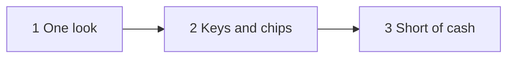
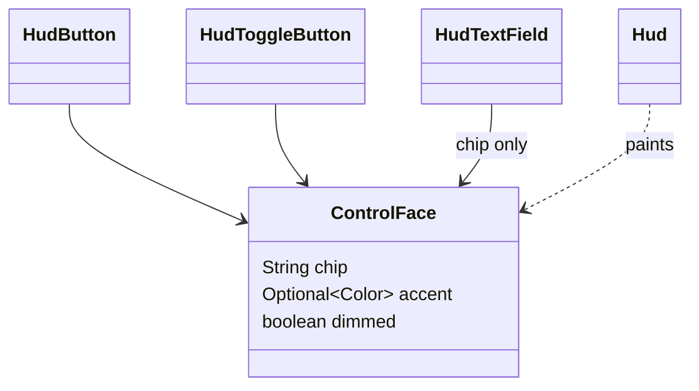

# Plan: Key hints and HUD unification

**Status:** in progress. Implements `docs/features/FEATURE-key-hints-and-hud-unification.md`; the accepted look is
the mockup linked there.

Three phases, one commit each, `mvn verify` green before every commit. The live `run-jtd` pass runs once, after
phase 3.

## Decisions

**D1. A control carries a `ControlFace`.** An immutable record on every `HudButton`/`HudToggleButton`: its key chip
(empty for none), an accent (empty for a neutral button, the tower colour for a tile) and whether the tile is dimmed.
`Hud.paintControl` paints both kinds from it: a button square with the neutral border, a tile with 7 px corners and
the accent border. *Rejected:* client properties (stringly typed), a subclass per kind (both kinds exist as push and
toggle buttons).

**D2. A chip reads the binding its key runs.** Tower tiles read `TowerFactory.Type.placementKey`, upgrade nodes
`UpgradeTree.keyOf`, both already what the key handler reads. The game's other keys are one enum, `GameKey` (key
code and chip label), which `TowerDefense` dispatches on and panels label chips from. A dev shortcut is bound
together with the control it presses (`PanelDev.bind(..., control, ...)`), and the chip comes from the stroke.

**D3. A purchase refused for cash is an economy event.** `EconomyListener.paymentRefused()` (a default no-op)
fires when `EconomyLedger.doPay` refuses, so every refusal (a tower, an upgrade, by click or key) reaches the header
without the callers knowing about it. `StatusFlash` flashes cash on it. The engine stays headless.

**D4. The placing ghost knows its price.** `Cell` carries the price beside the range it shows; the frame build
compares it with the credits, so the ghost turns "can't afford" and back without the pointer moving.

**D5. Alt reveals dev chips through the frame's key dispatcher.** While the dev panel shows, a bare Alt press shows
its chips and the release hides them; both are consumed, so the platform's Alt handling never moves the focus. A
window losing focus hides them too, since its Alt release never arrives.

**D6. The speed strip is a radio driven by the loop.** Four `HudToggleButton`s; a click only reports, and
`TowerDefense.setSpeed` selects the one matching the speed (none for a dev-dialled rate). Space presses ❚❚; ❚❚
resumes at the last play speed and sends a ready wave when paused or between waves, and pauses otherwise.

**D7. Space and Delete are read on key press.** Delete types no reliable character, so non-character keys go
through a frame `keyPressed`; characters stay on `keyTyped`.

**D8. Level cards take digits through `PanelLevelSelect.startByKey`**, which `TowerDefense` calls while the menu
shows.

**D9. `GameEngine.debugSpawnNextCatalogEnemy` goes with the bare `x` key**, and its tests with it.
`debugGrantCredits` stays: the harnesses use it.

## Phases

1. **One look.** `ControlFace`, tile and button painting, hover border, selected border; tower tiles with accent
   border and price under, never greyed; the tree's neutrals and hover; level cards on Hud neutrals with hover.
2. **Keys and chips.** `GameKey`; chips on every game control, inside the tree's node corners, on level cards;
   dev chips on Alt and ↵ on a focused field's button; the four-button speed strip; Space, D F G, Delete, the menu
   button, Enter in `ConfirmPopup`, M on the overlay, 1-9 on the menu; p, s, the f cycle, n, x, c retired;
   `TooltipLayer` for the speed buttons and Pin line; welcome text, shop sheet, README, run-jtd docs.
3. **Short of cash.** Unaffordable towers pickable; placing stays on after a refusal; the cash flash; the ghost's
   "can't afford" tint.

## Verification at the end (live, once)

- Holding Alt with a dev field focused shows the chips and leaves the caret in the field.
- Space and Delete do nothing while a dev field has focus, and act on the board otherwise.
- A refused placement flashes cash and keeps placing; the next click after cash arrives builds.
- Screenshots of the HUD at rest, a tile hovered, and the menu.
