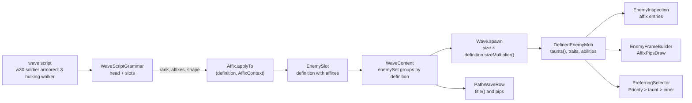

# Plan: Enemy affixes (`docs/features/shipped/FEATURE-enemy-affixes.md`)

**Status:** planned 2026-11-09. Not started.

## How to use this plan

Read sections 1 to 4 once, then do the phases of section 5 in order, one commit each.

- One phase is one commit with the subject line it gives. `mvn verify` is green before every
  commit, and the docs a phase names change in the same commit.
- Rename types, methods and fields with the IDE's `rename_refactoring` while the IDE is open. Ids
  inside string literals are not symbols: they move with the migration script of phase 2.
- Names in this plan are final. A step that cannot be done as written stops and asks; it does not
  invent another mechanism.
- Numbers an affix uses are first values, written straight into its row. They are content:
  `BalanceReport` judges them later, and no phase runs a detailed balance pass. A phase that
  changes how existing content plays (only phase 4, which must not) says so.
- Tests: mechanics on fixture definitions (`EnemyFixtures`, a test catalog), never a built-in
  entry's numbers or wording. A test about what a phase changes is rewritten in that phase; any
  other test is touched only where an id it names moved.
- Phases 6 and 8 touch per-tick or per-frame code and end with `td.PerformanceHarness` (and
  `zones`). Fix the cost, never the budget.

## 1. Decisions

Product decisions are in the feature request. These are the design decisions it left to the
plan: what, why, what was rejected. They are not reopened during implementation.

### D1. An affix is one row of a closed enum, `td.enemy.Affix`, that is also a `Term`
- **Decision:** `public enum Affix implements Term` in `td.enemy`, ten rows in the feature's
  order. A row holds its script word, its title, its sentence, its board glyph's key (the term
  key, `affix.<name>`) and how it changes a definition. Content assembled from existing mechanics
  lives in the row; a mechanic with maths of its own (Exalted's doubling, the share-of-health
  numbers) is a small named method or class beside it.
- **Why:** a closed set the grammar, the inspector, the board and the wording test all switch
  over; `Term` gives the info pane, tooltips and mentions for free (the same path `TraitTerm`
  takes). `td.enemy` owns it because every row changes an enemy definition.
- **Rejected:** a sealed interface with a record per affix (ten classes for data rows); putting it
  in `td.wave` (it would have to reach into `td.enemy` internals for every row).

### D2. The definition carries its affixes; the name is derived
- **Decision:** `EnemyDefinition` gains `List<Affix> affixes` (empty from `of`), set only through
  `withAffix(Affix, AffixContext)`, which applies the row and records it. `displayName` stays the
  noun. A new derived `title()` is the affix titles in written order, then the noun ("Hulking
  Taunting Walker"); the info pane, the wave preview and tooltips read `title()`.
- **Why:** an affixed enemy is a different enemy for every reader (the preview groups by
  definition, the pane names it, the board marks it), and none of them should re-apply affixes.
  Derive, don't store: the name never drifts from the list.
- **Constraint changed:** `td/enemy/CLAUDE.md`'s "Spawn-time variation is a new template, never a
  new `EnemyDefinition` component" stays true: affixes are authored, resolved when the script is
  parsed, not when a mob spawns. The line gains "an affix is authored, and the definition carries
  it".
- **Rejected:** affixes on `EnemySlot` and a new `DefinedEnemyMob` constructor argument (the
  wave preview reads definitions, not mobs, and every mob constructor caller would change).

### D3. What an affix measures against
- **Decision:** `Affix.applyTo(EnemyDefinition, AffixContext)` with
  `record AffixContext(Rank rank, int memberHealthPoints)`. `memberHealthPoints` is the health one
  member of the slot is sent with (definition health over its divisor, times the shape's health
  multiplier), computed by the grammar from the slot it is building. Share-of-health affixes
  (Regenerating, Shielded, Withered) turn their share into points from it, so a swarm member
  regenerates what its own health is worth. Rank affixes (Elusive, Commanding, Vengeful) read
  `rank`.
- **Order:** rows apply in enum order, Hulking first, so the others measure the hulking health.
  The title keeps the written order.
- **Rejected:** a trait that reads max health per tick (a new `TraitContext` component and a
  per-tick cost for a number fixed at spawn).

### D4. Hulking's size travels with the definition
- **Decision:** `Affix` has `float sizeMultiplier()` (1 for all but Hulking);
  `EnemyDefinition.sizeMultiplier()` is the product over its affixes, and `Wave` multiplies it into
  the shape's size when it builds `SpawnParameters`. Health and speed are definition fields the row
  scales directly.
- **Rejected:** writing size into the slot's `SpawnShape` (a shape is how a slot spawns, not what
  the enemy is: the confusion `plated` had).

### D5. The script head is split off before the grammar runs
- **Decision:** the cursor splits a token ending in `:` into the word and a `:` token, so
  `w30 soldier armored:` and `w30 soldier armored :` read alike. If any `:` token exists, the first
  is the head's end: `head := spacing? rank? affix* ':'`. Anything else before it fails at that
  token ("a head holds only w<n>, a rank and affixes"). A second `:` fails. A `w<n>` outside a head
  fails, with a hint to end it with `:`.
- **Grammar** after this plan:
  ```
  script := head? item*
  head   := spacing? rank? affix* ':'
  item   := count* rank? count* (shape count*)? affix* (enemy | 'e')
  ```
- **Rejected:** a separate head string on `WaveDefinition` (two formats for one wave; the dev
  panel's spawn box would need a second field).

### D6. The default rank: Grunt for level waves, the dev panel's choice for its spawn box
- **Decision:** `WaveDefinition` loses `rank`; `WaveScript.parse(script, catalog)` reads level
  waves with Grunt under a head without a rank. `WaveScript.parse(script, fallbackRank, catalog)`
  stays for the dev panel, whose rank chooser is the fallback, and for tests that pass a rank.
- **Why:** the head is the only place a level wave's rank is written, as decided; the dev panel's
  chooser is a second, real user of a fallback, and keeping the overload spares the test churn.
- **Rejected:** dropping the dev panel's rank chooser (a product change nobody asked for).

### D7. Validation lives in the grammar, the reasons in `Affix`
- **Decision:** `Affix.problemWith(EnemyDefinition)` returns `Optional<String>`: Exalted on an
  enemy with no base stat off its default. The grammar adds the slot-level rules: more than two
  affixes (head and slot together), the same affix twice, Regenerating with Withered, any affix on
  a unique enemy. Each fails at the offending token through `Cursor.fail`, so the dev panel's check
  shows it like any other script error.
- **Reserved words:** the affix words join `WaveScript.RESERVED_TOKENS`, so
  `EnemyCatalog.register` rejects an id that collides with one (which is why phase 2 frees
  `armored`).

### D8. Exalted doubles the distance from the default
- **Decision:** for every base stat but `MOVE_SPEED` (health is not a stat), the new base is
  `default + 2 × (base − default)`. A stat at its default is untouched; a damage-taken stat below
  1 falls further. Traits and abilities are untouched. Past a stat's ceiling it does nothing more,
  and a negative stat doubles against the enemy: both are the accepted risk in the feature.
- **Rejected:** `base × 2` (doubles a damage-taken 0.8 to 1.6, which weakens the enemy).

### D9. Taunting is a definition fact read by targeting
- **Decision:** `EnemyTarget` gains `boolean taunts()`; `DefinedEnemyMob` answers
  `definition.affixes().contains(Affix.TAUNTING)`. `PreferringSelector.priority(inner)` becomes
  "Priority first, else a taunter, else `inner`": two nested preferring steps built in the one
  factory, so every single-target tower gets it and no tower changes. Invisible enemies are
  filtered before, as today.
- **Rejected:** putting the `PRIORITY` effect on the taunter (timed, shortened by tenacity, adds
  damage taken, reads as the player's mark); a new stat (a sheet row for a yes/no fact).

### D10. Commanding and Vengeful are abilities, so the support ring comes free
- **Decision:** Commanding is a periodic `ApplyEffectAction` on a `RadiusTarget` of a new kind,
  `EffectKind.RALLIED` ("Rally", `BUFF`, `helpsCarrier`, `stackingOnASharedClock`, each stack
  lowering physical and magic damage taken), through a new `RallyTemplate(stacks, durationTicks)`
  like `SpellproofTemplate`. Its stacks come from rank. The duration outlasts the period, so an ally
  in reach stays Rallied and loses it soon after the Commander dies or walks away. Vengeful is an
  `OnDeathTrigger` with `ApplyEffectAction(new SprintTemplate(durationTicks), new RadiusTarget(r))`,
  the duration from rank. Both rings come from `EnemyDefinition.supportAura()` as they are.
- **Ability terms:** `AbilityTerm.COMMAND` ("Command", "lowers the damage the allies near it
  take") and `AbilityTerm.VENGEANCE` ("Vengeance", "sends the allies near it into a Sprint as it
  dies"). If `TermWordingTest` rejects a title as taken, stop and ask.

### D11. The board glyph
- **Decision:** one pip per affix, in written order, in a row beside the rank badge, drawn by a
  new `AffixPipsDraw(x, y, size, alpha, List<Affix>)` overlay record in `td.ui.render` that the
  painter fills with each affix's pictogram (a new `AffixPictograms` table, monogram until its art
  exists) in one signal colour, **Affixed**. The colour is chosen in phase 8 by `docs/UI.md` §7
  from the open mint and teal hues, and added to its signal table in that commit. A shape tells the
  affixes apart, so colour is never the only signal.
- **Board noise:** pips are the badge's size class, hidden while the enemy is hidden, and drawn in
  the badge pass so they stay readable over effects. Checked with `PreviewEnemy` on a swarm before
  the commit.

## 2. Design

### Where an affix goes, from the script to the screen



### What each affix is made of

| Affix | Built from | New code |
|---|---|---|
| Hulking | `baseHealth` ×, `baseSpeed` ×, `sizeMultiplier` | `sizeMultiplier` on `Affix` and the definition |
| Armored | `AdaptiveResist.against(PHYSICAL, …)`, anonymous trait, moved from `SpawnShape` | none |
| Elusive | agility added to the base, by rank | none |
| Exalted | every base stat, D8 | `Affix.exalt` |
| Regenerating | `RegenerationTrait` worth a share of member health | none |
| Shielded | `HealthThresholdTrigger` + `ShieldTemplate`, worth a share of member health | none |
| Withered | `baseSpeed` × and `CrumbleTrait` worth a share of member health | none |
| Commanding | periodic `ApplyEffectAction(RallyTemplate, RadiusTarget)` | `RALLIED`, `RallyTemplate`, `AbilityTerm.COMMAND` |
| Vengeful | `OnDeathTrigger` + `SprintTemplate` on a `RadiusTarget` | `AbilityTerm.VENGEANCE` |
| Taunting | `EnemyTarget.taunts()` | the preferring step |

Abilities and traits an affix adds are anonymous, so they stack with the enemy's own and never
replace a named rank step (Shielded beside a Knight's Brace is two shields; the Knight's is
physical-only, the affix's is not).

### The rename (phase 2)

An id is the display name in lower camel case without "The". Unlisted ids already follow it.

| Old id | New id | New name, where it changes |
|---|---|---|
| `simple` | `walker` | Walker (was Simple mob) |
| `armored` | `knight` | Knight (was Armored mob) |
| `armoredSpawn` | `squire` | Squire (was Armored Reinforcement) |
| `fast` | `runner` | Runner (was Fast mob) |
| `fastSpawn` | `frenzySpawnling` | |
| `ghost` | `ghost` | Ghost (was Ghost mob) |
| `mender` | `mender` | Mender (was Mender mob) |
| `miteBrood` | `miteBroodling` | |
| `titan` | `juggernaut` | |
| `lizard` | `salamander` | |
| `shield` | `shieldbearer` | |
| `dodger` | `skirmisher` | |
| `hiveguard` | `hiveGuard` | |
| `nurse` | `broodNurse` | |
| `bull` | `bronzeBull` | |
| `echo` | `mirrorImage` | |
| `drop` | `raindrop` | |
| `cloud` | `raincloud` | |
| `sentinel` | `glassSentinel` | |
| `reaver` | `sandReaver` | |
| `keeper` | `keeperOfHours` | |
| `colossus` | `ironColossus` | |
| `warden2` | `weakenedWarden` | |
| `warden3` | `exhaustedWarden` | |
| `wardenEgg1` | `wardensFirstEgg` | Warden's First Egg (two eggs shared one name) |
| `wardenEgg2` | `wardensSecondEgg` | Warden's Second Egg |
| `wardenEgg3` | `wardensFinalEgg` | |

Classes: `SimpleEnemy` → `WalkerEnemy`, `ArmoredEnemy` → `KnightEnemy`, `FastEnemy` →
`RunnerEnemy`. `BodyArchetype` constants name looks, not enemies, and stay.

## 3. Dead code and tidy-ups found while planning

Each is removed in the phase named, with the reason in its commit body.

| What | Why it is dead or wrong | Removed in |
|---|---|---|
| `AbilitySpawnShape.traitOverride` and its composition in `AbilitySpawnFactory` | Every ability spawn passes `Optional.empty()`; no content sets it | 1 |
| The six-argument `AbilitySpawnShape` calls in `SpawnEnemiesAction`, `RiftLevel`, `StormTwinsEnemy` | Only there to pass the empty override | 1 |
| Stale ids in Javadoc (`ArmoredEnemy` "({@code s})", `MenderEnemy` "({@code m})", any other `{@code x}` id that no longer exists) | The one-letter ids are long gone | 1 |
| `SpawnShape.traitOverride`, `SpawnShape.armored()`, `ARMORED_*` constants, the composition in `Wave.spawnShaped` | Armored becomes an affix; nothing else sets a trait override | 4 |
| `ShapeKeyword.PLATED` and the "fixed member count" branch's message naming `plated` | The keyword goes | 4 |
| `WaveDefinition.rank` and its two-argument constructor | The head holds the rank | 3 |
| `EnemySlot`'s three-argument constructor | Only tests use it; the grammar always knows `unique`. Kept if phase 4's slot change makes it a fixture helper instead | 4 |
| `WaveScript.isShapeToken` / `takesMemberCount` | Check for callers outside `WaveScriptSuggestions` in phase 3; inline or keep as the suggestions' query, whichever leaves one owner of the format | 3 |

Anything else found dead along the way: removed in the phase that touches it when it is local,
else one entry in `TODO.md` with **Where** and **Approach**.

## 4. Docs every phase keeps true

`README.md` (enemy table, "Spawn shapes", "Wave script ids", the wave-script prose, any enemy name
in level text), `src/main/java/td/wave/CLAUDE.md` ("Wave script"), `src/main/java/td/enemy/CLAUDE.md`
("Model", "Traits and abilities", "Display"), `docs/ARCHITECTURE.md` where it names a changed type,
`docs/DESIGN.md` where an example names a renamed type, `docs/UI.md` (phase 8's colour). Shipped
feature requests and plans are history and stay as written.

## 5. Phases

### Phase 1. Remove the unused trait override from ability spawns

Commit: `Remove the unused trait override from ability spawns`

1. Drop `traitOverride` from `AbilitySpawnShape` and the composition in `AbilitySpawnFactory.build`.
2. Fix the callers the compiler names; fix the stale `{@code}` ids in enemy Javadoc.
3. No test changes beyond what names the removed component.

### Phase 2. Name every enemy with a noun and make its id its name

Commit: `Name every enemy with a noun and make its id its name`

1. IDE-rename the three classes (section 2).
2. Change ids and display names in the definitions, every `SpawnEnemiesAction` id, every
   `ranked("…")`/`cloneAs("…")`, `TowerLab.PLAIN`.
3. Migrate string literals with a scratchpad script: a literal is a wave script if every token is
   a count, a rank or shape keyword, `e`, `w<n>` or an old id, and has at least one id; its old ids
   become new ones. A literal that is exactly an old id changes too. Every other literal is left,
   and the diff is read hunk by hunk (`"shield"` and `"drop"` are ordinary words too).
4. `plated armored` becomes `plated knight` (the keyword still exists until phase 4).
5. README: the enemy table, "Wave script ids" (one row per new id), level prose ("on the Simple's
   ladder", "a Fast mob cast in bronze" → the new nouns). Enemy CLAUDE.md examples.
6. Tests: only ids in literals move. `EnemyFixtures.simpleDefinition` names a fixture, not
   content, and stays.

### Phase 3. Move a wave's default rank into its script head

Commit: `Move a wave's default rank into its script head`

1. `WaveScriptGrammar`: the `:` split (D5), `head := spacing? rank? ':'` (affixes come in phase 4),
   `w<n>` only in a head, the errors of D5. `WaveContent` is unchanged: the head's rank is applied
   while slots are built.
2. `WaveScript.parse(script, catalog)` and the fallback overload (D6); the class Javadoc states the
   grammar once.
3. `WaveDefinition` loses `rank`: `WaveDefinition(String enemies)` plus the existing `withX`.
   `GameEngine`, `RandomPlayInvariantTest` and every level move to the two-argument parse.
4. Migrate every `new WaveDefinition("…", Rank.X)` with a script: Grunt drops the argument, any
   other rank becomes the head's rank; an existing leading `w<n>` joins the head
   (`"w30 3 c", Rank.SOLDIER` → `"w30 soldier: 3 c"`, `"w30 3 c", Rank.GRUNT` → `"w30: 3 c"`).
   Remove `Rank` imports that become unused.
5. `WaveScriptSuggestions`: offer `:` after a head's last word and the head's words before it;
   never offer `w<n>` after the head.
6. Tests (`WaveScriptTest`): a head's rank is every slot's default; a slot's rank beats it; no head
   is Grunt; `w<n>` without `:` fails at that token; two `:` fail; a slot word before `:` fails.
   Suggestions: `:` is offered after `w30 soldier`.
7. Docs: wave CLAUDE.md "Wave script", README's wave-script prose.

### Phase 4. Turn plated into the Armored affix

Commit: `Turn plated into the Armored affix`

The affix model, the grammar for affixes, and one row. Iron Crossing must play exactly as before.

1. `Affix` (D1) with the `ARMORED` row only: the `AdaptiveResist` numbers move from `SpawnShape`
   unchanged. `AffixContext` (D3). `Term` key `affix.armored`; title "Armored"; sentence from
   `AdaptiveResist`'s own wording.
2. `EnemyDefinition.affixes`, `withAffix`, `title()`, `sizeMultiplier()` (D2, D4). Every `withX`
   copy passes the new component.
3. Grammar: `affix*` in the head and right before the id; the D7 rules; the affix words reserved.
4. Remove `PLATED`, `SpawnShape.traitOverride` and the rest of section 3's row; `Wave` multiplies
   `definition.sizeMultiplier()`. Iron Crossing: `plated knight` → `armored knight`.
5. `EnemyInspection.name` reads `title()`. The info pane needs no other change yet: the Armored
   row's trait already shows as Adaptation.
6. Tests: the affix is applied and recorded (`WaveScriptTest` on a test catalog); head affixes add
   to slot affixes; a third affix, a repeat, an affix on a unique enemy and an affix word as an id
   each fail; `title()` follows the written order. Rewrite `SpawnShapeTest`'s armored tests and
   `WaveTest`'s plated tests as affix tests on fixtures; delete the ones about `traitOverride`.
7. Docs: README "Spawn shapes" loses `plated`, gains an "Affixes" section (the table of section 2,
   one line each, player-facing), wave and enemy CLAUDE.md.

### Phase 5. Add the stat and trait affixes

Commit: `Add the Hulking, Elusive, Exalted, Regenerating, Shielded and Withered affixes`

1. The six rows. Exalted's `exalt` (D8) and its `problemWith`; Regenerating with Withered fails
   in the grammar.
2. Tests on fixture definitions, one behaviour each: Hulking scales health, speed and size; a
   share-of-health affix measures the member's health (a swarm member regenerates its own share);
   Hulking applies before them; Exalted doubles the distance from default and leaves speed;
   Exalted on an all-default fixture fails; Shielded raises its shield below half; Withered's
   crumble kills a fixture left alone.
3. README "Affixes".

### Phase 6. Add the Commanding and Vengeful affixes

Commit: `Add the Commanding and Vengeful affixes`

1. `EffectKind.RALLIED`, `RallyTemplate` (add it to `EffectTemplate`'s `permits`), its pictogram
   row in `EffectPictograms` (monogram is acceptable until art), `AbilityTerm.COMMAND`,
   `AbilityTerm.VENGEANCE`. Every exhaustive switch the compiler names.
2. The two rows (D10).
3. Tests: an ally beside a Commander takes less damage and loses it after the Commander dies; an
   ally beside a dying Vengeful enemy Sprints, one out of reach does not; `supportAura()` reports
   both radii.
4. `td.PerformanceHarness` and `zones` (radius casts per tick).

### Phase 7. Add the Taunting affix

Commit: `Add the Taunting affix`

1. `EnemyTarget.taunts()`, `DefinedEnemyMob`, `FakeEnemyMob` (a settable fact), the row.
2. `PreferringSelector.priority` nests Priority over the taunt (D9); its Javadoc says so.
3. Tests (`PreferringSelectorTest` or its neighbour): a taunter in range wins; a Prioritised enemy
   beats a taunter; with neither, the inner selector decides. One `GameEngineTest` that a real
   single-target tower shoots a taunting fixture over a nearer plain one, for the wiring.

### Phase 8. Show affixes in the info pane, the wave preview and on the board

Commit: `Show enemy affixes in the info pane, the wave preview and on the board`

1. `EnemyInspection` gains `List<Affix> affixes`; the enemy pane lists them as term rows (icon and
   sentence) above the traits, through the same row code traits use.
2. `PathWaveRow`: an affixed enemy's swatch carries its pips and its tooltip reads `title()` with
   one line per affix.
3. `AffixPipsDraw`, `EnemyFrameBuilder` beside `badge`, the Java2D painter; `AffixPictograms`
   art for the ten (24-unit grid, like the other tables); the **Affixed** signal colour in
   `docs/UI.md` (D11).
4. `PreviewEnemy`: a Walker with two affixes at Grunt and at Boss, and a `swarm 12` of affixed
   Mites; read the images before committing.
5. Tests: the inspection carries the affixes in written order; the frame builder emits one pip per
   affix and none for a plain enemy; a hidden enemy draws none.
6. `td.PerformanceHarness` (frame build, allocation).

### Phase 9. Close the feature

Commit: `Mark the enemy affixes feature shipped`

1. Read the feature request against what shipped; fix any gap or record it in `TODO.md`.
2. One live `run-jtd` pass: the dev panel's spawn box with a head and affixes (an error marks the
   token), an affixed enemy's pane and tooltip, the wave preview on Iron Crossing.
3. Move the feature request to `docs/features/shipped/` and this plan to `docs/plans/shipped/`;
   remove its `TODO.md` "Feature ideas" line (the deferred affixes stay).

## 6. Verification at the end

What no test can assert, checked once in phase 9: the pips read at a glance and don't clutter a
swarm (seen in `PreviewEnemy`, then live), the pane's affix rows fit the 184 px pane, the dev panel's
error marks the right token as it is typed, and the preview tooltip reads naturally.
