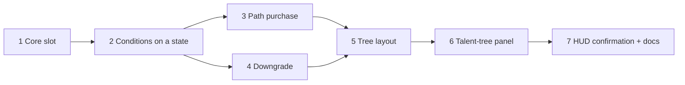
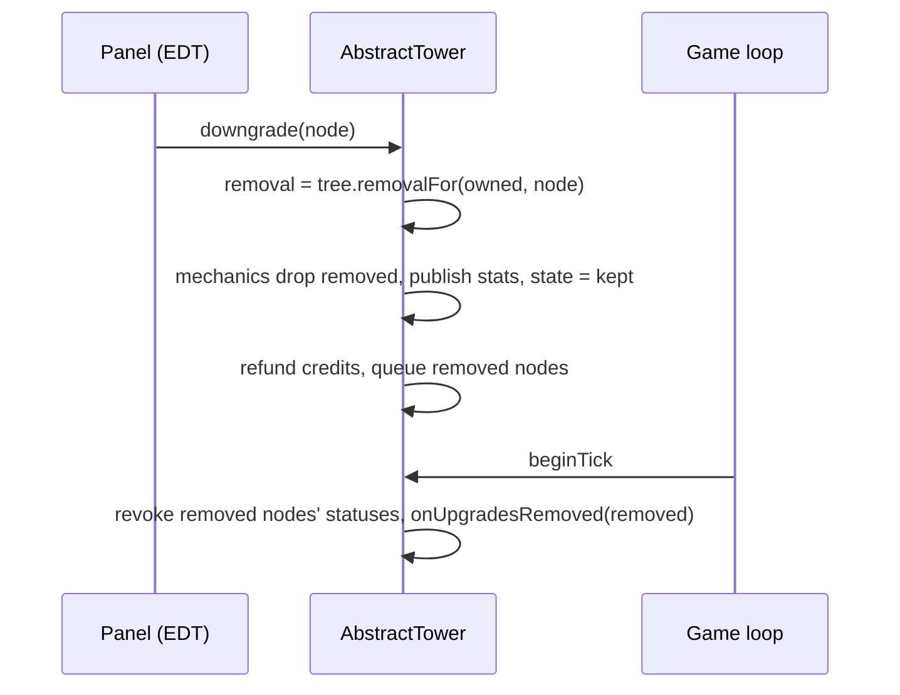
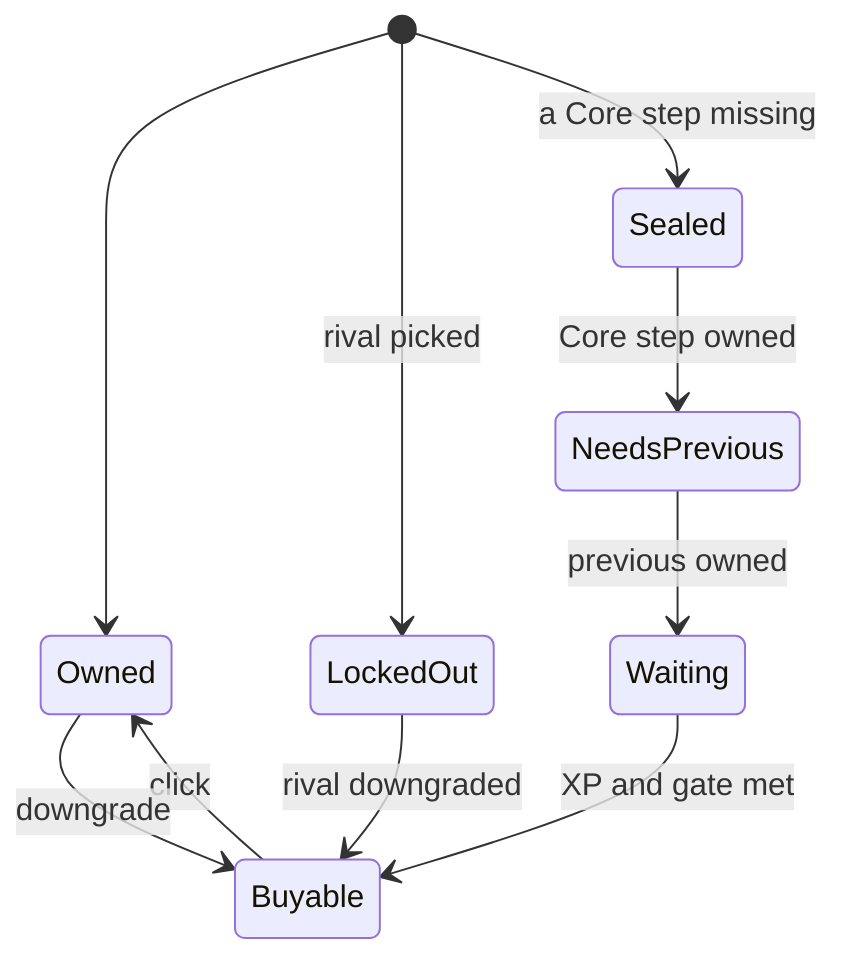

# Plan: Tower Upgrade Visual Revamp

**Status:** implemented, 2026-10-24. Implements `docs/features/FEATURE-tower-upgrade-visual-revamp.md`;
the accepted look is the mockup canvas linked there.

Seven phases, one commit each, `mvn verify` green before every commit. The live `run-jtd` pass runs
once, after phase 7.

## Decisions

**D1. Core ids stay `base.attune`, `base.awaken`, `base.transcendent`.** Saves store node ids; renaming
would need an alias table for no player-visible gain. `StandardBaseSlot` keeps its name and builds both
shared slots. *Rejected:* `core.*` ids with a migration.

**D2. Slot order is `CORE, BASE, HEAD, SPECIAL`.** Declaration order is pip and offer order; the chain
was first inside `BASE`, so Core first keeps every list in the same order as before.

**D3. A condition is judged against an `UpgradeState`, not only the tower's live one.** Paths and
downgrades must ask "would this hold if these nodes were owned?". `UpgradeCondition` gets
`isSatisfied(tower, owned, context)` as its one abstract test; the two-argument form becomes a default
that passes `tower.upgrades()`. Callers stay as they are. *Rejected:* a proxy `Tower` with substituted
upgrades (the interface is wide and every new method would need forwarding).

**D4. What a condition still needs and whether it can ever be met are questions on the condition.**
`missingNodes(tower, owned, context)` (an `or` takes a side that is met, else the fixable side with
fewer nodes) and `lockedOut(nodeLocked)` (an `owns` is locked when its node is; `and` when either side
is, `or` when both are). The tree combines them with its choices; no caller walks condition records.

**D5. A path is planned in the model, bought in one call.** `UpgradeTree.planPath` simulates the steps
in buy order on a growing state and returns an `UpgradePath`: steps, total, the first block and what it
locks out. `Tower.buyPath(target)` pays the total with one `doPay` and owns every step, or does nothing.
A path never takes an exclusive member off the target's own line: that is a `CHOOSE_FIRST` block.

**D6. A downgrade is a replay.** `UpgradeTree.removalFor(owned, node)` replays the owned nodes in
purchase order without `node`, dropping each whose prerequisites or choice now fail. The refund is the
drop in sell price (`getSellPrice()` before minus after), so downgrading then selling pays exactly what
selling would have.

**D7. Removing mechanics keeps the survivors' instances.** `OwnedMechanics` remembers which node
brought which mechanic and drops only those, so a kept mechanic's counters survive. What a tower holds
outside its mechanics (statuses a removed node's procs granted, a nest, an aim focus, a bracket) is
cleared on the game loop at the start of the tower's next tick, through `onUpgradesRemoved`.

**D8. The layout comes from the keys.** `UpgradeTreeLayout` (in `td.ui`) places a node from data the
tree already has: Core on the spine by level, Base's Range line by level, Head rows by the key of the
line's first node (4, 5, 3 top to bottom), a level IV in a two-member choice on a fork, specials
centred on the halo in declaration order. Coordinates are the mockup's, in design units of a 300x420
panel, scaled to the real size, so node size follows the space (D9). Two nodes on one place, or more
than six specials, throw; a rule test lays out every built-in tower, and the panel lays a tree out the
first time it shows it. *Rejected:* a layout check in the
`UpgradeTree` constructor (test fixture trees of loose nodes would all have to change).

**D9. Node size adapts at runtime** (open question 1): the design scales by `min(w/300, h/420)`, never
up past 1.15, so the tree always fits and grows where the panel is larger. The preferred height is 420.

**D10. Specials keep keys 6-8 per set, and the halo shows no digits** (open question 4), as the mockup.

**D11. Core pictograms:** Attune keeps its gem; Awaken gets an open eye, Transcendent a crown, the
mockup's shapes. Badges reuse them at 10 px.

**D12. One HUD popup, `ConfirmPopup`, serves the downgrade and the abandon-level confirmations.** It
sits on the frame's popup layer; Esc, a click outside it, or `close()` from its owner cancels. The
abandon dialog keeps pausing the game while it is open.

## Phases

1. **Add the Core slot** — `UpgradeSlot.CORE`; Attune, Awaken, Transcendent tiers in `CORE`; `keyOf`
   (`CORE` → 1, `BASE` → 2); `artNodeOf` gives a Core node its own art; palette `TOWER_UPGRADE_CORE`
   (127, 212, 255); pip group and chevron; the Transcendent diamond keyed on Core; slot header text;
   Awaken and Transcendent pictograms. Tests naming `BASE` for chain nodes move to `CORE`. README and
   `td/tower/CLAUDE.md`.
2. **Judge conditions on a state** — D3 and D4, `UpgradeTree.isLockedOut`, `sealedBy`. Unit tests on
   fixture trees.
3. **Buy a path** — `UpgradePath`, `UpgradeTree.planPath`, `Tower.buyPath`. Tests: a path buys every
   step and charges the total once; a blocked step or short cash buys nothing; a path never picks a
   rival off the line.
4. **Downgrade** — `UpgradeState.without`, `UpgradeTree.removalFor`, `OwnedMechanics.remove`,
   `Tower.downgrade`/`refundFor`, `onUpgradesRemoved`, statuses revoked. Tests: cascade, the later
   special goes, a choice reopens, refund equals the sell-price drop, a removed node's mechanic and
   status are gone, kept mechanics keep their state.
5. **Lay the tree out** — `UpgradeTreeLayout`, its rule test over every built-in tower.
6. **The talent-tree panel** — `PanelUpgradeTree` rewritten as one painted component: rook, links,
   forks, nodes in their looks, prices, digits, badges, rings, XP line, footer; hover sheets with the
   path and downgrade sections; click buys the path, right-click asks to downgrade. `TooltipLayer`
   refreshes an open spot tooltip. Old `ChoiceBracket`, `UpgradeOffer` button text go.
7. **HUD confirmation** — `ConfirmPopup`; downgrade confirmation; the abandon-level dialog moves to it.
   `td/ui/CLAUDE.md`, README, `TODO.md`, the feature doc's status.

## Verification at the end (live, once)

- The Sniper tree fits the real panel without clipping; node size as measured.
- Hover, click and right-click land on the node under the pointer; footer text swaps.
- The confirmation opens beside the node, Esc and an outside click cancel it.
- The abandon dialog opens in the HUD look and pauses the game.
