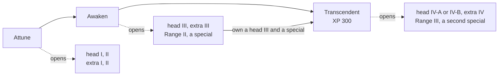

# jTD 1.5 — state of the game

Released 2026-11-10, tagged `v1.5`. This is a frozen snapshot of everything the game does at
this version: its rules, its content and how it is built. Later versions change the code, not
this file. The living references are `README.md` (content tables), `CLAUDE.md` (constraints),
`docs/ARCHITECTURE.md` (the system as it is now), `docs/DESIGN.md` and `docs/adr/` (how and why
it is shaped), `docs/features/` (feature designs) and `TODO.md` (gaps).

Every number here is a named constant in the code, read off the 1.5 build. `TODO.md` treats most
of them as unbalanced placeholders.

## Contents

1. [The game](#1-the-game)
2. [What changed since 1.4](#2-what-changed-since-14)
3. [Game flow](#3-game-flow)
4. [Economy and XP](#4-economy-and-xp)
5. [Towers](#5-towers)
6. [Tower upgrades](#6-tower-upgrades)
7. [Combat model](#7-combat-model)
8. [Status effects and tower terms](#8-status-effects-and-tower-terms)
9. [Ground zones](#9-ground-zones)
10. [Enemies](#10-enemies)
11. [Waves, affixes and levels](#11-waves-affixes-and-levels)
12. [Interface and controls](#12-interface-and-controls)
13. [Playtesting and developer tools](#13-playtesting-and-developer-tools)
14. [Technical architecture](#14-technical-architecture)
15. [Build, quality gates and release](#15-build-quality-gates-and-release)
16. [Known gaps at 1.5](#16-known-gaps-at-15)

---

## 1. The game

jTD is a single-player desktop tower-defense game in Java and Swing. Enemies walk one or more
fixed paths across a grid board. The player spends credits on towers placed on the cells beside
the paths and tries to kill every enemy before it reaches a path's end, where it costs a life.

- Six built-in levels, each on a ground of its own; eight towers, one of which (the Burst) forks
  into two named variants; 14 built-in enemy types (and four more they only spawn) plus 35 level-authored ones,
  among them eight bosses; five enemy ranks; 18 affixes; 45 status effects; ten kinds of ground
  zone; two damage types.
- Every tower has a four-slot upgrade tree (Core, Range, Head, Special) drawn as a talent tree.
  Nodes are bought with credits and unlocked by XP the tower earns from the enemies it reaches, and
  some by a purpose gate: a count of what the tower has done with its own mechanic.
- All artwork is vector, drawn in code. There are no image assets.
- The simulation is deterministic given a seed, and fully headless: tests, the balance report and
  the harnesses drive the same engine the window does. A game between waves can be saved as text.

## 2. What changed since 1.4

1.5 is the tower and enemy rework: some 500 commits between the tags.

- **Every tower rebuilt** around one identity mechanic, and renamed for display: Sniper (Steady
  Aim), Burst (Saturation, forking into the Stormcaller or the Hexer), Mortar (Bracketing, shell
  types), Scorcher (Stoke, Soulfire), Hive (the Nest), Radar (Ping), Obelisk (a kill-box field with
  Toll) and Beacon (Kinship). The code and every node id keep the old names (Splash, Cinder, Seeker,
  Sonar, Pulse, Aura).
- **Upgrade trees** gained the Core chain Attune → Awaken → Transcendent, a level IV head, an extra
  line, two special slots, XP gates and purpose gates in place of kill and damage gates, buying a
  node with every node it needs in one payment, and downgrades.
- **Stats** for towers and enemies alike resolve through one generic stat sheet; tower fire rate is
  additive attack speed with fractional cadence. Agility and dodging, tenacity, spirit, insulation,
  regeneration (and crumbling) are enemy stats.
- **Effects** grew from 11 to 45, in groups (control, affliction, weakness, mark, hex, boon), plus
  tower terms; every term has one wording shared by every panel and hover.
- **Ground zones**: patches a shot or an enemy leaves that keep working.
- **Enemies**: Simple, Armored and Frenzied renamed Walker, Knight and Runner; nine new built-in
  types (Relay, Juggernaut, Mite, Courier, Salamander, Magma, Golem, Yeti, Skirmisher); 18 affixes,
  the Jammer among them as Jamming; bosses that take every life when they leak.
- **Levels**: Curly Path, Zigzag Path and Twisted Hourglass reworked into The Amber Hive, The Storm
  Ridge and The Last Hour; The Rift, Iron Crossing and The Labyrinth added; per-round clear bonuses.
- **Tooling**: the dev panel, save and load between waves, restarting a wave from its checkpoint,
  the balance report with headless players and a tower lab, the wave check report, the purchase and
  build harnesses, JFR profiling in the performance harness, and on-demand PIT mutation testing.
- **Docs**: `docs/DESIGN.md`, 22 architecture decision records and `docs/UI.md`.

## 3. Game flow

1. **Level select.** The game opens on a menu with one card per level showing a path preview,
   the wave count, starting credits and starting lives. A click or the level's number key
   (`1`-`9`) starts it.
2. **Build phase.** Nothing moves until the player sends the first wave. The player places towers
   and buys or downgrades upgrades at any time, between waves or during one.
3. **Rounds.** A round spawns every path's wave for that index together. Waves never
   auto-advance: the player sends each one, once every enemy of the round before is dead or has
   leaked. A round cleared with no enemy leaked pays the level's clear bonus, if it has one.
4. **Restart.** `z` puts the game back to how it was when the last wave was sent (after a
   confirmation): the engine keeps a save of each wave as it is sent.
5. **Outcome.** The level is **lost** the moment lives reach zero, checked before the win, so a
   last enemy leaking the last life loses. A boss leaking takes every life, so a boss that escapes
   loses the level whatever lives are left. It is **won** when the final round is cleared.
6. **Back to menu.** `m` returns to the menu at any time (with a confirmation mid-level).

The game ticks 20 times a second at normal speed. Speeds: pause, normal, fast (×3.3) and super
fast (×16.7). The board keeps redrawing while paused.

## 4. Economy and XP

The ledger holds **credits**, **score** and **lives**.

| Event                            | Credits                                    | Score                      | Lives |
|----------------------------------|--------------------------------------------|----------------------------|-------|
| Level start                      | the level's starting credits               | 0                          | the level's starting lives |
| Buy a tower                      | − its current price                        | —                          | —     |
| Buy an upgrade                   | − node price (and every node it needs)     | —                          | —     |
| Sell a tower / downgrade a node  | + refund (below)                           | —                          | —     |
| Kill an enemy                    | + its bounty                               | + bounty × rank multiplier | —     |
| Round cleared with no leak       | + the round's clear bonus                  | + the same                 | —     |
| Enemy leaks                      | —                                          | − its bounty               | −1, or every life for a boss |

- **Copy pricing.** Each copy of a tower already on the board makes the next cost 25% more than
  the one before, compounding (the 10th copy costs about 7.5× the first). The shop shows the
  current price. Upgrade prices are multiples of the tower's list price, not its copy price.
- **Refunds.** What no wave has used yet (bought in the break still running) refunds in full; the
  rest refunds 75%. A downgrade takes a node back with every node that needs it, and asks for
  confirmation unless all of it refunds in full.
- **Rank score multipliers:** Grunt ×1.0, Soldier ×1.3, Veteran ×1.7, Elite ×2.2, Boss ×3.0.
- A buy is an atomic check-and-charge: it charges and succeeds, or does nothing. A path of several
  nodes is one payment or none.
- **XP.** When an enemy's walk ends, killed or leaked, every tower it came within reach of earns
  its bounty as XP. A Beacon earns with the towers it buffs, and its Kinship, Tutelage, Shared
  Lessons and Apprentice add to what they earn. **Tower ranks**, shown as silver diamonds beside a
  tower: Seasoned at 50 XP, Expert at 150, Hero at 300.

## 5. Towers

Range is in cells. Damage is in points per hit.

| Tower    | Key | Price | Damage                  | Type     | Range | Attack rate          | Aims at                                    |
|----------|-----|-------|-------------------------|----------|-------|----------------------|--------------------------------------------|
| Sniper   | `q` | 15    | 40                      | physical | 4.0   | 0.4 / s              | visible enemy furthest along its path      |
| Burst    | `w` | 15    | 14, with falloff        | physical | 3.2   | 1.0 / s              | random visible enemy                       |
| Mortar   | `e` | 30    | 32, with falloff        | physical | 4.5   | 0.28 / s             | furthest along, never within 1.5 cells     |
| Scorcher | `r` | 28    | 1.5 a tick, a 3 s burn  | magic    | 2.2   | 0.95 / s             | nearest visible enemy                      |
| Hive     | `t` | 30    | 40                      | magic    | 4.5   | 0.43 / s             | fastest enemy in range                     |
| Radar    | `y` | 20    | 16 per beam pass        | physical | 4.5   | one sweep per 3 s    | everything the beam passes                 |
| Obelisk  | `u` | 25    | 1 a tick (20 a second)  | magic    | 1.5   | every tick           | everything in its field                    |
| Beacon   | `i` | 20    | —                       | —        | 1.5   | passive              | other towers in range                      |

- **Sniper.** Single target, 5% crit chance, Crit damage 200%. Each shot adds a stack of Steady
  Aim, kept across targets and kills, that makes crits likelier; a stack fades 3 s after the last
  shot, one at a time. Its turret turns at a capped rate and holds its heading when idle.
- **Burst.** An instant blast (1.5-cell radius) on a random target, physical with falloff.
  Attuned, it aims at the most crowded group and Saturates what it hits. Forks into the
  **Stormcaller** (lightning Arcs past the blast) or the **Hexer** (every 4th shot casts a hex).
- **Mortar.** Lobs a slow, unguided shell (1.75-cell blast) that cracks the plating of everything
  it reaches; a 1.5-cell dead zone. Attuned, a shell landing near the last one hits harder and
  wider (Bracketing). Specials make every third shell a Napalm, Tar or Cryo shell that leaves
  burning, tarred or frozen ground.
- **Scorcher.** Turns slowly toward the nearest visible enemy and fires a flame wave once one is
  inside its cone; the wave burns everything it reaches, invisible enemies included. A burn never
  crits but an ignition can. Its info pane puts the burn at about 21 DPS on one target. Attuned,
  each wave on an enemy it already burns raises Stoke.
- **Hive.** A slow homing missile that keeps its target through invisibility, deals magic damage
  and freezes what it hits for 1.5 s. Attuned, it banks missiles in a Nest (3), between waves too,
  and launches them as a salvo.
- **Radar.** A beam sweeps the full circle every 3 s and hits everything it passes. Attuned, each
  sweep Pings the healthiest enemy it passed with Expose.
- **Obelisk.** A kill box: a field that drags everything inside 15% and deals a little magic
  damage every tick, ghosts included and with no visible enemy needed; each other field
  overlapping it takes a quarter off its damage. Attuned, an enemy that stays builds Toll, which
  strengthens every effect the field holds on it. Reveals nothing until its Ward head is bought.
- **Beacon.** Never attacks. Gives the towers in range Damage and Range +20% and Jam taken ×0.5;
  never buffs another Beacon; several stack. Attuned, Kinship makes the towers it buffs earn more
  XP for each other tower type in range.

**Attack speed.** A bonus adds to the attacks a second, so +100% is twice as fast; bonuses add up.
A tower remembers the fraction of a tick left over, so its cadence follows its fire rate exactly.
No tower runs more than ten times faster than its base, or slower than a quarter of it. The Radar
spins faster instead.

**The info pane** shows Range, then how the tower deals damage (damage per hit, fire rate and DPS;
the Radar's sweep time; the Obelisk's damage a second; a placed tower's Wave DPS), then every
other stat off its default. A changed value has an arrow for its direction, red only when worse;
hovering a row says what the stat does and what made it.

## 6. Tower upgrades

Every tower has its own **upgrade tree** of four slots, shown in place of the wave preview while
the tower is selected and drawn whole as a talent tree.

| Slot      | Holds                                                                                  |
|-----------|----------------------------------------------------------------------------------------|
| `CORE`    | Attune → Awaken → Transcendent; Attune turns on the tower's identity mechanic           |
| `BASE`    | Range I, II and III                                                                     |
| `HEAD`    | two exclusive chains of four levels (IV is one of two picks), and an extra line of four; three of each on the Beacon |
| `SPECIAL` | three specialisations to choose from; a tower keeps one, or two once Transcendent       |

A node is **offered** once its prerequisites are owned, and **buyable** once the tower has the
node's XP, its gate (if any) is met and it is affordable. Clicking any offered node buys it with
every node it needs first. The Beacon's tree stops at Awaken: no Transcendent, Range III, level IV
or second special.

**Prices and XP by tier**, as a share of the tower's list price:

| Tier      | Price | XP  | | Tier      | Price | XP  |
|-----------|-------|-----|-|-----------|-------|-----|
| Range I   | 60%   | —   | | Head I    | 100%  | —   |
| Range II  | 120%  | —   | | Head II   | 150%  | 50  |
| Range III | 200%  | —   | | Head III  | 250%  | 150 |
| Attune    | 80%   | —   | | Head IV   | 400%  | —   |
| Awaken    | 100%  | —   | | Extra I   | 80%   | 25  |
| Transcendent | 400% | 300 | | Extra II | 120% | 75  |
| Special   | 400%  | 150 | | Extra III | 200%  | 200 |
|           |       |     | | Extra IV  | 300%  | —   |

Level IV, Extra IV, Range III and the second special need Transcendent, which needs a special and
a level III head. **Purpose gates** (on most level III heads) count what the tower has done with
its own mechanic, such as "20 shots with Steady Aim"; a few nodes need towers built nearby.

On the board each tower carries one pip mark per slot, and a tower with a special glows. The
Upgrades panel's XP bar ticks where the next node waits.

The tables below list every node but Range I, Range II and Awaken, which do only what their names
say (on the Scorcher, Awaken also makes the attack speed a Beacon gives it widen its cone). Each
effect is the node's own hover text in the 1.5 build. In each tree the first head chain listed is
exclusive with the second. The Sniper and the Burst list six specials, three for each head chain:
the Sniper's first three need Focused Optics and the last three Marksman's Eye; the Burst's
Stormcaller specials need Arc and its Hexer ones Hex. Every other tower offers its three whatever
its head.

### Sniper

| Tier | Node | Price | XP | Gate | Effect |
|---|---|---|---|---|---|
| Range III | Range III | 30 | — | — | Range +1.4 cells; Dead zone +2 cells |
| Core I | Attune | 12 | — | — | Crit chance +10%, Accuracy +10 per stack of Steady Aim. Unlocks head levels I and II. |
| Head I | Focused Optics | 15 | — | — | Crit chance +50% on the first shot at a target. Fire rate +25% while it has Steady Aim. |
| Head II | Focused Optics II | 23 | 50 | — | Damage +16 /hit; A crit grants Frenzy. A dodged shot grants Frenzy. |
| Head III | Focused Optics III | 38 | 150 | 20 shots with Steady Aim | Damage +12 /hit; A shot that doesn't crit ignores plating, insulation and 50 armor. |
| Head IV | Railgun | 60 | — | — | The shot pierces every enemy on the line through its target, 2 cells past max range; each one after the first takes 25% less. |
| Head IV | Executioner | 60 | — | — | Damage +50% against Boss enemies under 25% health. A shot that leaves an enemy other than a boss under 15% health kills it; an execution counts as a crit. |
| Head I | Marksman's Eye | 15 | — | — | Steady Aim stacks +2 stacks; Damage +20% per stack of Steady Aim. A dodged shot grants Patience. |
| Head II | Marksman's Eye II | 23 | 50 | — | Fire rate +25%; Armor ignored +30 |
| Head III | Marksman's Eye III | 38 | 150 | 20 shots with Steady Aim | A crit passes through Shield. |
| Head IV | Unbroken Aim | 60 | — | — | Steady Aim stacks +2 stacks |
| Head IV | Sunder Rounds | 60 | — | — | Each shot applies a stack of Sunder. |
| Extra I | Tradecraft | 12 | 25 | — | Each crit adds a stack of Crit Streak, up to 2; a shot that doesn't crit clears it. |
| Extra II | Tradecraft II | 18 | 75 | — | Damage +25% past 2/3 of range. |
| Extra III | Silver Rounds | 30 | 200 | — | Every 3rd shot is a Silver Round. |
| Extra IV | Spotter Uplink | 45 | — | — | May shoot an enemy with Mark or Reveal within x2 its range. |
| Special | Momentum | 60 | 150 | — | Targets highest rank. A crit shot grants Charged Shot. A shot that kills grants Haste. |
| Special | Ricochet | 60 | 150 | — | Targets most neighbours. A crit or a kill bounces to the nearest enemy within 1.5 cells for 60% of the damage, up to 3 bounces; each bounce can crit. |
| Special | Headhunter | 60 | 150 | — | Targets highest rank. Damage +75% against Elite and Boss enemies. |
| Special | Hollow Point | 60 | 150 | — | Each shot applies a stack of Vulnerable. |
| Special | Fourth Shot | 60 | 150 | — | Every 4th shot is a Deadeye Round. |
| Special | Shatter Shot | 60 | 150 | — | Crit chance +15%; Crit damage +50% |

### Burst

| Tier | Node | Price | XP | Gate | Effect |
|---|---|---|---|---|---|
| Range III | Range III | 30 | — | — | Range +0.32 cells; Blast radius +0.15 cells; Every 4th blast leaves a mine on the path for 10 s, up to 3 at once, that the next enemy to step on it sets off as one blast. |
| Core I | Attune | 12 | — | — | Damage +5% per stack of Saturation on blasts. Unlocks head levels I and II. Aims at the enemy with the most neighbours in the blast, and each blast that catches an enemy applies Saturation to it. |
| Head I | Arc | 15 | — | — | The blast carries past its edge as an Arc: 2 jumps at 50% as magic, reaching further from an enemy with Saturation. |
| Head II | Conductor | 23 | 50 | — | Crit chance +10%; An Arc can crit, and makes 1 more jump. |
| Head III | Overload | 38 | 150 | 45 blasts on Saturation | An Arc that crits applies Daze for 0.5 s; an Arc into an enemy at full Saturation gets Crit chance +10%. |
| Head IV | Chain Lightning | 60 | — | — | An Arc makes up to 6 jumps at the blast's full damage; the 3rd jump forks. |
| Head IV | Lightning Rod | 60 | — | — | An Arc with nowhere to go returns to the primary at full strength, up to 3 times; an Arc gets Crit damage +50%. |
| Head I | Hex | 15 | — | — | Every 4th shot casts a Hex instead of a blast; adds Doom to the hexes it casts. |
| Head II | Witch's Brew | 23 | 50 | — | Adds Blight to the hexes it casts; a cast reaches up to 3 enemies. |
| Head III | Spreading Curse | 38 | 150 | 45 blasts on Saturation | Adds Contagion to the hexes it casts. |
| Head IV | Rime Coven | 60 | — | — | Adds Malaise to the hexes it casts. |
| Head IV | Ash Coven | 60 | — | — | Adds Malaise to the hexes it casts. |
| Extra I | Wide Charge | 12 | 25 | — | Blast radius +0.38 cells; Blast edge damage +25% |
| Extra II | Shaped Charge | 18 | 75 | — | Saturation cap +1 stacks; Saturation in the inner half +1 stacks |
| Extra III | Potency | 30 | 200 | — | Stormcaller: 1 more Arc jump, each at 65%; Hexer: Doom pays out 45%. |
| Extra IV | Mastery | 45 | — | — | Stormcaller: each Arc gets Crit chance +10%, and Overload's Daze lasts 1 s; Hexer: Blight deals 50% more, and an enemy that dies carrying this tower's Hex leaves a cursed cloud. |
| Special | Thunderclap | 60 | 150 | — | After a crit, the next shot also sends an Arc into every enemy in range at 50%, and applies Daze to each one it crits. |
| Special | Static Charge | 60 | 150 | — | Each Arc applies Charge for 3 s. |
| Special | Thunderstrike | 60 | 150 | — | Every 6th shot calls lightning onto the enemy in range with the most health: x4 the blast as magic, counted as a crit, and Daze for 0.5 s; the shot's Arc starts there at full damage. |
| Special | Hex of Inversion | 60 | 150 | — | Adds Inversion to the hexes it casts. |
| Special | Hex of Sympathy | 60 | 150 | — | Adds Sympathy to the hexes it casts. |
| Special | Hex of Reckoning | 60 | 150 | — | Adds Reckoning to the hexes it casts. |

### Mortar

| Tier | Node | Price | XP | Gate | Effect |
|---|---|---|---|---|---|
| Range III | Range III | 60 | — | — | Range +1.4 cells; Dead zone +1 cells |
| Core I | Attune | 24 | — | — | Unlocks head levels I and II. A shell landing within 1.5 cells of the last raises Bracketing a step, up to 3; a shell elsewhere clears it. |
| Head I | Siege Rounds | 30 | — | — | Damage +9.6 /hit; Bracketing step +5% |
| Head II | Siege Rounds II | 45 | 50 | — | Blast radius +0.44 cells; Damage +8 /hit; Crit chance +10% |
| Head III | Heavy Shell | 75 | 150 | 15 shells with Bracketing | Damage +16 /hit; Fire rate -20%; Projectile speed -25%; Projectile size +30%; Enemies within 0.5 cells of the impact gain Daze for 0.5 s. |
| Head IV | Tactical Nuke | 120 | — | — | Every 4th shell is a Nuke Shell: x4 damage over x1.5 the blast; it is never a special shell. |
| Head IV | Bunker Buster | 120 | — | — | Blast radius -0.53 cells; The enemy at the centre of the blast takes x3 damage and 3 stacks of Sunder. |
| Head I | Fragmentation Rounds | 30 | — | — | A ring of Shrapnel flies past the blast for 25% damage and applies Crack, reaching 0.25 cells further per step of Bracketing. |
| Head II | Fragmentation Rounds II | 45 | 50 | — | Shrapnel does 30% more of everything it does, and carries its shell's own effect. |
| Head III | Cluster Shell | 75 | 150 | 15 shells with Bracketing | The shell breaks into 4 bombs along the path around the impact, each a Bomblet of 40% damage over 1 cell. |
| Head IV | Carpet Bombing | 120 | — | — | 8 bombs instead, each a Bomblet, in a line along the path ahead of the impact. |
| Head IV | Shrapnel Storm | 120 | — | — | An enemy Shrapnel hits gains Bleed. |
| Extra I | Rifled Barrel | 24 | 25 | — | Projectile speed +40%; Projectile size -30% |
| Extra II | Predictive Fire | 36 | 75 | — | Aims where the enemy will be when the shell lands. |
| Extra III | Airburst | 60 | 200 | — | Blast radius +0.44 cells; Full damage across the inner 50% of the blast. |
| Extra IV | Barrage | 90 | — | — | The reload takes x2 as long, but each salvo is 3 shells 0.5 s apart at full damage. |
| Special | Napalm | 120 | 150 | — | Every 3rd shell is a Napalm Shell. |
| Special | Tar | 120 | 150 | — | Every 3rd shell is a Tar Shell. |
| Special | Cryo Shells | 120 | 150 | — | Every 3rd shell is a Cryo Shell. |

### Scorcher

| Tier | Node | Price | XP | Gate | Effect |
|---|---|---|---|---|---|
| Range III | Range III | 56 | — | — | Range +0.44 cells; Flame wave speed +100% |
| Core I | Attune | 22 | — | — | Unlocks head levels I and II. A wave on an enemy with this tower's Burn raises its Stoke a step, up to 3; Stoke goes when that Burn ends. |
| Head I | White Flame | 28 | — | — | Damage +0.6 /hit; Stoke step +5%; The flame turns white. |
| Head II | White Flame II | 42 | 50 | — | Damage +1 /hit; Crit chance +10%; Burn duration -0.75 s |
| Head III | Soulfire | 70 | 150 | 45 waves that raise Stoke | Every wave also applies Soulfire beside Burn, at the same strength; Stoke raises both. |
| Head IV | Flashpoint | 112 | — | — | Crit chance +50%; Crit damage +150%; A crit ignition also adds 8 stacks of Scorch. |
| Head IV | Combustion | 112 | — | — | Burn pool cap +200%; A Burn that grows hotter than one wave could make it bursts for 50% of what it has left onto enemies within 1 cell, and can burst again once it has cooled to half. |
| Head I | Wide Nozzle | 28 | — | — | Range +0.55 cells; Cone width +12°; Stoke lingers +2 s |
| Head II | Wide Nozzle II | 42 | 50 | — | Range +0.44 cells; Cone width +10°; Fire rate +20% |
| Head III | Lingering Flames | 70 | 150 | 45 waves that raise Stoke | Each wave leaves flames where its target stands for 2 s that apply Burn. |
| Head IV | Inferno Ring | 112 | — | — | The cone becomes a full ring. |
| Head IV | Dragon's Breath | 112 | — | — | Range +0.66 cells; Damage -0.45 /hit; Fire rate +200%; Burn pool cap +200%; A steady stream that keeps every Burn topped up and Stoke always full. |
| Extra I | Kindling | 22 | 25 | — | Scorch rate +100% |
| Extra II | Cauterize | 34 | 75 | — | An enemy with Burn has 50 less Spirit, so it gets less from Heal and Shield. |
| Extra III | Heat | 56 | 200 | — | An enemy with Burn takes +20% damage over time from every source. |
| Extra IV | Everburn | 84 | — | — | A Burn never fades below 40% while its enemy is in this tower's range. |
| Special | Searing Flame | 112 | 150 | — | An ignition applies a stack of Vulnerable, and so does every wave that hits an enemy with Burn, at most one stack every 1 s. |
| Special | Thermal Shock | 112 | 150 | — | When an enemy it set alight dies with Burn, what is left of it lands on the enemies near it at 150%, and they gain Chill. |
| Special | Pyromancer's Mark | 112 | 150 | — | An enemy with Burn takes +40% magic damage from every source. |

### Hive

| Tier | Node | Price | XP | Gate | Effect |
|---|---|---|---|---|---|
| Range III | Range III | 60 | — | — | Range +0.45 cells; May fire at an enemy with Reveal or Mark within x1.5 its range. |
| Core I | Attune | 24 | — | — | Unlocks head levels I and II. The cooldown loads a missile into the Nest instead of firing; with a target in range, stored missiles launch 0.2 s apart. |
| Head I | Twin Warhead | 30 | — | — | Fire rate +30%; Nest capacity +1 missiles |
| Head II | Twin Warhead II | 45 | 50 | — | Missiles a shot +1 |
| Head III | Brood | 75 | 150 | 25 times Freeze landed | Nest capacity +2 missiles; A salvo spreads across different targets. |
| Head IV | Shatterburst | 120 | — | — | A missile that hits an enemy with Freeze bursts for 35% magic damage around it; every enemy the burst hits gains Silence for 2 s and a stack of Unravel. |
| Head IV | Rearm | 120 | — | — | A missile that applies Freeze launches a new missile from the tower at once; a rearmed missile's Freeze rearms nothing. |
| Head I | Deep Freeze | 30 | — | — | Freeze duration +0.75 s |
| Head II | Deep Freeze II | 45 | 50 | — | Damage +12 /hit; Crit chance +10%; An enemy with Freeze this tower kills breaks in a Shatter of 50% of its damage around it. |
| Head III | Brittle | 75 | 150 | 25 times Freeze landed | A Freeze it lands also gives Brittle for the tower's full Freeze time. |
| Head IV | Absolute Zero | 120 | — | — | The missile applies Freeze to everything within 1 cell of the impact; a Shatter deals x2; an enemy with this tower's Freeze breaks in a Shatter when it ends. |
| Head IV | Frostbite | 120 | — | — | Crit chance +50% |
| Extra I | Arcane Payload | 24 | 25 | — | Every 3rd missile carries a payload, the payloads taking turns; adds the Arcane Missile. |
| Extra II | EMP Payload | 36 | 75 | — | Every 3rd missile carries a payload, the payloads taking turns; adds the EMP Missile. |
| Extra III | Tracer Payload | 60 | 200 | — | Every 3rd missile carries a payload, the payloads taking turns; adds the Tracer Missile. |
| Extra IV | Full Rack | 90 | — | — | Every missile carries a payload, taking turns: Cryo Missile, Arcane Missile, EMP Missile, Tracer Missile, each 25% stronger. |
| Special | Arcane Warhead | 120 | 150 | — | Every impact applies a stack of Unravel, 2 stacks to an enemy with Freeze or Chill. |
| Special | Nullifier | 120 | 150 | — | Damage +50% against an enemy with Shield. Each missile removes Shield and Heal. |
| Special | Hunter's Mark | 120 | 150 | — | Targets highest rank. Damage +20% per stack of Focus, up to 5. |

### Radar

| Tier | Node | Price | XP | Gate | Effect |
|---|---|---|---|---|---|
| Range III | Range III | 40 | — | — | Range +0.45 cells; Each revolution applies Reveal to enemies with Invisibility in the outer 25% of its range, for 1 s. |
| Core I | Attune | 16 | — | — | Unlocks head levels I and II. Each revolution, Ping applies Expose to the enemy with the most health the beam passes, until the next pass. |
| Head I | Rapid Array | 20 | — | — | Damage +4 /hit; Pings +1 |
| Head II | Rapid Array II | 30 | 50 | — | Damage +4 /hit; Crit chance +10%; A beam crit renews Expose on its target. |
| Head III | Spin-Up | 50 | 150 | 25 times Ping fired | Fire rate +50% |
| Head IV | Twin Beam | 80 | — | — | A second beam, opposite, at 70% damage. |
| Head IV | Phased Array | 80 | — | — | Stops spinning and holds the beam on the enemy with the most health, hitting everything on it 3 times a revolution. |
| Head I | Long Reach | 20 | — | — | Range +0.9 cells; Ping picks the enemy with the most health past 50% of its range, and its Expose lasts 2 passes. |
| Head II | Long Reach II | 30 | 50 | — | Crit chance +10%; Up to Damage +100%, growing to full at max range. |
| Head III | Resonant Crack | 50 | 150 | 25 times Ping fired | Each beam hit adds a stack of Fracture. |
| Head IV | Horizon | 80 | — | — | Range +1.8 cells; Dead zone +1.5 cells; Up to Damage +50%, growing to full at max range. |
| Head IV | Fault Line | 80 | — | — | Fracture doesn't wear off while the enemy has Expose, and can reach Resilience -100. |
| Extra I | Ultrasound | 16 | 25 | — | 20% of each hit is added as magic, up to 50% against an enemy with armor. |
| Extra II | Harmonics | 24 | 75 | — | Each beam hit applies a stack of Resonance. |
| Extra III | Pure Tone | 40 | 200 | — | Magic penetration +15%; Deals magic damage. |
| Extra IV | Shatter Tone | 60 | — | — | Each hit on an enemy with Shield takes 25% of what Shield has left. |
| Special | Mark on Sweep | 80 | 150 | — | Every enemy the beam hits gains Mark. |
| Special | Wide Band | 80 | 150 | 2 nearby towers | The beam applies Reveal for 3 s and Expose for 1 s to every enemy with Invisibility it passes. |
| Special | Command Ping | 80 | 150 | — | The enemy Ping picks gains Priority until the next pass. |

### Obelisk

| Tier | Node | Price | XP | Gate | Effect |
|---|---|---|---|---|---|
| Range III | Range III | 50 | — | — | Range +0.3 cells; Toll lingers +1 s |
| Core I | Attune | 20 | — | — | Unlocks head levels I and II. Each second an enemy stays inside adds a stack of Toll, which fades after it leaves; the field's effects on it start at 50% strength and grow 10% a stack. |
| Head I | Undertow | 25 | — | — | The Drag grows with Toll to 30% at full Toll; enemies inside gain Anchor, and keep it 2 s after they leave. |
| Head II | Snare | 38 | 50 | — | An enemy gains Daze for 0.5 s with its first stack of Toll, once per visit. |
| Head III | Event Horizon | 63 | 150 | 30 seconds at full Toll | Each death inside adds a stack of Event Horizon: the field widens by 10% of its range until the wave ends, up to x2 its range. |
| Head IV | Gravity Well | 100 | — | — | The Drag deepens toward the centre, to 50% at the middle. |
| Head IV | Stasis | 100 | — | — | An enemy at full Toll gains Daze for 1 s and Stasis: while both hold, it loses a stack of Toll every 0.25 s; a Daze that doesn't take hold costs nothing and is tried again a second later. |
| Head I | Sight | 25 | — | — | Enemies inside gain Reveal for every tower, and keep it 0.5 s after they leave. |
| Head II | Null Field | 38 | 50 | — | Enemies inside gain Silence, and keep it 2 s after they leave. |
| Head III | Dead Zone | 63 | 150 | 30 seconds at full Toll | Enemies inside gain Dead Zone, and keep it 2 s after they leave. |
| Head IV | True Sight | 100 | — | — | Reveal lasts 4 s after an enemy leaves. |
| Head IV | Purge | 100 | — | — | An enemy loses every buff and Shield as it comes in. |
| Extra I | Frailty | 20 | 25 | — | Enemies inside gain Frail: Physical damage taken and Magic damage taken +10% on entry, +20% at full Toll, and keep it 2 s after they leave. |
| Extra II | Corrosion | 30 | 75 | — | Enemies inside gain Corrode: Armor and Magic resist -15 on entry, -30 at full Toll, stopping at 0, and keep it 2 s after they leave. |
| Extra III | Resonant Coils | 50 | 200 | — | Toll rate +1 /s |
| Extra IV | Meltdown | 75 | — | — | Toll cap +5 stacks |
| Special | Arc Discharge | 100 | 150 | — | Once a second a zap strikes the visible enemy of the highest rank inside, the furthest along of them: it gains Priority and a stack of Condemn, up to 4; both hold 3 s after the last zap. |
| Special | Soul Drain | 100 | 150 | — | Each second inside: Spirit -15, so heals and shields are worth less. |
| Special | Ley Line | 100 | 150 | — | Casts a Ley Line to another Obelisk within 5 cells, the one whose line crosses the path most; an enemy on it gets both fields' rules at the Toll it carries, but no damage and no Toll. |

### Beacon

| Tier | Node | Price | XP | Gate | Effect |
|---|---|---|---|---|---|
| Core I | Attune | 16 | — | — | Unlocks head levels I and II. Kinship makes buffed towers earn +5% XP for each other tower type in range, up to +20%. |
| Head I | Amplifying Core | 20 | — | — | Buff power +10%; Kinship also strengthens the buff: +5% per other tower type, up to 4 types. |
| Head II | Amplifying Core II | 30 | 50 | — | Buff power +10%; buffed towers get Fire rate +10% |
| Head III | Keen Edge | 50 | 150 | buffing 4 towers and next to another Beacon | Buffed towers get Crit damage +50% |
| Head I | Broadcast | 20 | — | — | Range +0.45 cells; Kinship counts tower types 1 cell further and loses its cap. |
| Head II | Broadcast II | 30 | 50 | — | Buffed towers get Buff duration +100% and Jam taken x0.5 |
| Head III | Conduit | 50 | 150 | buffing 4 towers | Buffed towers get Effect duration +30% |
| Extra I | Tutelage | 16 | 25 | — | Buffed towers earn +10% XP, on top of Kinship. |
| Extra II | Shared Lessons | 24 | 75 | — | Buffed towers share what they see: each earns the XP of every enemy any of them reached. |
| Extra III | Apprentice | 40 | 200 | — | The buffed tower with the least XP earns x2 XP from every source. |
| Special | Withering Field | 80 | 150 | — | Each buffed tower's first hit every 10 s applies a stack of Vulnerable. |
| Special | Chosen | 80 | 150 | — | Buffs only the most experienced tower in range, at x3 strength. |
| Special | Rally | 80 | 150 | — | Picks the path spot nearest this tower: when an enemy steps on it, every buffed tower gains Rally, then the spot rests 10 s. |

## 7. Combat model

**Units.** Health, damage, plating and healing are authored and displayed in points and stored
internally in hundredths of a point.

**Damage types.** Every hit is **physical** or **magic**. Physical meets armor and plating; magic
meets magic resist and insulation. Each type has its own damage-taken multiplier on the enemy.

**Hits and damage over time.** Only a hit can crit or be dodged: a shot, a blast, a beam pass.
Damage over time (a burn, a poison, a field) never crits, but a pool started by a critical hit
starts that much stronger. It goes past shields, then through steps 4-6 below like a hit, and last
meets the enemy's damage-over-time-taken multiplier.

**How a hit lands**, in this order:

1. **Dodge** (aimed hits only). Chance = `agility / (agility + 100)`, after the tower's accuracy
   cancels agility point for point. A dodged hit deals nothing and sets off nothing. Area damage,
   damage over time, arcs, missiles, the Railgun's line and guaranteed crits are never dodged, and
   a frozen or Dazed enemy can't dodge.
2. **Crit roll.** Chance = the tower's crit chance × (1 − resilience / 100, above zero) × (1 −
   agility / 100, below zero). A crit multiplies damage by 1 + (Crit damage − 1) × (1 −
   resilience / 100). Crit damage is 150% for every tower but the Sniper's 200%. Resilience 100 is
   crit-immune; negative resilience makes crits hit harder. A guaranteed crit lands below 100.
3. **Shields** absorb the hit, up to what they have left; shields from different sources add up,
   and one may take only physical or only magic damage.
4. **Mitigation.** Penetration lowers armor or magic resist, then damage is multiplied by
   `100 / (100 + armor)`. Armor and magic resist never go below 0.
5. **Plating / insulation.** A flat number of points off the hit (flat penetration and Crack get
   past it), never below zero.
6. **Damage taken** for that type (Vulnerable, Priority, Condemn and the like act here).
7. **Cap** at the enemy's remaining health; the tower is credited with what landed.

**Adaptive armor.** The level tallies every point of damage landed, by type. Elite and Boss
Walkers and Menders resist whichever type dominates, from nothing at an even split to full
strength against a one-type defence. The Armored and Plated affixes grow the same way with how
physical the level's damage leans.

**Enemy stats** every enemy has, zero or not: Move speed (cells/s), Armor, Magic resist, Plating,
Insulation, Resilience, Agility, Physical / Magic / Damage-over-time taken, Spirit (what its
regeneration restores and its shields hold), Regeneration (hp/s; negative crumbles it) and
Tenacity (debuffs last `100 / (100 + t)` of their time, or `1 − t / 100` below zero). An immunity
is a trait of its own. From Elite every enemy carries a little of each stat, but plating and
insulation (only on the enemies built around them), agility on the heaviest and resilience on the
Wardens.

## 8. Status effects and tower terms

Towers and enemy abilities put timed effects on enemies. A burning enemy burns, a frozen one is
inside ice and a shielded one inside a bubble; effects with no picture show as one small dot per
group under the enemy. Selecting an enemy shows each effect as an icon whose tooltip says what it
does. The wording below is the game's own at 1.5.

| Effect | Group | Side | What it does |
|---|---|---|---|
| Chill | Control | Debuff | Slows by what its source gives; only the strongest slow counts, and speed comes back over its last 0.5 s. |
| Burn | Affliction | Debuff | Damage over time that fades; a top-up adds less the fuller it is, up to x2 its strongest application; it adds a stack of Scorch every 0.5 s while it lasts, and every tower can see and aim at it. |
| Freeze | Control | Debuff | Stops it where it stands and keeps its abilities from firing; Agility -100, so no dodges and more crits on it; time under it shortens the next one, and walking wins that back, more slowly at higher rank. |
| Shield | Boon | Buff | Takes a hit before armor does, until its amount is spent or it runs out; more Spirit makes it hold more, shields from different sources add up, and damage over time goes past it. |
| Invisibility | Boon | Buff | Towers can't aim at it, though damage on an area still reaches it. |
| Heal | Boon | Buff | Adds to its Regeneration while it lasts; heals from different sources add up. |
| Vulnerable | Weakness | Debuff | Each stack: Physical damage taken and Magic damage taken +15%, up to 3 stacks. |
| Reveal | Mark | Debuff | Every tower can see and aim at it, and it can't gain Invisibility. |
| Poison | Affliction | Debuff | Damage over time that fades; it adds a stack of Sicken every 0.5 s while it lasts. |
| Scorch | Weakness | Debuff | Each stack: Resilience -1, up to 100; once nothing adds more, it loses a stack every 1 s. |
| Sicken | Weakness | Debuff | Each stack: Spirit -1, up to 100; once nothing adds more, it loses a stack every 1 s. |
| Sunder | Weakness | Debuff | Each stack: Armor -5, up to 10 stacks. |
| Expose | Mark | Debuff | Agility and Resilience -50: more and stronger crits on it. |
| Mark | Mark | Debuff | The next hit on it is a crit, which spends this. |
| Priority | Mark | Debuff | Physical damage taken and Magic damage taken +15%, and a tower that picks one target picks it. |
| Resonance | Weakness | Debuff | Each stack: Magic damage taken +8%, up to 3 stacks. |
| Fracture | Weakness | Debuff | Each stack: Resilience -10, up to 5; it loses a stack every 1 s. |
| Daze | Control | Debuff | Stops it and keeps its abilities from firing, like Freeze; Agility -100, so no dodges and more crits on it. |
| Saturation | Weakness | Debuff | Each stack makes a Burst's blasts hit it harder. |
| Charge | Mark | Debuff | The next hit on it from another tower lands 30% of that hit again as magic, twice that on a crit, for the tower that applied it. |
| Doom | Hex | Debuff | When it ends, it takes a share of all the damage it took while it lasted. |
| Blight | Hex | Debuff | It has Poison for as long as this lasts. |
| Contagion | Hex | Debuff | When it dies, its hexes and debuffs jump to the enemies nearest it. |
| Malaise | Hex | Debuff | Tenacity -50: its debuffs last longer. |
| Inversion | Hex | Debuff | Its Regeneration deals it damage instead of restoring health, and a Shield it receives strikes it instead. |
| Sympathy | Hex | Debuff | Once a second, its Chill, Vulnerable, Sunder, Expose and Unravel are copied, up to what it has, to the other enemies nearby that carry a hex from the same tower. |
| Reckoning | Hex | Debuff | When it dies, each Doom from the same tower near it releases at once and starts again. |
| Silence | Control | Debuff | Its abilities don't fire; abilities on death and auras still do. |
| Anchor | Control | Debuff | Holds Move speed to at most 75% of its base, whatever raises it, and it comes back over its last 0.5 s. |
| Unravel | Weakness | Debuff | Each stack: Magic resist -10, up to 5 stacks. |
| Brittle | Weakness | Debuff | Physical damage taken +30%. |
| Toll | Weakness | Debuff | Time spent in an Obelisk's field, a stack a second; it sets how strongly the field holds it, and goes soon after it leaves. |
| Corrode | Weakness | Debuff | Each stack: Armor and Magic resist -3, up to 15 stacks. |
| Drag | Control | Debuff | Slows by 1% a stack, up to 50 stacks; only the strongest slow counts, and speed comes back over its last 0.5 s. |
| Condemn | Weakness | Debuff | Each stack: Physical damage taken and Magic damage taken +5%, up to 4 stacks. |
| Stasis | Weakness | Debuff | While it also has Daze, the field holding it takes its Toll away. |
| Dead Zone | Weakness | Debuff | Spirit -100, so Heal and Shield are worth nothing. |
| Frail | Weakness | Debuff | Each stack: Physical damage taken and Magic damage taken +2%, up to 15 stacks. |
| Crack | Weakness | Debuff | Plating -5 and Insulation -5. |
| Tar | Weakness | Debuff | Slows by 40%; only the strongest slow counts, and speed comes back over its last 0.5 s. |
| Bleed | Affliction | Debuff | Physical damage for every cell it travels, ignoring Armor and Plating; standing still, it takes none. |
| Soulfire | Affliction | Debuff | Damage over time in a pool of its own beside Burn and Poison; it adds a stack of Scorch and Sicken every 0.5 s while it lasts, and every tower can see and aim at it. |
| Sprint | Boon | Buff | Move speed +60%. |
| Hasten | Boon | Buff | Move speed x2; Freeze and Daze still stop it. |
| Resolve | Boon | Buff | Each stack: Physical damage taken and Magic damage taken -1%, as many stacks as the ally that gives it has to give. |

**Tower terms** — buffs, debuffs and mechanics that towers carry or leave on enemies:

| Term | Side | What it does |
|---|---|---|
| Steady Aim | Buff | Each shot adds a stack, kept across targets and kills; 3 s after the last shot a stack fades, then the next. |
| Crit Streak | Buff | Crits in a row make the next crit hit harder. |
| Focus | Buff | Hits on one target build it; it starts over on a new target. |
| Frenzy | Buff | Faster attacks for the next few shots. |
| Haste | Buff | Faster attacks for a while. |
| Charged Shot | Buff | The next shot hits far harder and ignores armor and plating. |
| Patience | Buff | The next shot is a crit. |
| Deadeye Round | Buff | A shot that is a crit and hits harder. |
| Silver Round | Buff | A shot of magic damage that ignores some magic resist. |
| Bracketing | Buff | Each shell landing near the last hits harder and wider, a step at a time; a shell elsewhere clears it. |
| Napalm Shell | Buff | A shell whose blast is magic and leaves flames that apply Burn. |
| Tar Shell | Buff | A shell that leaves tar applying Tar and Poison. |
| Cryo Shell | Buff | A shell that leaves frost applying Chill, and Freeze to an enemy that stays. |
| Nuke Shell | Buff | A shell that hits far harder and wider and leaves Dead Zone. |
| Cryo Missile | Buff | A missile that applies Freeze. |
| Arcane Missile | Buff | A missile that applies Unravel instead of Freeze. |
| EMP Missile | Buff | A missile that removes Shield and Heal and applies Silence. |
| Tracer Missile | Buff | A missile that applies Reveal and Mark. |
| Event Horizon | Buff | Each death inside the field widens it until the wave ends. |
| Rally | Buff | Faster attacks for a while, from a Beacon's rally spot. |
| Aura | Buff | A Beacon in range raises its damage and range, and takes some of the jam enemies put on it. |
| Ley Line | Buff | A beam between two Obelisks; an enemy on it gets both fields' rules. |
| Nest | Buff | Missiles stored to launch one after another when a target comes. |
| Jammed | Debuff | An enemy nearby slows its attacks and shortens its range. |
| Interference | Debuff | Other Obelisk fields overlapping this one take some of its damage away. |
| Stoke | Debuff | Each wave on an enemy with this tower's Burn raises that Burn a step; the steps go when it ends. |
| Kinship | Buff | Towers a Beacon buffs earn more XP for each other tower type in range. |
| Ping | Buff | Each revolution, the Radar applies Expose to the enemy with the most health its beam passes. |
| Shatter | Buff | An enemy with Freeze breaks apart and hurts the enemies around it. |
| Arc | Buff | Lightning that jumps from a blast to enemies past its edge, as magic. |
| Hex | Buff | A curse a Burst casts instead of a blast; each kind does its own thing. |
| Shrapnel | Buff | Fragments that fly past a shell's blast. |
| Bomblet | Buff | A small bomb a shell drops on the path. |

Stacks wear off one per second once nothing adds more, and every other debuff runs out on its own clock, whatever the enemy's spirit. Effects don't change one another, with two exceptions: a pool earns its marks while it lasts, and a Reveal keeps Invisibility out.

## 9. Ground zones

A tower can leave a patch of ground that keeps working after the shot that made it. A zone pulses
twice a second on every enemy inside (hidden ones too), credited to the tower that made it, and the
pulse never crits. Two zones of one kind never stack: an enemy standing in both takes one pulse.
Zones combine only through what they leave on the enemy: only the strongest slow counts, and a burn keeps
burning through a freeze.

| Zone           | Made by                    | What it does to enemies inside |
|----------------|----------------------------|--------------------------------|
| Burning ground | Mortar's Napalm            | Burns them |
| Tar            | Mortar's Tar               | Poisons them and leaves them Tarred (slowed 40%) |
| Frost ground   | Mortar's Cryo Shells       | Chills them, and freezes one that stays 2 s |
| Fallout        | Mortar's Tactical Nuke     | Drains their spirit and leaves them in a Dead Zone                       |
| Mine           | Burst, from Range III      | The first enemy to step on it sets it off as one blast, and it is gone; it lasts 10 s, a Burst keeps 3 |
| Cursed cloud   | Hexer's Mastery            | Gives every enemy inside the debuffs the hexed enemy that died there carried, for as long as they had left |
| Healing ground | Mender, from Soldier       | Heals them; it lasts 5 s |
| Haste ground   | Runner, from Veteran       | Hastens them (twice the speed) for a second after each pulse; it lasts until the wave is over |
| Ward mine      | Knight, from Elite         | Armed a second after it is laid; the first enemy to step on it gets a Shield, and it is gone; it lasts 8 s |
| Blinding field | Juggernaut, from Veteran   | Works on towers, not enemies: every tower inside misses 75% of its hits, whatever hits them again; fields never stack, the strongest counts; it lasts until the wave is over |

## 10. Enemies

Every enemy is data, not a class: a definition with health, bounty, speed, body, movement, stats,
traits (always on) and abilities (a trigger and an action). Health and bounty below are per rank,
Grunt → Soldier → Veteran → Elite → Boss; speed is in cells a second.

**Ranks.** Each rank's health climbs a quadratic curve from the Grunt's to the enemy's Boss factor
(20× for the Walker, 12-20× for the rest); bounty grows only with the square root of health, so a
tougher rank asks for more damage per credit. A rank is drawn as a badge on the body. Enemies gain
traits and abilities as they climb. A boss chain is unique: every stage is a Boss whatever rank its
wave asks for, and a boss that leaks takes every life.

### Built-in enemies

| Enemy (id) | Health | Bounty | Speed | Behaviour |
|---|---|---|---|---|
| Walker (`walker`) | 75/164/431/877/1500 | 2/3/5/7/9 | 1.28 | Plain mob, no special ability, and no stats up to Veteran. From Elite, adaptive armor and a little of every stat; at Boss, +30 resilience |
| Knight (`knight`) | 120/218/510/998/1680 | 2/3/4/6/7 | 1.28 | +25 armor and magic resist, rising with rank, plating from 2 to 10; immune to crits. From Veteran, +33 tenacity; from Elite, thick plating, a physical shield once below half health, and ward mines laid along its path; at Boss rank, calls three Squires every three seconds |
| Runner (`runner`) | 90/169/405/799/1350 | 2/3/4/6/8 | 1.28 | Speeds up as it loses health; -20 agility, so crits land more often. From Veteran, once badly hurt, it throws down haste ground that lasts until the wave is over; from Elite it also sprints once below half health; at Boss rank, no haste ground, crit immune, calls three spawnlings once below half health and heals itself when left alone |
| Ghost (`ghost`) | 150/272/638/1247/2100 | 3/4/6/9/11 | 1.28 | +20 armor. Turns invisible to single-target towers for ~10s the first time it's hit (~15s from Veteran; area damage still reaches it); at Elite and Boss rank, also permanently shrouds every other ally near it; at Boss rank it fades out for 3s of every 10 |
| Mender (`mender`) | 90/163/383/748/1260 | 3/4/6/9/11 | 1.28 | Deals no damage of its own; periodically restores health to every other ally near it; +20 spirit, rising to 60 at Boss. From Veteran it heals itself when left alone and, when it dies, heals and shields every ally near it; from Elite, adaptive armor; at Boss rank, the death blast is a heal alone. |
| Relay (`relay`) | 70/127/298/582/980 | 3/4/6/9/11 | 1.1 | A fragile signal post: +10 magic resist, little health. The first time it is hurt it calls two Walkers of its rank; from Veteran it calls two more once below half health; from Elite, three each time, and four at Boss. Kill it in one blow, or fight what it calls. |
| Juggernaut (`juggernaut`) | 450/984/2588/5259/9000 | 6/9/14/21/27 | 0.64 | Slow, with plating that blunts a huge flat chunk of every physical hit; magic, Cracked and Sundered get past it. +15 magic resist and +43 tenacity. From Veteran, when it dies it blinds the towers within 2 cells (4 from Elite) until the wave is over; from Elite, crit immune; at Boss rank, a large magic shield once below half health. |
| Mite (`mite`) | 15/27/64/125/210 | 1/1/2/3/4 | 1.5 | Tiny and quick, with 10 agility rising 5 a rank to 25 at Elite and 35 at Boss; meant for a `swarm 12 mite`. at Boss rank it bursts into three broodlings when it dies. |
| Courier (`courier`) | 45/76/169/323/540 | 5/6/10/13/17 | 3 | Very fast and fragile, with a high bounty, and nimble (25 agility, 35 from Veteran, 50 at Boss) enough to dodge an aimed shot now and then. From Elite it sprints when first hit; at Boss rank, after every dodge too. |
| Salamander (`salamander`) | 135/253/608/1198/2025 | 3/4/6/9/12 | 1.28 | Immune to burn, so a Scorcher-only defence does nothing; Soulfire still burns it. Regenerates 1 health a second (a trait), doubling at Veteran, Elite and Boss. From Elite, +25 magic resist and a burst of healing once below 30% health. |
| Magma (`magma`) | 190/416/1093/2221/3800 | 4/6/10/14/18 | 0.8 | Slow, pulsing and immune to burn. +30 magic resist, 30 spirit, 10 agility, 70 resilience (85 from Elite, 95 at Boss), so crits rarely land. Once below 65% health it gives every other enemy within 3 cells +15 magic resist for 15 s (+30 from Soldier, +50 from Veteran); below 5% it gains +100 resilience, spirit and magic resist for 10 s. From Veteran, every 1.5 s it drops a pool that heals the enemies in it (0.35 health a tick, 0.6 from Elite, 1 at Boss), until it falls below half health (a quarter at Boss). From Elite, +10 armor, 45 magic resist and 45 spirit (+15, 60 and 60 at Boss). |
| Golem (`golem`) | 220/481/1265/2571/4400 | 4/6/10/14/18 | 0.7 | Slow, swaying and heavily armored: +35 armor, +40 resilience, so crits rarely land. Once below 50% health it hardens into a shield that holds until broken (40 points, then 80, 160, 300 and 600 at Boss). When it dies it splits into two smaller Golemites with its defences and a quarter of its health. From Elite, 50 armor, 60 resilience, +20 magic resist and 2 plating (65, 80, 35 and 4 at Boss). |
| Yeti (`yeti`) | 165/361/949/1928/3300 | 3/4/7/10/13 | 1.1 | Immune to freeze and chill; Dazed still stops it. +15 armor and magic resist. From Elite its fur blunts 2 points of every hit and it heals once below 40% health; at Boss rank, +50 resilience. |
| Skirmisher (`skirmisher`) | 90/163/383/748/1260 | 2/3/4/6/7 | 1.6 | Nimble: 40 agility, rising to 80 with rank, so it dodges some aimed shots; +20 resilience. From Soldier it sprints off for 1.5 s after every dodge; from Elite it gets harder to hit the more it is hurt; at Boss rank it also vanishes for a moment after every dodge. |

**Spawned only:** Squire (150 health, bounty 1, a Boss Knight's escort), Frenzy Spawnling (210, 1,
a Boss Runner's brood), Mite Broodling (23, 1, speed 1.7, what a Boss Mite bursts into) and
Golemite (55-1100, a Golem's split halves with its defences). `e` is a spacer that takes a wave
slot and spawns nothing.

### Level-authored enemies

**The Amber Hive**

| Enemy (id) | Health | Bounty | Speed | Behaviour |
|---|---|---|---|---|
| Drone (`drone`) | 75/164/431/877/1500 | 2/3/5/7/9 | 1.28 | A Walker with Hivemind: +4 armor and magic resist for every other enemy within 1.5 cells, up to five, so a pack is far tougher than its members alone; area damage breaks it up. On the Walker's ladder. Appears on The Amber Hive — a level-authored enemy, like the Reaver. |
| Hive Guard (`hiveGuard`) | 225/492/1293/2631/4500 | 4/6/10/14/18 | 0.64 | A Walker with three times the health at half the speed, a point of plating and a stronger Hivemind (+9 a neighbour, up to four). On the Walker's ladder. Appears on The Amber Hive. |
| Brood Nurse (`broodNurse`) | 90/163/383/748/1260 | 3/4/6/9/11 | 1.28 | A Mender in the hive's colours, on the Mender's ladder; from Veteran it also wards every other ally near it with a shield that stops any damage. Appears on The Amber Hive. |
| Hornet (`hornet`) | 110/199/468/914/1540 | 4/5/8/12/15 | 2 | Quick (2 cells/s), nimble and faster as it is hurt, with -20 resilience; from Veteran it sprints after every dodge. What a Cocoon hatches into, and sent on its own in later rounds. Appears on The Amber Hive. |
| The Warden (`warden`) | 13500 | 50 | 0.8 | A boss: armor and magic resist, and plating, all lower with each hatching; periodically calls three Elite Drones, hardens for every ally near it (Hivemind), shields itself and nearby allies, and shields itself again whenever it survives a crit, so its escort has to be cleared before it can be worn down. On death it leaves behind a stationary egg that hatches back into a weaker Warden if not destroyed in time — the fight only ends once an egg is defeated before it hatches. If any stage escapes, the level is lost, however many lives are left. The final round of The Amber Hive — a level-authored enemy. |
| Warden's First Egg (`wardensFirstEgg`) | 2250 | 10 | 0 | Stationary, sealed in amber: it hatches into the Weakened Warden after 8 s unless destroyed first. |
| The Weakened Warden (`weakenedWarden`) | 8250 | 50 | 0.8 | The Warden's second stage: lower armor, magic resist and plating, the same abilities. |
| Warden's Second Egg (`wardensSecondEgg`) | 2250 | 10 | 0 | Stationary, sealed in amber: it hatches into the Exhausted Warden after 8 s unless destroyed first. |
| The Exhausted Warden (`exhaustedWarden`) | 5100 | 50 | 0.8 | The third and last stage. |
| Warden's Final Egg (`wardensFinalEgg`) | 2250 | 10 | 0 | The last egg: it never hatches, and destroying it ends the fight. |
| Cocoon (`cocoon`) | 240/435/1020/1995/3360 | 3/4/6/9/11 | 0 | Stationary, armored and plated but soft to crits (-40 resilience); it hatches into a Hornet after six seconds unless it is broken open. Appears on The Amber Hive. |
| Larva (`larva`) | 60/131/345/702/1200 | 2/3/5/7/9 | 0.9 | A soft, slow Walker that spins itself into a Cocoon where it stands after nine seconds, unless it is killed first. On the Walker's ladder. Appears on The Amber Hive. |

**The Labyrinth**

| Enemy (id) | Health | Bounty | Speed | Behaviour |
|---|---|---|---|---|
| Bronze Bull (`bronzeBull`) | 45/84/202/399/675 | 2/3/4/6/8 | 1.28 | A Runner cast in bronze: half its health, a little plating and immune to burn, on the Runner's ladder and abilities. Appears on The Labyrinth — a level-authored enemy. |
| Talos (`talos`) | 3000 | 60 | 0.35 | A boss: the bronze guardian. A body that crits cut deep (-60 resilience) inside a huge shield that holds until broken, recast again and again; shooting through it is hopeless, so it asks for a tower that strips, pierces, blocks or inverts shields. If it escapes, the level is lost. Round 2 of The Labyrinth. |
| The Minotaur (`minotaur`) | 12000 | 0 | 0.5 | A boss: thick hide (armor, plating, resilience), +100 tenacity, a bellow that jams the towers near it, a charge every ten seconds, faster the more it bleeds, and a bloodlust once badly hurt that heals it and sends it running. If it escapes, the level is lost. The last round of The Labyrinth. |

**The Last Hour**

| Enemy (id) | Health | Bounty | Speed | Behaviour |
|---|---|---|---|---|
| Sandling (`sandling`) | 70/127/298/582/980 | 1/1/2/3/4 | 1.5 | Quick (1.5 cells/s) and a little nimble, and it crumbles: it loses health on its own (negative regeneration), faster with rank, so it lasts about as long as it takes to cross the board. Slow it and it never arrives; a heal it is given holds it together. Appears on The Last Hour — a level-authored enemy, like the Drone. |
| Timekeeper (`timekeeper`) | 130/236/553/1081/1820 | 3/4/6/9/11 | 1 | Every seven seconds it turns the health of every other enemy within about 3 cells back to what it was two or three seconds before (Rewind), further with rank. A rewind is a heal: it gives back what Spirit makes it worth, nothing under Dead Zone, Inversion turns it into damage, and a freeze, a daze or a silence stops the cast. Appears on The Last Hour. |
| Glass Sentinel (`glassSentinel`) | 260/504/1235/2454/4160 | 4/6/9/12/16 | 0.8 | Slow, with 8 plating and 8 insulation that blunt every small hit of either type (up to 22 at Boss) and -60 resilience, so crits shatter it: it asks for big hits, crits, Cracked or flat penetration. Appears on The Last Hour. |
| Sand Reaver (`sandReaver`) | 750/1359/3188/6234/10500 | 6/8/12/17/22 | 1.28 | Speeds up as it's hurt, shrugs off a flat point of every hit, crit immune from Elite, shields itself once badly wounded, and falls apart into two Sandlings on death. Appears on The Last Hour. |
| The Keeper of Hours (`keeperOfHours`) | 6000 | 50 | 0.45 | A boss: every six seconds it turns its health back to what it was three seconds before (Rewind), every ten it calls a Veteran Timekeeper that turns it back further, once below half it calls six Sandlings, and once nearly dead it turns the glass one last time, eight seconds back. Time runs slow around it: it jams the towers near it. Stop it casting (freeze, Daze, Silence), make heals worth nothing (Dead Zone), Invert it, or outpace it. If it escapes, the level is lost. The last round of The Last Hour. |

**The Storm Ridge**

| Enemy (id) | Health | Bounty | Speed | Behaviour |
|---|---|---|---|---|
| Raincloud (`raincloud`) | 170/308/723/1413/2380 | 3/4/6/9/11 | 0.9 | Slow, +15 magic resist; bursts into Raindrops when it dies, more with rank (3 to 8). From Elite it leaves rain behind it that heals the enemies who stand in it. Appears on The Storm Ridge — a level-authored enemy. |
| Gale (`gale`) | 120/218/510/998/1680 | 3/4/6/9/11 | 1.4 | Every four seconds it shoves every other enemy within 1.5 cells 1.2 cells further along its path (Gust), further and wider with rank, never past the end; 15 agility. Kill it first, or hold the whole lane. Appears on The Storm Ridge. |
| The Thunder (`thunder`) | 4200 | 40 | 0.6 | A boss, the slow half of the storm's twins: armor, plating and resilience that blunt physical hits, +100 tenacity, immune to Daze, and a rumble that jams the towers near it; once badly hurt it blinds the towers near it until the wave is over (Thunderclap). Bond: if the Lightning falls and the Thunder still stands six seconds later, it calls the Lightning back, reborn - quicker, harder to hit and worth no bounty. If any twin escapes, the level is lost. The last round of The Storm Ridge. |
| The Lightning (`lightning`) | 2400 | 40 | 1.6 | A boss, the quick half of the twins: magic resist and insulation that blunt magic hits, agility, +100 tenacity, immune to Daze, faster as it is hurt and a sprint after every dodge. Its Bond calls the Thunder back, reborn - louder and more heavily plated - if the Thunder falls first and stays down six seconds. Bring both down close together. |
| The Thunder Reborn (`thunderReborn`) | 2600 | 0 | 0.7 | What the Lightning calls back if the Thunder stays down 6 s: louder, more heavily plated, no bounty, no bond. |
| The Lightning Reborn (`lightningReborn`) | 1500 | 0 | 2 | What the Thunder calls back if the Lightning stays down 6 s: quicker, harder to hit, no bounty, no bond. |
| Raindrop (`raindrop`) | 30 | 1 | 2 | Quick (2 cells/s) and a little nimble; what a Raincloud bursts into, and sent in swarms of its own. Appears on The Storm Ridge. |

**The Rift**

| Enemy (id) | Health | Bounty | Speed | Behaviour |
|---|---|---|---|---|
| Mirage (`mirage`) | 90/163/383/748/1260 | 2/3/4/6/7 | 1.6 | A Skirmisher that leaves a Mirror Image behind every time it dodges: a fragile copy that pays no bounty and grows tougher with the Mirage's rank. Appears on The Rift — a level-authored enemy. |
| Herald (`herald`) | 45/76/169/323/540 | 5/6/10/13/17 | 3 | A Courier that lays haste ground until the wave is over the moment it is first hurt, speeding everything behind it. Appears on The Rift. |
| Eclipse (`eclipse`) | 110/199/468/914/1540 | 3/4/6/9/11 | 1.1 | Every few seconds hides every other ally near it from aimed shots, longer with rank; never itself. Appears on The Rift. |
| The Monolith (`monolith`) | 3800 | 80 | 0.22 | A lone, very slow boss: crit immune, immune to freeze, chill and Daze, armor that hardens against the damage type that hurts it most, regeneration, a heal whenever it is left alone, a stone-skin shield at two thirds and at one third of its health, and a last stand once nearly dead. If it escapes, the level is lost. Walks alone in one round of The Rift. |
| Mirror Image (`mirrorImage`) | 30 | 1 | 1.6 | What a Mirage leaves where a shot missed it: fragile, no bounty, tougher behind a higher-rank Mirage. |

**Iron Crossing**

| Enemy (id) | Health | Bounty | Speed | Behaviour |
|---|---|---|---|---|
| The Iron Colossus (`ironColossus`) | 5000 | 40 | 0.45 | A boss in an iron shell: armor and heavy plating blunt physical hits, crit immune, +100 tenacity, immune to Daze. It lays ward mines that shield the escorts behind it and calls two Knight escorts from time to time. Once badly hurt it reforges into the Molten Core. If it or the Core escapes, the level is lost. The final wave of Iron Crossing — a level-authored enemy. |
| The Molten Core (`moltenCore`) | 3800 | 40 | 0.6 | What the Colossus melts down into: no armor or plating but high magic resist and a casing that blunts magic hits, immune to burn, freeze and Daze, and faster the more it is hurt. It leaves pools behind it that heal the escorts who stand in them, and bursts into four Embers when it dies. |
| Ember (`ember`) | 160 | 1 | 1.7 | A quick, nimble, burn-immune shard of the Molten Core; each one that gets through costs a life. |

## 11. Waves, affixes and levels

### Wave script

A wave is a line of space-separated tokens; the grammar is in `src/main/java/td/wave/CLAUDE.md`.

- an enemy id (`walker`, `knight` … or a level's own, such as `hornet`), or `e` for a gap;
- a **count** before a token repeats it (`3 knight e 4 walker`); before a rank, shape or affix it
  repeats the whole slot (`3 elite swarm 4 walker`);
- a **head** before a colon sets the wave's default rank, its spacing and its affixes for every
  slot: `w30 soldier armored: 8 walker`. `w<number>` is how many ticks one slot of spacing is worth
  (22.4 by default);
- a **rank** keyword (`grunt soldier veteran elite boss`) for one slot;
- a **shape** and an **affix** before the enemy id.

A malformed script stops the game at startup with a clear error, except in the dev panel, whose
script box checks as it is typed. Formation scatter is seeded from the level and wave.

| Shape   | Keyword  | What one slot produces                                                |
|---------|----------|-------------------------------------------------------------------------|
| Normal  | (none)   | One enemy on the path centre                                            |
| Swarm   | `swarm`  | *N* enemies at 50% size, scattered off-path, sharing one spawn's bounty and health |
| Line    | `line`   | *N* enemies spread evenly across the path's width, abreast              |
| Flank   | `flank`  | Two enemies hugging opposite edges of the path                          |
| Column  | `column` | *N* enemies in a tight single file, closer together than *N* separate spawns |
| Drip    | `drip`   | *N* enemies stretched over more time than *N* separate spawns           |

### Affixes

An affix is an adjective a wave script writes right before the enemy id (`3 elite swarm 4 armored
mite`), or in the head for every slot of the wave (`soldier armored: 8 walker`). Each gives the enemy
one twist on top of its type and rank, and its name reads in front of the enemy's ("Armored Knight").
A slot carries at most two, the head's included, and a boss chain takes none. An affix that works on the allies
near it (Commanding, Vengeful, Warding, Mending, Jamming) never goes on a swarm, whose every member would cast it. No affix changes the
bounty. An affix that measures health measures what one member of the slot is sent with, so a swarm
member's share is its own; Hulking counts first, so the others measure its extra health.

| Affix   | Keyword   | What it does                                                                     |
|---------|-----------|----------------------------------------------------------------------------------|
| Hulking | `hulking` | x2.5 health but 75% of its speed, and a bigger body |
| Exalted | `exalted` | Stronger in every stat it has off its default (not speed): a strength twice as far from it, a weakness half as far; a load fails if it has none |
| Armored | `armored` | Armor against physical damage on top of its own: +25, rising to +400 as the level's landed damage leans physical; never with Plated |
| Elusive | `elusive` | Dodges aimed shots: +15 agility at Grunt, rising to +40 at Boss |
| Regenerating | `regenerating` | Restores 2% of its health every second |
| Shielded | `shielded` | A shield worth 30% of its health once below half of it |
| Withered | `withered` | 130% of its speed, but loses 2% of its health every second, so what holds it back kills it; never with Regenerating |
| Commanding | `commanding` | While it lives, the allies near it have Resolve: 10% less damage taken at Grunt, up to 30% at Boss; it fades soon after the Commander falls |
| Vengeful | `vengeful` | As it dies, the allies near it Sprint: 1.5 s at Grunt, up to 4 s at Boss |
| Warding | `warding` | Every 5 s, the allies near it get a Shield against physical hits only: 40 points at Grunt, up to 640 at Boss; magic goes straight through |
| Mending | `mending` | While it lives, the allies near it Heal, more with rank; less than a Mender heals |
| Jamming | `jamming` | Jams the towers near it: they fire 30% slower and see 0.6 cells less far at Grunt, up to 50% and a cell at Boss |
| Taunting | `taunting` | Every tower that picks one target aims at it while it is in range; an enemy carrying Priority still comes first |
| Coldblooded | `coldblooded` | A Freeze on it lasts half as long; never with Unstoppable |
| Steadfast | `steadfast` | A Daze on it lasts a third as long |
| Fireproof | `fireproof` | Immune to Burn, so it never builds Scorch from one; Soulfire still burns it |
| Unstoppable | `unstoppable` | Immune to every slow: Chill, Tar, Drag and Anchor; a Freeze or a Daze still stops it; never with Coldblooded |
| Plated | `plated` | Plating on top of its own, a fixed loss on every physical hit: +5, rising to +30 as the level's landed damage leans physical; never with Armored |

### Levels

A level is a board size, one or more coloured paths each with its own waves and pace, starting
credits and lives, a ground, and optionally its own enemies and per-round clear bonuses. Every path
in a level runs the same number of waves; round *N* spawns wave *N* of every path. A lane may start
or end inside the board, run faster or slower than the others and send nothing in a round. Cells
the final path geometry covers are unbuildable.

| Level          | Board | Paths | Rounds | Credits | Lives | Clear bonus | Notes |
|----------------|-------|-------|--------|---------|-------|-------------|-------|
| The Amber Hive | 20×13 | 1     | 16     | 60      | 5     | 5 a round   | A honey lane loops at the entrance, sweeps a wide bend and leaves over the top. Drones and Hive Guards harden for every ally beside them; Larvae spin Cocoons that hatch Hornets; Brood Nurses heal and ward; the Warden ends it |
| The Labyrinth  | 9×9   | 1     | 3      | 150     | 5     | —           | One lane fills every cell but the 3×3 at the heart: nine towers is all there is. A long paying round, a round of Bosses around Talos, then the Minotaur |
| The Last Hour  | 9×15  | 3 (dusk, glass, sand) | 12 | 100 | 4  | —           | Three Bézier lanes pinched through an hourglass waist. Sandlings crumble, Timekeepers rewind, Glass Sentinels shatter under crits; the Keeper of Hours ends it |
| The Storm Ridge| 16×11 | 2 (blue road, yellow lane) | 12 | 90 | 4 | 4 a round | In the rain. Gales shove their neighbours on, Rainclouds burst into Raindrops; the Thunder and the Lightning, who must fall close together, end it |
| The Rift       | 17×15 | 3 (one ×1.1, one ×0.85 pace) | 12 | 175 | 3 | — | Lanes start and end at a tear in the middle, one silent for the first rounds; in one round the Monolith walks alone |
| Iron Crossing  | 18×13 | 2 (steel, rush) | 15 | 90 | 3 | —           | The hardest. A long steel lane of Golems, Juggernauts and Magma; a rush lane of Couriers, Skirmishers, Ghosts and Mite swarms cuts through it three times; the Iron Colossus and its Molten Core end it |

Paths are smoothed with circular arcs, except The Last Hour's quadratic Bézier fillets and The
Labyrinth's unsmoothed square turns. Levels are Java constants in `td.level`; there is no level file format
yet.

## 12. Interface and controls

**Screens.** A level-select menu and the game screen, switched in one window. The game screen
holds the board, a tower toolbar, a console (round, lives, score, cash, speed buttons and a status
bar of icons with tooltips), a side panel that shows the tower being placed, the selected tower or
the selected enemy, and a pane that shows the wave preview, or the upgrade tree while a tower is
selected. The level-select screen fits six levels.

**Inspection.**

- Hovering a toolbar tower opens its tooltip; the side panel shows it in full while it is placed.
  The click that builds a tower selects it.
- A selected tower shows its stats, behaviours, kills, damage, XP and rank, and a Sell button with
  its refund. In the upgrade tree, hovering a node shows what it does and what a click would do (the
  path it buys, what it locks out); a click buys; a right-click downgrades.
- Clicking an enemy, invisible ones included, shows its live health, shield strip, stats, effects
  and traits, updating even while paused, and keeps a "Killed" or "Leaked" line after it is gone.
- The Waves panel marks each round's bounty and clear bonus (`24+5`); the wave preview shows the
  coming rounds drawn as real enemies, and hovering one shows the stats that enemy type spawns with.

**Controls.** Every button shows its key on a chip in its top-left corner.

| Input                           | Action                                                                          |
|---------------------------------|---------------------------------------------------------------------------------|
| `q` `w` `e` `r` `t` `y` `u` `i` | Pick tower 1-8 for placement                                                    |
| click a buildable cell          | Place the picked tower                                                          |
| `Esc`                           | Cancel placement; cancel a question                                             |
| click a tower / an enemy        | Select it for inspection                                                        |
| `1`-`8`                         | Buy the selected tower's next step: 1 Core, 2 Range, 3 extra line, 4/5 the branches, 6-8 specials |
| click / right-click a node      | Buy it with what it needs / downgrade it with what needs it                     |
| `Space` or `P`                  | Pause; while paused or between waves, play on at the last speed and send the next wave |
| `d` `f` `g`                     | Normal, fast, super fast; each also sends the next wave if it is waiting        |
| `Delete`                        | Sell the selected tower                                                         |
| `z`                             | Restart the last wave sent (asks to confirm)                                    |
| `m`                             | Back to the level menu (asks to confirm mid-level)                              |
| `Enter`                         | Confirm a question                                                              |
| `1`-`9` on the menu             | Start that level                                                                |
| `Ctrl`+`Shift`+`D`              | Open or close the dev panel (hold `Alt` for its keys)                           |

**Look.** One look on every OS: every control is a self-painted `HudButton` or
`HudToggleButton` with no platform look-and-feel, on Graphite panels with borders from `Hud`.
Colours follow `docs/UI.md`. Every term (an effect, a stat, a tower mechanic) has one name, icon
and wording, shared by the panels, hovers and the status bar.

## 13. Playtesting and developer tools

- **Dev panel** (`Ctrl`+`Shift`+`D`, shipped in the jar): sets credits and lives and keeps them
  topped up (free build, infinite lives, shown in the status bar), spawns any wave script on any
  path with a live check and preview, skips, jumps to or restarts waves, steps one tick, shows and
  nudges the tick rate, kills or clears the board, saves and loads a game between waves (one save
  per level, in `saves/`), grants XP to or resets the selected tower, lets upgrades ignore their
  gates, sets an enemy's health, and draws the cell grid. Every control has an `Alt` shortcut.
- **`td.balance.BalanceReport`** plays every level headless over many seeds with a naive player, a
  competent one (it reads the coming rounds and buys what saves the most enemy health per credit),
  that player on random cells and without upgrades, and optionally a strong player that rehearses
  each round. It reports the **margin** (the highest enemy health, as a share of the authored one,
  a player still wins at), where the pressure comes, where credits go, which towers carry the
  defence, what never triggers, each with a 95% interval. A tower lab measures each tower on every
  cell against every enemy kind and rank before any play. `--save` / `--compare` check one change;
  `--variety`, `--sweep` and `--html` add more.
- **`td.balance.WaveCheckReport`** checks one level wave by wave against what each wave asks of
  the player: the strong player's margin and pressure, role bans (each signature wave should be
  where the player denied its role first leaks) and strips (the army losing a role's towers just
  before a wave should leak). It can save the game before a late wave and replay only from there.
- **`td.PurchaseHarness`** compares the lives saved per 100 credits by each tower copy and upgrade
  node, with each line's fair price. **`td.BuildHarness`** compares builds of one tower.
- **`td.PerformanceHarness`** fills every buildable cell of the level with the most of them and
  reports p50/p99/max tick time, frame-build time and bytes allocated per frame build, exiting
  non-zero over budget. `zones` runs a ground-zone loadout; `--jfr` records a Flight Recorder
  profile.
- **Saves.** `td.save` writes a game between waves as text, complete enough to replay the next
  wave tick for tick. The engine keeps one per wave sent (the restart checkpoint), and the balance
  tools start plays from saves.
- **`run-jtd`** (a Claude Code skill): builds, runs and drives the live window, renders boards and
  enemies headless to PNG (`PreviewBoard`, `PreviewEnemy`) and traces an enemy tick by tick (Observe).
- **Mutation testing.** PIT on demand, narrowed to one package; never part of `mvn verify`.
- **Logging.** SLF4J + Logback. One `logs/jTD-<timestamp>.log` per run plus console at `INFO`;
  per-tick detail at `DEBUG`. Old run logs are pruned at startup.

## 14. Technical architecture

**Stack.** Java 25, Swing/Java2D, Maven. Runtime dependencies: SLF4J and Logback only. Tests:
JUnit 5 and AssertJ. 783 main source files (about 64,700 lines) and 264 test files (about 33,500
lines, about 2,100 test methods).

**Packages** (`td.*`): `balance` · `board` (scale, cell↔pixel math, the ground) · `cell` ·
`damage` · `economy` · `effect` (timed status effects) · `enemy` · `level` · `projectile` ·
`save` · `stat` (the generic stat sheet) · `term` (the game's vocabulary) · `tower` (+
`targeting`, `upgrade`, `proc`, `aura`, `cinder`, `mortar`, `pulse`, `seeker`, `sniper`, `sonar`,
`splash`) · `ui` (+ `render`) · `util` (`GameWorld`, `GameHost`, `Threads`) · `wave` (path
geometry, wave scripts) · `zone` (ground zones). `GameEngine`, `GameLoop`, `TowerDefense` and
`Main` sit in `td`.

**Headless engine.** `GameEngine`, `GameWorld` and the domain packages own all game state and
input semantics and never touch Swing/AWT; `TowerDefense` is wiring only. `GameHost` is the
engine's only channel to the UI (ADR 0002).

**Composition.** `GameWorld` hands out collaborators (`EconomyLedger`, `EnemyRoster`,
`TowerRoster`, `ProjectileRoster`, `ZoneRoster`, `WaveAnnouncer`, `DisruptionField`), and a
consumer takes the narrowest one. A level load tears down the previous level first and publishes
one immutable `LoadedLevel` (ADR 0004, 0005).

**Simulation loop.** The `game-loop` thread runs ticks and builds frames. `GameEngine.doTick`
runs enemies, projectiles, zones, playtest hooks, towers, then settles the round, a loss before a
clear. Falling behind runs one tick and resyncs.

**Threading.** The owning thread publishes; the other reads only what was published. Correlated
fields cross as one immutable snapshot behind one `volatile` (`RenderFrame`, `LoadedLevel`,
`TowerStats`, `RoundState`, `CellHighlight`). The EDT owns the cells and tower stat
recalculation; the economy computes under its lock and fires outside it. An EDT command that
changes game state is a request the next tick consumes (ADR 0019); rebuilding the level stops the
loop instead (ADR 0022).

**Render pipeline.** `BoardRenderer.buildFrame` describes the board as an immutable, AWT-free
`RenderFrame` of draw records, one frame builder per domain type dispatching through visitors;
`Java2DFrameRenderer` alone paints it on the EDT, and `AsciiBoardRenderer` is a text backend.
Enemy bodies are looks keyed by role in `EnemyLook` (ADR 0003, 0018).

**Stats, effects and hits.** One generic stat formula serves both sides: a tower's `TowerStats`
folds its base, owned nodes, statuses, aura emissions and disruption; an enemy's `StatSheet` folds
its rank's base stats, traits and effects. `HitResolution` is the one hit formula. Upgrade effects
are data (stat modifiers, emissions, procs, hit bonuses, statuses, targeting, capabilities); a
mechanic with maths of its own is a named class. Upgrade node ids are permanent (ADR 0015, 0016).

**Values, determinism, geometry.** Values that combine have an algebra (ADR 0008); absence is a
value, never `null`. All randomness comes from an injected `RandomSource`, and what the simulation
iterates keeps a fixed order, so runs reproduce. Paths are authored in cells, smoothed into pixel
geometry and walked by arc length; buildability comes from the final geometry (ADR 0006).

**Performance budget** (p99, the level with the most buildable cells, every one a tower): tick ≤
1 ms, frame build ≤ 1 ms, ≤ 512 KB allocated per frame build. Tests: 5 s each, 60 s per fork.

## 15. Build, quality gates and release

- `mvn verify` runs Spotless (formatting), Checkstyle (naming, style and import control: no
  Swing/AWT in the engine packages or `td.ui.render`, plus the package boundaries) and the tests.
- `mvn package` builds a shaded `target/jTD.jar` that runs with `java -jar`.
- `pom.xml`'s `<version>` is the single source of the version; it is filtered into the jar and
  shown in the window title.
- Each release is tagged `v<version>` on the commit that documents it in `docs/releases/`, and the
  next commit raises the pom version.

## 16. Known gaps at 1.5

`TODO.md` is the full list. The headline items at this version:

- Tower, upgrade, zone, effect, enemy, affix and crit numbers are unbalanced placeholders, and the
  three reworked levels are untuned.
- The balance lab can't read an upgrade line past about 3.33×, so upgrades look overpriced to it,
  and no test runs the whole lab.
- No tower denies heals or shields along a whole lane.
- Levels exist only as Java code; a file-based level catalog is planned. The level-select screen
  fits six levels.
- The simulation is not a strict single writer: EDT input reaches it by three routes (a request
  the tick consumes, a stopped loop, and tower placement while it runs). A command queue is recorded
  as an option, not a defect.
- `Tower` is a forty-method interface and `HitReceiver` a wide one; `td.util` mixes leaves and the
  world; path geometry lives in `td.wave`; a board look other than an enemy body is still a switch
  in the painter.
- The tower visual revamp (every tower a foundation that shows its upgrades and a head that aims
  and fires) is a draft feature request.
